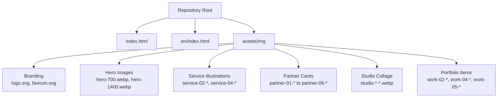
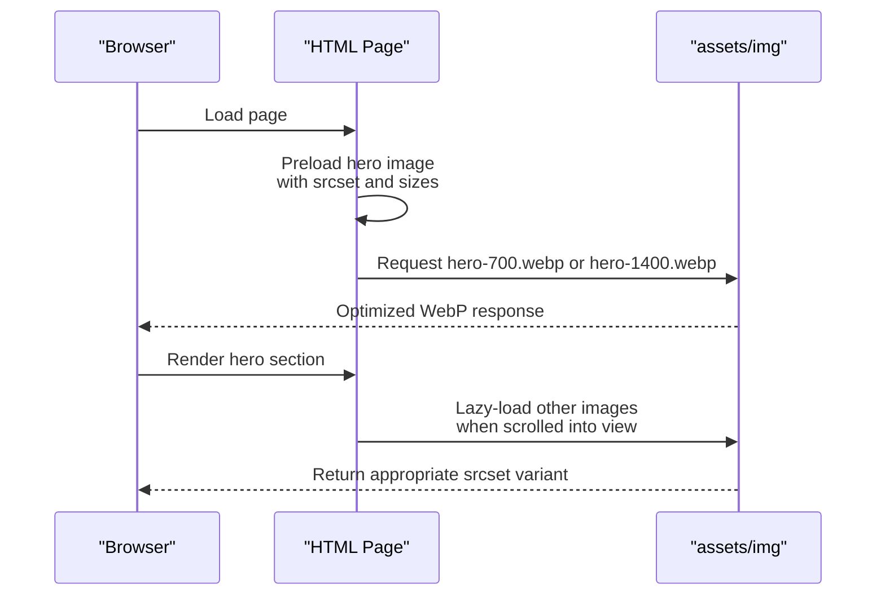
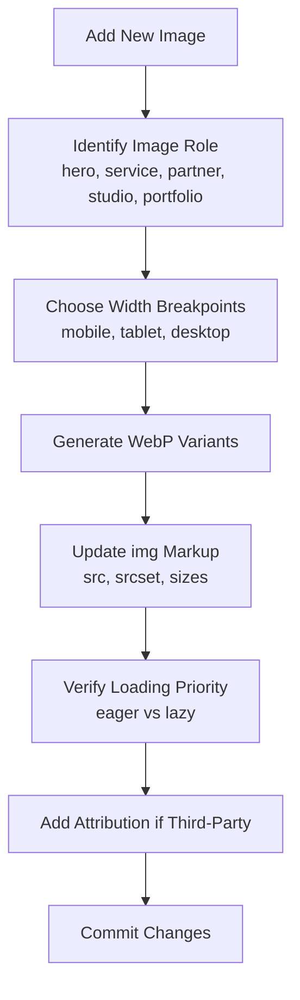
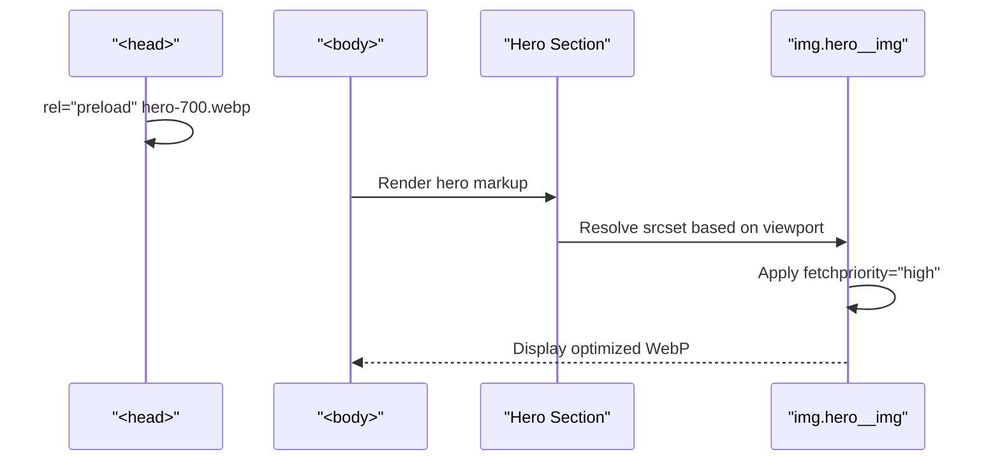
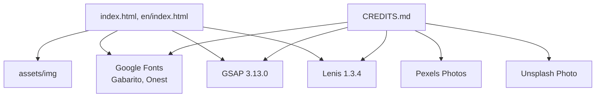
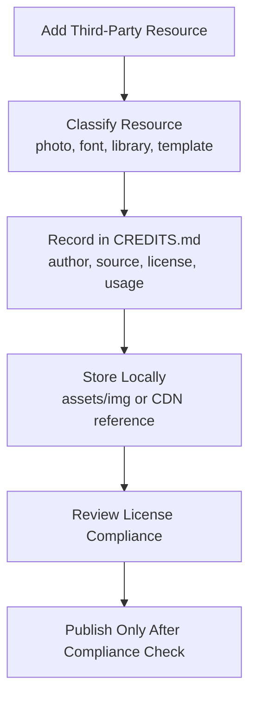

# Assets and Credits

<cite>
**Referenced Files in This Document**   
- [index.html](file://index.html)
- [en/index.html](file://en/index.html)
- [CREDITS.md](file://CREDITS.md)
- [README.md](file://README.md)
</cite>

## Table of Contents
1. [Introduction](#introduction)
2. [Project Structure](#project-structure)
3. [Core Components](#core-components)
4. [Architecture Overview](#architecture-overview)
5. [Detailed Component Analysis](#detailed-component-analysis)
6. [Dependency Analysis](#dependency-analysis)
7. [Performance Considerations](#performance-considerations)
8. [Troubleshooting Guide](#troubleshooting-guide)
9. [Conclusion](#conclusion)
10. [Appendices](#appendices)

## Introduction
This document explains how website assets and third-party credits are organized, optimized, and maintained in the TiTech Digital project. It focuses on:

- The `assets/img` directory and its WebP image optimization strategy.
- How hero images, service illustrations, portfolio items, partner cards, and branding assets are used.
- Attribution requirements for fonts, animation libraries, and stock photography.
- The structure and compliance rules defined in `CREDITS.md`.
- Guidelines for adding new assets while preserving performance and legal compliance.

The site is a single-page template with two language versions: Italian at `index.html` and English at `en/index.html`. Both pages share the same asset layout under `assets/img`, but the English page uses relative paths like `../assets/img/...`.

**Section sources**
- [README.md:1-15](file://README.md#L1-L15)
- [README.md:32-41](file://README.md#L32-L41)
- [README.md:65-76](file://README.md#L65-L76)

## Project Structure
At the root of the repository, the main HTML files reference shared assets under `assets/img`. The image directory contains:

- Branding assets: `logo.svg`, `favicon.svg`.
- Hero image variants: `hero-700.webp`, `hero-1400.webp`.
- Service illustration variants: `service-02-*`, `service-04-*`.
- Partner card variants: `partner-01-*` through `partner-06-*`.
- Studio collage variants: `studio-01-wide-*`, `studio-02-tall-*`, `studio-03-tall-*`, `studio-04-wide-*`, `studio-05-wide-*`.
- Portfolio item variants: `work-02-*`, `work-04-*`, `work-05-*`.

**Diagram sources**
- [index.html:26-27](file://index.html#L26-L27)
- [index.html:579-579](file://index.html#L579-L579)
- [index.html:609-630](file://index.html#L609-L630)
- [index.html:648-670](file://index.html#L648-L670)
- [index.html:709-714](file://index.html#L709-L714)
- [index.html:737-799](file://index.html#L737-L799)
- [en/index.html:26-27](file://en/index.html#L26-L27)
- [en/index.html:579-579](file://en/index.html#L579-L579)

**Section sources**
- [index.html:26-27](file://index.html#L26-L27)
- [index.html:579-579](file://index.html#L579-L579)
- [index.html:609-630](file://index.html#L609-L630)
- [index.html:648-670](file://index.html#L648-L670)
- [index.html:709-714](file://index.html#L709-L714)
- [index.html:737-799](file://index.html#L737-L799)
- [en/index.html:26-27](file://en/index.html#L26-L27)
- [en/index.html:579-579](file://en/index.html#L579-L579)

## Core Components
The core asset components are:

| Component | Purpose | Example Files | Usage Notes |
|---|---|---|---|
| Branding assets | Site identity and browser icon | `logo.svg`, `favicon.svg` | Used in navigation and as the browser favicon. |
| Hero images | First-screen animated circular image | `hero-700.webp`, `hero-1400.webp` | Preloaded with `fetchpriority="high"` and responsive `srcset`/`sizes`. |
| Service illustrations | Visuals for solution cards | `service-02-600.webp`, `service-02-900.webp`, `service-02-1200.webp`, `service-04-600.webp`, `service-04-900.webp`, `service-04-1200.webp` | Responsive variants for horizontal scrolling service cards. |
| Partner cards | Principles wheel visuals | `partner-01-480.webp`, `partner-01-720.webp`, `partner-01-900.webp`, etc. | Three breakpoints per partner; used in the rotating principles section. |
| Studio collage | Team/workflow imagery | `studio-01-wide-600.webp`, `studio-02-tall-400.webp`, etc. | Wide and tall aspect ratios; lazy-loaded. |
| Portfolio items | Case study thumbnails | `work-02-480.webp`, `work-04-480.webp`, `work-05-480.webp`, etc. | Responsive grid; lazy-loaded. |

All images use the WebP format and provide multiple widths through `srcset`, allowing modern browsers to select the most appropriate file size.

**Section sources**
- [index.html:26-27](file://index.html#L26-L27)
- [index.html:579-579](file://index.html#L579-L579)
- [index.html:609-630](file://index.html#L609-L630)
- [index.html:648-670](file://index.html#L648-L670)
- [index.html:709-714](file://index.html#L709-L714)
- [index.html:737-799](file://index.html#L737-L799)

## Architecture Overview
The asset loading architecture follows a responsive-first pattern:

1. Critical assets such as the hero image are preloaded early in the `<head>` using `rel="preload"`, `imagesrcset`, and `imagesizes`.
2. The hero image also uses `loading="eager"` and `fetchpriority="high"` to prioritize first-screen rendering.
3. Non-critical images use `loading="lazy"` and `decoding="async"` to avoid blocking initial paint.
4. Every image provides width-based variants via `srcset`, paired with `sizes` that describe the layout breakpoints.
5. SVG branding assets are referenced directly because they scale without additional variants.

**Diagram sources**
- [index.html:27-27](file://index.html#L27-L27)
- [index.html:579-579](file://index.html#L579-L579)
- [index.html:709-714](file://index.html#L709-L714)
- [index.html:737-799](file://index.html#L737-L799)

**Section sources**
- [index.html:27-27](file://index.html#L27-L27)
- [index.html:579-579](file://index.html#L579-L579)
- [index.html:709-714](file://index.html#L709-L714)
- [index.html:737-799](file://index.html#L737-L799)

## Detailed Component Analysis

### WebP Image Optimization Strategy
The project uses WebP images exclusively in `assets/img`. Each visual component has multiple width variants:

| Asset Category | Variants Pattern | Typical Breakpoints | Loading Behavior |
|---|---|---|---|
| Hero | `hero-{width}.webp` | 700w, 1400w | Eager preload, high priority |
| Service illustrations | `service-{id}-{width}.webp` | 600w, 900w, 1200w | Async decoding |
| Partner cards | `partner-{id}-{width}.webp` | 480w, 720w, 900w | Async decoding |
| Studio collage | `studio-{id}-{shape}-{width}.webp` | 400w, 600w, 900w, 1100w | Lazy load |
| Portfolio items | `work-{id}-{width}.webp` | 480w, 720w, 960w | Lazy load |

Best practices demonstrated by the codebase:

- Use `srcset` with explicit width descriptors.
- Provide `sizes` that match CSS layout breakpoints.
- Keep critical above-the-fold images eager and non-critical images lazy.
- Prefer WebP for raster images to reduce payload size.
- Keep SVGs for scalable branding assets.

**Diagram sources**
- [index.html:579-579](file://index.html#L579-L579)
- [index.html:609-630](file://index.html#L609-L630)
- [index.html:648-670](file://index.html#L648-L670)
- [index.html:709-714](file://index.html#L709-L714)
- [index.html:737-799](file://index.html#L737-L799)

**Section sources**
- [index.html:579-579](file://index.html#L579-L579)
- [index.html:609-630](file://index.html#L609-L630)
- [index.html:648-670](file://index.html#L648-L670)
- [index.html:709-714](file://index.html#L709-L714)
- [index.html:737-799](file://index.html#L737-L799)

### Hero Images
The hero image is the most critical visual asset:

- Preloaded in the head with `as="image"`, `imagesrcset`, and `imagesizes`.
- Rendered inside an animated aperture container.
- Uses `loading="eager"` and `fetchpriority="high"`.
- Provides two WebP variants: mobile-friendly 700w and high-resolution 1400w.
- The English page references the same filenames with a parent directory path.

**Diagram sources**
- [index.html:27-27](file://index.html#L27-L27)
- [index.html:579-579](file://index.html#L579-L579)
- [en/index.html:27-27](file://en/index.html#L27-L27)
- [en/index.html:579-579](file://en/index.html#L579-L579)

**Section sources**
- [index.html:27-27](file://index.html#L27-L27)
- [index.html:579-579](file://index.html#L579-L579)
- [en/index.html:27-27](file://en/index.html#L27-L27)
- [en/index.html:579-579](file://en/index.html#L579-L579)

### Service Illustrations
Service illustrations appear in the horizontal service track:

- Two services use dedicated illustration sets: `service-02` and `service-04`.
- Each set includes three widths: 600w, 900w, 1200w.
- The markup uses responsive `srcset` and `sizes` aligned with the 700px breakpoint.
- Images are decoded asynchronously to avoid layout shifts.

**Section sources**
- [index.html:614-617](file://index.html#L614-L617)
- [index.html:624-627](file://index.html#L624-L627)
- [index.html:750-758](file://index.html#L750-L758)
- [index.html:786-794](file://index.html#L786-L794)

### Portfolio Items
Portfolio items use `work-*` image sets:

- `work-02`, `work-04`, and `work-05` each provide 480w, 720w, and 960w variants.
- They are used both in the service track and in the portfolio grid.
- All portfolio images use `loading="lazy"` and `decoding="async"`.
- The grid adapts from one column on small screens to two columns on larger screens.

**Section sources**
- [index.html:609-612](file://index.html#L609-L612)
- [index.html:619-622](file://index.html#L619-L622)
- [index.html:629-632](file://index.html#L629-L632)
- [index.html:737-747](file://index.html#L737-L747)
- [index.html:761-771](file://index.html#L761-L771)
- [index.html:785-794](file://index.html#L785-L794)

### Partner Cards
Partner cards represent six principles in a scroll-driven wheel:

- Six partners: `partner-01` through `partner-06`.
- Each partner has three width variants: 480w, 720w, 900w.
- The `sizes` attribute accounts for mobile, tablet, and desktop layouts.
- These images are decorative within animated cards and use async decoding.

**Section sources**
- [index.html:648-670](file://index.html#L648-L670)

### Studio Collage
The studio section shows workflow imagery in a responsive collage:

- Wide shots: `studio-01-wide-*`, `studio-04-wide-*`, `studio-05-wide-*`.
- Tall shots: `studio-02-tall-*`, `studio-03-tall-*`.
- Widths include 400w, 600w, 900w, and 1100w depending on the shot.
- Images are lazy-loaded and sized according to CSS grid and absolute positioning.

**Section sources**
- [index.html:709-714](file://index.html#L709-L714)

### Branding Assets
Branding assets are SVGs:

- `logo.svg` is used in the navigation brand link and mobile menu.
- `favicon.svg` is linked as the browser favicon.
- SVGs are preferred because they scale cleanly and do not require multiple resolutions.

**Section sources**
- [index.html:26-26](file://index.html#L26-L26)
- [index.html:548-548](file://index.html#L548-L548)
- [index.html:561-561](file://index.html#L561-L561)
- [en/index.html:26-26](file://en/index.html#L26-L26)
- [en/index.html:548-548](file://en/index.html#L548-L548)
- [en/index.html:561-561](file://en/index.html#L561-L561)

## Dependency Analysis
The assets depend on the following external resources:

| Resource Type | Name | License / Source | Where Referenced |
|---|---|---|---|
| Fonts | Gabarito | Google Fonts, SIL Open Font License 1.1 | `index.html`, `en/index.html` |
| Fonts | Onest | Google Fonts, SIL Open Font License 1.1 | `index.html`, `en/index.html` |
| Animation Library | GSAP 3.13.0 | GreenSock standard license | `CREDITS.md` |
| Smooth Scrolling | Lenis 1.3.4 | MIT | `CREDITS.md` |
| Stock Photography | Pexels photos | Pexels License | `CREDITS.md` |
| Stock Photography | Unsplash photo | Unsplash License | `CREDITS.md` |

**Diagram sources**
- [index.html:28-30](file://index.html#L28-L30)
- [en/index.html:28-30](file://en/index.html#L28-L30)
- [CREDITS.md:38-46](file://CREDITS.md#L38-L46)
- [CREDITS.md:7-36](file://CREDITS.md#L7-L36)

**Section sources**
- [index.html:28-30](file://index.html#L28-L30)
- [en/index.html:28-30](file://en/index.html#L28-L30)
- [CREDITS.md:7-36](file://CREDITS.md#L7-L36)
- [CREDITS.md:38-46](file://CREDITS.md#L38-L46)

## Performance Considerations
The current asset strategy already implements several performance best practices:

- WebP reduces image payload compared to JPEG/PNG.
- Responsive `srcset` prevents downloading oversized images on small screens.
- `sizes` helps the browser choose the correct variant before download.
- Hero image preload avoids first-paint delay.
- Lazy loading defers offscreen images.
- Async decoding improves render timing.

When adding new assets, follow these guidelines:

1. Convert source images to WebP.
2. Generate at least three widths: mobile, tablet, desktop.
3. Match `sizes` to actual CSS breakpoints.
4. Use eager loading only for above-the-fold critical images.
5. Avoid unnecessary image formats unless required by design.
6. Keep SVGs for logos and icons.
7. Do not inline large images into HTML.
8. Validate accessibility attributes such as `alt` where applicable.

[No sources needed since this section provides general guidance]

## Troubleshooting Guide
Common issues when managing assets and credits:

| Issue | Symptom | Resolution |
|---|---|---|
| Missing image path | Broken image or 404 error | Check whether the page is Italian (`assets/img/...`) or English (`../assets/img/...`). |
| Wrong image size | Blurry or pixelated image | Ensure the selected `srcset` width matches the rendered layout size. |
| Slow first paint | Hero loads late | Confirm hero preload, `fetchpriority`, and eager loading are present. |
| Missing attribution | Legal risk | Add the resource to `CREDITS.md` with author, source, license, and usage. |
| Incorrect font license | Compliance issue | Verify fonts are loaded from approved sources and documented under SIL Open Font License. |
| Animation library license mismatch | Legal risk | Confirm GSAP and Lenis licenses match their official documentation. |

**Section sources**
- [index.html:26-27](file://index.html#L26-L27)
- [index.html:579-579](file://index.html#L579-L579)
- [en/index.html:26-27](file://en/index.html#L26-L27)
- [en/index.html:579-579](file://en/index.html#L579-L579)
- [CREDITS.md:7-36](file://CREDITS.md#L7-L36)
- [CREDITS.md:38-46](file://CREDITS.md#L38-L46)

## Conclusion
The TiTech Digital website uses a disciplined asset strategy centered on WebP images, responsive delivery, and clear third-party attribution. The `assets/img` directory organizes hero images, service illustrations, portfolio items, partner cards, studio collage images, and branding assets. The `CREDITS.md` file documents fonts, animation libraries, stock photography, and template licensing. Maintaining this structure ensures fast loading, consistent visuals, and legal compliance.

[No sources needed since this section summarizes without analyzing specific files]

## Appendices

### CREDITS.md Structure and License Compliance
`CREDITS.md` defines the attribution model for third-party resources:

- Stock photos from Pexels and Unsplash are documented separately with author links and license references.
- Fonts Gabarito and Onest are listed under the SIL Open Font License 1.1.
- GSAP and Lenis are listed with their respective licenses.
- The original template credit points to 8B and the MIT license.

Compliance requirements:

- Every third-party image must be recorded in `CREDITS.md`.
- The license type must be stated.
- The author or source link must be preserved.
- Local WebP copies must remain in `assets/img` rather than hotlinking.
- Fonts and libraries must remain under their declared licenses.

**Diagram sources**
- [CREDITS.md:7-36](file://CREDITS.md#L7-L36)
- [CREDITS.md:38-46](file://CREDITS.md#L38-L46)
- [CREDITS.md:48-50](file://CREDITS.md#L48-L50)

**Section sources**
- [CREDITS.md:7-36](file://CREDITS.md#L7-L36)
- [CREDITS.md:38-46](file://CREDITS.md#L38-L46)
- [CREDITS.md:48-50](file://CREDITS.md#L48-L50)