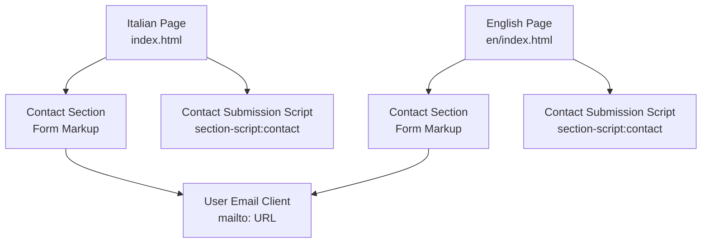
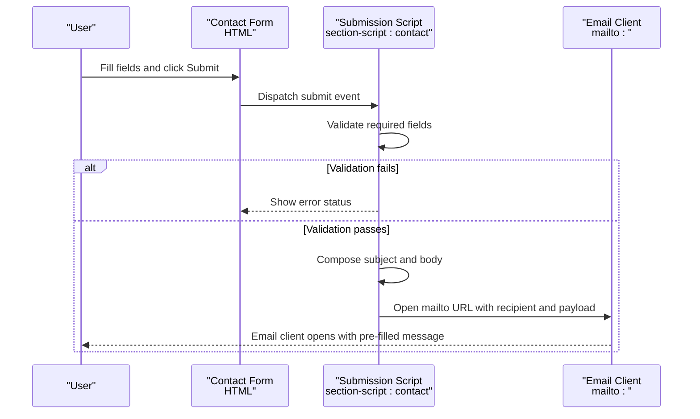
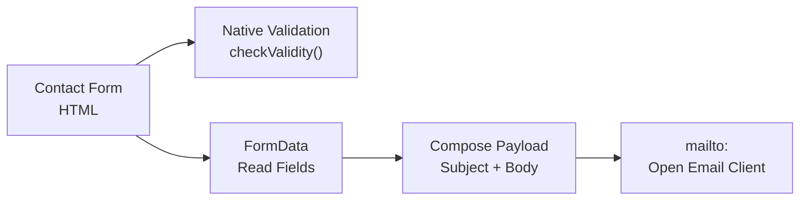

# Contact Form Configuration

<cite>
**Referenced Files in This Document**
- [index.html](file://index.html)
- [en/index.html](file://en/index.html)
- [README.md](file://README.md)
</cite>

## Table of Contents
1. [Introduction](#introduction)
2. [Project Structure](#project-structure)
3. [Core Components](#core-components)
4. [Architecture Overview](#architecture-overview)
5. [Detailed Component Analysis](#detailed-component-analysis)
6. [Dependency Analysis](#dependency-analysis)
7. [Performance Considerations](#performance-considerations)
8. [Troubleshooting Guide](#troubleshooting-guide)
9. [Conclusion](#conclusion)
10. [Appendices](#appendices)

## Introduction
This document explains the contact form implementation and configuration for the TiTech Digital website. The current submission flow is client-side only: it validates required fields, composes a mailto request with name, email, company, interest area, and message, and opens the user’s default email client. The recipient address is currently a placeholder that must be replaced before production use. The documentation also provides guidance for integrating alternative form services such as Formspree or Netlify Forms, along with validation rules, error handling, security considerations, backend integration possibilities, and migration strategies.

## Project Structure
The contact form exists in both language versions of the site:
- Italian version: `index.html`
- English version: `en/index.html`

Each page contains:
- A visible contact section with form markup.
- Inline CSS for layout and styling.
- An inline JavaScript block that handles form submission through a mailto link.

**Diagram sources**
- [index.html:829-857](file://index.html#L829-L857)
- [index.html:1210-1238](file://index.html#L1210-L1238)
- [en/index.html:829-857](file://en/index.html#L829-L857)
- [en/index.html:1210-1238](file://en/index.html#L1210-L1238)

**Section sources**
- [index.html:829-857](file://index.html#L829-L857)
- [en/index.html:829-857](file://en/index.html#L829-L857)
- [README.md:55-63](file://README.md#L55-L63)

## Core Components
- Contact form markup defines the input fields and submit button.
- Validation uses native HTML constraints plus a client-side check.
- Submission builds a subject and body from the form data and opens a mailto link.
- Status messages are displayed to guide users when validation fails or after successful composition.

Key responsibilities:
- Form markup: collects name, email, company, topic (interest area), and message.
- Validation logic: ensures required fields are present and email format is valid.
- Mailto composition: constructs a properly encoded subject and body.
- User feedback: updates status text based on success or error states.

**Section sources**
- [index.html:841-855](file://index.html#L841-L855)
- [en/index.html:841-855](file://en/index.html#L841-L855)
- [index.html:1210-1238](file://index.html#L1210-L1238)
- [en/index.html:1210-1238](file://en/index.html#L1210-L1238)

## Architecture Overview
The contact form follows a simple client-side pipeline:

**Diagram sources**
- [index.html:1210-1238](file://index.html#L1210-L1238)
- [en/index.html:1210-1238](file://en/index.html#L1210-L1238)

## Detailed Component Analysis

### Contact Form Markup
The form includes:
- Required inputs: name, email, message.
- Optional input: company.
- Select field: topic (interest area).
- Submit button and status element for user feedback.

Validation attributes:
- `required` on name, email, and message.
- `type="email"` on the email field for basic format validation.
- `novalidate` on the form allows custom validation behavior via the script.

Recipient configuration:
- The script sets a recipient variable to `info@titechdigital.it`.
- This is a placeholder and must be replaced with actual addresses before deployment.

Status messaging:
- Success and error messages are stored in `data-success` and `data-error` attributes on the status element.
- These messages are localized per language page.

**Section sources**
- [index.html:841-855](file://index.html#L841-L855)
- [en/index.html:841-855](file://en/index.html#L841-L855)

### Submission Script: Validation and Mailto Composition
The script attached to `section-script:contact`:
- Prevents default form submission.
- Validates using `form.checkValidity()`.
- On failure, displays the error message and focuses the invalid field.
- On success, reads form values via `FormData`, constructs subject and body, updates status, and navigates to a `mailto:` URL.

Data mapping:
- Subject includes the selected topic.
- Body includes name, email, company (with fallback if empty), topic, and message.

Security note:
- The recipient is hardcoded in the script and should be updated to real addresses.
- No server-side processing occurs; all logic runs in the browser.

**Section sources**
- [index.html:1210-1238](file://index.html#L1210-L1238)
- [en/index.html:1210-1238](file://en/index.html#L1210-L1238)

### Validation Rules
Current rules:
- Name: required, non-empty.
- Email: required, valid email format.
- Message: required, non-empty.
- Company: optional.
- Topic: select field; defaults to a localized placeholder if none selected.

Behavior:
- Native browser validation is used.
- Custom error message is shown when validation fails.
- Focus moves to the first invalid field.

**Section sources**
- [index.html:841-855](file://index.html#L841-L855)
- [index.html:1210-1238](file://index.html#L1210-L1238)
- [en/index.html:841-855](file://en/index.html#L841-L855)
- [en/index.html:1210-1238](file://en/index.html#L1210-L1238)

### Error Handling and User Feedback
- On validation failure: status text shows the localized error message.
- On successful composition: status text shows the localized success message instructing the user about opening their email client.
- Footer note also has idle/success/error messages but does not process submissions in the current implementation.

**Section sources**
- [index.html:851-855](file://index.html#L851-L855)
- [index.html:1210-1238](file://index.html#L1210-L1238)
- [en/index.html:851-855](file://en/index.html#L851-L855)
- [en/index.html:1210-1238](file://en/index.html#L1210-L1238)

### Security Considerations
- Recipient exposure: The mailto recipient is visible in the source code. Replace the placeholder with real addresses and consider hiding them behind a service if needed.
- Input sanitization: Values are trimmed and included directly in the mailto body. Avoid sensitive data in the message.
- XSS risk: Since no server-side processing occurs, client-side injection risks are limited to the user’s own email client. Still, avoid embedding untrusted content.
- Rate limiting and abuse protection: Not implemented. Consider adding CAPTCHA or rate limiting when migrating to a backend or third-party service.

**Section sources**
- [index.html:1210-1238](file://index.html#L1210-L1238)
- [en/index.html:1210-1238](file://en/index.html#L1210-L1238)
- [README.md:55-63](file://README.md#L55-L63)

### Backend Integration Possibilities
Current state:
- No backend endpoint is configured.
- Submission relies entirely on the browser’s mailto protocol.

Potential integrations:
- Server-side API: Replace the mailto navigation with an HTTP POST to your backend, which can then send emails securely.
- Third-party form services: Use Formspree, Netlify Forms, or similar services by updating the form action and/or the submission script.

Migration strategy:
- Keep existing form markup and validation while transitioning to a new handler.
- Gradually move validation and submission logic into a dedicated module.
- Add analytics and logging on the server side.
- Ensure GDPR compliance and privacy notices are updated accordingly.

**Section sources**
- [README.md:55-63](file://README.md#L55-L63)

### Migration Strategies to Alternative Services

#### Formspree Integration
Steps:
- Update the form markup to include `action="https://formspree.io/f/YOUR_FORM_ID"` and `method="POST"`.
- Optionally add hidden fields for topic and other metadata.
- Modify the submission script to handle JSON responses and show success/error UI without relying on mailto.
- Keep native validation for immediate feedback.

Considerations:
- Configure allowed origins and spam protection in Formspree.
- Map form fields to your desired email structure.

#### Netlify Forms Integration
Steps:
- Add `netlify` attribute to the form element.
- Remove or adjust the custom submit handler to let Netlify handle submission.
- Configure form notifications and storage in Netlify dashboard.
- Maintain client-side validation for better UX.

Considerations:
- Netlify will store submissions and can send notifications.
- Ensure CSP and headers allow Netlify endpoints.

#### Custom Backend Integration
Steps:
- Create an endpoint to receive form data.
- Update the submission script to POST JSON to the endpoint.
- Handle success and error responses and update UI accordingly.
- Implement server-side validation, sanitization, and email sending.

Considerations:
- Add CSRF protection and rate limiting.
- Log submissions securely and comply with data retention policies.

**Section sources**
- [index.html:1210-1238](file://index.html#L1210-L1238)
- [en/index.html:1210-1238](file://en/index.html#L1210-L1238)
- [README.md:55-63](file://README.md#L55-L63)

## Dependency Analysis
The contact form depends on:
- Native HTML form elements and validation APIs.
- DOM APIs (`FormData`, `querySelector`, `addEventListener`).
- Browser mailto protocol.

No external libraries are required for the form itself. GSAP and Lenis are loaded globally but are not used by the contact submission logic.

**Diagram sources**
- [index.html:1210-1238](file://index.html#L1210-L1238)
- [en/index.html:1210-1238](file://en/index.html#L1210-L1238)

**Section sources**
- [index.html:1210-1238](file://index.html#L1210-L1238)
- [en/index.html:1210-1238](file://en/index.html#L1210-L1238)

## Performance Considerations
- The form logic is lightweight and runs only on submit.
- No network requests occur under the current mailto approach.
- Avoid heavy computations in the submit handler to keep UI responsive.
- If migrating to a backend, debounce repeated submissions and provide loading states.

[No sources needed since this section provides general guidance]

## Troubleshooting Guide
Common issues and resolutions:
- Placeholder recipient not replaced:
  - Update the recipient variable in the contact script to real addresses.
  - Verify the same change is applied in both language pages.
- Email client does not open:
  - Inform users via the success message to manually email the provided address.
  - Consider providing a direct mailto link as a fallback.
- Validation errors persist:
  - Ensure fields have correct `required` attributes and types.
  - Check that the form has `novalidate` and the script calls `checkValidity()`.
- Service migration failures:
  - Confirm endpoint URLs and CORS settings.
  - Inspect network requests and response payloads.
  - Update UI handlers to reflect service-specific success/error states.

**Section sources**
- [index.html:1210-1238](file://index.html#L1210-L1238)
- [en/index.html:1210-1238](file://en/index.html#L1210-L1238)
- [README.md:55-63](file://README.md#L55-L63)

## Conclusion
The contact form currently uses a simple, client-only mailto-based workflow with native validation and clear user feedback. Before production, replace the placeholder recipient with real addresses. For more robust handling, integrate a third-party form service or a custom backend, preserving the existing validation and improving security, reliability, and observability.

[No sources needed since this section summarizes without analyzing specific files]

## Appendices

### Field Reference
- Name: required text input.
- Email: required email input.
- Company: optional text input.
- Topic: select field representing interest area.
- Message: required textarea.

**Section sources**
- [index.html:841-855](file://index.html#L841-L855)
- [en/index.html:841-855](file://en/index.html#L841-L855)

### Current Data Flow Summary
- Validate required fields.
- Compose subject and body from form data.
- Update status message.
- Open mailto URL with recipient and encoded payload.

**Section sources**
- [index.html:1210-1238](file://index.html#L1210-L1238)
- [en/index.html:1210-1238](file://en/index.html#L1210-L1238)