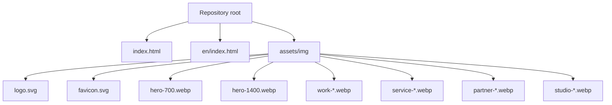
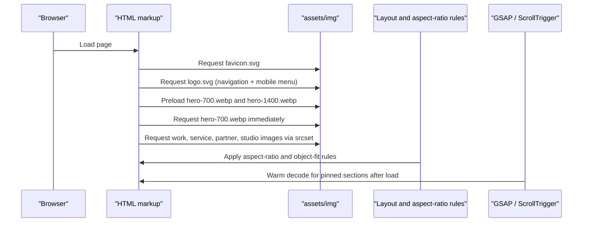
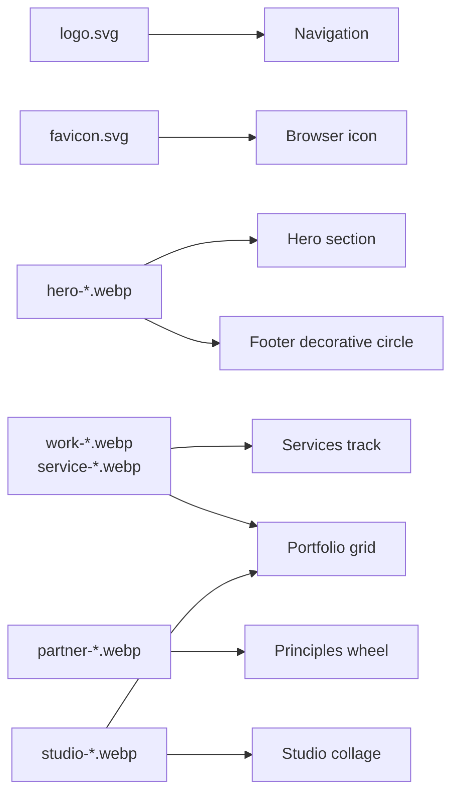

# Brand Assets

<cite>
**Referenced Files in This Document**
- [README.md](file://README.md)
- [index.html](file://index.html)
- [en/index.html](file://en/index.html)
</cite>

## Table of Contents
1. [Introduction](#introduction)
2. [Project Structure](#project-structure)
3. [Core Components](#core-components)
4. [Architecture Overview](#architecture-overview)
5. [Detailed Component Analysis](#detailed-component-analysis)
6. [Dependency Analysis](#dependency-analysis)
7. [Performance Considerations](#performance-considerations)
8. [Troubleshooting Guide](#troubleshooting-guide)
9. [Conclusion](#conclusion)

## Introduction
This document explains how to replace brand assets and images in the TiTech Digital template while keeping paths, dimensions, aspect ratios, and performance behavior intact. It covers:

- Replacing `assets/img/logo.svg` and `assets/img/favicon.svg`.
- Optimizing and naming WebP images under `assets/img`.
- Identifying which images are used for the hero background, service illustrations, portfolio items, studio collage, principles wheel, and footer decorative element.
- Maintaining visual consistency when adding new images.
- Understanding image loading performance, lazy loading, preloading, and responsive image selection.
- Providing step-by-step instructions for replacing assets and testing across screen sizes.

The site is a single-page layout with two language versions: Italian at `/index.html` and English at `/en/index.html`. Both pages share the same asset structure under `assets/img`, but the English page uses relative paths starting with `../assets/img/`.

**Section sources**
- [README.md:17-41](file://README.md#L17-L41)
- [README.md:65-76](file://README.md#L65-L76)

## Project Structure
The relevant asset structure for brand and image replacement is:

**Diagram sources**
- [index.html:26-27](file://index.html#L26-L27)
- [index.html:579](file://index.html#L579)
- [index.html:609-633](file://index.html#L609-L633)
- [index.html:648-670](file://index.html#L648-L670)
- [index.html:710-714](file://index.html#L710-L714)
- [index.html:862](file://index.html#L862)
- [en/index.html:26-27](file://en/index.html#L26-L27)

**Section sources**
- [index.html:26-27](file://index.html#L26-L27)
- [en/index.html:26-27](file://en/index.html#L26-L27)

## Core Components
The brand assets that must be replaced or updated are:

| Asset | Purpose | File path | Display size | Notes |
|---|---|---|---|---|
| Logo | Brand symbol in desktop navigation and mobile menu | `assets/img/logo.svg` | 30 × 30 pixels | SVG; keep transparent background and clean vector edges |
| Favicon | Browser tab icon | `assets/img/favicon.svg` | Small browser favicon size | SVG; simple, scalable, high contrast |

Both pages reference these files directly from `assets/img`. The logo appears twice in each page: once in the fixed top navigation and once inside the mobile menu overlay. The favicon is declared as the page icon.

**Section sources**
- [index.html:26](file://index.html#L26)
- [index.html:548](file://index.html#L548)
- [index.html:561](file://index.html#L561)
- [en/index.html:26](file://en/index.html#L26)
- [en/index.html:548](file://en/index.html#L548)
- [en/index.html:561](file://en/index.html#L561)

## Architecture Overview
Brand and image assets flow into the page through three main mechanisms:

1. **Direct `` references**: Used for the logo, hero image, service illustrations, partner principle cards, studio collage shots, and footer decorative circle.
2. **Responsive image sets**: Most images use `srcset` with multiple widths and `sizes` so the browser selects the appropriate file based on viewport width and layout constraints.
3. **Preload and priority hints**: The hero image is preloaded and marked as high priority because it is visible above the fold.

**Diagram sources**
- [index.html:26-27](file://index.html#L26-L27)
- [index.html:548](file://index.html#L548)
- [index.html:579](file://index.html#L579)
- [index.html:609-633](file://index.html#L609-L633)
- [index.html:648-670](file://index.html#L648-L670)
- [index.html:710-714](file://index.html#L710-L714)
- [index.html:862](file://index.html#L862)
- [index.html:1003-1011](file://index.html#L1003-L1011)

## Detailed Component Analysis

### Logo Replacement
The logo is an SVG placed at `assets/img/logo.svg`. It is displayed at 30 × 30 pixels in both the desktop navigation and the mobile menu.

Replacement steps:
1. Prepare a new vector logo in SVG format.
2. Keep the design clean, scalable, and readable at small sizes.
3. Replace the existing `assets/img/logo.svg` file.
4. Do not change the filename unless you also update every reference in both language pages.
5. Verify the logo in:
   - Desktop navigation bar.
   - Mobile menu header.
   - Dark background areas where the logo color may need adjustment.

Recommended properties:
- Format: SVG.
- Dimensions: Vector; no fixed pixel size required, but ensure it looks sharp at 30 × 30 pixels.
- Background: Transparent.
- Color: Works against dark navigation backgrounds.

**Section sources**
- [index.html:209](file://index.html#L209)
- [index.html:548](file://index.html#L548)
- [index.html:561](file://index.html#L561)
- [en/index.html:218](file://en/index.html#L218)
- [en/index.html:548](file://en/index.html#L548)
- [en/index.html:561](file://en/index.html#L561)

### Favicon Replacement
The favicon is declared as an SVG icon at `assets/img/favicon.svg`.

Replacement steps:
1. Create a simplified, high-contrast SVG suitable for small display sizes.
2. Replace `assets/img/favicon.svg`.
3. Clear browser cache if the old favicon persists.
4. Test in:
   - Browser tab.
   - Bookmarks.
   - Taskbar or dock preview.

Recommended properties:
- Format: SVG.
- Size: Simple enough to remain legible at favicon scale.
- Contrast: Strong against light and dark browser themes.

**Section sources**
- [index.html:26](file://index.html#L26)
- [en/index.html:26](file://en/index.html#L26)

### Hero Image
The hero image is the primary visual element in the first section. It is loaded eagerly and preloaded because it is critical for initial rendering.

Current implementation details:
- Files: `assets/img/hero-700.webp` and `assets/img/hero-1400.webp`.
- Responsive selection: `srcset` provides 700w and 1400w options.
- Layout sizing: `width="700"` and `height="700"` define intrinsic dimensions.
- Loading behavior: `loading="eager"` and `fetchpriority="high"`.
- Decoding: `decoding="async"`.
- Usage locations:
  - Hero circular aperture.
  - Footer decorative circle.

Replacement steps:
1. Prepare a square image because the hero container uses a 700 × 700 intrinsic size and the CSS applies `object-fit: cover`.
2. Export two WebP versions:
   - `hero-700.webp`: approximately 700 pixels wide.
   - `hero-1400.webp`: approximately 1400 pixels wide.
3. Keep the filenames unchanged unless you update all references.
4. Ensure the composition works inside a circular crop.
5. Test in:
   - Portrait and landscape orientations.
   - Narrow mobile viewports.
   - Wide desktop layouts.
   - Footer decorative circle.

Aspect ratio guidance:
- Use a square source image.
- If the original is rectangular, crop to square before exporting.

**Section sources**
- [index.html:27](file://index.html#L27)
- [index.html:579](file://index.html#L579)
- [index.html:862](file://index.html#L862)
- [en/index.html:27](file://en/index.html#L27)
- [en/index.html:579](file://en/index.html#L579)

### Service Illustrations
The services section contains five horizontal cards. Each card includes an illustration image with responsive variants.

Used files:
- `assets/img/work-02-480.webp`, `work-02-720.webp`, `work-02-960.webp`
- `assets/img/service-02-600.webp`, `service-02-900.webp`, `service-02-1200.webp`
- `assets/img/work-04-480.webp`, `work-04-720.webp`, `work-04-960.webp`
- `assets/img/service-04-600.webp`, `service-04-900.webp`, `service-04-1200.webp`
- `assets/img/work-05-480.webp`, `work-05-720.webp`, `work-05-960.webp`

Replacement steps:
1. Decide whether the new image represents a “work” style card or a “service” style card.
2. Match the existing naming pattern:
   - `work-NN-width.webp`
   - `service-NN-width.webp`
3. Provide responsive variants using the same width suffixes already present in the markup.
4. Keep the `width` and `height` attributes consistent with the current file set.
5. Update both language pages if the image is shared.

Aspect ratio guidance:
- Mobile: 4 × 5.
- Desktop: 16 × 11 or 16 × 10.5 depending on breakpoint and layout state.
- Source images should be tall enough to support both portrait-like and wider desktop crops without losing important content.

**Section sources**
- [index.html:306-320](file://index.html#L306-L320)
- [index.html:609-633](file://index.html#L609-L633)
- [en/index.html:306-320](file://en/index.html#L306-L320)
- [en/index.html:609-633](file://en/index.html#L609-L633)

### Principles Wheel Images
The “again” section shows six principle cards arranged in a scrolling wheel. Each card uses a vertical image.

Used files:
- `assets/img/partner-01-480.webp`, `partner-01-720.webp`, `partner-01-900.webp`
- `assets/img/partner-02-480.webp`, `partner-02-720.webp`, `partner-02-900.webp`
- `assets/img/partner-03-480.webp`, `partner-03-720.webp`, `partner-03-900.webp`
- `assets/img/partner-04-480.webp`, `partner-04-720.webp`, `partner-04-900.webp`
- `assets/img/partner-05-480.webp`, `partner-05-720.webp`, `partner-05-900.webp`
- `assets/img/partner-06-480.webp`, `partner-06-720.webp`, `partner-06-900.webp`

Replacement steps:
1. Prepare vertical images matching the existing numbering scheme.
2. Export three responsive variants per image:
   - `-480.webp`
   - `-720.webp`
   - `-900.webp`
3. Keep the `width="480"` and `height="600"` attributes consistent with the current markup.
4. Ensure text overlays still fit over the new images.
5. Test the wheel rotation and scroll behavior.

Aspect ratio guidance:
- Base aspect ratio: 4 × 5.
- Source images should be taller than wide.

**Section sources**
- [index.html:345-346](file://index.html#L345-L346)
- [index.html:648-670](file://index.html#L648-L670)
- [en/index.html:345-346](file://en/index.html#L345-L346)
- [en/index.html:648-670](file://en/index.html#L648-L670)

### Studio Collage Images
The studio section displays a collage of team or workspace photos.

Used files:
- `assets/img/studio-01-wide-600.webp`, `studio-01-wide-900.webp`, `studio-01-wide-1100.webp`
- `assets/img/studio-02-tall-400.webp`, `studio-02-tall-600.webp`
- `assets/img/studio-03-tall-400.webp`, `studio-03-tall-600.webp`
- `assets/img/studio-04-wide-600.webp`, `studio-04-wide-900.webp`, `studio-04-wide-1100.webp`
- `assets/img/studio-05-wide-600.webp`, `studio-05-wide-900.webp`, `studio-05-wide-1100.webp`

Replacement steps:
1. Follow the existing naming convention:
   - `studio-NN-wide-width.webp`
   - `studio-NN-tall-width.webp`
2. Provide responsive variants according to the existing `srcset` entries.
3. Preserve the wide/tall distinction:
   - Wide shots: roughly 3 × 2.
   - Tall shots: roughly 3 × 4.
4. Keep `width` and `height` values aligned with the current files.
5. Test the animated collage layout on desktop and mobile.

Aspect ratio guidance:
- Wide shots: 3 × 2.
- Tall shots: 3 × 4.

**Section sources**
- [index.html:412-415](file://index.html#L412-L415)
- [index.html:710-714](file://index.html#L710-L714)
- [en/index.html:412-415](file://en/index.html#L412-L415)
- [en/index.html:710-714](file://en/index.html#L710-L714)

### Portfolio Images
The portfolio grid reuses some of the service and studio images as placeholder project thumbnails.

Used files:
- `assets/img/work-02-480.webp` and its responsive variants.
- `assets/img/service-02-600.webp` and its responsive variants.
- `assets/img/work-04-480.webp` and its responsive variants.
- `assets/img/work-05-480.webp` and its responsive variants.
- `assets/img/service-04-600.webp` and its responsive variants.
- `assets/img/studio-04-wide-600.webp` and its responsive variants.

Replacement steps:
1. Treat portfolio images as reusable assets rather than unique files.
2. When replacing a reused image, remember it affects multiple sections:
   - Services track.
   - Portfolio grid.
3. Maintain responsive variants and aspect ratios.
4. Remove or replace the demo note before publishing real case studies.

Aspect ratio guidance:
- Portfolio media containers use 4 × 3.
- Source images should preserve key content within that rectangle.

**Section sources**
- [index.html:444-445](file://index.html#L444-L445)
- [index.html:737-800](file://index.html#L737-L800)
- [index.html:810-811](file://index.html#L810-L811)
- [en/index.html:444-445](file://en/index.html#L444-L445)
- [en/index.html:737-800](file://en/index.html#L737-L800)

### Footer Decorative Image
The footer uses the same hero image as a rotating decorative circle behind the closing greeting.

Replacement steps:
1. Replace `assets/img/hero-700.webp` and `assets/img/hero-1400.webp`.
2. Confirm the image remains visually acceptable when cropped into a circle.
3. Test the footer animation and reduced-motion behavior.

**Section sources**
- [index.html:507-530](file://index.html#L507-L530)
- [index.html:862](file://index.html#L862)
- [en/index.html:507-530](file://en/index.html#L507-L530)
- [en/index.html:862](file://en/index.html#L862)

## Dependency Analysis
The following table maps image usage to page sections and files:

| Section | Image role | File pattern | Page location |
|---|---|---|---|
| Navigation | Brand logo | `assets/img/logo.svg` | Top bar and mobile menu |
| Favicon | Browser icon | `assets/img/favicon.svg` | Head metadata |
| Hero | Primary visual | `hero-700.webp`, `hero-1400.webp` | First section and footer |
| Services | Illustrations | `work-*.webp`, `service-*.webp` | Horizontal services track |
| Principles | Vertical cards | `partner-*.webp` | Scrolling principles wheel |
| Studio | Team/workspace photos | `studio-*-wide-*.webp`, `studio-*-tall-*.webp` | Animated collage |
| Portfolio | Project thumbnails | Reuses service and studio files | Portfolio grid |

**Diagram sources**
- [index.html:26](file://index.html#L26)
- [index.html:548](file://index.html#L548)
- [index.html:579](file://index.html#L579)
- [index.html:609-633](file://index.html#L609-L633)
- [index.html:648-670](file://index.html#L648-L670)
- [index.html:710-714](file://index.html#L710-L714)
- [index.html:737-800](file://index.html#L737-L800)
- [index.html:862](file://index.html#L862)

**Section sources**
- [index.html:26](file://index.html#L26)
- [index.html:548](file://index.html#L548)
- [index.html:579](file://index.html#L579)
- [index.html:609-633](file://index.html#L609-L633)
- [index.html:648-670](file://index.html#L648-L670)
- [index.html:710-714](file://index.html#L710-L714)
- [index.html:737-800](file://index.html#L737-L800)
- [index.html:862](file://index.html#L862)

## Performance Considerations
The template already implements several performance-oriented image practices:

- **WebP format**: All raster images are WebP.
- **Responsive images**: Most images provide multiple widths through `srcset`.
- **Size hints**: `sizes` attributes describe expected rendered widths.
- **Intrinsic dimensions**: `width` and `height` prevent layout shifts.
- **Lazy loading**: Non-critical images use `loading="lazy"`.
- **Eager loading**: The hero image uses `loading="eager"` and `fetchpriority="high"`.
- **Async decoding**: Images use `decoding="async"` to avoid blocking the main thread.
- **Preload**: The hero image is preloaded in the head.
- **Decode warming**: After page load, the script warms decode for images in pinned sections.

Guidelines for new images:
- Prefer WebP for photographs and complex images.
- Provide at least two responsive widths for images shown in grids or tracks.
- Keep file sizes reasonable:
  - Hero images: optimize for clarity at 700px and 1400px widths.
  - Service and portfolio images: balance quality with mobile bandwidth.
  - Principle cards: prioritize readability at smaller widths.
  - Studio collage: vary sizes by shot type.
- Avoid oversized source images; resize before export.
- Keep aspect ratios consistent with the target layout.
- Do not remove `width`, `height`, `srcset`, or `sizes` unless you fully understand the layout impact.

**Section sources**
- [index.html:27](file://index.html#L27)
- [index.html:579](file://index.html#L579)
- [index.html:609-633](file://index.html#L609-L633)
- [index.html:648-670](file://index.html#L648-L670)
- [index.html:710-714](file://index.html#L710-L714)
- [index.html:1003-1011](file://index.html#L1003-L1011)

## Troubleshooting Guide

### Logo Not Visible
Symptoms:
- Blank space next to “TiTech”.
- Logo too large or too small.
- Poor contrast on dark background.

Checks:
- Confirm `assets/img/logo.svg` exists.
- Verify the SVG renders correctly in a standalone viewer.
- Check that the logo is readable at 30 × 30 pixels.
- Ensure the file was saved as SVG, not renamed PNG/JPG.

**Section sources**
- [index.html:548](file://index.html#L548)
- [index.html:561](file://index.html#L561)

### Favicon Not Updating
Symptoms:
- Old favicon remains in the browser tab.
- Favicon appears blurry or incorrect.

Checks:
- Confirm `assets/img/favicon.svg` exists.
- Clear browser cache or hard refresh.
- Validate that the SVG is simple and high-contrast.
- Check both language pages for correct icon path.

**Section sources**
- [index.html:26](file://index.html#L26)
- [en/index.html:26](file://en/index.html#L26)

### Hero Image Blurry or Cropped Incorrectly
Symptoms:
- Pixelated hero image.
- Important content cut off.
- Wrong image in footer circle.

Checks:
- Confirm both `hero-700.webp` and `hero-1400.webp` exist.
- Verify filenames match the markup.
- Ensure the source image is square.
- Check that the image works inside a circular crop.
- Test both hero and footer locations.

**Section sources**
- [index.html:27](file://index.html#L27)
- [index.html:579](file://index.html#L579)
- [index.html:862](file://index.html#L862)

### Service or Portfolio Image Missing
Symptoms:
- Broken image icon.
- Placeholder box instead of image.
- Image missing on one language page.

Checks:
- Confirm the exact filename exists under `assets/img`.
- For the English page, verify the path starts with `../assets/img/`.
- Ensure all responsive variants referenced in `srcset` exist.
- Remember that portfolio images reuse service and studio files.

**Section sources**
- [index.html:609-633](file://index.html#L609-L633)
- [index.html:737-800](file://index.html#L737-L800)
- [en/index.html:609-633](file://en/index.html#L609-L633)
- [en/index.html:737-800](file://en/index.html#L737-L800)

### Principles Wheel Image Misaligned
Symptoms:
- Image stretched or squashed.
- Text overlapping unwanted areas.
- Inconsistent card heights.

Checks:
- Confirm the image follows the `partner-NN-width.webp` naming pattern.
- Verify the three responsive variants exist.
- Keep the base aspect ratio near 4 × 5.
- Test the scroll wheel interaction.

**Section sources**
- [index.html:345-346](file://index.html#L345-L346)
- [index.html:648-670](file://index.html#L648-L670)

### Studio Collage Layout Broken
Symptoms:
- Images overlap incorrectly.
- Wide or tall shots appear wrong.
- Animation feels jumpy.

Checks:
- Confirm wide shots use the `-wide-*` naming pattern.
- Confirm tall shots use the `-tall-*` naming pattern.
- Keep responsive variants consistent with existing `srcset` entries.
- Preserve the intended aspect ratios.

**Section sources**
- [index.html:412-415](file://index.html#L412-L415)
- [index.html:710-714](file://index.html#L710-L714)

## Conclusion
Replacing brand assets in the TiTech Digital template requires careful attention to file names, paths, dimensions, aspect ratios, and responsive image sets. The logo and favicon are straightforward replacements, while the hero, service, principle, studio, and portfolio images require matching the existing naming conventions and responsive patterns. The template already optimizes image delivery through WebP, `srcset`, `sizes`, lazy loading, preload, and decode warming. When adding new images, maintain visual consistency, preserve layout constraints, and test across mobile, tablet, and desktop breakpoints to ensure a smooth user experience.