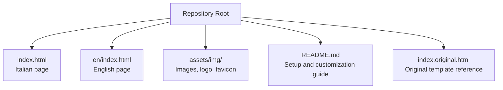
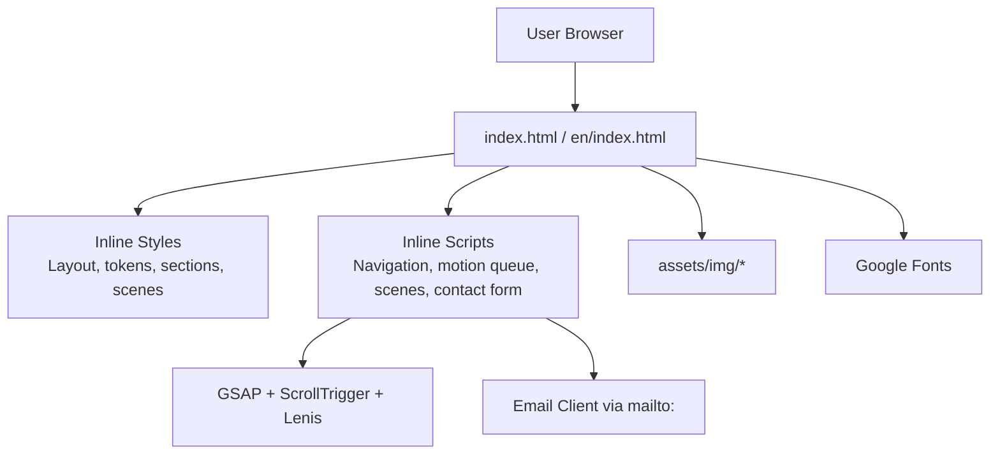
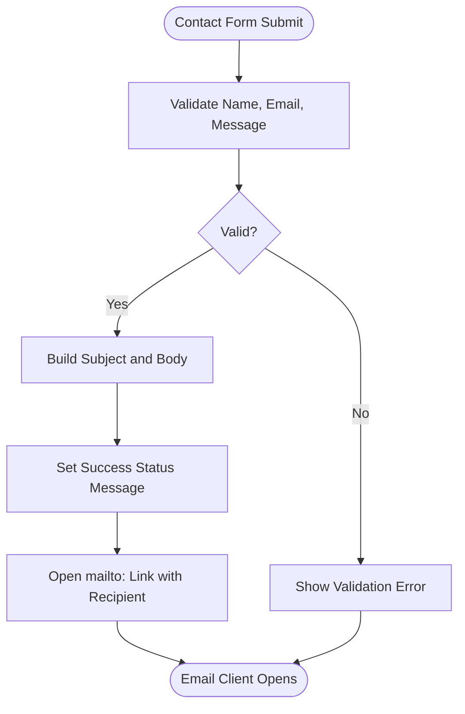
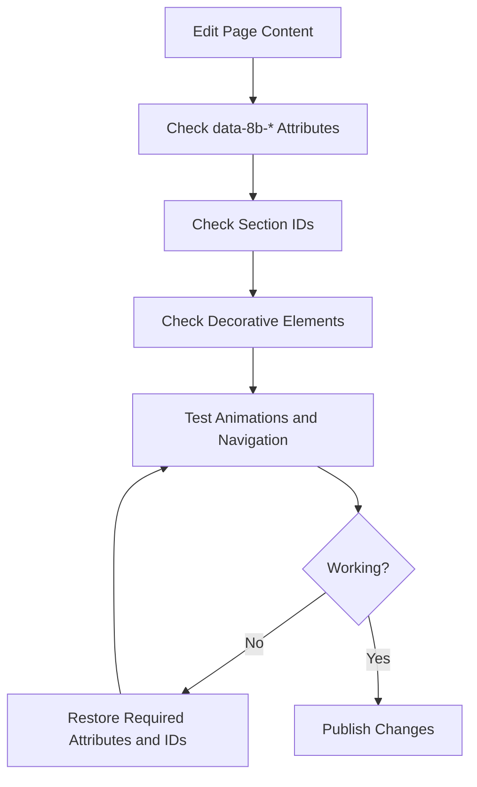
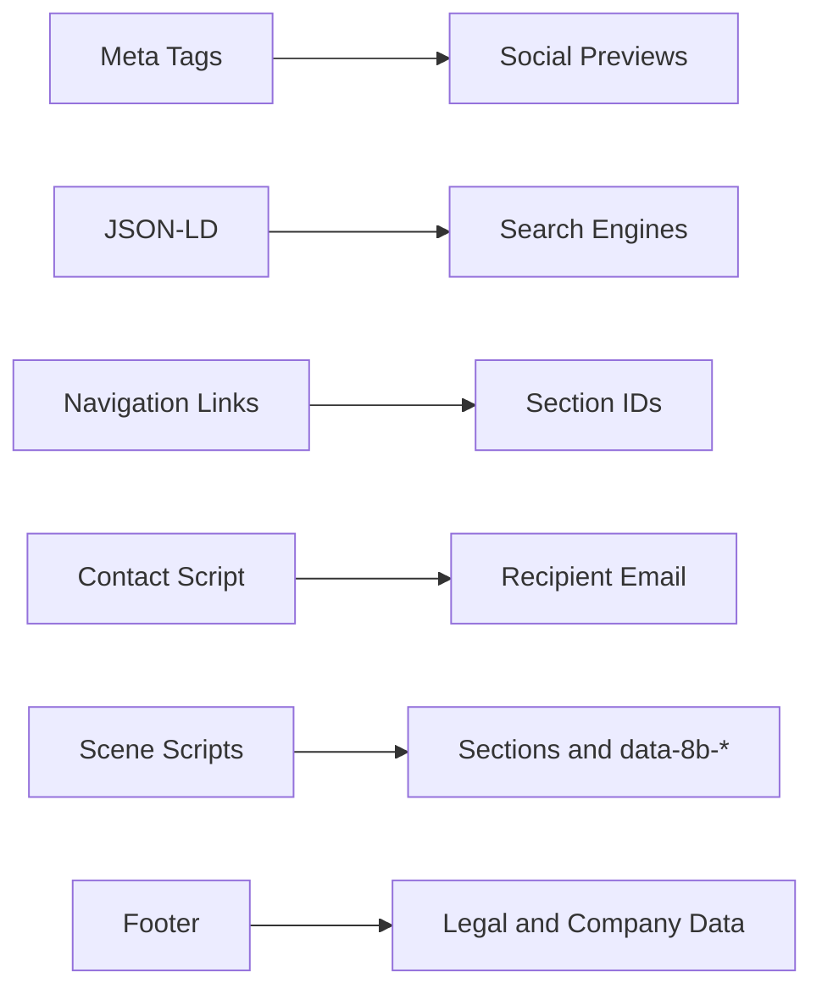

# Configuration Settings

<cite>
**Referenced Files in This Document**   
- [index.html](file://index.html)
- [en/index.html](file://en/index.html)
- [README.md](file://README.md)
</cite>

## Table of Contents
1. [Introduction](#introduction)
2. [Project Structure](#project-structure)
3. [Core Configuration Areas](#core-configuration-areas)
4. [Architecture Overview](#architecture-overview)
5. [Detailed Component Analysis](#detailed-component-analysis)
6. [Dependency Analysis](#dependency-analysis)
7. [Performance Considerations](#performance-considerations)
8. [Troubleshooting Guide](#troubleshooting-guide)
9. [Conclusion](#conclusion)

## Introduction
This document explains how to configure the TiTech Digital website template for production use. It focuses on:
- Changing the contact form email recipient address.
- Updating legal and company information in the footer.
- Customizing meta tags for social sharing, including Open Graph and Twitter Card metadata.
- Configuring JSON-LD structured data for SEO.
- Preserving required attributes and IDs that keep animations and navigation working.
- Handling common configuration issues such as broken links or missing resources.

The template is a single-page HTML site with inline CSS and JavaScript. The Italian version is at `index.html`, and the English version is at `en/index.html`. Both pages share the same structure, animation system, and configuration patterns.

## Project Structure
The repository contains two main language versions and shared assets:
- `index.html` — Italian page.
- `en/index.html` — English page.
- `assets/img/` — Images, logo, and favicon used by both pages.
- `README.md` — Setup instructions, content overview, and customization notes.
- `index.original.html` — Original template markup used as a reference; it is not the active production page.

**Diagram sources**
- [index.html:1-10](file://index.html#L1-L10)
- [en/index.html:1-10](file://en/index.html#L1-L10)
- [README.md:32-41](file://README.md#L32-L41)

**Section sources**
- [README.md:1-30](file://README.md#L1-L30)
- [README.md:32-41](file://README.md#L32-L41)

## Core Configuration Areas
The most important configuration areas are:
- Contact form recipient email.
- Footer legal data and company information.
- Social sharing metadata.
- JSON-LD organization schema.
- Animation and navigation integrity markers.

| Area | Where to change | What to update | Why it matters |
|---|---|---|---|
| Contact form email | `index.html` and `en/index.html` | Replace the placeholder email in the mailto link and in the script variable. | Ensures inquiries reach the correct inbox. |
| Footer legal data | `index.html` and `en/index.html` | Update copyright, VAT number, privacy policy links, and credit text. | Keeps legal notices accurate and compliant. |
| Social sharing metadata | `index.html` and `en/index.html` | Update title, description, image, locale, and card type. | Controls how links look when shared on Facebook, LinkedIn, and Twitter/X. |
| JSON-LD structured data | `index.html` and `en/index.html` | Update organization name, description, area served, and services. | Improves search engine understanding of the business. |
| Animations and navigation | `index.html` and `en/index.html` | Do not remove `data-8b-*` attributes, section IDs, decorative dots, or template comments. | Preserves scroll animations, smooth scrolling, and internal navigation. |

**Section sources**
- [index.html:16-25](file://index.html#L16-L25)
- [index.html:565-574](file://index.html#L565-L574)
- [index.html:873-937](file://index.html#L873-L937)
- [index.html:1254-1282](file://index.html#L1254-L1282)
- [README.md:55-76](file://README.md#L55-L76)

## Architecture Overview
The site uses a simple client-side architecture:
- Static HTML defines sections, forms, links, and metadata.
- Inline CSS styles layout, typography, colors, and animations.
- Inline JavaScript handles navigation, smooth scrolling, GSAP ScrollTrigger animations, and the contact form behavior.
- External libraries are loaded from CDN: GSAP, ScrollTrigger, and Lenis.
- Images and fonts are external resources referenced from `assets/img/` and Google Fonts.

**Diagram sources**
- [index.html:939-941](file://index.html#L939-L941)
- [index.html:942-1029](file://index.html#L942-L1029)
- [index.html:1057-1360](file://index.html#L1057-L1360)
- [index.html:1254-1282](file://index.html#L1254-L1282)

## Detailed Component Analysis

### Contact Form Email Recipient
The contact form does not send data through a backend. Instead, it validates user input, builds a subject and message body, and opens the user's default email program using a `mailto:` link.

Key implementation points:
- The recipient email is stored in a script variable.
- On submit, the script prevents the default form submission.
- If validation fails, an error message is shown.
- If validation passes, the script sets the status message and redirects to a constructed `mailto:` URL with encoded subject and body.

**Diagram sources**
- [index.html:1254-1282](file://index.html#L1254-L1282)

Configuration steps:
1. Change the recipient email in the contact form script.
2. Update the visible `mailto:` links in the contact section and footer.
3. Update any success or fallback messages that mention the old email.
4. Repeat the same changes in the English page if needed.

Common pitfalls:
- Leaving the placeholder email in only one location.
- Forgetting to update the visible email link in the footer.
- Not updating the fallback message text that tells users what to do if the mail client does not open.

**Section sources**
- [index.html:873-901](file://index.html#L873-L901)
- [index.html:924-936](file://index.html#L924-L936)
- [index.html:1254-1282](file://index.html#L1254-L1282)
- [en/index.html:875-891](file://en/index.html#L875-L891)
- [en/index.html:881](file://en/index.html#L881)
- [en/index.html:928](file://en/index.html#L928)
- [en/index.html:1279](file://en/index.html#L1279)
- [README.md:55-63](file://README.md#L55-L63)

### Footer Legal Data and Company Information
The footer contains:
- A closing greeting with an animated circular image.
- Navigation columns.
- Company description and direct email link.
- A call-to-action block.
- Legal row with copyright, VAT number, privacy-related text, and credit link.

Configuration steps:
1. Update the copyright year and company name.
2. Update the VAT number or tax identifier.
3. Add or update links to privacy policy, terms, cookie policy, or other legal pages.
4. Update the visible credit line if the design or ownership changes.
5. Keep the footer structure intact so the animation and responsive layout continue to work.

Important note:
- The current footer includes a VAT number and a credit link pointing to the TiTech Digital domain. If you replace this with your own legal entity, ensure all references are consistent across both language pages.

**Section sources**
- [index.html:904-937](file://index.html#L904-L937)
- [README.md:65-76](file://README.md#L65-L76)

### Meta Tags and Social Sharing Metadata
Social sharing metadata controls how the page appears when shared on platforms like Facebook, LinkedIn, and Twitter/X.

Current metadata includes:
- Page title and description.
- Open Graph type, locale, site name, title, description, and image.
- Image width, height, and alt text.
- Twitter Card type.

Configuration steps:
1. Update the page title and description for SEO and search results.
2. Update Open Graph title and description for social previews.
3. Replace the Open Graph image with a final brand image.
4. Adjust image width and height to match the new image dimensions.
5. Update the Twitter Card type if needed; the current template uses a large image card.

Best practices:
- Use an image at least 1200x630 pixels for optimal social previews.
- Ensure the image URL is publicly accessible.
- Keep the locale consistent with the page language.
- Update both Italian and English pages if their titles and descriptions differ.

**Section sources**
- [index.html:12-25](file://index.html#L12-L25)
- [README.md:65-76](file://README.md#L65-L76)

### JSON-LD Structured Data for SEO
The page includes a JSON-LD block defining an Organization schema. This helps search engines understand the business name, description, service areas, and capabilities.

Configuration steps:
1. Update the organization name.
2. Update the description to reflect current services.
3. Update `areaServed` with real country codes or regions.
4. Update `knowsAbout` with verified service keywords.
5. Optionally add additional fields such as `url`, `logo`, `contactPoint`, or `sameAs` social profiles, but only include verified data.

Caution:
- Do not add unverified addresses, phone numbers, or social profiles.
- Keep the JSON-LD valid and well-formed.
- Mirror meaningful updates in both language pages if they represent different entities or markets.

**Section sources**
- [index.html:565-574](file://index.html#L565-L574)
- [README.md:65-76](file://README.md#L65-L76)

### Preserving Animation and Navigation Integrity
The template relies on specific attributes and IDs:
- `data-8b-section` marks interactive sections.
- `data-8b-motion` triggers scroll-based animations.
- Section IDs such as `hero`, `statement`, `work`, `lavori`, `method`, `studio`, `faq`, `contact`, and `footer` are used by navigation links and scene scripts.
- Decorative elements like `.m-dot` and `.footer__period` are part of the visual design and animation logic.
- Template comments and `<meta name="generator">` should remain intact.

Configuration rules:
- Do not remove `data-8b-section` from section elements.
- Do not remove `data-8b-motion` from elements that need animation.
- Do not rename section IDs used by navigation or scene scripts.
- Do not remove decorative dots or periods inside headings and greetings.
- Do not delete the template source comment or generator meta tag.

**Diagram sources**
- [index.html:579-603](file://index.html#L579-L603)
- [index.html:606-901](file://index.html#L606-L901)
- [index.html:904-937](file://index.html#L904-L937)
- [index.html:1102-1118](file://index.html#L1102-L1118)
- [README.md:76](file://README.md#L76)

**Section sources**
- [index.html:579-603](file://index.html#L579-L603)
- [index.html:606-901](file://index.html#L606-L901)
- [index.html:904-937](file://index.html#L904-L937)
- [index.html:1102-1118](file://index.html#L1102-L1118)
- [README.md:76](file://README.md#L76)

## Dependency Analysis
The configuration changes interact with several parts of the page:

- Contact form script depends on the form element, validation API, and the recipient variable.
- Navigation links depend on section IDs.
- Scene animations depend on section classes, IDs, and `data-8b-*` attributes.
- Social previews depend on Open Graph and Twitter metadata.
- SEO depends on JSON-LD validity and accuracy.

**Diagram sources**
- [index.html:16-25](file://index.html#L16-L25)
- [index.html:565-574](file://index.html#L565-L574)
- [index.html:579-603](file://index.html#L579-L603)
- [index.html:1102-1118](file://index.html#L1102-L1118)
- [index.html:1254-1282](file://index.html#L1254-L1282)
- [index.html:904-937](file://index.html#L904-L937)

**Section sources**
- [index.html:16-25](file://index.html#L16-L25)
- [index.html:565-574](file://index.html#L565-L574)
- [index.html:579-603](file://index.html#L579-L603)
- [index.html:904-937](file://index.html#L904-L937)
- [index.html:1102-1118](file://index.html#L1102-L1118)
- [index.html:1254-1282](file://index.html#L1254-L1282)

## Performance Considerations
When configuring the site:
- Prefer optimized images in WebP format and keep existing `srcset` and `sizes` attributes.
- Avoid adding heavy third-party scripts unless necessary.
- Keep external font and library URLs unchanged unless you have a specific reason to host them locally.
- Do not disable `prefers-reduced-motion` support; the site remains functional without animations.
- When replacing social images, ensure the file size is reasonable to avoid slow loading on mobile networks.

[No sources needed since this section provides general guidance]

## Troubleshooting Guide

### Contact Form Does Not Send to the Correct Address
Symptoms:
- Emails go to the placeholder address.
- The mail client does not open.
- The success message still mentions the old email.

Checks:
1. Verify the recipient variable in the contact form script.
2. Verify the visible `mailto:` links in the contact section and footer.
3. Verify success and fallback messages.
4. Test in multiple browsers because `mailto:` behavior depends on the operating system and configured email client.

**Section sources**
- [index.html:873-901](file://index.html#L873-L901)
- [index.html:924-936](file://index.html#L924-L936)
- [index.html:1254-1282](file://index.html#L1254-L1282)
- [README.md:55-63](file://README.md#L55-L63)

### Broken Internal Navigation Links
Symptoms:
- Clicking a navigation link does not scroll to the expected section.
- Smooth scrolling or scene animations fail.

Checks:
1. Confirm that each target section has the correct `id`.
2. Confirm that navigation links point to those IDs.
3. Confirm that `data-8b-section` attributes are present on sections.
4. Confirm that decorative dots and periods are not removed from headings or greetings.

**Section sources**
- [index.html:579-603](file://index.html#L579-L603)
- [index.html:606-901](file://index.html#L606-L901)
- [index.html:1102-1118](file://index.html#L1102-L1118)
- [README.md:76](file://README.md#L76)

### Missing or Incorrect Social Preview
Symptoms:
- Shared links show the wrong title, description, or image.
- Facebook or LinkedIn preview looks incorrect.
- Twitter/X preview shows a small card instead of a large image.

Checks:
1. Verify Open Graph title, description, and image.
2. Verify image width and height match the actual image.
3. Verify the image URL is publicly accessible.
4. Verify Twitter Card type.
5. Clear platform caches if necessary; some platforms cache previews.

**Section sources**
- [index.html:16-25](file://index.html#L16-L25)
- [README.md:65-76](file://README.md#L65-L76)

### Invalid or Incomplete JSON-LD
Symptoms:
- Search tools report JSON-LD errors.
- Rich results do not appear.
- Business information is incomplete.

Checks:
1. Validate JSON syntax.
2. Verify required fields for the Organization schema.
3. Remove unverified optional fields.
4. Keep the context and type values unchanged.

**Section sources**
- [index.html:565-574](file://index.html#L565-L574)
- [README.md:65-76](file://README.md#L65-L76)

### Animations Stop Working After Editing
Symptoms:
- Scroll animations no longer trigger.
- Scene transitions break.
- Smooth scrolling behaves unexpectedly.

Checks:
1. Restore any removed `data-8b-section` attributes.
2. Restore any removed `data-8b-motion` attributes.
3. Restore section IDs used by scene scripts.
4. Restore decorative elements used by animations.
5. Reload the page and check browser console for script errors.

**Section sources**
- [index.html:1102-1118](file://index.html#L1102-L1118)
- [README.md:76](file://README.md#L76)

## Conclusion
To configure the TiTech Digital template safely:
- Update the contact form recipient email in both the script and visible links.
- Update footer legal data, company information, and credit lines consistently across languages.
- Customize Open Graph and Twitter metadata for accurate social previews.
- Configure JSON-LD with verified organization details.
- Preserve `data-8b-*` attributes, section IDs, and decorative elements to keep animations and navigation intact.
- Test changes locally before publishing, especially mailto behavior, social previews, and scroll animations.

[No sources needed since this section summarizes without analyzing specific files]