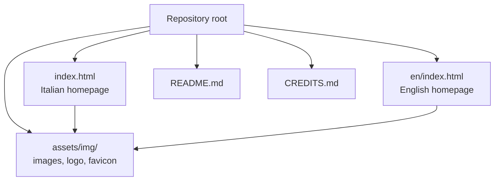
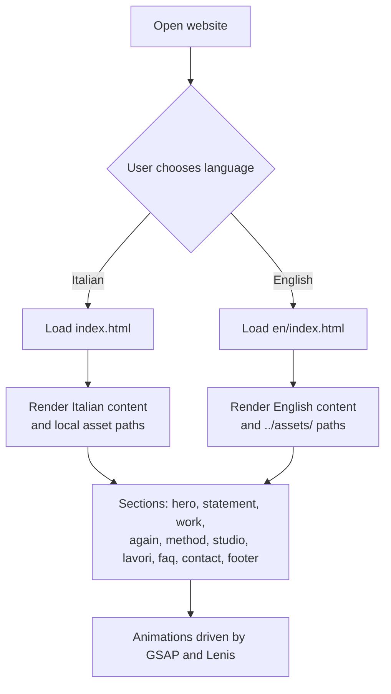
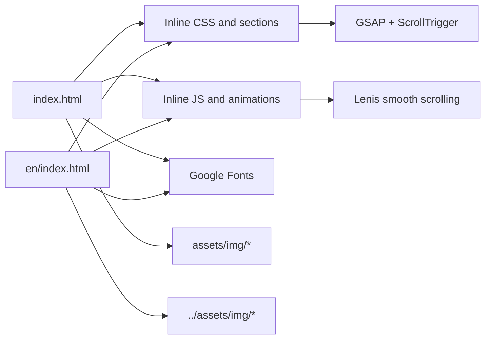

# Content Modification

<cite>
**Referenced Files in This Document**
- [index.html](file://index.html)
- [en/index.html](file://en/index.html)
- [README.md](file://README.md)
- [CREDITS.md](file://CREDITS.md)
</cite>

## Table of Contents
1. [Introduction](#introduction)
2. [Project Structure](#project-structure)
3. [Core Components](#core-components)
4. [Architecture Overview](#architecture-overview)
5. [Detailed Component Analysis](#detailed-component-analysis)
6. [Dependency Analysis](#dependency-analysis)
7. [Performance Considerations](#performance-considerations)
8. [Troubleshooting Guide](#troubleshooting-guide)
9. [Conclusion](#conclusion)

## Introduction
This document explains how to modify the text content of the TiTech Digital website while keeping the Italian and English versions aligned. The site is a single-page template with two language files:
- Italian version: `index.html`
- English version: `en/index.html`

Both pages share the same structure, animations, CSS classes, section IDs, and accessibility attributes. When you edit one page, you should update the corresponding section in the other page so that headings, navigation labels, service descriptions, portfolio items, FAQ entries, contact form labels, and footer content remain parallel.

The site uses inline CSS and JavaScript, external fonts, GSAP for animations, Lenis for smooth scrolling, and placeholder images from Pexels and Unsplash. The README also documents the contact form behavior, which currently opens a `mailto:` message instead of sending data through a backend.

**Section sources**
- [README.md:1-15](file://README.md#L1-L15)
- [README.md:32-41](file://README.md#L32-L41)
- [README.md:55-63](file://README.md#L55-L63)

## Project Structure
The repository contains two main HTML files plus supporting documentation and assets:
- `index.html`: Italian homepage
- `en/index.html`: English homepage
- `assets/img/`: shared images, logo, favicon, and hero image
- `README.md`: project overview, localization notes, preview instructions, customization guidance, and technology stack
- `CREDITS.md`: third-party photo, font, library, and template credits

**Diagram sources**
- [index.html:1-10](file://index.html#L1-L10)
- [en/index.html:1-10](file://en/index.html#L1-L10)
- [README.md:32-41](file://README.md#L32-L41)

**Section sources**
- [README.md:1-15](file://README.md#L1-L15)
- [README.md:32-41](file://README.md#L32-L41)

## Core Components
The editable content is organized into clear sections. Each section has a stable ID, semantic heading, and consistent class names. You should only replace visible text or metadata values; do not remove structural elements unless you are intentionally changing the layout.

Editable areas include:
- Meta tags and JSON-LD in the `<head>`
- Navigation links and language switcher
- Hero headline and lead paragraph
- Statement section title and introduction
- Services section titles, descriptions, and tags
- Design principles cards
- Method phases
- Studio description and integrated skills
- Portfolio grid items
- FAQ questions and answers
- Contact section title, direct information, form labels, and call-to-action
- Footer greeting, columns, legal line, and note

**Section sources**
- [index.html:12-25](file://index.html#L12-L25)
- [index.html:547-571](file://index.html#L547-L571)
- [index.html:574-580](file://index.html#L574-L580)
- [index.html:583-597](file://index.html#L583-L597)
- [index.html:600-637](file://index.html#L600-L637)
- [index.html:640-675](file://index.html#L640-L675)
- [index.html:680-701](file://index.html#L680-L701)
- [index.html:704-725](file://index.html#L704-L725)
- [index.html:728-800](file://index.html#L728-L800)

## Architecture Overview
The two language pages are independent HTML files with identical section architecture. The Italian file references local assets directly, while the English file uses relative paths starting with `../assets/`. Both pages use the same animation hooks, such as `data-8b-section`, `data-8b-motion`, and section IDs like `hero`, `statement`, `work`, `again`, `method`, `studio`, `lavori`, `faq`, `contact`, and `footer`.

**Diagram sources**
- [index.html:547-571](file://index.html#L547-L571)
- [en/index.html:547-571](file://en/index.html#L547-L571)
- [README.md:32-41](file://README.md#L32-L41)

**Section sources**
- [index.html:547-571](file://index.html#L547-L571)
- [en/index.html:547-571](file://en/index.html#L547-L571)
- [README.md:32-41](file://README.md#L32-L41)

## Detailed Component Analysis

### Global Metadata and SEO
Edit these elements to keep company identity, search descriptions, and social previews accurate:
- Page `<title>`
- `<meta name="description">`
- Open Graph `<meta property="og:title">`, `<meta property="og:description">`, and `<meta property="og:image">`
- Twitter card settings
- JSON-LD `Organization` block with name, description, area served, and topics

When updating the company name, make sure to change it consistently in both languages and in the structured data. Keep meta descriptions concise and focused on what TiTech Digital offers.

**Section sources**
- [index.html:12-25](file://index.html#L12-L25)
- [index.html:533-542](file://index.html#L533-L542)
- [en/index.html:12-25](file://en/index.html#L12-L25)
- [en/index.html:533-542](file://en/index.html#L533-L542)

### Navigation
The navigation contains:
- Brand link with logo and wordmark
- Section links: solutions, our work, method, TiTech
- Language switcher between Italian and English
- Call-to-action button
- Mobile menu overlay with the same links and language option

Update navigation labels when you rename services or sections. Do not remove the language switcher or the mobile menu structure.

**Section sources**
- [index.html:547-571](file://index.html#L547-L571)
- [en/index.html:547-571](file://en/index.html#L547-L571)

### Hero Section
The hero includes:
- A short lead paragraph describing TiTech Digital’s focus
- A link to the services section
- A large animated title containing the brand word
- An animated circular image aperture

When editing the hero, preserve the `hero__lead`, `hero__link`, `hero__title`, and image container structure. Only replace the visible text and image alt attributes if needed.

**Section sources**
- [index.html:574-580](file://index.html#L574-L580)
- [en/index.html:574-580](file://en/index.html#L574-L580)

### Statement Section
The statement section provides:
- A two-line headline
- A lead paragraph explaining the approach
- An internal navigation index linking to major sections

Keep the two-line headline structure intact. Update the lead paragraph to reflect current positioning, but maintain the emphasis on goals, technical choices, design, development, and evolution.

**Section sources**
- [index.html:583-597](file://index.html#L583-L597)
- [en/index.html:583-597](file://en/index.html#L583-L597)

### Services Section
The services section presents five areas:
- Websites and e-commerce
- Design and digital identity
- Software and automation
- SEO and digital growth
- Ongoing support

Each service card contains:
- A badge tag
- A heading
- A descriptive line
- A list of tags

When updating offerings, edit the heading, description, and tags for each card. Keep the number of cards and their structure unchanged unless you are intentionally redesigning the section.

**Section sources**
- [index.html:600-637](file://index.html#L600-L637)
- [en/index.html:600-637](file://en/index.html#L600-L637)

### Design Principles Section
The principles section shows six rotating cards covering:
- Reliability
- Scalability
- Security
- Maintainability
- Integration
- Improvement

Each card has an image, a numbered badge, a principle name, and a short explanation. Update explanations to match current practices, but preserve the six-card wheel structure.

**Section sources**
- [index.html:640-675](file://index.html#L640-L675)
- [en/index.html:640-675](file://en/index.html#L640-L675)

### Development Process Phases
The method section describes four phases:
- Analysis
- Design
- Development
- Evolution

Each phase has a heading and a short description. Update the descriptions to reflect actual workflows, but keep the four-phase sequence and the animated ring structure.

**Section sources**
- [index.html:680-701](file://index.html#L680-L701)
- [en/index.html:680-701](file://en/index.html#L680-L701)

### Team and Studio Information
The studio section includes:
- A headline about technology, method, and responsibility
- A lead paragraph describing TiTech Digital’s role and approach
- An animated photo collage
- Integrated skills: design, engineering, digital strategy
- A call-to-action link

Update the lead paragraph and skills to reflect real team capabilities. Do not remove the roles list or the call-to-action unless you are replacing the entire section.

**Section sources**
- [index.html:704-725](file://index.html#L704-L725)
- [en/index.html:704-725](file://en/index.html#L704-L725)

### Portfolio Items
The portfolio section contains a grid of demo projects. Each item includes:
- Media image
- Year badge
- Category line
- Project name
- Description
- Tags

Replace demo projects with real case studies. Update the project count label and remove the section note before publishing. Keep the same markup structure for each `<li class="project">`.

**Section sources**
- [index.html:728-800](file://index.html#L728-L800)
- [en/index.html:728-800](file://en/index.html#L728-L800)
- [README.md:72](file://README.md#L72)

### FAQ Questions and Answers
The FAQ section uses collapsible details. Edit the question summaries and answer paragraphs. Keep the same number of items and structure so the visual layout remains consistent across languages.

**Section sources**
- [index.html:468-483](file://index.html#L468-L483)
- [en/index.html:468-483](file://en/index.html#L468-L483)

### Contact Form Labels and Direct Information
The contact section includes:
- A large title
- Lead text
- Direct contact information
- Form fields with labels
- Action buttons and status text

Update labels, placeholders, direct contact details, and email addresses. The README explains that the form currently validates input and opens a `mailto:` message to a placeholder address. Replace the placeholder email with the real contact address before publication.

**Section sources**
- [index.html:484-504](file://index.html#L484-L504)
- [en/index.html:484-504](file://en/index.html#L484-L504)
- [README.md:55-63](file://README.md#L55-L63)

### Footer Content
The footer includes:
- Animated greeting
- Columns with labels and links
- Newsletter or note area
- Legal line with copyright, VAT number, and credits

Update the legal line, email, and any footer copy. Keep the credit line “Design e sito web: titechdigital.it” as documented in the README.

**Section sources**
- [index.html:505-532](file://index.html#L505-L532)
- [en/index.html:505-532](file://en/index.html#L505-L532)
- [README.md:70-76](file://README.md#L70-L76)

### Common Content Updates

#### Changing the Company Name
- Update the page title in both languages.
- Update the JSON-LD organization name.
- Update the brand wordmark in the navigation.
- Update any repeated mentions of the company name in headings, statements, and footers.

**Section sources**
- [index.html:12-12](file://index.html#L12-L12)
- [index.html:533-542](file://index.html#L533-L542)
- [index.html:548-548](file://index.html#L548-L548)
- [en/index.html:12-12](file://en/index.html#L12-L12)
- [en/index.html:533-542](file://en/index.html#L533-L542)
- [en/index.html:548-548](file://en/index.html#L548-L548)

#### Updating Service Offerings
- Edit the service card headings, descriptions, and tags in the services section.
- Update the statement and studio lead paragraphs if new services change the positioning.
- Ensure the same changes appear in both Italian and English files.

**Section sources**
- [index.html:600-637](file://index.html#L600-L637)
- [en/index.html:600-637](file://en/index.html#L600-L637)
- [index.html:583-597](file://index.html#L583-L597)
- [en/index.html:583-597](file://en/index.html#L583-L597)

#### Modifying Contact Information
- Update direct contact details in the contact section.
- Replace the placeholder email in the form script and footer.
- Verify that the `mailto:` behavior matches your intended workflow.

**Section sources**
- [index.html:484-504](file://index.html#L484-L504)
- [en/index.html:484-504](file://en/index.html#L484-L504)
- [README.md:55-63](file://README.md#L55-L63)

#### Updating Portfolio Projects
- Replace demo project entries with real case studies.
- Update project names, categories, descriptions, tags, and years.
- Adjust the selected project counter and remove the demo note before launch.

**Section sources**
- [index.html:728-800](file://index.html#L728-L800)
- [en/index.html:728-800](file://en/index.html#L728-L800)
- [README.md:72](file://README.md#L72)

## Dependency Analysis
The two language pages depend on:
- Shared CSS classes and section IDs
- External fonts from Google Fonts
- GSAP and ScrollTrigger for animations
- Lenis for smooth scrolling
- Placeholder images from Pexels and Unsplash
- Local assets under `assets/img`

The English page differs mainly in resource paths, using `../assets/` because it lives under `en/`.

**Diagram sources**
- [index.html:28-30](file://index.html#L28-L30)
- [en/index.html:28-30](file://en/index.html#L28-L30)
- [README.md:78-85](file://README.md#L78-L85)

**Section sources**
- [README.md:78-85](file://README.md#L78-L85)
- [CREDITS.md:38-50](file://CREDITS.md#L38-L50)

## Performance Considerations
When modifying content:
- Avoid adding very long headings or descriptions that could break responsive layouts.
- Keep image `alt` attributes meaningful but concise.
- Do not add unnecessary nested elements inside existing containers.
- Preserve `loading="lazy"` and `fetchpriority` attributes where they exist.
- Keep meta descriptions within typical length limits for search results.
- Avoid duplicating large blocks of text unnecessarily across languages; translate rather than copy-paste without review.

[No sources needed since this section provides general guidance]

## Troubleshooting Guide

### Links Break After Editing Paths
If you move or rename assets, check both pages for absolute and relative paths. The Italian page uses local paths, while the English page uses `../assets/`.

**Section sources**
- [index.html:26-27](file://index.html#L26-L27)
- [en/index.html:26-27](file://en/index.html#L26-L27)

### Contact Form Does Not Send Email
The form currently opens a `mailto:` message to a placeholder address. Replace the placeholder email with the real address and, if needed, integrate a backend or form service.

**Section sources**
- [README.md:55-63](file://README.md#L55-L63)

### Animations Stop Working
Do not remove `data-8b-*` attributes, section IDs, decorative dots in headings, or the template comment and generator meta tag. These are required for the original animations and behavior.

**Section sources**
- [README.md:76](file://README.md#L76)

### Images Show Incorrect Attribution
Images are illustrative and sourced from Pexels and Unsplash. Check `CREDITS.md` for author and license information.

**Section sources**
- [CREDITS.md:1-5](file://CREDITS.md#L1-L5)
- [CREDITS.md:7-29](file://CREDITS.md#L7-L29)
- [CREDITS.md:30-37](file://CREDITS.md#L30-L37)

## Conclusion
To modify the TiTech Digital website content safely:
- Edit only the visible text and metadata values.
- Keep the HTML structure, classes, IDs, and animation attributes intact.
- Update both Italian and English pages to maintain parallel content.
- Review SEO metadata, JSON-LD, and social preview values.
- Replace placeholder contact information and demo portfolio items before publishing.
- Use the README and CREDITS files as reference for localization, preview, customization, and third-party licenses.

[No sources needed since this section summarizes without analyzing specific files]