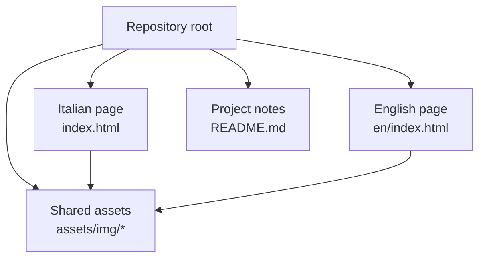
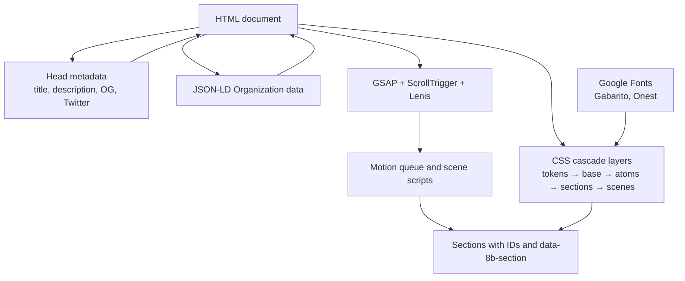
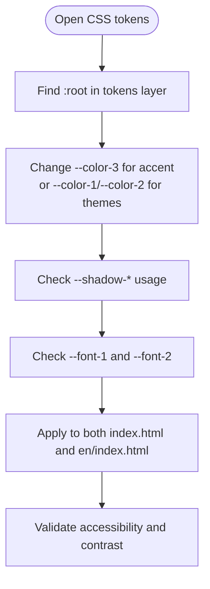
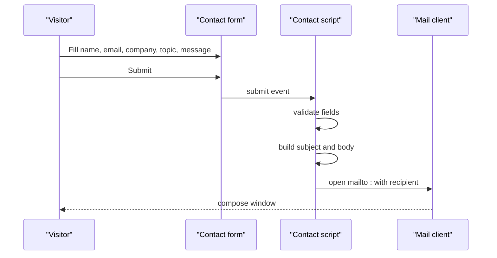
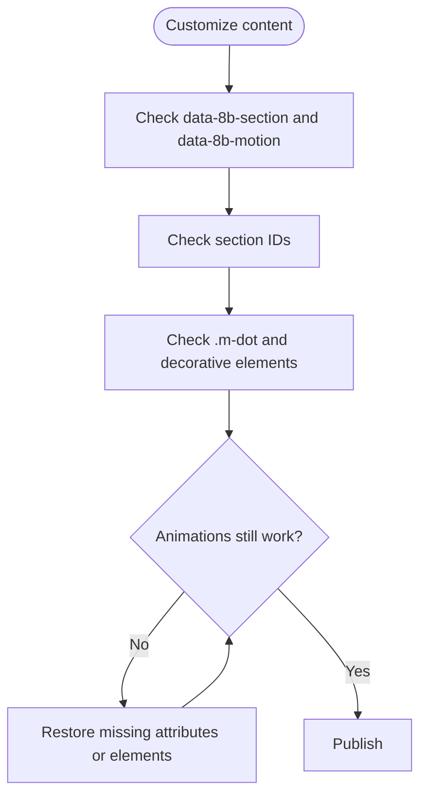
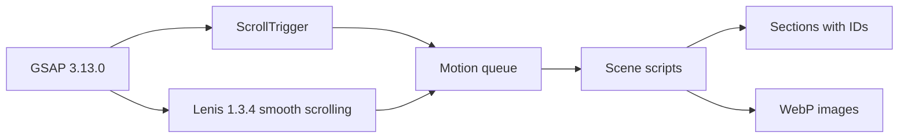

# Customization Guide

<cite>
**Referenced Files in This Document**
- [README.md](file://README.md)
- [index.html](file://index.html)
- [en/index.html](file://en/index.html)
</cite>

## Table of Contents
1. [Introduction](#introduction)
2. [Project Structure](#project-structure)
3. [Core Components](#core-components)
4. [Architecture Overview](#architecture-overview)
5. [Detailed Component Analysis](#detailed-component-analysis)
6. [Dependency Analysis](#dependency-analysis)
7. [Performance Considerations](#performance-considerations)
8. [Troubleshooting Guide](#troubleshooting-guide)
9. [Conclusion](#conclusion)

## Introduction
This guide explains how to customize the TiTech Digital website template for both Italian and English audiences. It covers text updates, brand asset replacement, color and font configuration, contact form behavior, legal data, social meta tags, JSON-LD structured data, and the structural attributes required for animations to work correctly.

The site is a single-page layout with inline CSS and JavaScript, no build step, and two language versions:
- Italian: `index.html`
- English: `en/index.html`

Both pages share the same structure, animation system, and custom attributes; only text, metadata, and image paths differ.

**Section sources**
- [README.md:1-41](file://README.md#L1-L41)

## Project Structure
The repository contains:
- Root Italian page: `index.html`
- English page: `en/index.html`
- Shared assets: `assets/img/`
- Documentation: `README.md`, `CREDITS.md`



**Diagram sources**
- [index.html:1-27](file://index.html#L1-L27)
- [en/index.html:1-27](file://en/index.html#L1-L27)
- [README.md:32-53](file://README.md#L32-L53)

**Section sources**
- [README.md:17-53](file://README.md#L17-L53)

## Core Components
The customization surface includes:
- Text content in both language files
- Brand assets in `assets/img/`
- Color tokens defined as CSS custom properties
- Font declarations for Gabarito and Onest from Google Fonts
- Meta tags for SEO and social sharing
- JSON-LD organization data
- Contact form email recipient
- Footer legal information
- Animation-critical attributes and section IDs

Key areas to update:
- Head metadata and JSON-LD
- Navigation links and labels
- Hero statement and lead copy
- Service cards and portfolio items
- FAQ questions and answers
- Contact section text and form messages
- Footer navigation, direct contact link, legal line, and credit line

**Section sources**
- [index.html:9-27](file://index.html#L9-L27)
- [index.html:547-570](file://index.html#L547-L570)
- [index.html:574-597](file://index.html#L574-L597)
- [index.html:600-637](file://index.html#L600-L637)
- [index.html:728-814](file://index.html#L728-L814)
- [index.html:817-827](file://index.html#L817-L827)
- [index.html:830-857](file://index.html#L830-L857)
- [index.html:861-893](file://index.html#L861-L893)
- [en/index.html:9-27](file://en/index.html#L9-L27)
- [en/index.html:547-570](file://en/index.html#L547-L570)
- [en/index.html:574-597](file://en/index.html#L574-L597)
- [en/index.html:600-637](file://en/index.html#L600-L637)
- [en/index.html:728-814](file://en/index.html#L728-L814)
- [en/index.html:817-827](file://en/index.html#L817-L827)
- [en/index.html:830-857](file://en/index.html#L830-L857)
- [en/index.html:861-893](file://en/index.html#L861-L893)

## Architecture Overview
The site uses a layered CSS architecture and GSAP-based scroll animations.



**Diagram sources**
- [index.html:9-27](file://index.html#L9-L27)
- [index.html:114-139](file://index.html#L114-L139)
- [index.html:533-542](file://index.html#L533-L542)
- [index.html:895-1012](file://index.html#L895-L1012)
- [index.html:1013-1303](file://index.html#L1013-L1303)

**Section sources**
- [index.html:114-139](file://index.html#L114-L139)
- [index.html:533-542](file://index.html#L533-L542)
- [index.html:895-1012](file://index.html#L895-L1012)

## Detailed Component Analysis

### Text Content Modification

#### Italian Version
Update visible text in `index.html`:
- Page title and description
- Navigation labels
- Hero lead and title
- Statement paragraph and index links
- Service cards titles, descriptions, and tags
- Portfolio project names, descriptions, years, and tags
- FAQ questions and answers
- Contact section lead, direct email link, form labels, options, and status messages
- Footer exploration and service links, company description, direct email, call-to-action note, and legal line

When editing one version, mirror changes in the other file to keep structure and metadata aligned.

#### English Version
Update visible text in `en/index.html`:
- Page title and description
- Navigation labels
- Hero lead and title
- Statement paragraph and index links
- Service cards titles, descriptions, and tags
- Portfolio project names, descriptions, years, and tags
- FAQ questions and answers
- Contact section lead, direct email link, form labels, options, and status messages
- Footer exploration and service links, company description, direct email, call-to-action note, and legal line

The English page uses relative paths like `../assets/img/...` because it lives under `en/`.

**Section sources**
- [index.html:12-13](file://index.html#L12-L13)
- [index.html:547-570](file://index.html#L547-L570)
- [index.html:574-597](file://index.html#L574-L597)
- [index.html:600-637](file://index.html#L600-L637)
- [index.html:728-814](file://index.html#L728-L814)
- [index.html:817-827](file://index.html#L817-L827)
- [index.html:830-857](file://index.html#L830-L857)
- [index.html:861-893](file://index.html#L861-L893)
- [en/index.html:12-13](file://en/index.html#L12-L13)
- [en/index.html:547-570](file://en/index.html#L547-L570)
- [en/index.html:574-597](file://en/index.html#L574-L597)
- [en/index.html:600-637](file://en/index.html#L600-L637)
- [en/index.html:728-814](file://en/index.html#L728-L814)
- [en/index.html:817-827](file://en/index.html#L817-L827)
- [en/index.html:830-857](file://en/index.html#L830-L857)
- [en/index.html:861-893](file://en/index.html#L861-L893)

### Brand Asset Replacement

#### Logo
The logo appears in the fixed navigation and mobile menu. Replace the SVG file at `assets/img/logo.svg`. Both pages reference this path directly.

#### Favicon
The browser favicon is set through the `<link rel="icon">` tag. Replace `assets/img/favicon.svg`. The English page references it with `../assets/img/favicon.svg`.

#### WebP Images
All images are optimized WebP files in `assets/img/`. Replace or add images while preserving:
- Existing filenames when possible
- `srcset` and `sizes` attributes
- Width and height values
- Loading strategy (`eager` for hero, `lazy` for below-the-fold images)

Important image locations:
- Hero image: `assets/img/hero-700.webp` and `assets/img/hero-1400.webp`
- Work and partner images used in animated sections
- Studio collage images
- Portfolio project images

The English page uses relative paths such as `../assets/img/...`.

```mermaid
flowchart TD
Start(["Replace brand asset"]) --> Type{"Asset type?"}
Type --> |Logo| LogoPath["Replace assets/img/logo.svg"]
Type --> |Favicon| FaviconPath["Replace assets/img/favicon.svg"]
Type --> |WebP Image| WebPPath["Replace matching filename in assets/img/"]
LogoPath --> VerifyPaths["Verify nav and menu references"]
FaviconPath --> VerifyMeta["Verify <link rel=\"icon\">"]
WebPPath --> VerifySrcset["Verify srcset, sizes, width, height"]
VerifyPaths --> Done(["Test both languages"])
VerifyMeta --> Done
VerifySrcset --> Done
```

**Diagram sources**
- [index.html:26-27](file://index.html#L26-L27)
- [index.html:547-570](file://index.html#L547-L570)
- [index.html:579](file://index.html#L579)
- [index.html:862](file://index.html#L862)
- [en/index.html:26-27](file://en/index.html#L26-L27)
- [en/index.html:547-570](file://en/index.html#L547-L570)
- [en/index.html:579](file://en/index.html#L579)
- [en/index.html:862](file://en/index.html#L862)

**Section sources**
- [README.md:69-71](file://README.md#L69-L71)
- [index.html:26-27](file://index.html#L26-L27)
- [index.html:547-570](file://index.html#L547-L570)
- [index.html:579](file://index.html#L579)
- [index.html:862](file://index.html#L862)
- [en/index.html:26-27](file://en/index.html#L26-L27)
- [en/index.html:547-570](file://en/index.html#L547-L570)
- [en/index.html:579](file://en/index.html#L579)
- [en/index.html:862](file://en/index.html#L862)

### Color Scheme Customization

Colors are controlled by CSS custom properties inside the `tokens` layer. Edit these variables to change the theme:
- `--color-1`: primary dark background
- `--color-2`: light background and text on dark surfaces
- `--color-3`: accent color used for buttons, dots, and highlights
- `--color-4`: card and surface background
- `--color-5`: secondary text and muted labels
- `--color-6`: body text on light backgrounds
- `--color-7`: dark card background
- `--shadow-*`: shadow definitions using `color-mix()`
- `--space-*`: spacing scale
- `--radius-*`: border radius tokens
- `--font-1`, `--font-2`: typography tokens

The CSS uses cascade layers declared with `@layer tokens, base, atoms, layout, sections, scenes`. Tokens are defined first, then base styles, atomic utilities, section styles, and finally scene-specific animation styles.

To customize colors safely:
1. Open `index.html` and locate the `data-8b-part="tokens"` style block.
2. Update the `:root` variables.
3. Keep contrast ratios accessible.
4. Test both light and dark surfaces.
5. Repeat the same changes in `en/index.html`.



**Diagram sources**
- [index.html:114-139](file://index.html#L114-L139)
- [index.html:165-203](file://index.html#L165-L203)
- [index.html:204-532](file://index.html#L204-L532)
- [en/index.html:114-139](file://en/index.html#L114-L139)
- [en/index.html:165-203](file://en/index.html#L165-L203)
- [en/index.html:204-532](file://en/index.html#L204-L532)

**Section sources**
- [index.html:114-139](file://index.html#L114-L139)
- [index.html:165-203](file://index.html#L165-L203)
- [index.html:204-532](file://index.html#L204-L532)
- [en/index.html:114-139](file://en/index.html#L114-L139)
- [en/index.html:165-203](file://en/index.html#L165-L203)
- [en/index.html:204-532](file://en/index.html#L204-L532)

### Font Configuration

The site loads Gabarito and Onest from Google Fonts. Fonts are declared with `@font-face` blocks and referenced through CSS variables:
- `--font-1` uses Gabarito
- `--font-2` uses Onest

Fallback fonts are included for robust rendering. To change fonts:
1. Add new Google Fonts links and preload tags.
2. Add matching `@font-face` blocks.
3. Update `--font-1` and `--font-2` in the tokens layer.
4. Ensure fallbacks remain sensible.
5. Apply the same changes to both language files.

The README confirms that Gabarito and Onest are the intended fonts.

**Section sources**
- [index.html:28-113](file://index.html#L28-L113)
- [index.html:117-139](file://index.html#L117-L139)
- [index.html:140-144](file://index.html#L140-L144)
- [index.html:165-173](file://index.html#L165-L173)
- [en/index.html:28-113](file://en/index.html#L28-L113)
- [en/index.html:117-139](file://en/index.html#L117-L139)
- [en/index.html:140-144](file://en/index.html#L140-L144)
- [en/index.html:165-173](file://en/index.html#L165-L173)
- [README.md:78-83](file://README.md#L78-L83)

### Contact Form Email Address

The contact form does not use a backend. On submit, it validates fields, builds a subject and body, and opens the user’s mail client via `mailto:`.

To change the recipient:
1. Find the script tagged `data-8b-part="section-script:contact"`.
2. Update the `recipient` variable.
3. Also update any visible `mailto:` links in the contact and footer sections.
4. Update the success and error messages if needed.
5. Apply the same changes to both language files.

Current recipient location:
- Italian page: `info@titechdigital.it`
- English page: `info@titechdigital.it`



**Diagram sources**
- [index.html:841-855](file://index.html#L841-L855)
- [index.html:1210-1238](file://index.html#L1210-L1238)
- [en/index.html:841-855](file://en/index.html#L841-L855)
- [en/index.html:1210-1238](file://en/index.html#L1210-L1238)

**Section sources**
- [README.md:55-63](file://README.md#L55-L63)
- [index.html:830-857](file://index.html#L830-L857)
- [index.html:1210-1238](file://index.html#L1210-L1238)
- [en/index.html:830-857](file://en/index.html#L830-L857)
- [en/index.html:1210-1238](file://en/index.html#L1210-L1238)

### Legal Data in Footer

Footer legal information includes:
- Copyright notice
- VAT number
- Rights reserved text
- Design and website credit link
- Tagline about digital solutions and markets

Update these lines in both `index.html` and `en/index.html`. Keep the credit line intact unless you have permission to modify it.

**Section sources**
- [index.html:892](file://index.html#L892)
- [en/index.html:892](file://en/index.html#L892)
- [README.md:70](file://README.md#L70)

### Meta Tags for Social Sharing

Social preview metadata is defined in the `<head>`:
- `og:type`
- `og:locale`
- `og:site_name`
- `og:title`
- `og:description`
- `og:image`
- `og:image:width`
- `og:image:height`
- `og:image:alt`
- `twitter:card`

Update these tags when finalizing titles, descriptions, and the social image URL. The current image points to an external Pexels photo.

**Section sources**
- [index.html:16-25](file://index.html#L16-L25)
- [en/index.html:16-25](file://en/index.html#L16-L25)
- [README.md:73](file://README.md#L73)

### JSON-LD Structured Data

The page includes a JSON-LD block describing the organization:
- `@type`: Organization
- `name`
- `description`
- `areaServed`
- `knowsAbout`

Add only verified data such as address, phone, and social profiles. Do not invent business details.

**Section sources**
- [index.html:533-542](file://index.html#L533-L542)
- [en/index.html:533-542](file://en/index.html#L533-L542)
- [README.md:74](file://README.md#L74)

### Preserving Animation-Critical Attributes

Animations rely on specific DOM structure and attributes. When customizing:
- Keep all `data-8b-section` attributes on sections.
- Keep all `data-8b-motion` attributes on elements that should animate.
- Keep section IDs such as `hero`, `statement`, `work`, `again`, `method`, `studio`, `lavori`, `faq`, `contact`, `footer`.
- Keep decorative dot elements `.m-dot` where they appear in headings and statements.
- Keep the template comment and `<meta name="generator">`.
- Do not remove the footer period element `.footer__period` or the aperture/tint elements required by the footer animation.

The motion queue reads `[data-8b-section]` elements to determine section order and adjacency, which affects transitions between hero, statement, work, again, method, studio, lavori, contact, and footer scenes.



**Diagram sources**
- [index.html:547-570](file://index.html#L547-L570)
- [index.html:574-597](file://index.html#L574-L597)
- [index.html:600-637](file://index.html#L600-L637)
- [index.html:640-675](file://index.html#L640-L675)
- [index.html:680-701](file://index.html#L680-L701)
- [index.html:704-725](file://index.html#L704-L725)
- [index.html:728-814](file://index.html#L728-L814)
- [index.html:817-827](file://index.html#L817-L827)
- [index.html:830-857](file://index.html#L830-L857)
- [index.html:861-893](file://index.html#L861-L893)
- [index.html:929-984](file://index.html#L929-L984)
- [index.html:1058-1074](file://index.html#L1058-L1074)
- [index.html:1076-1303](file://index.html#L1076-L1303)

**Section sources**
- [README.md:76](file://README.md#L76)
- [index.html:929-984](file://index.html#L929-L984)
- [index.html:1058-1074](file://index.html#L1058-L1074)
- [index.html:1076-1303](file://index.html#L1076-L1303)

## Dependency Analysis



**Diagram sources**
- [index.html:895-897](file://index.html#L895-L897)
- [index.html:929-984](file://index.html#L929-L984)
- [index.html:1013-1303](file://index.html#L1013-L1303)
- [README.md:78-83](file://README.md#L78-L83)

**Section sources**
- [index.html:895-897](file://index.html#L895-L897)
- [index.html:929-984](file://index.html#L929-L984)
- [index.html:1013-1303](file://index.html#L1013-L1303)
- [README.md:78-83](file://README.md#L78-L83)

## Performance Considerations
- Use WebP images already provided in `assets/img/`.
- Preserve `srcset`, `sizes`, `width`, and `height` attributes when replacing images.
- Keep hero images eager-loaded and below-the-fold images lazy-loaded.
- Avoid removing the template generator meta tag or animation-related comments.
- Respect `prefers-reduced-motion`; the site remains functional without animations.
- Keep the GSAP, ScrollTrigger, and Lenis dependencies unchanged unless you replace them entirely.

[No sources needed since this section provides general guidance]

## Troubleshooting Guide

Common issues and fixes:
- Animations do not trigger: verify `data-8b-section`, `data-8b-motion`, section IDs, and decorative `.m-dot` elements.
- Hero-to-statement transition fails: ensure `hero` and `statement` sections exist and are adjacent in DOM order.
- Work track or wheel animations break: check that `.work__track`, `.work__window`, `.again__wheel`, and related classes remain intact.
- Method ring animation breaks: keep `.method__ring`, `.method__svg`, `.method__arc`, `.method__station`, and `.method__steps`.
- Footer animation breaks: keep `.footer__bye`, `.footer__word`, `.footer__period`, `.footer__aperture`, and `.footer__tint`.
- Contact form sends to wrong address: update the `recipient` variable in the contact script and visible `mailto:` links.
- Social preview shows wrong image: update `og:image` and confirm the URL is publicly accessible.
- JSON-LD validation errors: remove unverified fields and keep only accurate organization data.

**Section sources**
- [index.html:929-984](file://index.html#L929-L984)
- [index.html:1076-1303](file://index.html#L1076-L1303)
- [index.html:1210-1238](file://index.html#L1210-L1238)
- [en/index.html:929-984](file://en/index.html#L929-L984)
- [en/index.html:1076-1303](file://en/index.html#L1076-L1303)
- [en/index.html:1210-1238](file://en/index.html#L1210-L1238)
- [README.md:76](file://README.md#L76)

## Conclusion
Customizing the TiTech Digital template means updating text in both language files, replacing brand assets in `assets/img/`, adjusting CSS custom properties in the tokens layer, keeping fonts consistent, updating social metadata and JSON-LD, changing the contact form recipient, and maintaining the structural attributes required by the animation system. Always test both Italian and English versions after changes, especially when modifying paths, IDs, or animation-critical markup.

[No sources needed since this section summarizes without analyzing specific files]