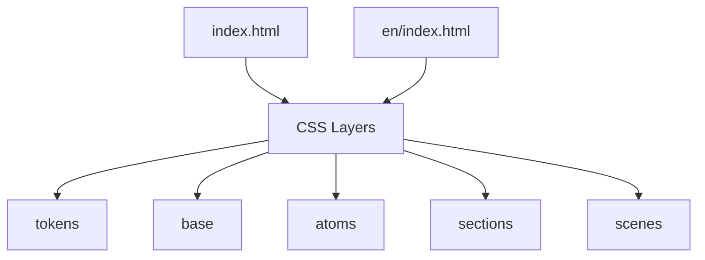
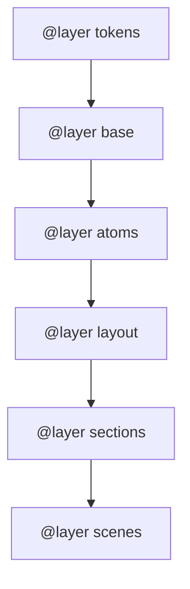
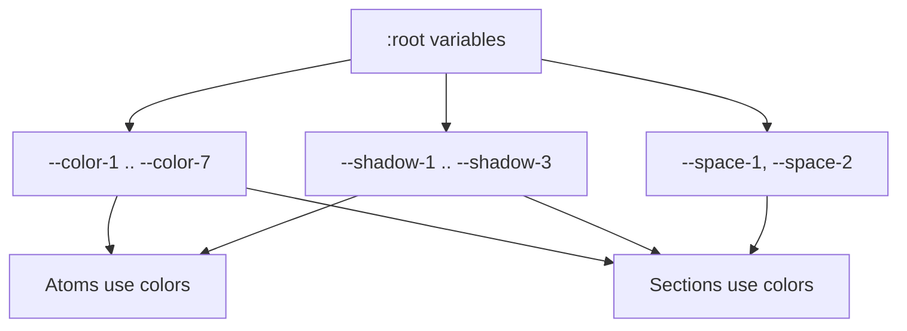
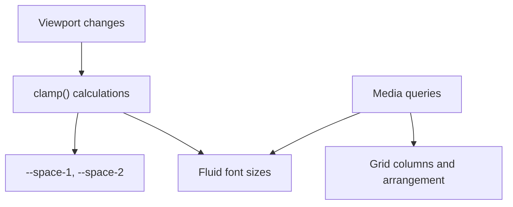
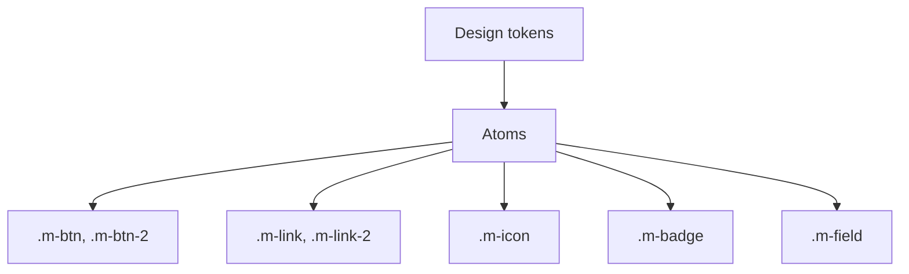
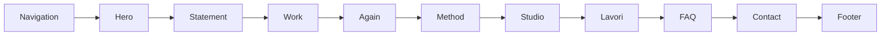
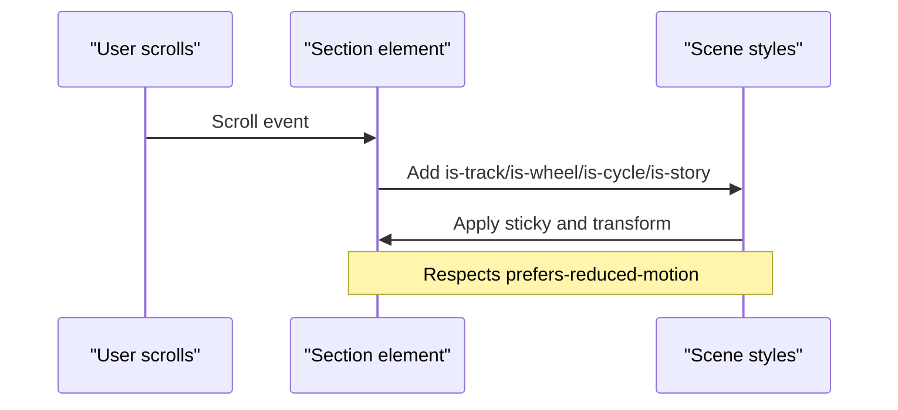
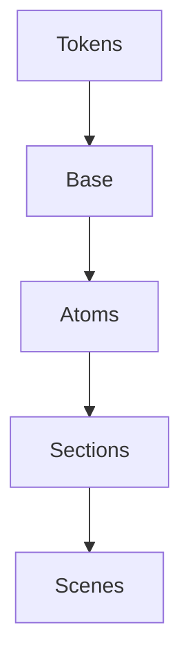

# Styling Customization

<cite>
**Referenced Files in This Document**
- [index.html](file://index.html)
- [en/index.html](file://en/index.html)
- [README.md](file://README.md)
</cite>

## Table of Contents
1. [Introduction](#introduction)
2. [Project Structure](#project-structure)
3. [Core Components](#core-components)
4. [Architecture Overview](#architecture-overview)
5. [Detailed Component Analysis](#detailed-component-analysis)
6. [Dependency Analysis](#dependency-analysis)
7. [Performance Considerations](#performance-considerations)
8. [Troubleshooting Guide](#troubleshooting-guide)
9. [Conclusion](#conclusion)

## Introduction
This document explains how to customize the styling of the TiTech Digital template. It focuses on the CSS architecture, cascade layers, design tokens, typography, responsive breakpoints, fluid typography with clamp(), and practical customization examples such as changing colors, spacing, fonts, and component styles while preserving design system consistency.

The template is a single-page site with inline CSS organized into cascade layers. It uses modern CSS features like color-mix() and viewport units, and it relies on Google Fonts for Gabarito and Onest typefaces.

**Section sources**
- [README.md:78-85](file://README.md#L78-L85)

## Project Structure
The project contains two HTML pages (Italian and English) that share the same structure and styling approach. All CSS is defined inline within each page using multiple <style> blocks, each tagged with data attributes for clarity. The CSS is split into logical cascade layers: tokens, base, atoms, layout, sections, and scenes.



**Diagram sources**
- [index.html:114-116](file://index.html#L114-L116)
- [en/index.html:114-116](file://en/index.html#L114-L116)

**Section sources**
- [index.html:114-116](file://index.html#L114-L116)
- [en/index.html:114-116](file://en/index.html#L114-L116)

## Core Components
The styling system is built around these core components:

- Cascade layers declaration
- Design tokens in :root
- Base resets and global rules
- Atoms (small reusable UI primitives)
- Sections (page-level modules)
- Scenes (animation and scroll-driven enhancements)

Key responsibilities:
- tokens: define colors, fonts, radii, shadows, and spacing variables
- base: normalize elements, set defaults, accessibility helpers
- atoms: small components like buttons, links, icons, badges, fields
- sections: full-page or major section layouts and content styles
- scenes: motion, sticky behavior, and scroll-driven effects

**Section sources**
- [index.html:114-116](file://index.html#L114-L116)
- [index.html:117-139](file://index.html#L117-L139)
- [index.html:140-164](file://index.html#L140-L164)
- [index.html:165-203](file://index.html#L165-L203)

## Architecture Overview
The template uses CSS @layer to enforce a strict cascade order. Tokens are declared first, then base, atoms, layout, sections, and finally scenes. This ensures predictable overrides and clear separation between design tokens and presentation logic.



**Diagram sources**
- [index.html:114-116](file://index.html#L114-L116)
- [en/index.html:114-116](file://en/index.html#L114-L116)

**Section sources**
- [index.html:114-116](file://index.html#L114-L116)
- [en/index.html:114-116](file://en/index.html#L114-L116)

## Detailed Component Analysis

### Cascade Layers and Organization
The layers are explicitly declared once per page and then used throughout the stylesheet. Each layer has a specific purpose:

- tokens: centralizes all design tokens (colors, fonts, radii, shadows, spacing)
- base: global resets, body defaults, focus visibility, utility classes
- atoms: small, reusable UI building blocks (buttons, links, icons, badges, fields)
- sections: page sections (navigation, hero, statement, work, again, method, studio, lavori, faq, contact, footer)
- scenes: animation and scroll-driven behaviors tied to sections

```mermaid
classDiagram
class Tokens {
"+color variables"
"+font variables"
"+radius variables"
"+shadow variables"
"+spacing variables"
}
class Base {
"+global resets"
"+body defaults"
"+focus-visible"
"+utility classes"
}
class Atoms {
"+m-text variants"
"+m-btn variants"
"+m-link variants"
"+m-icon"
"+m-badge"
"+m-field"
}
class Sections {
"+navigation"
"+hero"
"+statement"
"+work"
"+again"
"+method"
"+studio"
"+lavori"
"+faq"
"+contact"
"+footer"
}
class Scenes {
"+scroll-driven animations"
"+sticky containers"
"+motion enhancements"
}
Tokens --> Base
Base --> Atoms
Atoms --> Sections
Sections --> Scenes
```

**Diagram sources**
- [index.html:117-139](file://index.html#L117-L139)
- [index.html:140-164](file://index.html#L140-L164)
- [index.html:165-203](file://index.html#L165-L203)
- [index.html:204-564](file://index.html#L204-L564)

**Section sources**
- [index.html:114-116](file://index.html#L114-L116)
- [index.html:117-139](file://index.html#L117-L139)
- [index.html:140-164](file://index.html#L140-L164)
- [index.html:165-203](file://index.html#L165-L203)
- [index.html:204-564](file://index.html#L204-L564)

### Tokens and Color System
All colors are exposed as CSS custom properties under :root inside the tokens layer. This makes them easy to override globally.

- Primary dark background: --color-1
- Light background: --color-2
- Accent color: --color-3
- Surface tint: --color-4
- Muted text: --color-5
- Secondary text: --color-6
- Dark surface: --color-7

Shadows and spacing also use variables:
- Shadows: --shadow-1, --shadow-2, --shadow-3
- Spacing: --space-1 (horizontal padding), --space-2 (vertical rhythm)

To change the primary accent color across the site, update --color-3 in :root. To adjust spacing, modify --space-1 and --space-2.



**Diagram sources**
- [index.html:117-139](file://index.html#L117-L139)

**Section sources**
- [index.html:117-139](file://index.html#L117-L139)

### Typography and Font Configuration
The template loads two typefaces from Google Fonts:

- Gabarito: used for headings and display text
- Onest: used for body and interface text

Fallbacks are provided via local font stacks and additional @font-face declarations for fallback families. The base layer includes size-adjust and ascent/descent overrides to improve metric consistency when fallback fonts load.

To configure fonts:
- Modify the font-family values in :root variables --font-1 and --font-2
- Adjust the @font-face declarations if you want to swap or add typefaces
- Use the m-text-* classes for consistent typographic scales

Fluid typography is implemented using clamp() and min()/calc() expressions to scale text smoothly across viewports.

**Section sources**
- [index.html:31-113](file://index.html#L31-L113)
- [index.html:140-144](file://index.html#L140-L144)
- [index.html:165-173](file://index.html#L165-L173)

### Responsive Breakpoints and Fluid Layouts
Breakpoints are primarily based on width thresholds:

- Mobile-first default styles
- max-width: 899px for mobile navigation and compact layouts
- min-width: 700px for two-column grids in some sections
- min-width: 760px for multi-column project grids
- min-width: 900px for desktop layouts and landscape-specific adjustments
- min-width: 1000px for wider grid configurations
- min-width: 1100px for three-column project grids

Fluid typography and spacing rely on clamp() and viewport units (svh, vw, vh). For example:
- Horizontal spacing: --space-1 = clamp(16px, 3.4vw, 48px)
- Vertical rhythm: --space-2 = clamp(96px, 15vh, 200px)
- Headings and large text use clamp() to scale smoothly



**Diagram sources**
- [index.html:117-139](file://index.html#L117-L139)
- [index.html:231-235](file://index.html#L231-L235)
- [index.html:291-295](file://index.html#L291-L295)
- [index.html:316-320](file://index.html#L316-L320)
- [index.html:352-354](file://index.html#L352-L354)
- [index.html:385-394](file://index.html#L385-L394)
- [index.html:460-461](file://index.html#L460-L461)

**Section sources**
- [index.html:231-235](file://index.html#L231-L235)
- [index.html:291-295](file://index.html#L291-L295)
- [index.html:316-320](file://index.html#L316-L320)
- [index.html:352-354](file://index.html#L352-L354)
- [index.html:385-394](file://index.html#L385-L394)
- [index.html:460-461](file://index.html#L460-L461)

### Atoms: Buttons, Links, Icons, Badges, Fields
Atoms provide consistent UI primitives:

- Buttons: .m-btn (accent background), .m-btn-2 (inverted style)
- Links: .m-link (with animated underline and arrow), .m-link-2 (simple underline)
- Icons: .m-icon (circular icon container with hover fill)
- Badge: .m-badge (small label with border)
- Field: .m-field (input/textarea with bottom border and focus state)

These components use design tokens for colors, radii, and fonts, ensuring consistency.



**Diagram sources**
- [index.html:165-203](file://index.html#L165-L203)

**Section sources**
- [index.html:165-203](file://index.html#L165-L203)

### Sections: Navigation, Hero, Statement, Work, Again, Method, Studio, Lavori, FAQ, Contact, Footer
Each section is encapsulated in its own style block under the sections layer. They compose atoms and tokens to build complex layouts. Notable patterns:

- Navigation: fixed top bar, desktop links, mobile menu overlay
- Hero: circular image stage with orbit and mask animations
- Statement: two-line headline with lead text and index list
- Work: horizontal track with case cards and gradient overlays
- Again: partner wheel with rotating cards
- Method: step ring with SVG arc and runner
- Studio: collage grid with roles list
- Lavori: project stories with stacked media and progress bars
- FAQ: details/summary accordion with animated mark
- Contact: title, info, form, actions
- Footer: large wordmark, aperture image, grid columns, legal line



**Diagram sources**
- [index.html:204-564](file://index.html#L204-L564)

**Section sources**
- [index.html:204-564](file://index.html#L204-L564)

### Scenes: Animation and Scroll-Driven Enhancements
Scenes layer adds motion and sticky behaviors for certain sections. Examples include:

- Work track: sticky container with horizontal scrolling
- Again wheel: rotating card carousel
- Method cycle: sticky ring with step progression
- Lavori story: sticky story mode with pip progress and project stacking

Animations respect prefers-reduced-motion and pause when sections are offscreen.



**Diagram sources**
- [index.html:323-335](file://index.html#L323-L335)
- [index.html:357-367](file://index.html#L357-L367)
- [index.html:397-404](file://index.html#L397-L404)
- [index.html:464-498](file://index.html#L464-L498)

**Section sources**
- [index.html:323-335](file://index.html#L323-L335)
- [index.html:357-367](file://index.html#L357-L367)
- [index.html:397-404](file://index.html#L397-L404)
- [index.html:464-498](file://index.html#L464-L498)

## Dependency Analysis
The styling dependencies follow a clear hierarchy:

- Tokens depend only on browser support for CSS custom properties
- Base depends on tokens for colors and fonts
- Atoms depend on base and tokens
- Sections depend on atoms, base, and tokens
- Scenes depend on sections and tokens



**Diagram sources**
- [index.html:117-139](file://index.html#L117-L139)
- [index.html:140-164](file://index.html#L140-L164)
- [index.html:165-203](file://index.html#L165-L203)
- [index.html:204-564](file://index.html#L204-L564)

**Section sources**
- [index.html:117-139](file://index.html#L117-L139)
- [index.html:140-164](file://index.html#L140-L164)
- [index.html:165-203](file://index.html#L165-L203)
- [index.html:204-564](file://index.html#L204-L564)

## Performance Considerations
- Inline CSS avoids extra network requests but increases HTML size; this is acceptable for a single-page template without a build step.
- Google Fonts are preloaded and use font-display: swap to improve perceived performance.
- Animations are guarded by prefers-reduced-motion and paused when offscreen to reduce unnecessary rendering.
- Modern CSS features like color-mix() and clamp() are efficient and avoid JavaScript overhead.

[No sources needed since this section provides general guidance]

## Troubleshooting Guide

Common issues and resolutions:

- Colors not updating: Ensure you edit the correct variable in :root within the tokens layer. Verify your override is placed after the original tokens declaration or in a later layer.
- Fonts not loading: Check the @font-face declarations and preload links. Confirm the font URLs are accessible and the unicode-range matches your content.
- Fluid typography looks too large/small: Adjust clamp() parameters in the relevant m-text-* classes or section titles. Remember that clamp(min, preferred, max) controls scaling bounds.
- Breakpoints not applying: Confirm your media query conditions match the intended viewport ranges. The template uses 899px, 700px, 760px, 900px, 1000px, and 1100px thresholds.
- Animations not working: Check that the section has the expected is-* class added by script and that prefers-reduced-motion is not set to reduce.
- Accessibility concerns: Focus-visible outlines use the accent color; ensure contrast ratios meet standards when changing colors.

**Section sources**
- [index.html:117-139](file://index.html#L117-L139)
- [index.html:140-164](file://index.html#L140-L164)
- [index.html:165-203](file://index.html#L165-L203)
- [index.html:204-564](file://index.html#L204-L564)

## Conclusion
The TiTech Digital template’s styling system is modular, predictable, and highly customizable through CSS cascade layers and design tokens. By editing :root variables, adjusting clamp() functions, and overriding atoms and sections within their respective layers, you can adapt colors, spacing, typography, and component styles while maintaining consistency. Respect the layer order and breakpoint conventions to keep the design system coherent across devices and interactions.

[No sources needed since this section summarizes without analyzing specific files]