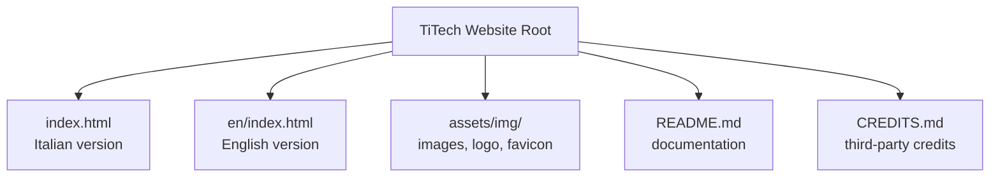
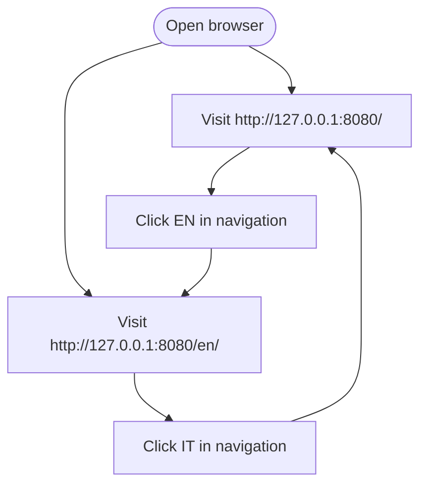
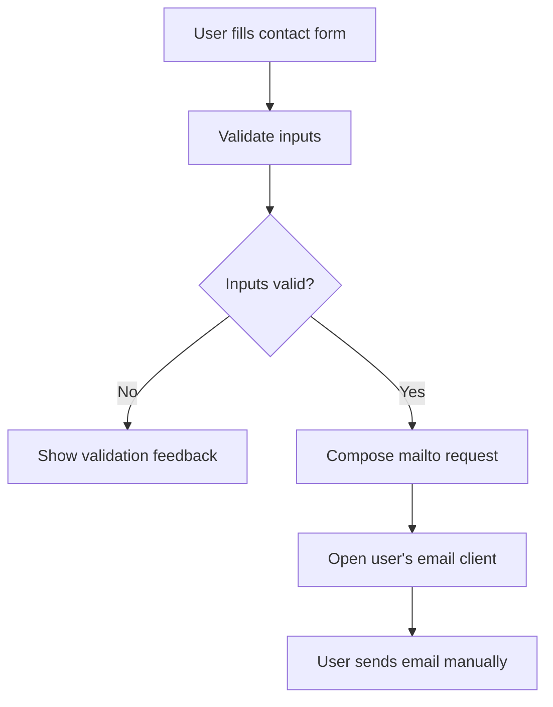

# Getting Started

<cite>
**Referenced Files in This Document**
- [README.md](file://README.md)
- [index.html](file://index.html)
- [en/index.html](file://en/index.html)
- [assets/img/logo.svg](file://assets/img/logo.svg)
- [assets/img/favicon.svg](file://assets/img/favicon.svg)
</cite>

## Table of Contents
1. [Introduction](#introduction)
2. [Prerequisites and Environment Setup](#prerequisites-and-environment-setup)
3. [Project Structure](#project-structure)
4. [Local Development Setup](#local-development-setup)
5. [Previewing the Italian and English Versions](#previewing-the-italian-and-english-versions)
6. [Basic Customization Guide](#basic-customization-guide)
7. [Contact Form Behavior](#contact-form-behavior)
8. [Assets and Branding](#assets-and-branding)
9. [Troubleshooting](#troubleshooting)
10. [Conclusion](#conclusion)

## Introduction
This guide explains how to run, preview, and customize the TiTech Digital website locally. The site is a static one-page website with two language versions:
- Italian version at `/index.html`
- English version at `/en/index.html`

The project has no build step. Each page is a single HTML file that includes inline CSS and JavaScript, while shared assets such as fonts, GSAP, Lenis, and images are loaded from external sources or the `assets/img` folder.

**Section sources**
- [README.md:1-15](file://README.md#L1-L15)
- [README.md:32-41](file://README.md#L32-L41)
- [README.md:53-54](file://README.md#L53-L54)

## Prerequisites and Environment Setup
You need only a modern web browser and Python 3 installed on your computer. Python’s built-in HTTP server module is used to serve the files locally.

Requirements:
- A terminal or command prompt
- Python 3 available as `python` or `python3`
- A web browser such as Chrome, Edge, Safari, or Firefox

Check your environment by running:
```bash
python --version
```

If Python is not installed, install it from the official Python website for your operating system.

**Section sources**
- [README.md:43-53](file://README.md#L43-L53)

## Project Structure
The repository contains two main entry points and a shared asset folder:

| Path | Purpose |
|---|---|
| `index.html` | Italian version of the site |
| `en/index.html` | English version of the site |
| `assets/img/` | Shared images, logo, and favicon |
| `README.md` | Project documentation, local preview instructions, customization notes, and technology list |
| `CREDITS.md` | Credits for photos, fonts, and third-party libraries |
| `index.original.html` | Original template reference file |

Both language pages share the same structure, animations, and design system. They differ in text, metadata, and resource paths. The English page uses relative paths such as `../assets/img/...`, while the Italian page uses paths like `assets/img/...`.



**Diagram sources**
- [index.html:1-27](file://index.html#L1-L27)
- [en/index.html:1-27](file://en/index.html#L1-L27)
- [README.md:32-41](file://README.md#L32-L41)

**Section sources**
- [README.md:32-41](file://README.md#L32-L41)
- [README.md:65-76](file://README.md#L65-L76)

## Local Development Setup
Follow these steps to start the local development server:

1. Open a terminal.
2. Navigate to the project root directory where `index.html` lives.
3. Run the Python HTTP server:
   ```bash
   python -m http.server 8080 --bind 127.0.0.1
   ```
4. Wait until the server starts and prints its listening address.
5. Open your browser and visit the URLs described below.

Important details:
- The server binds to `127.0.0.1`, so it is accessible only on the local machine.
- Port `8080` is used by default.
- No installation of additional packages is required.
- No build step is required.

**Section sources**
- [README.md:43-53](file://README.md#L43-L53)

## Previewing the Italian and English Versions
After starting the server, open these URLs:

| Language | URL |
|---|---|
| Italian | `http://127.0.0.1:8080/` |
| English | `http://127.0.0.1:8080/en/` |

Navigation between languages is manual:
- On the Italian page, the navigation link labeled `EN` goes to the English version.
- On the English page, the navigation link labeled `IT` goes back to the Italian version.
- On mobile devices, the same switch is available inside the menu as `English` or `Italiano`.



**Diagram sources**
- [index.html:547-570](file://index.html#L547-L570)
- [en/index.html:547-570](file://en/index.html#L547-L570)
- [README.md:32-41](file://README.md#L32-L41)

**Section sources**
- [README.md:32-41](file://README.md#L32-L41)
- [index.html:547-570](file://index.html#L547-L570)
- [en/index.html:547-570](file://en/index.html#L547-L570)

## Basic Customization Guide
### Text Modification
Edit the visible content in both language files:
- Italian text is in `index.html`.
- English text is in `en/index.html`.

When you change content in one language, update the other language so titles, descriptions, navigation labels, and metadata stay aligned.

Key areas to review:
- Page title and description
- Open Graph metadata for social previews
- Navigation links
- Section headings and body text
- FAQ items
- Footer legal information

**Section sources**
- [README.md:65-76](file://README.md#L65-L76)
- [index.html:9-26](file://index.html#L9-L26)
- [en/index.html:9-26](file://en/index.html#L9-L26)

### Email Configuration
The contact form currently opens the user’s email client using a `mailto:` link. The placeholder email address is:
`info@titechdigital.it`

Before publishing:
1. Search for `info@titechdigital.it` in both `index.html` and `en/index.html`.
2. Replace it with your real contact email.
3. Update any footer or contact-related references.

If you want to use a backend service instead of `mailto:`, modify the contact form script and markup. The README mentions that services such as Formspree, Netlify Forms, or a custom endpoint can be integrated by changing the relevant section script and form markup.

**Section sources**
- [README.md:55-63](file://README.md#L55-L63)
- [README.md:65-69](file://README.md#L65-L69)

### Asset Replacement
Replace images and branding assets as needed:

| Asset | Location | Notes |
|---|---|---|
| Logo | `assets/img/logo.svg` | Used in the desktop navigation and mobile menu |
| Favicon | `assets/img/favicon.svg` | Browser tab icon |
| Hero image | `assets/img/hero-700.webp`, `assets/img/hero-1400.webp` | Referenced in the hero section |
| Service and partner images | `assets/img/` | Multiple WebP variants are referenced across sections |

When replacing images:
- Keep the existing filenames if possible.
- Use optimized WebP images when available.
- Ensure the image dimensions and aspect ratios match the current layout.
- Update attribution in `CREDITS.md` if you change licensed assets.

**Section sources**
- [README.md:69-71](file://README.md#L69-L71)
- [index.html:26-27](file://index.html#L26-L27)
- [en/index.html:26-27](file://en/index.html#L26-L27)

## Contact Form Behavior
The contact form does not send data directly to a server. Its behavior is:

1. Validate name, email, and description fields.
2. Build a message containing name, email, company, area of interest, and message.
3. Open the user’s default mail program with a `mailto:` request addressed to the configured email.

This means:
- The form works without a backend.
- The actual delivery depends on the user’s email client.
- You must replace the placeholder email before publishing.
- For automated submissions, integrate a form backend or API endpoint.



**Diagram sources**
- [README.md:55-63](file://README.md#L55-L63)

**Section sources**
- [README.md:55-63](file://README.md#L55-L63)

## Assets and Branding
### Fonts and Libraries
The site loads:
- Gabarito and Onest fonts from Google Fonts
- GSAP 3.13.0 and ScrollTrigger from jsDelivr
- Lenis 1.3.4 for smooth scrolling

These are referenced in the HTML head and scripts. Do not remove animation-related attributes such as `data-8b-*`, section IDs, decorative dots, template comments, or the generator meta tag unless you understand their role in the animations.

### Supported Browsers
According to the project documentation, supported browsers include:
- Chrome / Edge 111+
- Safari 16.2+
- Firefox 113+

### Legal and Credits
- Copyright, VAT number, and credit lines are in the footer of both language pages.
- Photo and library licenses are documented in `CREDITS.md`.
- The visible footer credit reads “Design e sito web: titechdigital.it”.

**Section sources**
- [README.md:78-91](file://README.md#L78-L91)
- [README.md:65-76](file://README.md#L65-L76)

## Troubleshooting
### The site does not load at `http://127.0.0.1:8080/`
- Make sure you ran the server from the project root directory.
- Confirm that `index.html` exists in the root.
- Check whether another process is already using port `8080`.
- Verify that your firewall allows local connections on that port.

### The English page shows broken images
- Confirm that the server is running from the project root.
- Confirm that `assets/img/` exists alongside `en/index.html`.
- Check that the English page uses relative paths such as `../assets/img/...`.

### The contact form does not send an email automatically
- This is expected. The form opens the user’s email client via `mailto:`.
- Replace the placeholder email address with your real address.
- If you need automatic submission, integrate a backend service or API endpoint.

### Animations or layout look incorrect
- Do not remove `data-8b-*` attributes, section IDs, or animation-related comments.
- Ensure fonts and external resources can be loaded.
- Test in a supported browser version.

**Section sources**
- [README.md:43-53](file://README.md#L43-L53)
- [README.md:55-63](file://README.md#L55-L63)
- [README.md:65-76](file://README.md#L65-L76)
- [README.md:78-85](file://README.md#L78-L85)

## Conclusion
You can run the TiTech Digital website locally with Python’s built-in HTTP server, preview both the Italian and English versions, and customize text, email, and assets without a build system. Keep both language pages synchronized, replace the placeholder email before publishing, and preserve the animation-related attributes and structure that make the site work as designed.