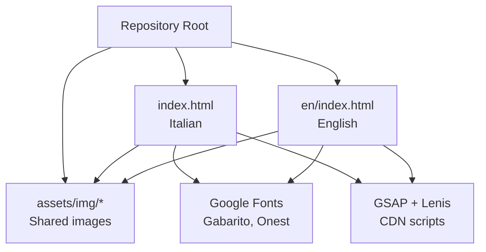
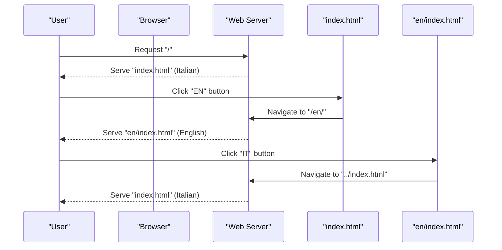
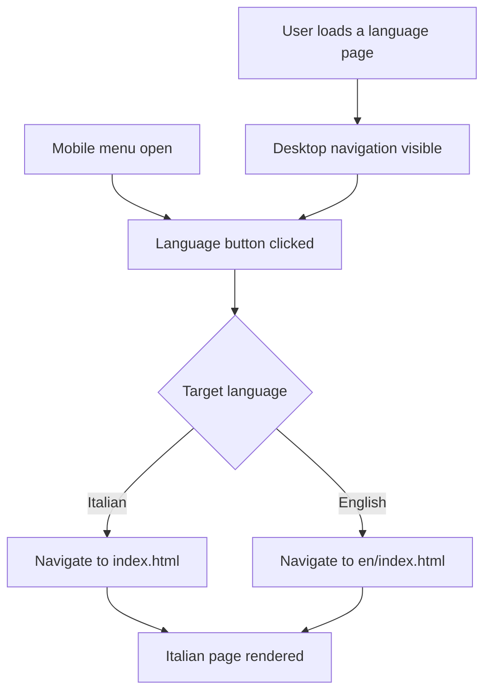
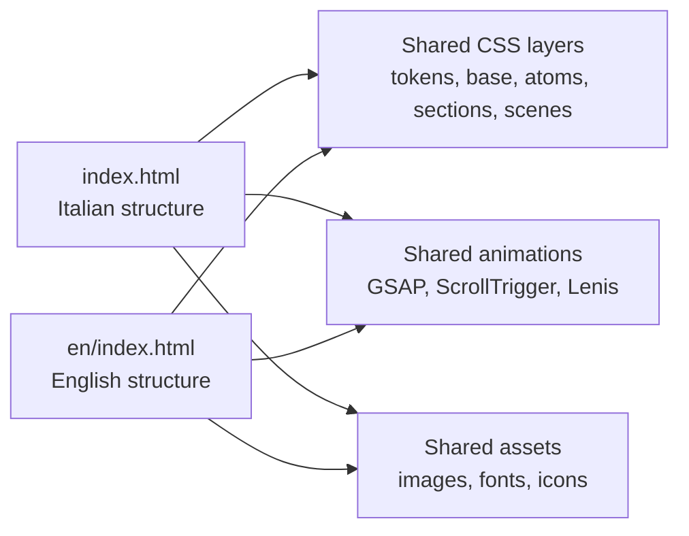
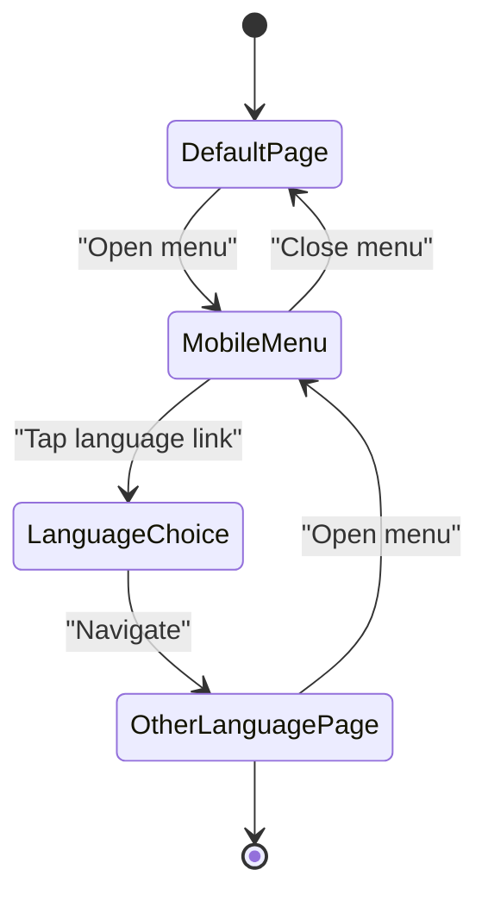
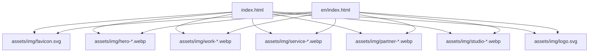

# Internationalization

<cite>
**Referenced Files in This Document**   
- [index.html](file://index.html)
- [en/index.html](file://en/index.html)
- [README.md](file://README.md)
</cite>

## Table of Contents
1. [Introduction](#introduction)
2. [Project Structure](#project-structure)
3. [Core Components](#core-components)
4. [Architecture Overview](#architecture-overview)
5. [Detailed Component Analysis](#detailed-component-analysis)
6. [Dependency Analysis](#dependency-analysis)
7. [Performance Considerations](#performance-considerations)
8. [Troubleshooting Guide](#troubleshooting-guide)
9. [Conclusion](#conclusion)

## Introduction
This document explains the bilingual implementation for the TiTech Digital website, which supports Italian and English through two parallel static pages. The Italian version is served from the repository root, while the English version is served from a dedicated subdirectory. There is no automatic browser-language detection: users switch languages manually by clicking the language buttons in the navigation bar or in the mobile menu.

The two pages share the same layout, animations, CSS layers, section identifiers, and `data-8b-*` attributes. What differs between them is the localized text, page metadata, resource paths, and the direction of the language-switch links.

## Project Structure
The internationalization strategy is file-based rather than runtime-based:

- `/index.html` — Italian default page.
- `/en/index.html` — English localization.
- `/assets/img/` — Shared image assets referenced by both pages.
- External fonts and animation libraries are loaded from CDN URLs and are shared across both versions.

**Diagram sources**
- [index.html:1-30](file://index.html#L1-L30)
- [en/index.html:1-30](file://en/index.html#L1-L30)

**Section sources**
- [README.md:32-41](file://README.md#L32-L41)

## Core Components
The internationalization system relies on three core components:

| Component | Responsibility | Italian Page | English Page |
|---|---|---|---|
| Language declaration | Declares the page language to browsers and assistive technologies | `<html lang="it">` | `<html lang="en">` |
| Metadata layer | Title, description, Open Graph, Twitter card, JSON-LD, theme color | Localized Italian values | Localized English values |
| Navigation language switcher | Manual EN / IT toggle in desktop and mobile menus | Links to `en/index.html` | Links to `../index.html` |

Key differences between the two files include:

- HTML language attribute.
- SEO and social metadata.
- Visible UI text.
- Resource path prefixes (`assets/img` vs `../assets/img`).
- Direction of the language link.

**Section sources**
- [index.html:8-26](file://index.html#L8-L26)
- [en/index.html:8-26](file://en/index.html#L8-L26)
- [README.md:32-41](file://README.md#L32-L41)

## Architecture Overview
The site does not use a backend routing layer or JavaScript-based i18n framework. Instead, it uses two independent HTML documents that mirror each other structurally.

**Diagram sources**
- [index.html:547-570](file://index.html#L547-L570)
- [en/index.html:547-570](file://en/index.html#L547-L570)

There is no client-side logic that reads `navigator.language`, `document.documentElement.lang`, or HTTP `Accept-Language` headers. Language selection is purely manual through anchor elements.

**Section sources**
- [index.html:547-570](file://index.html#L547-L570)
- [en/index.html:547-570](file://en/index.html#L547-L570)
- [README.md:32-41](file://README.md#L32-L41)

## Detailed Component Analysis

### Manual Language Switching Through EN / IT Buttons
Language switching is implemented with standard anchor elements inside the fixed navigation header and the mobile overlay menu.

Desktop behavior:
- The Italian page shows an `EN` link pointing to `en/index.html`.
- The English page shows an `IT` link pointing to `../index.html`.

Mobile behavior:
- When the phone menu opens, the same language choice appears as a full-word link: `English` on the Italian page and `Italiano` on the English page.
- Both links point to the corresponding language page.

Accessibility attributes:
- Each language link includes `hreflang` and `lang` attributes describing the target language.
- Each link has an `aria-label` explaining the action, such as switching to the English or Italian version.

**Diagram sources**
- [index.html:547-570](file://index.html#L547-L570)
- [en/index.html:547-570](file://en/index.html#L547-L570)

**Section sources**
- [index.html:547-570](file://index.html#L547-L570)
- [en/index.html:547-570](file://en/index.html#L547-L570)
- [README.md:32-41](file://README.md#L32-L41)

### Parallel File Structure and Shared Structure
Both pages are single-file templates containing inline CSS and inline content. They share:

- Section IDs such as `hero`, `statement`, `work`, `lavori`, `method`, `studio`, `faq`, `contact`, `footer`.
- CSS cascade layers and component classes.
- Animation-related attributes such as `data-8b-section`, `data-8b-motion`, and scene-style hooks.
- Layout structure, including the fixed navigation, hero stage, horizontal work track, wheel principles, method ring, studio collage, project grid, FAQ details, contact form, and footer.

Because the structure is duplicated rather than dynamically translated, any structural change must be applied to both files to keep the experience consistent.

**Diagram sources**
- [index.html:114-532](file://index.html#L114-L532)
- [en/index.html:114-532](file://en/index.html#L114-L532)

**Section sources**
- [index.html:114-532](file://index.html#L114-L532)
- [en/index.html:114-532](file://en/index.html#L114-L532)
- [README.md:30-31](file://README.md#L30-L31)

### Localized Texts, Metadata, and Resource Paths
The following areas differ between the two pages:

| Area | Italian Page | English Page |
|---|---|---|
| HTML language | `it` | `en` |
| Title and description | Italian copy | English copy |
| Open Graph locale | `it_IT` | `en_US` |
| Social titles and descriptions | Italian | English |
| JSON-LD organization data | Italian fields | English fields |
| Visible headings, paragraphs, labels, and navigation text | Italian | English |
| Image and asset paths | `assets/img/...` | `../assets/img/...` |
| Language link destination | `en/index.html` | `../index.html` |

Resource path differences are important because the English page lives under `/en/`, so relative paths must go up one level to reach the shared `assets` directory.

**Section sources**
- [index.html:8-26](file://index.html#L8-L26)
- [en/index.html:8-26](file://en/index.html#L8-L26)
- [index.html:547-570](file://index.html#L547-L570)
- [en/index.html:547-570](file://en/index.html#L547-L570)

### Mobile Language Switching Behavior
On screens below the desktop breakpoint, the main navigation collapses into a mobile menu. The language switch remains available:

- In the desktop header, the compact `EN` or `IT` button stays visible.
- In the mobile overlay, the full-word `English` or `Italiano` link is provided for clarity.
- Both controls perform the same navigation action; there is no state persistence or URL parameter handling.

**Diagram sources**
- [index.html:547-570](file://index.html#L547-L570)
- [en/index.html:547-570](file://en/index.html#L547-L570)

**Section sources**
- [index.html:547-570](file://index.html#L547-L570)
- [en/index.html:547-570](file://en/index.html#L547-L570)
- [README.md:32-41](file://README.md#L32-L41)

### Absence of Automatic Browser Language Detection
The implementation does not detect the browser’s preferred language. Users must explicitly choose Italian or English. This design avoids unexpected redirects and keeps the site predictable, but it also means that first-time visitors see the default Italian page regardless of their browser settings.

If automatic detection were added later, it would need to:
- Read the browser language preference.
- Redirect only once per session or store a user choice.
- Respect explicit user overrides.
- Preserve deep links and current scroll positions where possible.
- Keep `hreflang` annotations correct for search engines.

At present, none of this logic exists in the repository.

**Section sources**
- [README.md:32-41](file://README.md#L32-L41)

## Dependency Analysis
The two language pages have minimal coupling:

- They do not import each other.
- They share external resources through absolute CDN URLs.
- They share local image assets through relative paths adjusted per page location.
- They share CSS and animation behavior through duplicated inline styles and scripts.

**Diagram sources**
- [index.html:26-27](file://index.html#L26-L27)
- [en/index.html:26-27](file://en/index.html#L26-L27)

**Section sources**
- [index.html:26-27](file://index.html#L26-L27)
- [en/index.html:26-27](file://en/index.html#L26-L27)

## Performance Considerations
- Each language page is a complete standalone HTML document, so switching languages triggers a full page load rather than a lightweight DOM update.
- Images are optimized WebP files and use responsive `srcset` and `sizes` attributes.
- Fonts are preloaded and use modern font-display strategies.
- Animations respect `prefers-reduced-motion`, keeping the page functional without motion.
- Because the English page references shared assets through relative paths, ensure the deployment server serves `/assets/img/` correctly when accessing `/en/index.html`.

[No sources needed since this section provides general guidance]

## Troubleshooting Guide

### Language Button Does Not Change Pages
Check the following:
- Verify that the Italian page contains a link to `en/index.html`.
- Verify that the English page contains a link to `../index.html`.
- Confirm that both files are deployed at the expected locations.
- Ensure the server does not rewrite `/en/` requests incorrectly.

**Section sources**
- [index.html:547-570](file://index.html#L547-L570)
- [en/index.html:547-570](file://en/index.html#L547-L570)

### Images Are Missing on the English Page
The English page uses relative paths starting with `../assets/img/`. If images appear broken only on the English page:
- Check that the deployment root exposes `/assets/img/`.
- Confirm that `/en/index.html` is served from `/en/`, not from the repository root.
- Avoid changing the relative prefix unless both pages are updated consistently.

**Section sources**
- [en/index.html:26-27](file://en/index.html#L26-L27)

### Content Is Out of Sync Between Languages
When updating either page:
- Update the matching section in the other language.
- Keep section IDs, `data-8b-*` attributes, and animation hooks identical.
- Update metadata, social previews, and JSON-LD together.
- Review visible text, labels, and accessibility attributes.

**Section sources**
- [README.md:65-76](file://README.md#L65-L76)

### Mobile Menu Language Link Points to the Wrong Page
Verify that:
- The Italian mobile menu links to `en/index.html`.
- The English mobile menu links to `../index.html`.
- The `hreflang` and `lang` attributes match the target page.

**Section sources**
- [index.html:560-570](file://index.html#L560-L570)
- [en/index.html:560-570](file://en/index.html#L560-L570)

## Conclusion
The TiTech Digital website implements internationalization through two parallel static pages rather than runtime translation. Italian is the default, and English is available under `/en/`. Users switch languages manually through the navigation bar and mobile menu. Both pages share the same visual structure, animations, and markup conventions, while differing in localized text, metadata, and resource paths. Maintaining consistency requires updating both files whenever content changes, especially visible text, metadata, and cross-page links.