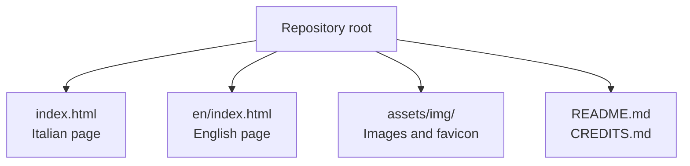
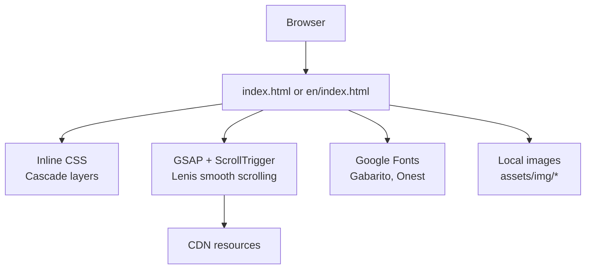
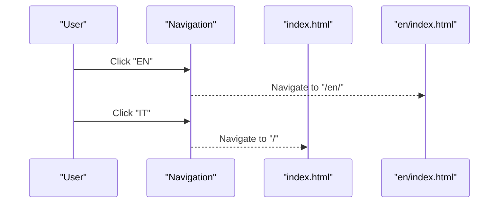
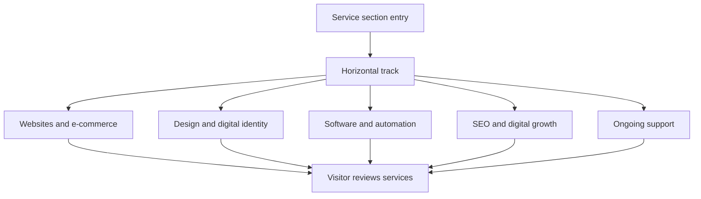
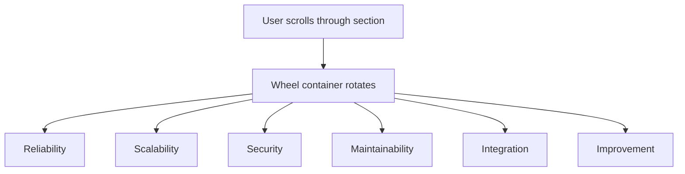
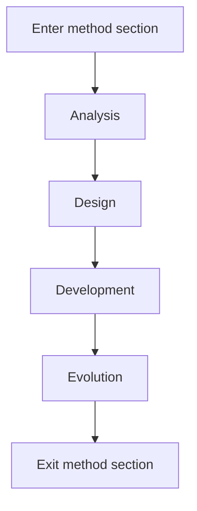
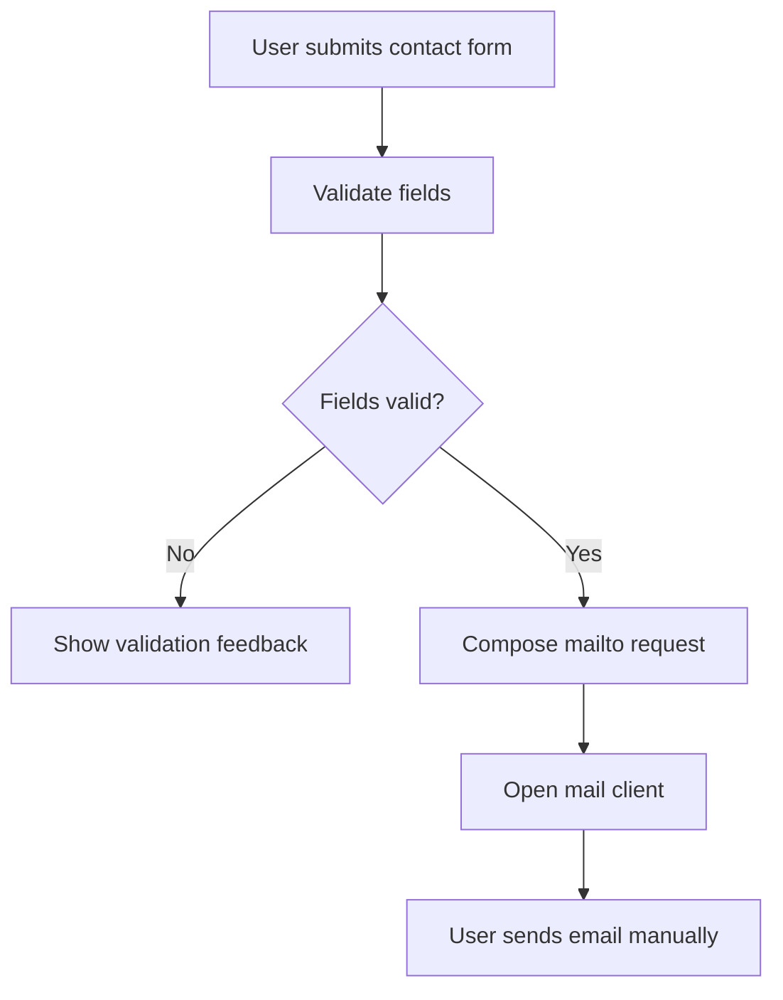
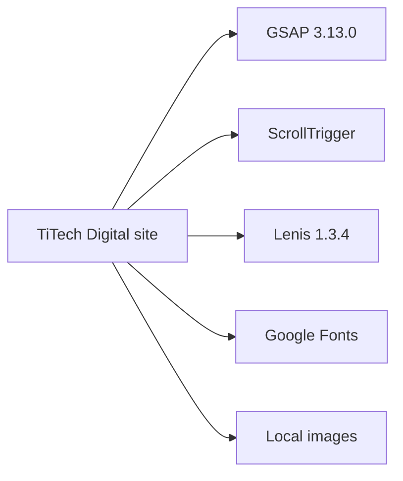

# Project Overview

<cite>
**Referenced Files in This Document**   
- [README.md](file://README.md)
- [CREDITS.md](file://CREDITS.md)
- [index.html](file://index.html)
- [en/index.html](file://en/index.html)
</cite>

## Table of Contents
1. [Introduction](#introduction)
2. [Project Structure](#project-structure)
3. [Core Components](#core-components)
4. [Architecture Overview](#architecture-overview)
5. [Detailed Component Analysis](#detailed-component-analysis)
6. [Dependency Analysis](#dependency-analysis)
7. [Performance Considerations](#performance-considerations)
8. [Troubleshooting Guide](#troubleshooting-guide)
9. [Conclusion](#conclusion)

## Introduction
This project is a one-page website template for **TiTech Digital**, positioned as a technology partner for businesses. It presents the company’s positioning, five core service areas, method, studio overview, selected projects, frequently asked questions, and contact information. The site is available in Italian and English and is built as a vanilla HTML/CSS/JavaScript static site based on the 8B design studio template.

The template preserves the original layout, visual system, typography, and animations while rewriting the content to reflect TiTech Digital’s services and approach. The default language is Italian; the English version lives under `/en/`.

**Section sources**
- [README.md:1-15](file://README.md#L1-L15)
- [README.md:32-41](file://README.md#L32-L41)

## Project Structure
The repository contains two main entry points:
- `index.html` — Italian version
- `en/index.html` — English version

Both pages share the same structure, animation attributes, and CSS layers. They differ only in text, metadata, and resource paths. Images and assets are stored under `assets/img/`.

**Diagram sources**
- [index.html:1-10](file://index.html#L1-L10)
- [en/index.html:1-10](file://en/index.html#L1-L10)
- [README.md:32-41](file://README.md#L32-L41)

**Section sources**
- [README.md:32-53](file://README.md#L32-L53)
- [index.html:1-10](file://index.html#L1-L10)
- [en/index.html:1-10](file://en/index.html#L1-L10)

## Core Components
The page is organized into clearly separated sections that guide the visitor through TiTech Digital’s value proposition and offerings.

| Section | Purpose | Key Elements |
|---|---|---|
| Navigation | Fixed top bar with brand, section links, language switcher, and call-to-action | Brand link, desktop links, mobile menu, `EN` / `IT` switch |
| Hero | First screen introducing TiTech Digital with an animated circular image | Lead paragraph, anchor link, rotating aperture image |
| Statement | Two-line positioning statement plus page index | Title, lead paragraph, internal navigation list |
| Work | Five service cards on a horizontal track | Web and e-commerce, Design and identity, Software and automation, SEO and growth, Ongoing support |
| Principles Wheel | Six principles displayed on a scroll-driven wheel | Quality, Scalability, Security, Maintainability, Integration, Improvement |
| Method | Four-phase process beside an animated ring | Analysis, Design, Development, Evolution |
| Studio | Team and integrated skills with photo collage | Roles and capabilities grid |
| Selected Projects | Portfolio grid with demo cases | Project cards, tags, years, notes |
| FAQ | Expandable questions using `
` | Six common questions |
| Contact | Form and direct contact information | Name, email, company, interest area, message, mailto flow |
| Footer | Closing word, columns, legal notice, credits | Greeting, links, email, legal data, template credit |

The five core service areas are explicitly presented in the `work` section:
1. Websites and e-commerce
2. Design and digital identity
3. Software and automation
4. SEO and digital growth
5. Continuous support

These match the README’s documented positioning and the page markup.

**Section sources**
- [README.md:5-15](file://README.md#L5-L15)
- [README.md:17-30](file://README.md#L17-L30)
- [index.html:547-571](file://index.html#L547-L571)
- [index.html:574-580](file://index.html#L574-L580)
- [index.html:583-597](file://index.html#L583-L597)
- [index.html:600-637](file://index.html#L600-L637)
- [index.html:640-675](file://index.html#L640-L675)
- [index.html:680-701](file://index.html#L680-L701)
- [index.html:704-725](file://index.html#L704-L725)
- [index.html:728-800](file://index.html#L728-L800)

## Architecture Overview
The site is a static, single-file-per-language template. There is no build step. Each page includes inline CSS organized with cascade layers and inline JavaScript dependencies loaded from external CDNs. Animations are driven by GSAP and ScrollTrigger, smooth scrolling is provided by Lenis, and fonts are loaded from Google Fonts.

**Diagram sources**
- [README.md:78-85](file://README.md#L78-L85)
- [index.html:28-30](file://index.html#L28-L30)
- [index.html:114-116](file://index.html#L114-L116)

**Section sources**
- [README.md:53-54](file://README.md#L53-L54)
- [README.md:78-85](file://README.md#L78-L85)
- [index.html:114-116](file://index.html#L114-L116)

## Detailed Component Analysis

### Language Switching and Page Layout
The Italian page is served at the root path, while the English page is served under `/en/`. Both pages include a language button in the navigation. On desktop, the buttons are labeled `EN` and `IT`; on mobile, the overlay menu shows `English` and `Italiano`. There is no automatic browser-language detection; switching is manual.

**Diagram sources**
- [index.html:547-571](file://index.html#L547-L571)
- [en/index.html:547-571](file://en/index.html#L547-L571)
- [README.md:32-41](file://README.md#L32-L41)

**Section sources**
- [README.md:32-41](file://README.md#L32-L41)
- [index.html:547-571](file://index.html#L547-L571)
- [en/index.html:547-571](file://en/index.html#L547-L571)

### Service Areas Presentation
The `work` section displays five service cards in a horizontally scrollable track. Each card includes an image, badge, title, description, and tag list. The five areas align with the README documentation and the page markup.

**Diagram sources**
- [index.html:298-336](file://index.html#L298-L336)
- [index.html:600-637](file://index.html#L600-L637)

**Section sources**
- [README.md:5-15](file://README.md#L5-L15)
- [index.html:600-637](file://index.html#L600-L637)

### Principles Wheel
The principles section uses a scroll-driven wheel animation. Six principle cards rotate around a center point as the user scrolls. The principles emphasize reliability, scalability, security, maintainability, integration, and improvement.

**Diagram sources**
- [index.html:337-368](file://index.html#L337-L368)
- [index.html:640-675](file://index.html#L640-L675)

**Section sources**
- [index.html:640-675](file://index.html#L640-L675)

### Method Ring Animation
The method section pairs four steps with an animated ring. As the user scrolls, the ring highlights each phase: analysis, design, development, and evolution.

**Diagram sources**
- [index.html:369-405](file://index.html#L369-L405)
- [index.html:680-701](file://index.html#L680-L701)

**Section sources**
- [index.html:680-701](file://index.html#L680-L701)

### Contact Form Flow
The contact form does not use a backend. On submit, it validates name, email, and description, composes a request including name, email, company, interest area, and message, and opens the user’s mail client via `mailto:` addressed to a placeholder email. Before publication, the placeholder must be replaced with the real address or swapped for a form service.

**Diagram sources**
- [README.md:55-63](file://README.md#L55-L63)
- [index.html:484-503](file://index.html#L484-L503)

**Section sources**
- [README.md:55-63](file://README.md#L55-L63)
- [index.html:484-503](file://index.html#L484-L503)

### Target Audience and Positioning
The positioning describes TiTech Digital as a serious, concrete technology partner focused on technical competence, motivated choices, quality, and post-launch continuity. The office is in Italy, with an international horizon and particular attention to the Albanian market. Structured data also declares the served areas as Italy and Albania.

**Section sources**
- [README.md:15-15](file://README.md#L15-L15)
- [index.html:533-542](file://index.html#L533-L542)
- [en/index.html:533-542](file://en/index.html#L533-L542)

## Dependency Analysis
The project has minimal runtime dependencies:
- GSAP 3.13.0 and ScrollTrigger for animations
- Lenis 1.3.4 for smooth scrolling
- Google Fonts for Gabarito and Onest
- Local WebP images under `assets/img/`
- No build toolchain

**Diagram sources**
- [README.md:78-85](file://README.md#L78-L85)
- [CREDITS.md:38-50](file://CREDITS.md#L38-L50)

**Section sources**
- [README.md:78-85](file://README.md#L78-L85)
- [CREDITS.md:38-50](file://CREDITS.md#L38-L50)

## Performance Considerations
- The site is a static HTML file per language with inline CSS and no build step.
- Images are optimized WebP files served locally.
- Fonts are preloaded and preconnected where appropriate.
- Animations respect `prefers-reduced-motion`, keeping the page functional and static when motion is disabled.
- Smooth scrolling is handled by Lenis, which integrates with the page’s scroll behavior.

Recommended operational practices:
- Keep the template’s `data-8b-*` attributes intact because they drive animations.
- Replace demo project entries with real case studies before publishing.
- Update the placeholder contact email or integrate a backend form service.
- Verify social preview metadata once final images and descriptions are available.

**Section sources**
- [README.md:53-54](file://README.md#L53-L54)
- [README.md:65-76](file://README.md#L65-L76)
- [README.md:78-85](file://README.md#L78-L85)

## Troubleshooting Guide
Common issues and resolutions:

| Issue | Cause | Resolution |
|---|---|---|
| Animations do not run | Missing or altered `data-8b-*` attributes or removed template comments | Restore required attributes, IDs, decorative dots, template comment, and generator meta tag |
| Contact form does not send emails | Placeholder email still configured | Replace `info@titechdigital.it` with the real address or connect a form service |
| Images appear broken | Incorrect relative paths in the English page | Ensure English page references use `../assets/img/` |
| Social previews show wrong media | Placeholder OG image or missing final assets | Update `og:image`, `og:title`, and `og:description` with final values |
| Reduced-motion experience feels incomplete | Custom styles override accessibility preferences | Respect `prefers-reduced-motion` and avoid forcing heavy animations |

**Section sources**
- [README.md:55-76](file://README.md#L55-L76)
- [index.html:533-542](file://index.html#L533-L542)

## Conclusion
The TiTech Digital website is a clean, template-based one-page site that communicates a clear positioning: a technology partner for businesses offering web and e-commerce, digital design and identity, software and automation, SEO and growth, and continuous support. It maintains the original 8B template layout, visual system, typography, and animations while presenting tailored content for the Italian market with an international horizon, especially Albania. The stack is intentionally lightweight: vanilla HTML/CSS/JavaScript, GSAP, Lenis, and Google Fonts, with modern browser requirements and strong accessibility considerations through reduced-motion support.

[No sources needed since this section summarizes without analyzing specific files]