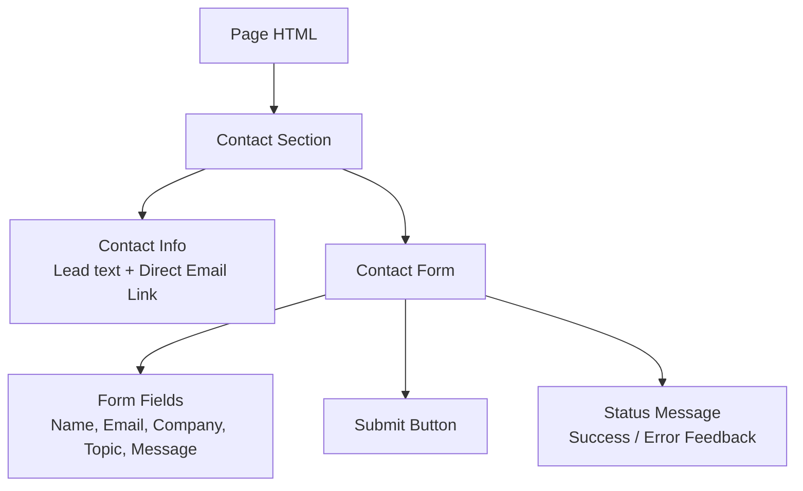
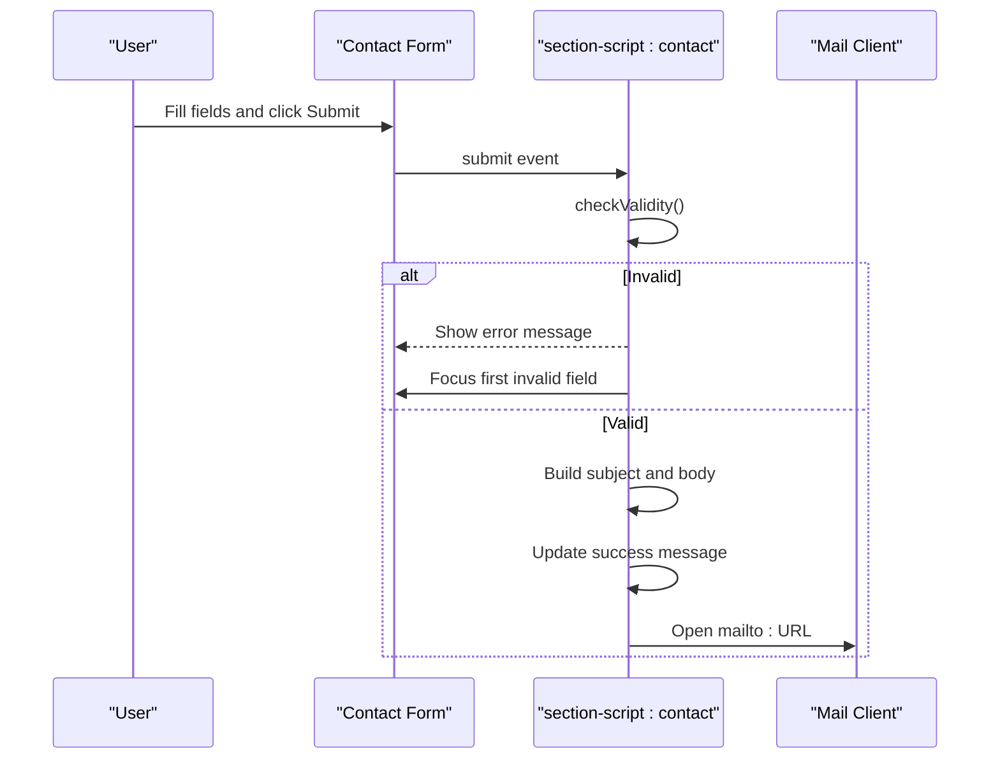
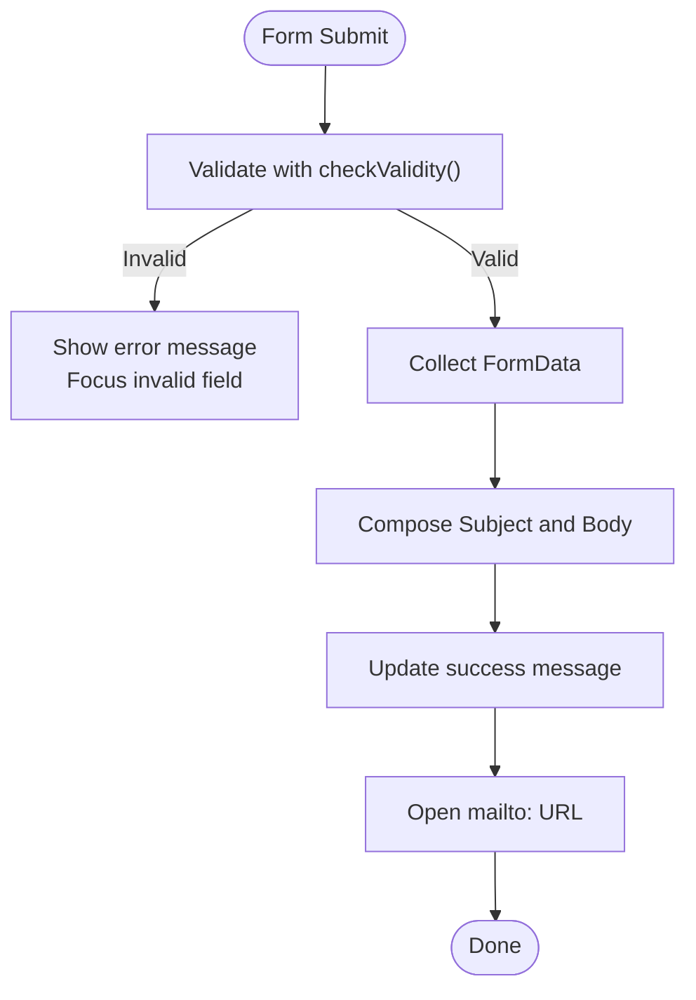
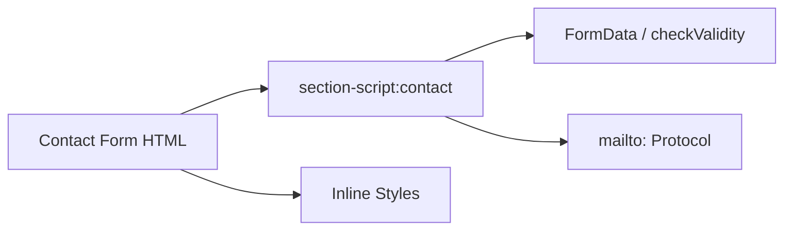

# Contact Form

<cite>
**Referenced Files in This Document**
- [index.html](file://index.html)
- [en/index.html](file://en/index.html)
- [README.md](file://README.md)
</cite>

## Table of Contents
1. [Introduction](#introduction)
2. [Project Structure](#project-structure)
3. [Core Components](#core-components)
4. [Architecture Overview](#architecture-overview)
5. [Detailed Component Analysis](#detailed-component-analysis)
6. [Dependency Analysis](#dependency-analysis)
7. [Performance Considerations](#performance-considerations)
8. [Troubleshooting Guide](#troubleshooting-guide)
9. [Conclusion](#conclusion)
10. [Appendices](#appendices)

## Introduction
This document explains the contact form implementation used by the TiTech Digital website. It covers the form fields, validation rules, user feedback, and mailto integration. It also provides guidance for customizing fields, modifying validation, integrating with backend services, and improving accessibility and user experience.

The site ships two language versions:
- Italian page at `index.html`
- English page at `en/index.html`

Both pages implement the same contact form behavior, with localized labels and messages.

**Section sources**
- [README.md:32-41](file://README.md#L32-L41)

## Project Structure
The contact form is part of a single-page layout that includes navigation, sections, animations, and inline scripts. The contact section contains:
- A short introduction and direct email link
- A form with six fields
- A submit button
- A status message area for user feedback

[No sources needed since this diagram shows conceptual structure]

**Section sources**
- [index.html:873-901](file://index.html#L873-L901)
- [en/index.html:873-901](file://en/index.html#L873-L901)

## Core Components
The contact form has five input fields plus one select field:
- Name: required text input
- Email: required email input
- Company: optional text input
- Topic: required select dropdown
- Message: required textarea

Validation uses native browser validation through `required`, `type="email"`, and `novalidate` on the form to allow custom handling. On submission:
- If invalid, the status message displays an error and focus moves to the first invalid field.
- If valid, the script builds a subject and body from the form data and opens the user’s default mail client via `mailto:`.

The recipient address is set to a placeholder email and should be updated before publishing.

**Section sources**
- [index.html:885-899](file://index.html#L885-L899)
- [en/index.html:885-899](file://en/index.html#L885-L899)
- [index.html:1254-1281](file://index.html#L1254-L1281)
- [en/index.html:1254-1281](file://en/index.html#L1254-L1281)
- [README.md:55-63](file://README.md#L55-L63)

## Architecture Overview
The contact form follows a simple client-side flow:

**Diagram sources**
- [index.html:1254-1281](file://index.html#L1254-L1281)
- [en/index.html:1254-1281](file://en/index.html#L1254-L1281)

## Detailed Component Analysis

### Form Fields and Labels
- Name: text input with autocomplete `name` and required attribute
- Email: email input with autocomplete `email` and required attribute
- Company: text input with autocomplete `organization`; optional
- Topic: select dropdown; required when submitted (the script treats empty selection as “Not specified” or its localized equivalent)
- Message: textarea; required

Labels are placed directly next to inputs using semantic `<label>` elements. The form uses CSS classes for consistent styling and responsive layout.

**Section sources**
- [index.html:885-899](file://index.html#L885-L899)
- [en/index.html:885-899](file://en/index.html#L885-L899)

### Validation Rules
- Required fields: name, email, topic, message
- Email format validated by the browser due to `type="email"`
- Custom validation is handled by JavaScript:
  - Prevents default form submission
  - Uses `form.checkValidity()`
  - Displays localized error message stored in `data-error`
  - Focuses the first invalid element

Note: Although the topic select allows an empty value, the script substitutes a default label (“Non specificato” in Italian, “Not specified” in English). To enforce a real selection, add a `required` attribute to the select element.

**Section sources**
- [index.html:1259-1265](file://index.html#L1259-L1265)
- [en/index.html:1259-1265](file://en/index.html#L1259-L1265)

### Mailto Integration
On successful validation:
- The script collects values using `FormData`.
- It constructs a subject line including the selected topic.
- It composes a multi-line body with name, email, company, area, and message.
- It updates the status message to a success hint.
- It redirects the window to a `mailto:` URL with encoded subject and body.

The recipient address is a placeholder and must be replaced with the real email before publishing.

**Diagram sources**
- [index.html:1266-1280](file://index.html#L1266-L1280)
- [en/index.html:1266-1280](file://en/index.html#L1266-L1280)

**Section sources**
- [index.html:1266-1280](file://index.html#L1266-L1280)
- [en/index.html:1266-1280](file://en/index.html#L1266-L1280)
- [README.md:55-63](file://README.md#L55-L63)

### User Feedback Mechanisms
- Success message: displayed after validation and before opening the mail client. It informs users that their email app will open with the request pre-filled.
- Error message: displayed when validation fails, instructing users to fill required fields correctly.
- Accessibility: the status element uses `role="status"` and `aria-live="polite"` so screen readers announce changes.

These messages are localized per language version.

**Section sources**
- [index.html:895-898](file://index.html#L895-L898)
- [en/index.html:895-898](file://en/index.html#L895-L898)
- [index.html:1278-1279](file://index.html#L1278-L1279)
- [en/index.html:1278-1279](file://en/index.html#L1278-L1279)

### Accessibility Features
- Semantic labels associate each input with a visible label.
- Autocomplete attributes improve usability for name, email, and organization.
- Focus management directs attention to the first invalid field on error.
- Live region announces status updates to assistive technologies.
- Keyboard navigation works with standard form controls.

**Section sources**
- [index.html:885-899](file://index.html#L885-L899)
- [en/index.html:885-899](file://en/index.html#L885-L899)
- [index.html:1261-1264](file://index.html#L1261-L1264)
- [en/index.html:1261-1264](file://en/index.html#L1261-L1264)

## Dependency Analysis
The contact form depends on:
- Native HTML form APIs (`FormData`, `checkValidity`)
- Browser mail client via `mailto:`
- Inline JavaScript in `section-script:contact`
- CSS classes for layout and styling

There is no server-side dependency for the current implementation.

**Diagram sources**
- [index.html:885-899](file://index.html#L885-L899)
- [index.html:1254-1281](file://index.html#L1254-L1281)

**Section sources**
- [index.html:1254-1281](file://index.html#L1254-L1281)
- [en/index.html:1254-1281](file://en/index.html#L1254-L1281)

## Performance Considerations
- The form logic is lightweight and runs only on submit.
- No network requests are made until the mail client opens.
- Avoid heavy validation libraries unless necessary; native validation is sufficient here.
- Keep the mailto recipient configurable and centralized to avoid repeated string operations.

[No sources needed since this section provides general guidance]

## Troubleshooting Guide
Common issues and resolutions:
- Mail client does not open:
  - Some environments block `window.location.href` redirections. Ensure the redirect is allowed and test on multiple devices.
  - Provide a fallback link to the direct email address near the form.
- Placeholder email still active:
  - Replace `info@titechdigital.it` with the real address in both pages and in any footer links.
- Topic not enforced:
  - Add `required` to the topic select if you want to prevent empty selections.
- Validation messages not clear:
  - Update `data-error` and `data-success` attributes to match your localization and UX needs.

**Section sources**
- [README.md:55-63](file://README.md#L55-L63)
- [index.html:881-882](file://index.html#L881-L882)
- [en/index.html:881-882](file://en/index.html#L881-L882)

## Conclusion
The contact form is a simple, accessible, client-side solution that validates inputs and opens the user’s mail client with a pre-filled message. It is easy to customize fields, adjust validation, and replace the mailto integration with a backend service. Before publishing, update the placeholder email address and consider adding stricter validation and richer feedback for a better user experience.

[No sources needed since this section summarizes without analyzing specific files]

## Appendices

### Field Reference
- Name: required text input
- Email: required email input
- Company: optional text input
- Topic: required select dropdown
- Message: required textarea

**Section sources**
- [index.html:885-899](file://index.html#L885-L899)
- [en/index.html:885-899](file://en/index.html#L885-L899)

### Customization Guidance
- Customize fields:
  - Add, remove, or rename inputs in the form markup.
  - Update labels and options accordingly.
- Modify validation:
  - Use HTML attributes like `required`, `minlength`, `maxlength`, and `pattern`.
  - Extend the submit handler to add custom checks and display targeted errors.
- Integrate with backend services:
  - Replace the mailto redirect with a fetch call to your endpoint.
  - Handle success and error responses and update the status message accordingly.
- Improve user experience:
  - Provide inline validation hints.
  - Add loading states while processing submissions.
  - Enhance accessibility with descriptive aria attributes and keyboard support.

**Section sources**
- [README.md:55-63](file://README.md#L55-L63)
- [index.html:1254-1281](file://index.html#L1254-L1281)
- [en/index.html:1254-1281](file://en/index.html#L1254-L1281)