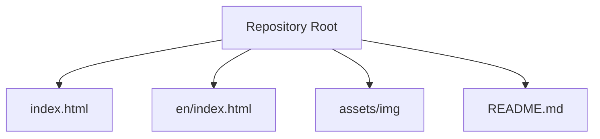
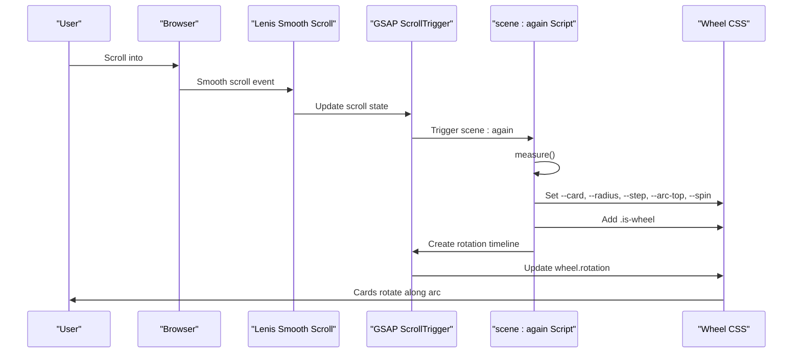
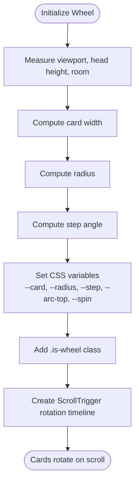
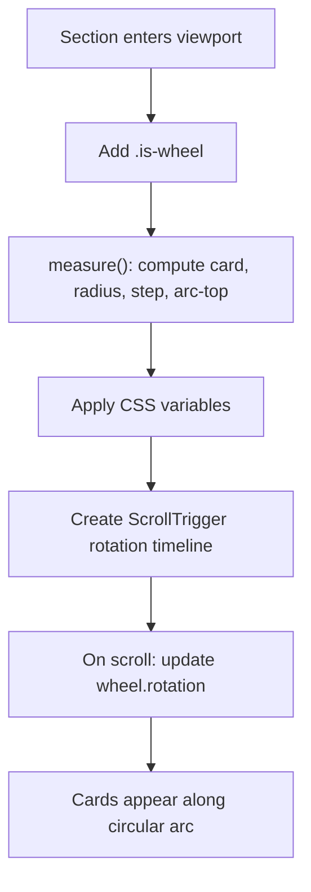
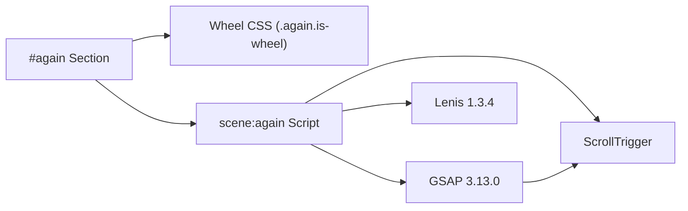

# Design Principles Wheel

<cite>
**Referenced Files in This Document**
- [index.html](file://index.html)
- [README.md](file://README.md)
</cite>

## Table of Contents
1. [Introduction](#introduction)
2. [Project Structure](#project-structure)
3. [Core Components](#core-components)
4. [Architecture Overview](#architecture-overview)
5. [Detailed Component Analysis](#detailed-component-analysis)
6. [Dependency Analysis](#dependency-analysis)
7. [Performance Considerations](#performance-considerations)
8. [Troubleshooting Guide](#troubleshooting-guide)
9. [Conclusion](#conclusion)
10. [Appendices](#appendices)

## Introduction
This document explains the six-card wheel layout that represents TiTech Digital’s design principles. It covers how the cards are arranged in a circular arc, how CSS positions them, how JavaScript rotates and sizes the wheel based on scroll and viewport size, and how accessibility and responsive behavior are handled. It also provides guidance for customizing the principle content, adjusting appearance, and maintaining the interactive experience across devices.

The wheel is part of a single-page website built from a template. The page uses inline CSS and JavaScript, GSAP with ScrollTrigger for animations, and Lenis for smooth scrolling. The wheel section is labeled “again” and contains six partner-style cards representing principles such as reliability, scalability, security, maintainability, integration, and improvement.

**Section sources**
- [README.md:17-30](file://README.md#L17-L30)
- [index.html:671-707](file://index.html#L671-L707)

## Project Structure
The repository is minimal:
- `index.html` contains the Italian version of the site, including all HTML markup, CSS layers, and JavaScript.
- `en/index.html` holds the English version (referenced by navigation).
- `assets/img` holds images used by the site.
- `README.md` describes the project structure, languages, preview instructions, customization notes, and technologies.

**Diagram sources**
- [README.md:17-30](file://README.md#L17-L30)
- [index.html:1-15](file://index.html#L1-L15)

**Section sources**
- [README.md:17-30](file://README.md#L17-L30)
- [index.html:1-15](file://index.html#L1-L15)

## Core Components
The wheel component consists of three main parts:
- Section container: `#again` with class `again__stage`.
- Swing container: `.again__swing`, which holds the rotating wheel.
- Wheel list: `.again__wheel`, containing six `<li class="partner">` cards.

Each card includes:
- A background image via `.partner__img`.
- An overlay gradient created by the parent card pseudo-element.
- Textual content under `.partner__text`:
  - A badge with the principle number and theme.
  - A heading with the principle name.
  - A short description paragraph.

The wheel is activated when the section receives the `is-wheel` class, which switches to a scene-specific style block. In this mode, the wheel becomes an absolutely positioned, zero-sized container at the top-left of the stage, and each card is rotated around the center using a CSS variable `--i` multiplied by a computed step angle `--step`.

Key CSS variables exposed by the wheel:
- `--card`: card width.
- `--radius`: radius of the circular path.
- `--step`: angular step between adjacent cards.
- `--arc-top`: vertical position where the swing begins.
- `--spin`: total scroll distance used to rotate the wheel.

These variables are set dynamically by JavaScript during initialization and on resize/refresh events.

**Section sources**
- [index.html:357-368](file://index.html#L357-L368)
- [index.html:671-707](file://index.html#L671-L707)

## Architecture Overview
The wheel interaction follows a scroll-driven architecture:
- The page initializes GSAP ScrollTrigger and Lenis.
- When the wheel section enters the animation queue, it adds the `is-wheel` class.
- JavaScript measures the viewport and head height to compute card size, radius, step angle, and arc position.
- A ScrollTrigger timeline rotates the wheel from a small initial rotation to a final rotation proportional to the number of cards.
- Cards are positioned using CSS transforms driven by per-card `--i` and global `--step`.

**Diagram sources**
- [index.html:1030-1056](file://index.html#L1030-L1056)
- [index.html:1188-1232](file://index.html#L1188-L1232)
- [index.html:357-368](file://index.html#L357-L368)

## Detailed Component Analysis

### Circular Arrangement and Positioning Logic
The wheel uses a geometric approach:
- Card width is constrained by viewport width and available vertical space below the section header.
- Radius is calculated to ensure the arc fits comfortably within the viewport while keeping cards readable.
- Step angle is derived from the chord length formed by adjacent cards and the radius.
- Each card is rotated by `var(--i) * var(--step)` so that the first card starts near the top of the arc and subsequent cards fan out clockwise.

**Diagram sources**
- [index.html:1199-1218](file://index.html#L1199-L1218)

**Section sources**
- [index.html:1199-1218](file://index.html#L1199-L1218)

### CSS Techniques for the Wheel Layout
- The wheel container is turned into a positioning context with absolute placement and zero dimensions.
- Cards are absolutely positioned at the center of the wheel and rotated around their own center.
- The `rotate` transform uses `calc(var(--i) * var(--step))` to distribute cards evenly.
- The swing container is placed at the computed `--arc-top` so the arc appears below the section header.
- Responsive breakpoints adjust grid layouts before the wheel activates; once active, JS computes sizes for all screen sizes.

Important selectors and classes:
- `.again.is-wheel`: activates wheel scene styles.
- `.again__swing`: positions the arc origin.
- `.again__wheel`: rotates as a whole.
- `.partner`: rotates per card index.
- `.partner__card`: positions the visible card rectangle.

**Section sources**
- [index.html:357-368](file://index.html#L357-L368)
- [index.html:671-707](file://index.html#L671-L707)

### JavaScript Interactions for Rotation and Selection
Rotation:
- The script adds the `is-wheel` class to the section.
- It sets per-card `--i` values.
- It computes geometry through `measure()` and updates CSS variables.
- It creates a ScrollTrigger timeline that rotates the wheel from a lead angle to a rest angle based on viewport width.

Selection:
- There is no explicit click-to-select behavior in the wheel. Interaction is scroll-driven.
- Users can visually inspect each principle by scrolling; the closest card to the top of the arc is effectively the “selected” one.

Accessibility:
- The wheel relies on visual rotation; keyboard users cannot directly select a card.
- Screen readers will read the semantic headings and descriptions inside each card.
- Focus management is not applied to individual cards.

**Diagram sources**
- [index.html:1188-1232](file://index.html#L1188-L1232)

**Section sources**
- [index.html:1188-1232](file://index.html#L1188-L1232)

### Accessibility Considerations
- Semantic structure: each principle has a numbered badge, a heading, and a descriptive paragraph.
- Skip link and focus styles are present globally.
- Reduced motion: animations are wrapped in `prefers-reduced-motion: no-preference`; when disabled, the wheel still renders but without animated rotation.
- Keyboard navigation: the wheel does not provide tab stops or selection controls; users rely on scrolling.
- ARIA roles: the section uses standard heading hierarchy; there is no special role for the wheel itself.

Recommendations:
- Consider adding `role="list"` and `role="listitem"` if assistive technology needs clearer semantics.
- Provide keyboard-accessible controls to jump to specific principles if interactivity expands.
- Ensure contrast ratios for text overlays remain sufficient against varied images.

**Section sources**
- [index.html:152-163](file://index.html#L152-L163)
- [index.html:357-368](file://index.html#L357-L368)
- [index.html:1188-1232](file://index.html#L1188-L1232)

### Customization Guidance

#### Customizing Principle Content
To change the six principles:
- Locate the six `<li class="partner">` elements inside `.again__wheel`.
- Update:
  - Badge text (number and theme).
  - Heading text (principle name).
  - Paragraph text (description).
  - Image source and alt text.
- Keep the order consistent with the intended narrative flow.

Example locations:
- Principle 1: lines around 680–683.
- Principle 2: lines around 684–687.
- Principle 3: lines around 688–691.
- Principle 4: lines around 692–695.
- Principle 5: lines around 696–699.
- Principle 6: lines around 700–703.

**Section sources**
- [index.html:679-703](file://index.html#L679-L703)

#### Adjusting Wheel Appearance
- Change card size: modify the computed card width logic in the `measure()` function.
- Change spacing: adjust the step angle calculation or add horizontal padding between cards.
- Change colors: use CSS variables defined in the tokens layer.
- Change typography: update font families and sizes in the base and atoms layers.
- Change image aspect ratio: adjust the card’s aspect-ratio or override `.partner__card` sizing.

Relevant areas:
- Tokens and base styles: lines around 117–163.
- Wheel scene styles: lines around 357–368.
- Measurement and rotation logic: lines around 1199–1218.

**Section sources**
- [index.html:117-163](file://index.html#L117-L163)
- [index.html:357-368](file://index.html#L357-L368)
- [index.html:1199-1218](file://index.html#L1199-L1218)

#### Maintaining Interactive Experience Across Screen Sizes
- The wheel calculates card width based on viewport width thresholds (`innerWidth < 700`).
- It recalculates geometry on refresh events triggered by ScrollTrigger.
- For very narrow screens, the lead and rest rotations differ to keep the top card visible.
- Images use responsive `srcset` and `sizes` attributes.

Best practices:
- Test on mobile portrait and landscape orientations.
- Verify that the arc remains below the section header on small screens.
- Ensure images load efficiently and do not cause layout shifts.
- Respect `prefers-reduced-motion` for users who prefer static content.

**Section sources**
- [index.html:1199-1218](file://index.html#L1199-L1218)
- [index.html:679-703](file://index.html#L679-L703)

## Dependency Analysis
The wheel depends on:
- GSAP and ScrollTrigger for scroll-driven animation.
- Lenis for smooth scrolling.
- CSS cascade layers for structured styling.
- IntersectionObserver indirectly through the motion queue and other scenes.

**Diagram sources**
- [index.html:939-941](file://index.html#L939-L941)
- [index.html:1030-1056](file://index.html#L1030-L1056)
- [index.html:1188-1232](file://index.html#L1188-L1232)

**Section sources**
- [index.html:939-941](file://index.html#L939-L941)
- [index.html:1030-1056](file://index.html#L1030-L1056)
- [index.html:1188-1232](file://index.html#L1188-L1232)

## Performance Considerations
- The wheel uses CSS transforms (`rotate`) for smooth performance.
- Images are pre-warmed using `decode()` for pinned sections, including `#again`.
- Animations are guarded by `prefers-reduced-motion`.
- ScrollTrigger timelines are scrub-based, tied to scroll progress rather than frame rate.

Optimization tips:
- Keep images optimized (WebP already used).
- Avoid heavy DOM mutations inside scroll handlers.
- Use `will-change` sparingly; the template already applies it where needed.
- Monitor memory usage if adding more complex interactions.

**Section sources**
- [index.html:1047-1055](file://index.html#L1047-L1055)
- [index.html:1188-1232](file://index.html#L1188-L1232)

## Troubleshooting Guide
Common issues and resolutions:
- Wheel does not rotate:
  - Check that `.is-wheel` is added to the section.
  - Verify ScrollTrigger is initialized and not blocked by reduced motion settings.
  - Confirm CSS variables `--card`, `--radius`, `--step`, `--arc-top`, `--spin` are set.
- Cards overlap or misalign:
  - Inspect `measure()` calculations for card width and radius.
  - Ensure viewport width thresholds match your content density.
- Images appear too large or too small:
  - Adjust the card width computation or override `.partner__card` sizing.
- Accessibility concerns:
  - Add keyboard navigation if selection is required.
  - Ensure text contrast against images meets WCAG guidelines.

**Section sources**
- [index.html:1188-1232](file://index.html#L1188-L1232)
- [index.html:357-368](file://index.html#L357-L368)

## Conclusion
The six-card wheel layout is a scroll-driven, geometrically computed visualization of TiTech Digital’s design principles. It combines semantic HTML, layered CSS, and GSAP ScrollTrigger to create an engaging experience that adapts to different screen sizes. While the current implementation focuses on visual rotation rather than direct selection, it provides a strong foundation for customization and extension. By following the guidance in this document, teams can adapt the principles content, refine the visual design, and maintain robust performance and accessibility across devices.

[No sources needed since this section summarizes without analyzing specific files]

## Appendices

### Key File Locations for the Wheel
- Section markup: `index.html` lines 671–707.
- Wheel scene styles: `index.html` lines 357–368.
- Wheel animation script: `index.html` lines 1188–1232.
- Global styles and tokens: `index.html` lines 117–163.
- Dependencies and initialization: `index.html` lines 939–941, 1030–1056.

**Section sources**
- [index.html:671-707](file://index.html#L671-L707)
- [index.html:357-368](file://index.html#L357-L368)
- [index.html:1188-1232](file://index.html#L1188-L1232)
- [index.html:117-163](file://index.html#L117-L163)
- [index.html:939-941](file://index.html#L939-L941)
- [index.html:1030-1056](file://index.html#L1030-L1056)