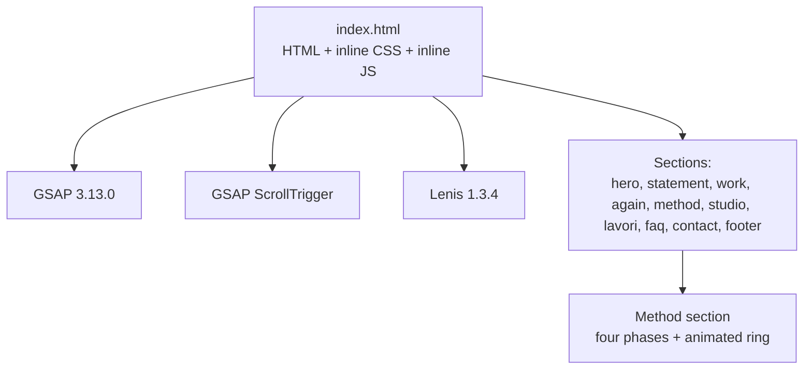
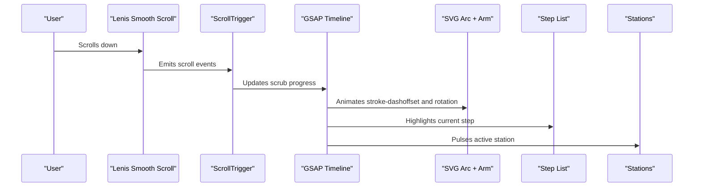
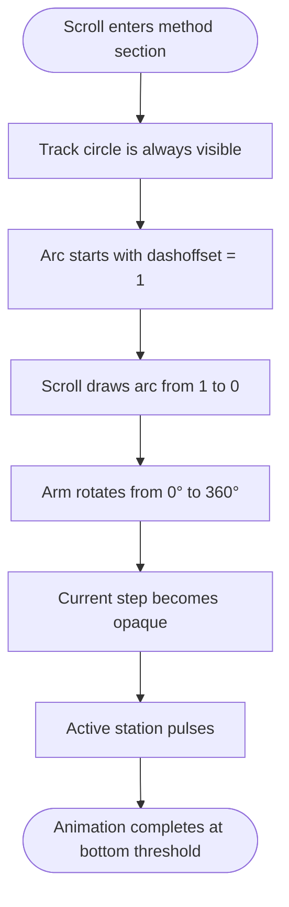
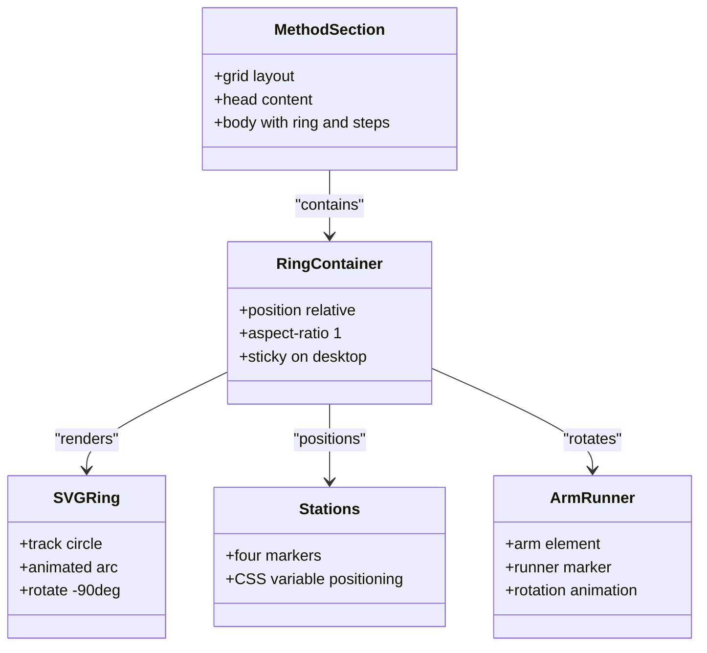
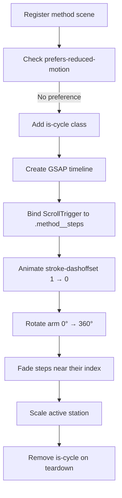
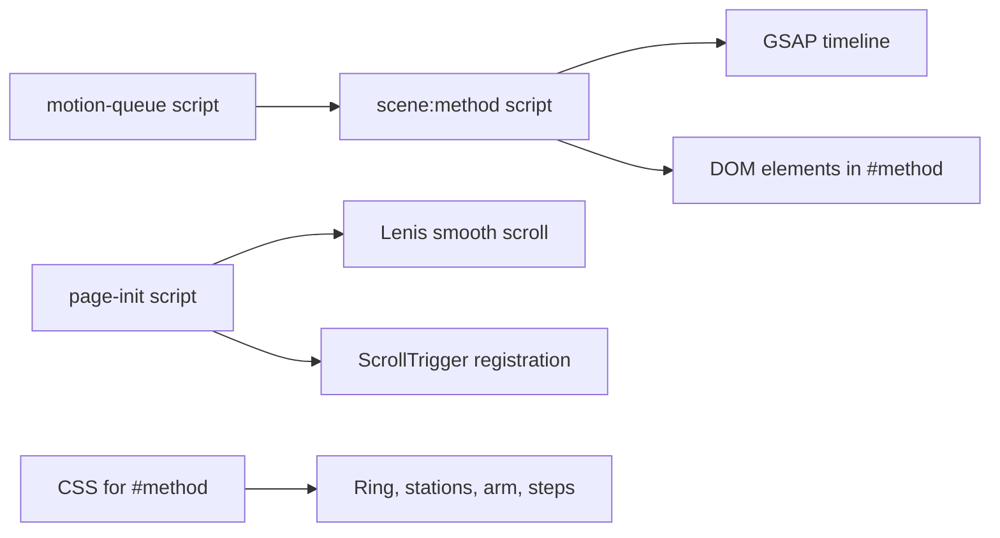

# Development Process Method

<cite>
**Referenced Files in This Document**
- [index.html](file://index.html)
- [README.md](file://README.md)
</cite>

## Table of Contents
1. [Introduction](#introduction)
2. [Project Structure](#project-structure)
3. [Core Components](#core-components)
4. [Architecture Overview](#architecture-overview)
5. [Detailed Component Analysis](#detailed-component-analysis)
6. [Dependency Analysis](#dependency-analysis)
7. [Performance Considerations](#performance-considerations)
8. [Troubleshooting Guide](#troubleshooting-guide)
9. [Conclusion](#conclusion)
10. [Appendices](#appendices)

## Introduction
This document explains the four-phase development process visualization with an animated ring. The section presents a circular track, four stations, a rotating arm with a runner, and a list of phases that highlight as the user scrolls. It also documents how CSS animations, GSAP timeline management, ScrollTrigger-based scroll effects, and Lenis smooth scrolling work together to create an educational and visually engaging methodology presentation.

The goal is to help you:
- Understand each phase of the process.
- See how the animated ring responds to scroll position.
- Modify the phases, descriptions, and animation timing safely.
- Preserve accessibility and visual appeal when customizing.

## Project Structure
The repository is a single-page website template. The method visualization lives inside the main HTML file alongside inline CSS and JavaScript. External libraries are loaded from a CDN:
- GSAP 3.13.0
- GSAP ScrollTrigger plugin
- Lenis 1.3.4 for smooth scrolling

The README confirms that animations use GSAP/ScrollTrigger and Lenis, and that the page remains complete and static when `prefers-reduced-motion` is active.

**Diagram sources**
- [index.html:939-941](file://index.html#L939-L941)
- [index.html:1030-1046](file://index.html#L1030-L1046)
- [index.html:1234-1251](file://index.html#L1234-L1251)

**Section sources**
- [README.md:30-31](file://README.md#L30-L31)
- [README.md:78-85](file://README.md#L78-L85)
- [index.html:939-941](file://index.html#L939-L941)
- [index.html:1030-1046](file://index.html#L1030-L1046)

## Core Components
The method visualization consists of three cooperating layers:
- Markup layer: the method section, SVG ring, stations, arm, runner, and step list.
- Styling layer: CSS layout, responsive positioning, and reduced-motion behavior.
- Animation layer: GSAP timelines driven by ScrollTrigger and Lenis.

Key responsibilities:
- The markup defines four steps and four station positions around the circle.
- CSS makes the ring sticky on desktop so it stays visible while the steps scroll.
- JavaScript creates a scrubbed timeline that draws the arc, rotates the arm, and highlights each step at the correct scroll fraction.

**Section sources**
- [index.html:711-733](file://index.html#L711-L733)
- [index.html:369-405](file://index.html#L369-L405)
- [index.html:1234-1251](file://index.html#L1234-L1251)

## Architecture Overview
The method scene is a scroll-driven animation. As the user scrolls through the `.method__steps`, GSAP updates:
- The SVG arc’s `stroke-dashoffset` from full to zero.
- The arm rotation from 0 to 360 degrees.
- Each step’s opacity to emphasize the current phase.
- Each station’s scale to pulse when its phase becomes active.

**Diagram sources**
- [index.html:1030-1046](file://index.html#L1030-L1046)
- [index.html:1234-1251](file://index.html#L1234-L1251)

## Detailed Component Analysis

### Four Phases of the Process
The method section contains four ordered steps:
1. **Analysis**: Define goals, users, constraints, and existing systems before choosing the technical direction.
2. **Design**: Shape the experience and architecture, sharing priorities and choices with the client.
3. **Development**: Implement the solution, verify functionality, and prepare a reliable release.
4. **Evolution**: Observe usage, collect new requirements, and plan subsequent improvements.

These phases are presented as a sequential process that maps to one quarter of the ring each time.

**Section sources**
- [index.html:726-731](file://index.html#L726-L731)

### Animated Ring Effect
The ring is built from:
- A background track circle.
- An animated arc circle using `pathLength="1"` and `stroke-dasharray="1 1"`.
- Four station markers positioned with CSS variables.
- An arm element containing a runner marker.

On scroll:
- The arc animates from fully hidden to fully drawn.
- The arm rotates continuously over the same scroll range.
- Each station scales up briefly when its corresponding phase becomes active.

**Diagram sources**
- [index.html:718-725](file://index.html#L718-L725)
- [index.html:1234-1251](file://index.html#L1234-L1251)

### CSS Layout and Sticky Behavior
The method section uses a two-column grid:
- Left column: the step list.
- Right column: the ring container.

On desktop, the ring becomes sticky so it remains centered while the steps scroll past. On mobile, the ring moves above the steps and is no longer sticky.

Important styling points:
- The SVG is rotated `-90deg` so the drawing starts at the top.
- Stations are placed using CSS variables `--x` and `--y`.
- The arm and runner are centered and sized relative to the ring.

**Diagram sources**
- [index.html:369-405](file://index.html#L369-L405)
- [index.html:718-725](file://index.html#L718-L725)

### JavaScript Timeline Management
The method scene is registered through the shared motion queue. When the browser supports animations and reduced motion is not preferred, the script:
1. Adds the `is-cycle` class to enable sticky behavior.
2. Creates a GSAP timeline bound to ScrollTrigger.
3. Uses scrub mode so animation progress follows scroll position.
4. Animates the SVG arc and arm rotation across the same duration.
5. Iterates over steps to fade them in near their assigned scroll fraction.
6. Scales stations to emphasize the active phase.

**Diagram sources**
- [index.html:1234-1251](file://index.html#L1234-L1251)

**Section sources**
- [index.html:1234-1251](file://index.html#L1234-L1251)

### Scroll-Triggered Effects
The ScrollTrigger configuration for the method section:
- Trigger element: `.method__steps`.
- Start position: `top 62%`.
- End position: `bottom 62%`.
- Scrub mode: enabled so animation progress matches scroll.
- Invalidation: refreshed on layout changes.

This means the entire ring animation happens while the step list scrolls through the middle portion of the viewport.

**Section sources**
- [index.html:1234-1251](file://index.html#L1234-L1251)

### User Interaction
Users interact with the method visualization primarily by scrolling:
- Scrolling down highlights each phase in order.
- The ring draws progressively as the user reads through the steps.
- The rotating arm and pulsing station reinforce which phase is currently active.
- If reduced motion is enabled, the page remains readable without animation.

There are no direct click interactions on the ring itself; navigation to the section is provided through the site’s navigation links.

**Section sources**
- [index.html:579-603](file://index.html#L579-L603)
- [index.html:711-733](file://index.html#L711-L733)
- [index.html:1234-1251](file://index.html#L1234-L1251)

## Dependency Analysis
The method visualization depends on several shared mechanisms:

**Diagram sources**
- [index.html:973-1028](file://index.html#L973-L1028)
- [index.html:1030-1046](file://index.html#L1030-L1046)
- [index.html:1234-1251](file://index.html#L1234-L1251)
- [index.html:369-405](file://index.html#L369-L405)

**Section sources**
- [index.html:973-1028](file://index.html#L973-L1028)
- [index.html:1030-1046](file://index.html#L1030-L1046)
- [index.html:1234-1251](file://index.html#L1234-L1251)
- [index.html:369-405](file://index.html#L369-L405)

## Performance Considerations
- The animation uses `scrub: true`, which ties animation progress directly to scroll position. This keeps motion smooth but requires efficient DOM access.
- The timeline is bound to a specific trigger element, limiting unnecessary recalculations.
- Lenis smooth scrolling integrates with ScrollTrigger via `lenis.on('scroll', ScrollTrigger.update)`.
- Reduced motion support ensures the page remains usable without animations.
- Image decoding warm-up is used elsewhere in the page; similar patterns can be applied if additional heavy visuals are added to the method section.

[No sources needed since this section provides general guidance]

## Troubleshooting Guide
Common issues and fixes:

- **Animation does not start**:
  - Ensure `prefers-reduced-motion` is not set to reduce motion.
  - Verify that the `is-cycle` class is added to the method section during animation setup.
  - Confirm that ScrollTrigger is registered and Lenis is initialized.

- **Ring is not sticky on desktop**:
  - Check that the CSS for `#method.is-cycle .method__ring` applies.
  - Verify viewport width breakpoints match the expected desktop size.

- **Arc or arm does not rotate**:
  - Confirm the SVG classes `.method__arc` and `.method__arm` exist.
  - Ensure the timeline targets these elements and uses valid attributes.

- **Steps do not highlight**:
  - Verify there are exactly four `.step` elements.
  - Check that the loop iterates over `.step` and assigns opacity near each index.

- **Station pulse is missing**:
  - Confirm there are four `.method__station` elements.
  - Ensure the station array length matches the step count.

**Section sources**
- [index.html:369-405](file://index.html#L369-L405)
- [index.html:718-725](file://index.html#L718-L725)
- [index.html:1234-1251](file://index.html#L1234-L1251)

## Conclusion
The four-phase development method visualization combines clear content with a scroll-driven animated ring. The design communicates process continuity: analysis leads to design, which leads to development, which evolves into ongoing improvement. By keeping the animation tied to scroll progress and preserving reduced-motion behavior, the section remains educational, accessible, and visually engaging.

[No sources needed since this section summarizes without analyzing specific files]

## Appendices

### How to Modify the Process Phases
To change the phases:
1. Update the four `<li class="step">` elements under `.method__steps`.
2. Keep the number of steps equal to the number of stations if you want one station per phase.
3. If you add or remove steps, adjust the station count accordingly.
4. Review the timeline logic that iterates over steps and stations to ensure indices remain consistent.

**Section sources**
- [index.html:726-731](file://index.html#L726-L731)
- [index.html:718-725](file://index.html#L718-L725)
- [index.html:1234-1251](file://index.html#L1234-L1251)

### How to Update Descriptions
- Edit the titles and paragraph text inside each `.step`.
- Maintain concise headings and descriptive paragraphs to preserve readability.
- Avoid adding excessive nested elements inside steps unless necessary for layout.

**Section sources**
- [index.html:726-731](file://index.html#L726-L731)

### How to Customize Animation Timing
To adjust timing:
- Change the ScrollTrigger `start` and `end` values to control when the animation begins and ends relative to the step list.
- Adjust the timeline duration values for arc drawing and arm rotation.
- Tune step opacity transitions and station pulse durations to match the desired pacing.
- Keep scrub mode enabled so scroll position remains the primary driver of animation progress.

**Section sources**
- [index.html:1234-1251](file://index.html#L1234-L1251)

### Preserving Educational Value and Visual Appeal
- Keep the four-phase structure simple and sequential.
- Use clear, outcome-focused language for each phase.
- Retain the ring animation because it reinforces continuity and progression.
- Respect reduced-motion preferences so all users can understand the methodology.
- Avoid overloading the section with extra interactive elements that distract from the core process.

[No sources needed since this section provides general guidance]