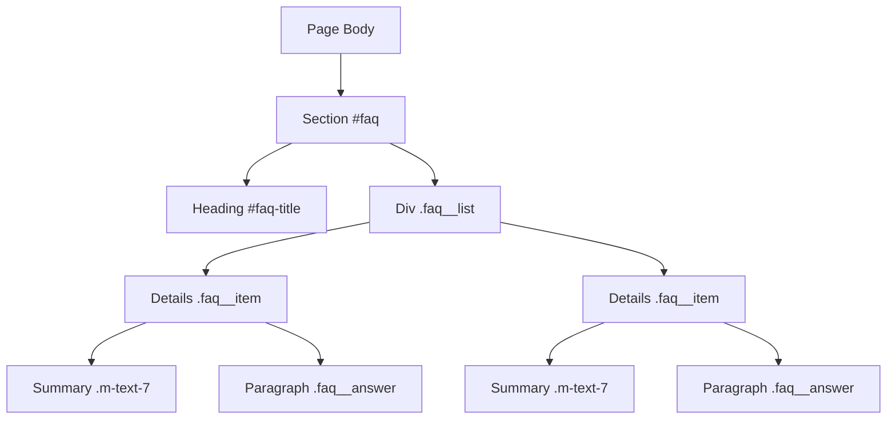
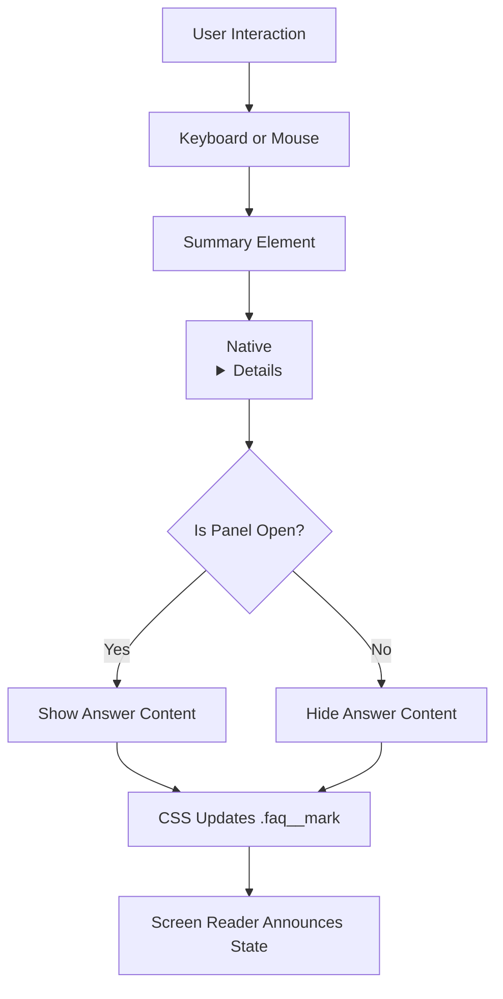
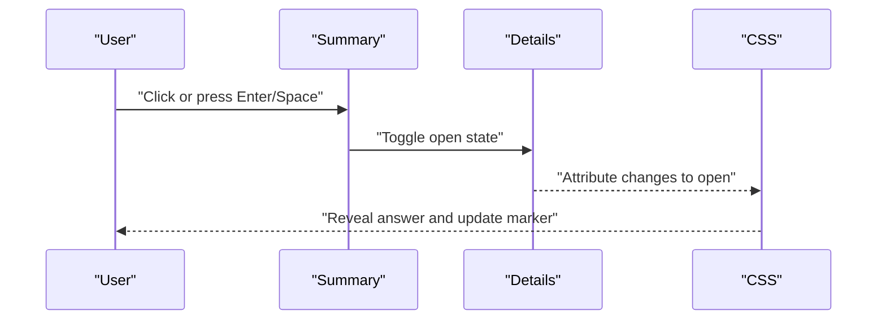
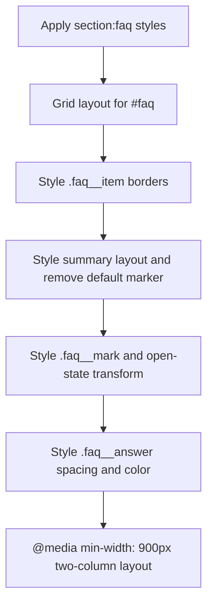
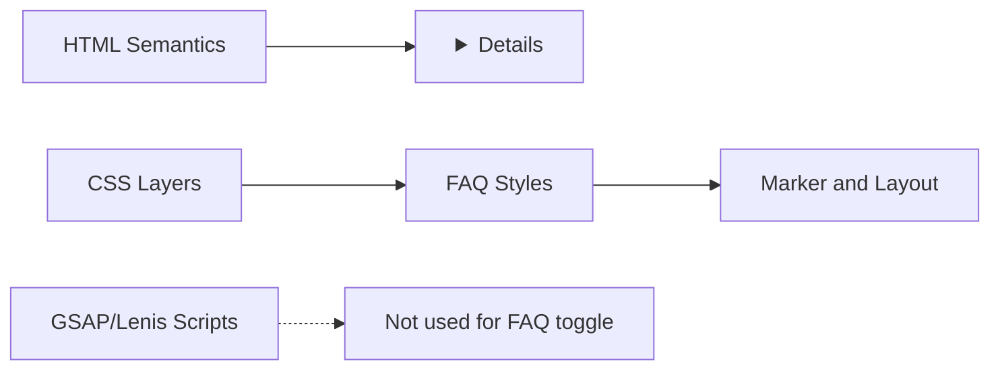

# FAQ Accordion

<cite>
**Referenced Files in This Document**   
- [index.html](file://index.html)
- [en/index.html](file://en/index.html)
- [README.md](file://README.md)
</cite>

## Table of Contents
1. [Introduction](#introduction)
2. [Project Structure](#project-structure)
3. [Core Components](#core-components)
4. [Architecture Overview](#architecture-overview)
5. [Detailed Component Analysis](#detailed-component-analysis)
6. [Dependency Analysis](#dependency-analysis)
7. [Performance Considerations](#performance-considerations)
8. [Troubleshooting Guide](#troubleshooting-guide)
9. [Conclusion](#conclusion)

## Introduction
This document explains the FAQ accordion built with native HTML `
` elements. It covers semantic markup, accessibility behavior, styling, keyboard navigation, mobile responsiveness, content organization, and guidance for adding new items and customizing appearance while keeping screen readers and keyboard-only users in mind.

The FAQ section is a self-contained part of a single-page website template that includes Italian and English versions. The accordion itself does not use JavaScript; its expand/collapse behavior comes from the browser’s native implementation of `
`.

## Project Structure
The FAQ lives inside the main page body as a dedicated section:
- Section element with `id="faq"` and `aria-labelledby` pointing to the visible heading.
- A list container with class `faq__list`.
- One `
` per question.
- Each item contains a `
` for the question and a paragraph `
` for the answer.

**Diagram sources**
- [index.html:860-870](file://index.html#L860-L870)
- [en/index.html:860-870](file://en/index.html#L860-L870)

**Section sources**
- [index.html:860-870](file://index.html#L860-L870)
- [en/index.html:860-870](file://en/index.html#L860-L870)
- [README.md:26-28](file://README.md#L26-L28)

## Core Components
- Semantic container: `<section id="faq" aria-labelledby="faq-title">` groups the FAQ and links it to its heading.
- Question/answer pair: `
` provides the collapsible panel; `
` is the clickable trigger; the answer is plain text inside the details element.
- Visual marker: an empty `` next to each summary is styled to show a state change when the panel opens.
- Styling scope: CSS under `section:faq` targets `#faq`, `.faq__item`, `summary`, `.faq__mark`, and `.faq__answer`.

Key responsibilities:
- `
` manages open/closed state.
- `
` is the accessible button-like control.
- CSS hides the default marker and adds a custom animated indicator.
- No JavaScript is required for basic functionality.

**Section sources**
- [index.html:860-870](file://index.html#L860-L870)
- [index.html:500-515](file://index.html#L500-L515)
- [en/index.html:860-870](file://en/index.html#L860-L870)
- [en/index.html:500-515](file://en/index.html#L500-L515)

## Architecture Overview
The FAQ accordion is a pure HTML/CSS component. Its behavior is driven by the browser’s native `
` API, while CSS handles layout, typography, borders, hover states, and the visual marker transition.

[No diagram sources needed since this diagram shows conceptual workflow, not actual code structure]

## Detailed Component Analysis

### Semantic Markup Structure
- Section wrapper:
  - `id="faq"` identifies the section for navigation and animations.
  - `aria-labelledby="faq-title"` associates the section with its heading.
- Heading:
  - `id="faq-title"` is the label referenced by `aria-labelledby`.
- List container:
  - `class="faq__list"` groups items but is not a list element because each item is a `
` panel rather than a simple list item.
- Each item:
  - `
` represents one question/answer pair.
  - `
` is the interactive trigger.
  - `
` holds the answer text.

Accessibility highlights:
- `
` is focusable and acts like a button.
- The decorative marker uses `aria-hidden="true"` so assistive technologies ignore it.
- The section heading provides context for screen readers.

**Section sources**
- [index.html:860-870](file://index.html#L860-L870)
- [en/index.html:860-870](file://en/index.html#L860-L870)

### Expand and Collapse Behavior
The accordion expands and collapses through the native `
` mechanism:
- Clicking or pressing Enter/Space on `
` toggles the `open` attribute.
- When `open` is present, the browser reveals the content after `
`.
- The CSS selector `details[open] .faq__mark::after` scales the marker to indicate the open state.

**Diagram sources**
- [index.html:500-515](file://index.html#L500-L515)
- [index.html:860-870](file://index.html#L860-L870)

**Section sources**
- [index.html:500-515](file://index.html#L500-L515)
- [index.html:860-870](file://index.html#L860-L870)
- [en/index.html:500-515](file://en/index.html#L500-L515)
- [en/index.html:860-870](file://en/index.html#L860-L870)

### Accessibility Features
- Keyboard support:
  - Tab moves focus between summaries.
  - Enter or Space toggles the panel.
  - Arrow keys are not automatically managed by `
`; if you add internal focusable controls inside answers, ensure they remain reachable via Tab.
- Screen reader support:
  - Summaries are announced as collapsible controls.
  - The open/closed state is exposed through the native `
` semantics.
  - Decorative markers should keep `aria-hidden="true"`.
- Focus visibility:
  - Global `:focus-visible` styles provide a visible outline for keyboard users.
- Landmarks and headings:
  - The section heading provides a clear landmark for scanning FAQs.

Recommendations for compliance:
- Keep questions concise and meaningful in `
`.
- Avoid placing interactive controls directly inside `
` unless necessary.
- If answers contain links or buttons, test them with keyboard-only navigation and screen readers.
- Preserve the existing `aria-hidden="true"` on decorative markers.

**Section sources**
- [index.html:145-163](file://index.html#L145-L163)
- [index.html:500-515](file://index.html#L500-L515)
- [index.html:860-870](file://index.html#L860-L870)
- [en/index.html:145-163](file://en/index.html#L145-L163)
- [en/index.html:500-515](file://en/index.html#L500-L515)
- [en/index.html:860-870](file://en/index.html#L860-L870)

### Styling Approach
The FAQ styling is scoped under the `section:faq` layer:
- Container:
  - Uses grid layout with responsive columns at larger breakpoints.
  - Adds top border and padding to separate it from other sections.
- Items:
  - Borders separate each question.
  - The first item gets a top border for visual symmetry.
- Summary:
  - Flex layout aligns the question text and marker.
  - Removes the default marker and sets pointer cursor.
- Marker:
  - A bordered square with a colored inner dot.
  - Scales up when the panel is open.
  - Hover effects enhance interactivity cues.
- Answer:
  - Constrained max width and bottom padding for readability.

Responsive behavior:
- On screens wider than 900px, the FAQ switches to a two-column grid layout.
- On smaller screens, it stacks vertically.

**Diagram sources**
- [index.html:500-515](file://index.html#L500-L515)
- [en/index.html:500-515](file://en/index.html#L500-L515)

**Section sources**
- [index.html:500-515](file://index.html#L500-L515)
- [en/index.html:500-515](file://en/index.html#L500-L515)

### Mobile Responsiveness
- The FAQ section uses CSS Grid with a responsive breakpoint at 900px.
- Below 900px, the FAQ stacks into a single column.
- Above 900px, it splits into two columns with a gap.
- Typography and spacing scale using CSS variables and clamp-based sizing elsewhere in the design system.

Practical implications:
- On narrow screens, each question takes full width.
- Answers wrap naturally within the constrained max width.
- Touch targets are adequate because summaries have sufficient padding.

**Section sources**
- [index.html:500-515](file://index.html#L500-L515)
- [en/index.html:500-515](file://en/index.html#L500-L515)

### Content Organization Strategy
Each FAQ item follows a consistent pattern:
- One `
` per question.
- A short, scannable question in `
`.
- A focused answer in a paragraph with class `faq__answer`.
- A decorative marker span with `aria-hidden="true"`.

Content best practices:
- Keep questions specific and user-focused.
- Keep answers concise and actionable.
- Use paragraphs for longer answers instead of dense blocks.
- Avoid embedding complex widgets inside answers unless necessary.

**Section sources**
- [index.html:860-870](file://index.html#L860-L870)
- [en/index.html:860-870](file://en/index.html#L860-L870)

### Adding a New FAQ Item
To add another question:
1. Locate the `faq__list` container inside the `#faq` section.
2. Add a new `
`.
3. Inside it, add a `
` with the question text.
4. Include the marker span `` inside the summary.
5. Add a `
` with the answer.
6. Repeat the same change in both language files (`index.html` and `en/index.html`) to keep translations aligned.

Example structure (described without code):
- Create a new details item.
- Put the question in the summary.
- Put the answer in a paragraph after the summary.
- Keep the marker span for visual consistency.

**Section sources**
- [index.html:860-870](file://index.html#L860-L870)
- [en/index.html:860-870](file://en/index.html#L860-L870)

### Customizing Appearance
You can customize the accordion by editing the `section:faq` styles:
- Colors:
  - Update colors through CSS variables defined in the tokens layer.
- Borders:
  - Modify `.faq__item` borders to change separators.
- Marker:
  - Adjust `.faq__mark` size, border, and background.
  - Change the open-state transform on `details[open] .faq__mark::after`.
- Spacing:
  - Adjust summary padding and answer padding.
- Layout:
  - Change the two-column breakpoint or column ratios in the media query.

Guidelines:
- Prefer modifying CSS variables where possible.
- Keep the marker visually distinct in both closed and open states.
- Maintain sufficient contrast for text and interactive elements.
- Test hover and focus states across devices.

**Section sources**
- [index.html:117-138](file://index.html#L117-L138)
- [index.html:500-515](file://index.html#L500-L515)
- [en/index.html:117-138](file://en/index.html#L117-L138)
- [en/index.html:500-515](file://en/index.html#L500-L515)

### Ensuring Accessibility Compliance
Checklist:
- Every `
` has clear, descriptive text.
- Decorative markers use `aria-hidden="true"`.
- Headings form a logical hierarchy; the FAQ section heading introduces the list.
- Keyboard navigation works:
  - Tab reaches each summary.
  - Enter or Space toggles panels.
  - Any interactive controls inside answers are reachable via Tab.
- Screen readers announce:
  - Collapsible group context.
  - Open/closed state changes.
- Focus outlines remain visible.
- Color changes alone do not convey state; combine color with shape or position.

If you extend the FAQ with additional controls:
- Give each control a visible label or associate labels properly.
- Ensure focus order matches visual order.
- Avoid relying solely on mouse hover for critical information.

**Section sources**
- [index.html:145-163](file://index.html#L145-L163)
- [index.html:500-515](file://index.html#L500-L515)
- [index.html:860-870](file://index.html#L860-L870)
- [en/index.html:145-163](file://en/index.html#L145-L163)
- [en/index.html:500-515](file://en/index.html#L500-L515)
- [en/index.html:860-870](file://en/index.html#L860-L870)

## Dependency Analysis
The FAQ accordion has minimal dependencies:
- HTML semantics: `<section>`, `<h2>`, `
`, `
`, `
`.
- CSS layers: tokens, base, atoms, sections.
- No JavaScript is required for core accordion behavior.

External scripts such as GSAP and Lenis exist in the page but do not control the FAQ toggle. They manage smooth scrolling and other scene animations.

**Diagram sources**
- [index.html:565-575](file://index.html#L565-L575)
- [index.html:939-945](file://index.html#L939-L945)
- [index.html:500-515](file://index.html#L500-L515)
- [index.html:860-870](file://index.html#L860-L870)

**Section sources**
- [index.html:565-575](file://index.html#L565-L575)
- [index.html:939-945](file://index.html#L939-L945)
- [index.html:500-515](file://index.html#L500-L515)
- [index.html:860-870](file://index.html#L860-L870)

## Performance Considerations
- Native `
` is lightweight and requires no runtime logic for basic expansion.
- CSS transitions are GPU-friendly transforms on the marker.
- The FAQ does not introduce heavy assets or scripts.
- Keep answer content concise to avoid large DOM trees.
- If you add images or rich content inside answers, consider lazy loading and appropriate image formats.

[No sources needed since this section provides general guidance]

## Troubleshooting Guide
Common issues and fixes:
- Marker does not change when opening:
  - Verify the CSS selector for `details[open] .faq__mark::after`.
  - Ensure the marker span exists inside each summary.
- Default marker still appears:
  - Confirm the rule hiding the webkit details marker is applied.
- Keyboard toggle does not work:
  - Check that the element is a valid `
` inside `
`.
  - Ensure no custom script prevents default behavior.
- Screen reader does not announce state:
  - Do not override `
` semantics with custom roles unless necessary.
  - Keep `aria-hidden="true"` only on decorative markers.
- Layout breaks on mobile:
  - Check the media query breakpoint and grid settings.
  - Validate that answers respect max width and padding.

**Section sources**
- [index.html:500-515](file://index.html#L500-L515)
- [index.html:860-870](file://index.html#L860-L870)
- [en/index.html:500-515](file://en/index.html#L500-L515)
- [en/index.html:860-870](file://en/index.html#L860-L870)

## Conclusion
The FAQ accordion is a simple, accessible, and maintainable component built entirely with native HTML and CSS. It relies on `
` for behavior, CSS for styling and animation, and semantic markup for accessibility. By following the documented structure, you can safely add new questions, customize the appearance, and ensure reliable keyboard and screen reader support across devices.

[No sources needed since this section summarizes without analyzing specific files]