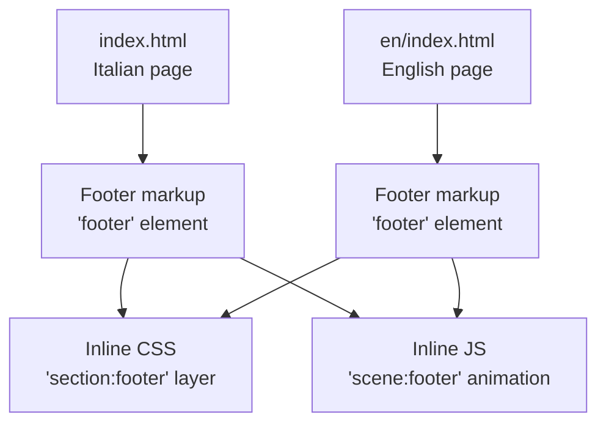
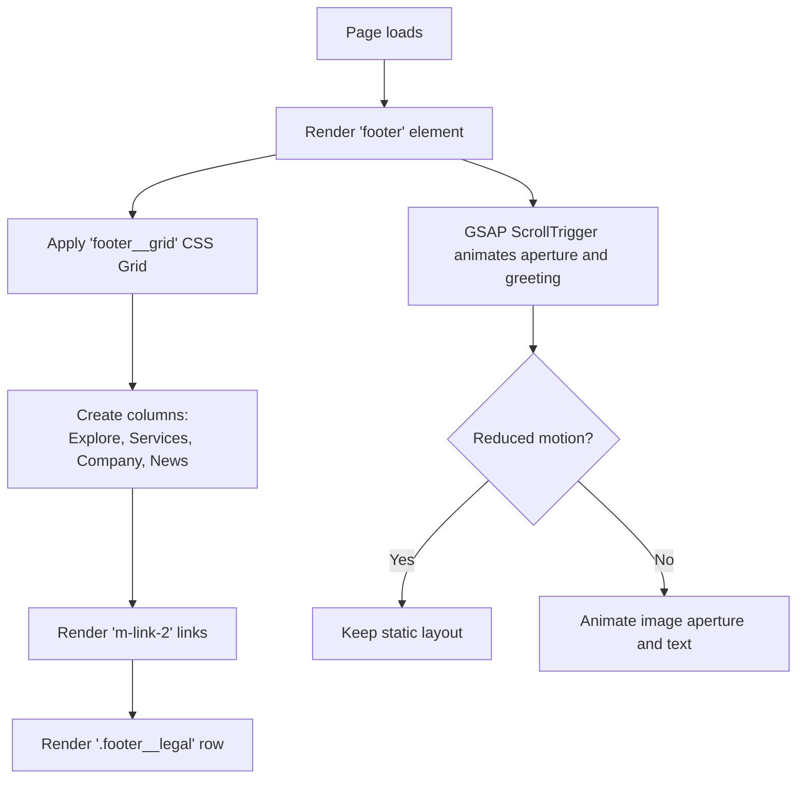
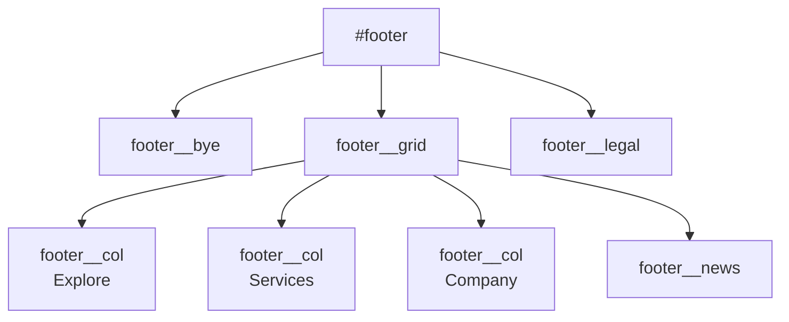
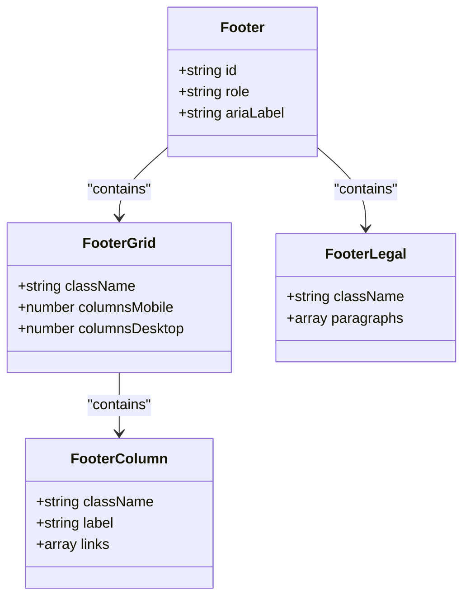
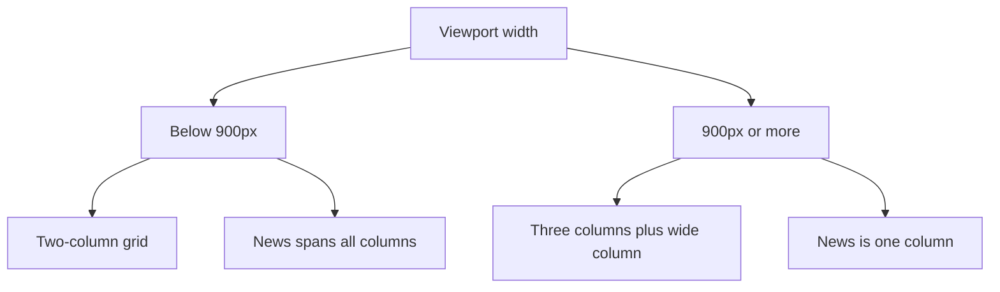
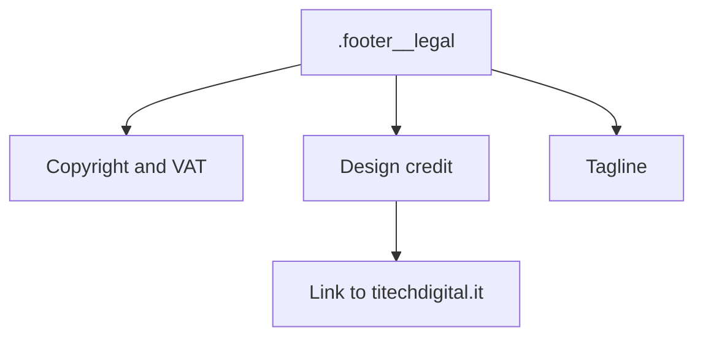
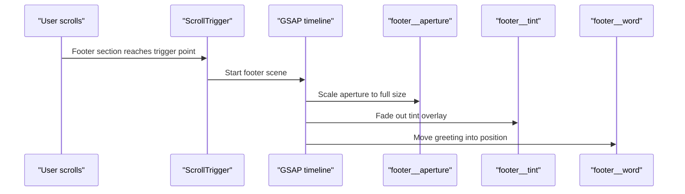
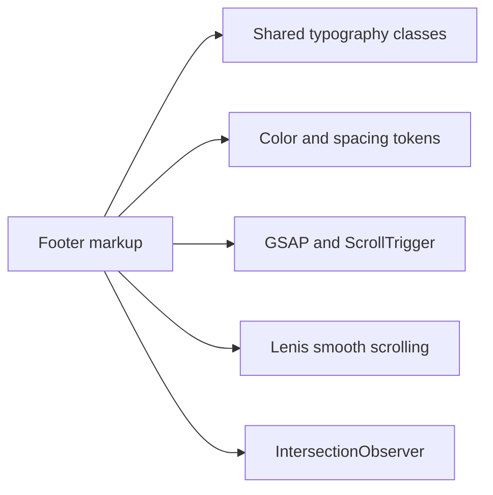

# Footer Navigation

<cite>
**Referenced Files in This Document**   
- [index.html](file://index.html)
- [en/index.html](file://en/index.html)
- [README.md](file://README.md)
</cite>

## Table of Contents
1. [Introduction](#introduction)
2. [Project Structure](#project-structure)
3. [Core Components](#core-components)
4. [Architecture Overview](#architecture-overview)
5. [Detailed Component Analysis](#detailed-component-analysis)
6. [Dependency Analysis](#dependency-analysis)
7. [Performance Considerations](#performance-considerations)
8. [Troubleshooting Guide](#troubleshooting-guide)
9. [Conclusion](#conclusion)
10. [Appendices](#appendices)

## Introduction
This document explains the multi-column footer navigation used by the TiTech Digital website. It covers the columnar layout, link organization, responsive behavior, legal information display, and how to update or extend the footer while keeping it consistent with the rest of the site.

The footer is a single-page component embedded directly in each language version of the site. It includes:
- A closing greeting with an animated circular image.
- A four-column grid containing exploration links, service links, company description and contact email, and a call-to-action area.
- A legal row with copyright, VAT number, design credit, and a short tagline.

There are no dedicated social media link columns in the current implementation; social presence would be added as additional links within existing columns or as new columns.

## Project Structure
The footer lives inside the main HTML files for both Italian and English versions. The styling is inline in the same file using CSS layers, and animations are handled by GSAP and ScrollTrigger through inline scripts.

**Diagram sources**
- [index.html:904-937](file://index.html#L904-L937)
- [en/index.html:904-937](file://en/index.html#L904-L937)
- [index.html:537-564](file://index.html#L537-L564)
- [index.html:1349-1360](file://index.html#L1349-L1360)

**Section sources**
- [index.html:904-937](file://index.html#L904-L937)
- [en/index.html:904-937](file://en/index.html#L904-L937)
- [README.md:28-29](file://README.md#L28-L29)

## Core Components
The footer is composed of these logical parts:

| Part | Purpose | Key class or element | Notes |
|---|---|---|---|
| Closing greeting | Branding closure and visual full stop | `footer__bye` | Contains an animated aperture image that scales into place on scroll. |
| Column grid | Main navigation and content area | `footer__grid` | Uses CSS Grid with two columns on small screens and three plus one wider column on larger screens. |
| Explore column | Section anchors | First `footer__col` wrapped in `nav` | Links to `#work`, `#lavori`, `#method`, `#studio`. |
| Services column | Service list | Second `footer__col` | Links to service sections and the contact section. |
| Company column | Description and email | Third `footer__col` | Includes mission text and a `mailto:` link. |
| Call-to-action block | Conversion prompt | `.footer__news` | Headline, link to contact, and status note. |
| Legal row | Compliance and credits | `.footer__legal` | Copyright, VAT, design credit, and tagline. |

**Section sources**
- [index.html:904-937](file://index.html#L904-L937)
- [en/index.html:904-937](file://en/index.html#L904-L937)

## Architecture Overview
The footer architecture combines semantic HTML, CSS Grid, and lightweight JavaScript animation.

**Diagram sources**
- [index.html:537-564](file://index.html#L537-L564)
- [index.html:904-937](file://index.html#L904-L937)
- [index.html:1349-1360](file://index.html#L1349-L1360)

## Detailed Component Analysis

### Columnar Layout Structure
The footer uses CSS Grid for its main layout:

- Mobile and tablet: two-column grid.
- Desktop (from 900px): three equal columns plus one wider final column.
- Each column is a grid container aligned to start with tight vertical gaps.
- The news block spans all columns on mobile and becomes a regular column on desktop.

**Diagram sources**
- [index.html:537-564](file://index.html#L537-L564)
- [index.html:904-937](file://index.html#L904-L937)

**Section sources**
- [index.html:537-564](file://index.html#L537-L564)
- [index.html:904-937](file://index.html#L904-L937)

### Link Organization
Links are grouped by purpose:

- **Explore**: navigates to major page sections.
- **Services**: lists the five core services and ends with a call to discuss a project.
- **Company**: provides a short positioning statement and an email address.
- **News**: contains a headline, a link to the contact section, and a status message.

All links use the shared `.m-link-2` utility class, which keeps typography, spacing, and hover underline behavior consistent with the rest of the site.

**Diagram sources**
- [index.html:904-937](file://index.html#L904-L937)
- [en/index.html:904-937](file://en/index.html#L904-L937)

**Section sources**
- [index.html:904-937](file://index.html#L904-L937)
- [en/index.html:904-937](file://en/index.html#L904-L937)

### Responsive Behavior
The footer adapts at a single breakpoint:

| Screen size | Layout behavior |
|---|---|
| Below 900px | Two-column grid; news block spans full width; greeting text is larger relative to viewport. |
| 900px and above | Three equal columns plus one wider column; news block becomes a normal column; greeting text scales differently. |

The responsive rules are defined in the `section:footer` CSS layer and adjust:
- The decorative aperture size variable.
- The greeting font size.
- The grid column count.
- The news block spanning behavior.

**Diagram sources**
- [index.html:537-564](file://index.html#L537-L564)

**Section sources**
- [index.html:537-564](file://index.html#L537-L564)

### Navigation Categories
The footer categories map to the page’s internal sections:

| Category | Links | Destination |
|---|---|---|
| Explore | Solutions, Our work, Method, TiTech Digital | `#work`, `#lavori`, `#method`, `#studio` |
| Services | Websites and e-commerce, Design and digital identity, Software and automation, SEO and digital growth, Ongoing support, Talk about a project | Mostly `#work`, last link goes to `#contact` |
| Company | Positioning text and email | `mailto:info@titechdigital.it` |
| News | Call-to-action headline and contact link | `#contact` |

These links should stay synchronized with the top navigation and section IDs.

**Section sources**
- [index.html:904-937](file://index.html#L904-L937)
- [en/index.html:904-937](file://en/index.html#L904-L937)

### Social Media Links
The current footer does not include a dedicated social media column. If social links are needed, add them to an existing column or create a new column following the same structure:

1. Add a new `footer__col` element.
2. Add a `footer__label` heading such as “Follow us”.
3. Add anchor elements using the existing `.m-link-2` class.
4. Keep the same spacing and typography so the column aligns with the others.

If icons are added, reuse the site’s icon pattern rather than introducing a new style system.

[No sources needed since this section provides guidance without analyzing specific code lines]

### Legal Information Display
The legal row contains:

- Copyright notice.
- VAT number.
- Rights reserved statement.
- Design and website credit with a link to the company site.
- Short tagline.

It uses flexbox to wrap items and space them across the footer width. On narrow screens, the items wrap naturally.

**Diagram sources**
- [index.html:936](file://index.html#L936)
- [en/index.html:936](file://en/index.html#L936)

**Section sources**
- [index.html:936](file://index.html#L936)
- [en/index.html:936](file://en/index.html#L936)

### CSS Grid and Flexbox Implementation
The footer relies on:

- **CSS Grid** for the main column layout (`footer__grid`).
- **Nested Grid** for each column (`footer__col`) to stack labels and links vertically.
- **Flexbox** for the legal row (`footer__legal`) to distribute and wrap legal text.
- **CSS variables** for spacing and colors via the shared token system.
- **Media queries** at 900px to switch from two columns to three plus a wider column.

This approach avoids heavy frameworks and keeps the footer easy to maintain in a single-file template.

**Section sources**
- [index.html:537-564](file://index.html#L537-L564)

### Footer Animation
The footer animation is driven by GSAP and ScrollTrigger:

- When the footer enters the viewport, the circular aperture image scales up.
- The tint overlay fades out.
- The greeting word moves into place.
- The animation respects `prefers-reduced-motion`.

**Diagram sources**
- [index.html:1349-1360](file://index.html#L1349-L1360)

**Section sources**
- [index.html:1349-1360](file://index.html#L1349-L1360)

## Dependency Analysis
The footer depends on:

- Shared typography classes like `.m-text`, `.m-text-6`, `.m-text-7`, and `.m-link-2`.
- Color and spacing tokens defined in the global CSS layer.
- GSAP and ScrollTrigger for scroll-based animation.
- Lenis smooth scrolling for overall page scrolling behavior.
- IntersectionObserver for toggling offscreen state and pausing animations when appropriate.

**Diagram sources**
- [index.html:537-564](file://index.html#L537-L564)
- [index.html:939-941](file://index.html#L939-L941)
- [index.html:1349-1360](file://index.html#L1349-L1360)

**Section sources**
- [index.html:537-564](file://index.html#L537-L564)
- [index.html:939-941](file://index.html#L939-L941)
- [index.html:1349-1360](file://index.html#L1349-L1360)

## Performance Considerations
- The footer image is loaded lazily and participates in a scroll-driven animation only when motion is allowed.
- The animation is scoped to the footer section and uses ScrollTrigger, so it does not run unnecessarily.
- On reduced-motion preferences, animations are disabled and the layout remains fully functional.
- Because the footer is part of a single-file template, avoid adding large external assets or heavy libraries just for the footer.

[No sources needed since this section provides general guidance]

## Troubleshooting Guide

### Links Do Not Scroll to Sections
- Verify that the target section exists and has the correct ID referenced by the footer link.
- Ensure the page still uses the same section IDs after edits.
- Check that the top navigation and footer links remain synchronized.

**Section sources**
- [index.html:904-937](file://index.html#L904-L937)
- [en/index.html:904-937](file://en/index.html#L904-L937)

### Footer Columns Misalign
- Confirm that each column uses the `.footer__col` class.
- Check that the grid wrapper is `.footer__grid`.
- Avoid overriding `display` or `grid-template-columns` on `.footer__grid` unless intentionally customizing the layout.

**Section sources**
- [index.html:537-564](file://index.html#L537-L564)

### Legal Text Wraps Unexpectedly
- The legal row uses flexbox wrapping; long legal strings may wrap on narrow screens.
- Keep legal statements concise or split them into separate paragraphs if needed.
- Do not remove the `.footer__legal` class if you want the default distribution behavior.

**Section sources**
- [index.html:537-564](file://index.html#L537-L564)
- [index.html:936](file://index.html#L936)

### Animation Does Not Play
- Check whether the browser honors `prefers-reduced-motion`.
- Verify that GSAP and ScrollTrigger scripts are loaded before the footer animation script.
- Ensure the footer element still has the expected structure for the animation selectors.

**Section sources**
- [index.html:939-941](file://index.html#L939-L941)
- [index.html:1349-1360](file://index.html#L1349-L1360)

## Conclusion
The footer is a compact, accessible, and responsive component built with semantic HTML, CSS Grid, and light JavaScript animation. Its four-column structure organizes navigation, services, company information, and a conversion prompt, while the legal row provides compliance and credit information. To keep the footer consistent with the site, reuse existing classes, keep links synchronized with page sections, and follow the established column and typography patterns.

[No sources needed since this section summarizes without analyzing specific files]

## Appendices

### How to Update Footer Links
1. Open the Italian and English pages.
2. Locate the relevant `.footer__col` or `.footer__news` block.
3. Update the link text and `href` values.
4. Keep the same class names and nesting structure.
5. Sync changes between both language versions.

**Section sources**
- [index.html:904-937](file://index.html#L904-L937)
- [en/index.html:904-937](file://en/index.html#L904-L937)

### How to Add a New Column
1. Insert a new `
` inside `.footer__grid`.
2. Add a `.footer__label` heading.
3. Add links or content using `.m-link-2` and `.m-text`.
4. Test at below 900px and at 900px or above.
5. If the column breaks the intended three-plus-wide layout, consider placing the content in an existing column instead.

**Section sources**
- [index.html:537-564](file://index.html#L537-L564)
- [index.html:904-937](file://index.html#L904-L937)

### How to Modify Legal Text
1. Find the `.footer__legal` element near the end of the footer.
2. Update the paragraph contents for copyright, VAT, credit, and tagline.
3. Keep the same structure so flexbox wrapping behaves predictably.
4. Update both language versions if the legal information applies globally.

**Section sources**
- [index.html:936](file://index.html#L936)
- [en/index.html:936](file://en/index.html#L936)
- [README.md:70](file://README.md#L70)