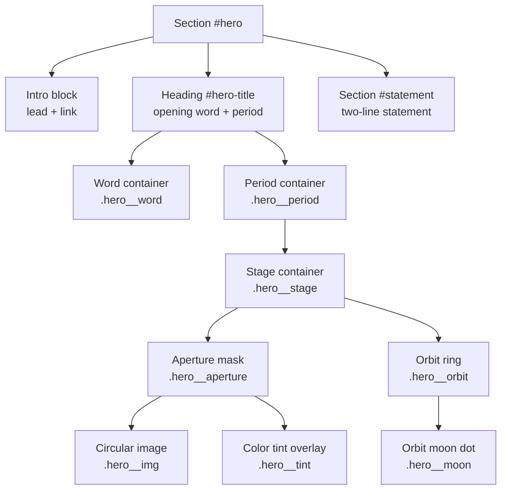
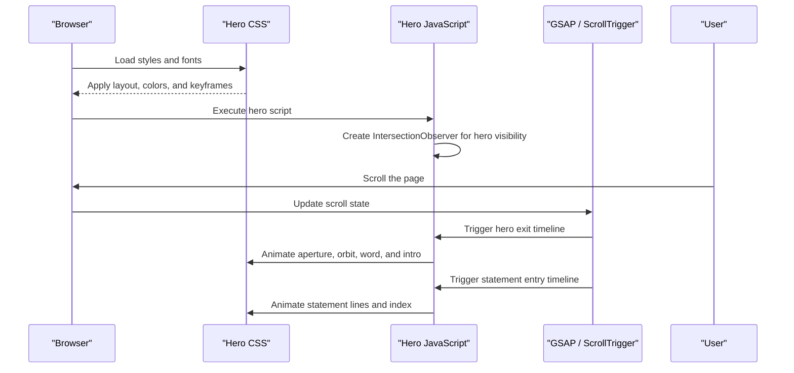
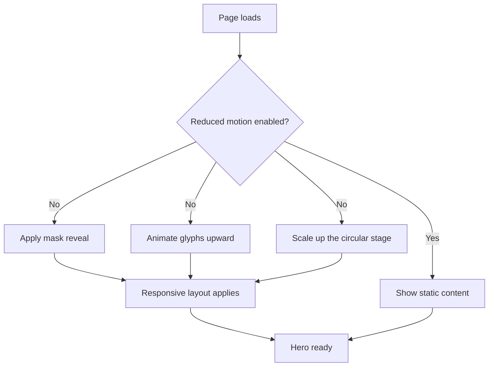
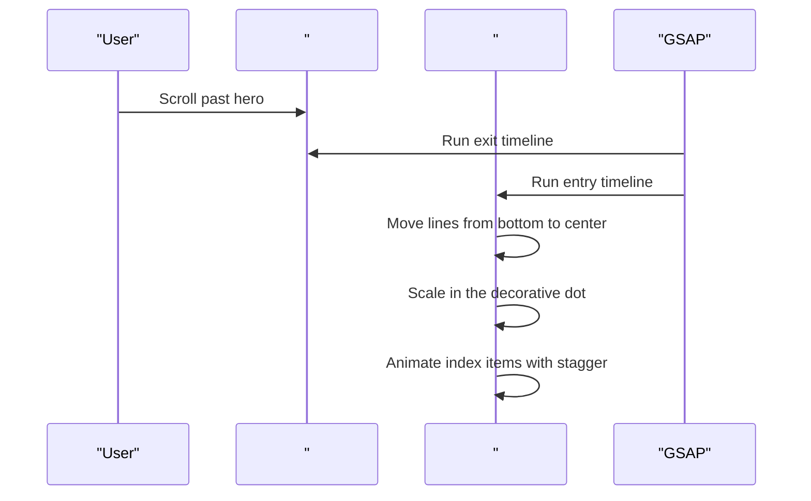
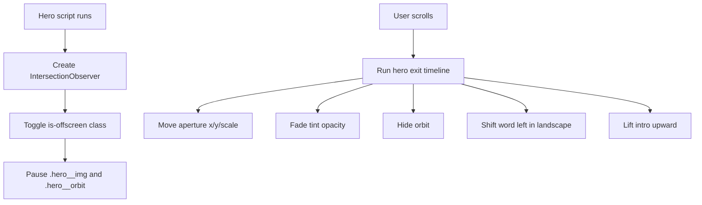
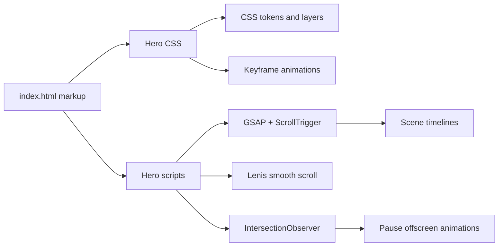

# Hero Section

<cite>
**Referenced Files in This Document**   
- [index.html](file://index.html)
- [README.md](file://README.md)
</cite>

## Table of Contents
1. [Introduction](#introduction)
2. [Project Structure](#project-structure)
3. [Core Components](#core-components)
4. [Architecture Overview](#architecture-overview)
5. [Detailed Component Analysis](#detailed-component-analysis)
6. [Dependency Analysis](#dependency-analysis)
7. [Performance Considerations](#performance-considerations)
8. [Troubleshooting Guide](#troubleshooting-guide)
9. [Conclusion](#conclusion)

## Introduction
This document explains the hero section implementation and how it creates a strong first impression through three coordinated ideas:
- A circular image that acts as the period at the end of the opening word.
- An opening-word animation where the text “TiTech” appears before the circular image reveals itself.
- A two-line statement immediately after the hero that reinforces the brand message.

The hero is built with semantic HTML, CSS animations, and GSAP/ScrollTrigger interactions. It also respects `prefers-reduced-motion` and uses responsive layout rules so it works well on phones, tablets, and desktops.

## Project Structure
The hero lives inside the main page file. Its structure combines:
- A visible introduction block with lead text and a link to the solutions section.
- A large heading containing the opening word and the animated circular image.
- The next section, which contains the two-line statement.



**Diagram sources**
- [index.html:574-580](file://index.html#L574-L580)
- [index.html:582-597](file://index.html#L582-L597)

**Section sources**
- [index.html:574-580](file://index.html#L574-L580)
- [index.html:582-597](file://index.html#L582-L597)

## Core Components
The hero has four main responsibilities:

| Component | Purpose | Key Behavior |
|---|---|---|
| Opening word | Shows “TiTech” as the headline | Uses a masked glyph layer so the word can animate independently from the image. |
| Circular image | Acts as the visual period | Sits inside an aperture mask and rotates continuously; its size and position adapt to screen size and orientation. |
| Intro block | Provides context and a call to action | Contains the lead paragraph and a link to the solutions section. |
| Two-line statement | Reinforces positioning | Appears directly after the hero and animates into place when scrolled into view. |

The opening word and circular image are intentionally paired: the word finishes with a period, and that period becomes the circular image. This makes the hero feel like one complete sentence rather than separate elements.

**Section sources**
- [index.html:574-580](file://index.html#L574-L580)
- [index.html:582-597](file://index.html#L582-L597)

## Architecture Overview
The hero’s behavior is split across CSS and JavaScript:

- **CSS handles**: layout, typography, color tokens, responsive sizing, and initial entrance animations.
- **JavaScript handles**: scroll-driven transitions, intersection-based performance control, and scene choreography between the hero and the statement.



**Diagram sources**
- [index.html:922-928](file://index.html#L922-L928)
- [index.html:1076-1095](file://index.html#L1076-L1095)
- [index.html:1097-1110](file://index.html#L1097-L1110)

## Detailed Component Analysis

### Opening Word Animation
The opening word is wrapped in nested containers:
- `.hero__title` holds the full headline.
- `.hero__word` wraps the text.
- `.hero__mask` and `.hero__glyphs` provide layers for masking and animation.
- `.hero__period` is the decorative period that contains the circular image stage.

On load, the word rises into view while the circular stage swells into place. In landscape mode on larger screens, the stage moves to the bottom-left and uses a different scale animation.



**Diagram sources**
- [index.html:238-281](file://index.html#L238-L281)
- [index.html:579](file://index.html#L579)

**Section sources**
- [index.html:238-281](file://index.html#L238-L281)
- [index.html:579](file://index.html#L579)

### Circular Image and Orbit System
The circular image is not just a round photo. It is composed of several layered pieces:
- `.hero__stage` defines the square viewport for the circle.
- `.hero__aperture` clips the image into a rounded shape.
- `.hero__img` fills the aperture and rotates continuously.
- `.hero__orbit` draws a thin ring around the circle.
- `.hero__moon` is a small accent dot on the orbit.
- `.hero__tint` is an optional color overlay used during transitions.

The rotation animations are infinite and paused when the hero leaves the viewport. This reduces unnecessary work when the user is not looking at the hero.

```mermaid
classDiagram
class HeroStage {
"+position absolute"
"+size controlled by --ap"
"+centered or pinned depending on orientation"
}
class HeroAperture {
"+rounded clip area"
"+background accent color"
"+contains image and tint"
}
class HeroImage {
"+object-fit cover"
"+infinite rotation"
"+paused when offscreen"
}
class HeroOrbit {
"+thin border ring"
"+infinite rotation"
"+fades out during exit"
}
class HeroMoon {
"+small accent dot"
"+rotates with orbit"
}
class HeroTint {
"+opacity transition"
"+used during scroll exit"
}
HeroStage --> HeroAperture : "contains"
HeroAperture --> HeroImage : "clips"
HeroAperture --> HeroTint : "overlays"
HeroStage --> HeroOrbit : "surrounds"
HeroOrbit --> HeroMoon : "carries"
```

**Diagram sources**
- [index.html:247-252](file://index.html#L247-L252)
- [index.html:264-280](file://index.html#L264-L280)
- [index.html:579](file://index.html#L579)

**Section sources**
- [index.html:247-280](file://index.html#L247-L280)
- [index.html:579](file://index.html#L579)

### Two-Line Statement Structure
The statement section follows the hero and presents the brand message in two lines:
- First line: “Tecnologia”
- Second line: “che muove il business” followed by a decorative dot.

When the hero exits, the statement enters with staggered vertical movement. The dot scales in near the end of the animation. The index below the statement then fades in items one by one.



**Diagram sources**
- [index.html:1076-1095](file://index.html#L1076-L1095)
- [index.html:1097-1110](file://index.html#L1097-L1110)
- [index.html:582-597](file://index.html#L582-L597)

**Section sources**
- [index.html:283-296](file://index.html#L283-L296)
- [index.html:582-597](file://index.html#L582-L597)
- [index.html:1076-1110](file://index.html#L1076-L1110)

### Responsive Behavior
The hero adapts to different screen sizes and orientations:

| Viewport Condition | Behavior |
|---|---|
| Default portrait | Circular image sits near the middle-right of the hero; title text scales fluidly. |
| Landscape on larger screens | Circular image moves to the bottom-left; title text shrinks to fit beside the image. |
| Short portrait devices | Circular image shrinks and repositions to keep both text and image visible. |
| Reduced motion | All continuous rotations and entrance animations are disabled. |

Key responsive controls include:
- CSS custom property `--ap` controlling the aperture size.
- Orientation-specific media queries.
- `prefers-reduced-motion` disabling animations.
- IntersectionObserver pausing image and orbit animations when the hero is offscreen.

**Section sources**
- [index.html:240-263](file://index.html#L240-L263)
- [index.html:264-280](file://index.html#L264-L280)
- [index.html:922-928](file://index.html#L922-L928)

### CSS Animations
The hero uses CSS keyframes for the initial entrance and continuous motion:

| Animation | Target | Effect |
|---|---|---|
| `hero-mask` | `.hero__mask` | Reveals the opening word through a clipping path. |
| `hero-rise` | `.hero__glyphs` | Slides the word upward into place. |
| `hero-swell` | `.hero__stage` | Scales the circular stage in. |
| `hero-inflate` | `.hero__stage` (landscape) | Uses a smaller starting scale for landscape layout. |
| `hero-lift` | `.hero__intro` | Lifts the intro block into view. |
| `hero-turn` | `.hero__img` | Rotates the image continuously. |
| `hero-orbit` | `.hero__orbit` | Rotates the orbit ring continuously. |

These animations are only applied when reduced motion is not preferred.

**Section sources**
- [index.html:264-280](file://index.html#L264-L280)

### JavaScript Interactions
The hero’s JavaScript has two main jobs:

1. **Visibility control**: An `IntersectionObserver` toggles `is-offscreen` on the hero. When offscreen, the rotating image and orbit animations pause.
2. **Scroll choreography**: GSAP timelines move the aperture toward the statement’s decorative dot, fade the tint, hide the orbit, shift the word horizontally in landscape mode, and lift the intro block.



**Diagram sources**
- [index.html:922-928](file://index.html#L922-L928)
- [index.html:1076-1095](file://index.html#L1076-L1095)

**Section sources**
- [index.html:922-928](file://index.html#L922-L928)
- [index.html:1076-1095](file://index.html#L1076-L1095)

## Dependency Analysis
The hero depends on several shared systems:

| Dependency | Role |
|---|---|
| CSS cascade layers | Organizes tokens, base styles, atoms, sections, and scenes. |
| CSS custom properties | Controls colors, spacing, radii, and the aperture size. |
| Google Fonts | Loads Gabarito and Onest with fallbacks. |
| GSAP and ScrollTrigger | Powers scroll-driven transitions and scene choreography. |
| Lenis | Provides smooth scrolling when reduced motion is allowed. |
| IntersectionObserver | Pauses heavy animations when the hero is not visible. |



**Diagram sources**
- [index.html:114-138](file://index.html#L114-L138)
- [index.html:238-281](file://index.html#L238-L281)
- [index.html:895-897](file://index.html#L895-L897)
- [index.html:922-928](file://index.html#L922-L928)
- [index.html:986-1002](file://index.html#L986-L1002)
- [index.html:1076-1095](file://index.html#L1076-L1095)

**Section sources**
- [index.html:114-138](file://index.html#L114-L138)
- [index.html:895-897](file://index.html#L895-L897)
- [index.html:986-1002](file://index.html#L986-L1002)

## Performance Considerations
The hero includes several performance-conscious choices:

- **Offscreen animation pause**: When the hero leaves the viewport, the rotating image and orbit stop. This avoids unnecessary GPU work.
- **Reduced motion support**: Continuous rotations and entrance animations are disabled for users who prefer reduced motion.
- **Image loading strategy**: The hero image uses eager loading and high fetch priority because it is part of the initial viewport experience.
- **Responsive image delivery**: The image uses `srcset` and `sizes` so browsers choose appropriate resolutions.
- **Font fallbacks**: Fallback font families prevent layout shifts while web fonts load.
- **Smooth scroll integration**: Smooth scrolling is disabled when reduced motion is preferred.

Recommendations if you extend the hero:
- Keep continuous rotations lightweight; avoid animating large images or complex filters.
- Prefer CSS transforms and opacity over layout-triggering properties.
- Avoid adding more infinite animations without checking whether they should pause offscreen.
- Test with reduced motion enabled to ensure accessibility.

**Section sources**
- [index.html:264-280](file://index.html#L264-L280)
- [index.html:579](file://index.html#L579)
- [index.html:922-928](file://index.html#L922-L928)
- [index.html:986-1002](file://index.html#L986-L1002)

## Troubleshooting Guide

| Problem | Likely Cause | Fix |
|---|---|---|
| Circular image does not appear | Missing or incorrect image path | Verify the image source and confirm the file exists under `assets/img`. |
| Image is too large or blurry | Wrong `srcset` or `sizes` values | Adjust widths and breakpoints to match your image assets. |
| Animations do not start | Reduced motion preference active | Check browser settings or test with `prefers-reduced-motion` disabled. |
| Rotations continue when hero is offscreen | IntersectionObserver not running or missing class toggle | Ensure the hero script runs and the `is-offscreen` class logic is intact. |
| Statement lines do not animate | GSAP or ScrollTrigger not loaded | Confirm external scripts are available and network requests succeed. |
| Hero exit looks broken on landscape | Orientation-specific layout mismatch | Review landscape media queries and the horizontal word shift. |
| Smooth scroll feels wrong | Lenis initialization conflict | Check reduced motion preferences and smooth scroll initialization. |

Common checks:
- Open the console for GSAP or ScrollTrigger errors.
- Inspect the hero element for the `is-offscreen` class when scrolled away.
- Validate that the statement section still has the expected `.statement__dot` target.
- Confirm that the hero and statement sections remain adjacent in the DOM order expected by the scene logic.

**Section sources**
- [index.html:579](file://index.html#L579)
- [index.html:922-928](file://index.html#L922-L928)
- [index.html:1076-1095](file://index.html#L1076-L1095)
- [index.html:1097-1110](file://index.html#L1097-L1110)

## Conclusion
The hero section creates impact by combining three simple but powerful ideas:
- The opening word ends with a period that becomes a rotating circular image.
- CSS animations introduce the word, mask, and stage smoothly.
- GSAP choreography connects the hero’s exit with the statement’s entrance.

To customize the hero safely:
- Change the opening word and lead text in the hero markup.
- Replace the image files and update paths if needed.
- Adjust typography and spacing through CSS variables and existing classes.
- Extend animations only within the existing `prefers-reduced-motion` and offscreen-pause patterns.
- Keep the statement section adjacent to the hero so the scroll choreography remains predictable.

**Section sources**
- [index.html:574-597](file://index.html#L574-L597)
- [index.html:238-281](file://index.html#L238-L281)
- [index.html:1076-1110](file://index.html#L1076-L1110)
- [README.md:17-30](file://README.md#L17-L30)