# Portfolio Grid

<cite>
**Referenced Files in This Document**   
- [index.html](file://index.html)
- [README.md](file://README.md)
</cite>

## Table of Contents
1. [Introduction](#introduction)
2. [Project Structure](#project-structure)
3. [Core Components](#core-components)
4. [Architecture Overview](#architecture-overview)
5. [Detailed Component Analysis](#detailed-component-analysis)
6. [Dependency Analysis](#dependency-analysis)
7. [Performance Considerations](#performance-considerations)
8. [Troubleshooting Guide](#troubleshooting-guide)
9. [Conclusion](#conclusion)
10. [Appendices](#appendices)

## Introduction
This document explains the portfolio grid that showcases six demo projects. The section is called “Lavori” and presents a responsive, scroll-driven story sequence rather than a traditional masonry layout. It uses CSS Grid for the default card stack and transitions to a pinned, full-height story mode where one project card overlays another as the user scrolls. Hover effects provide subtle image scaling on desktops without hover support. Navigation between portfolio items is driven by scroll position through GSAP ScrollTrigger; there is no client-side filtering or expand/collapse behavior.

The documentation covers:
- How the grid layout works at different breakpoints
- Image handling and optimization techniques used in the cards
- Hover effects and accessibility considerations
- Scroll-based navigation between projects
- Guidance for adding new portfolio items, optimizing images, and customizing appearance while keeping the professional presentation intact

## Project Structure
The portfolio grid lives inside the `#lavori` section. Its structure is:
- A section wrapper with class `#lavori`
- A header area with title, intro text, and a project counter
- A story container with progress bars and a list of project cards
- Each project card contains media (image), year badge, and body content with metadata and tags
- A footer area with a note and a call-to-action link

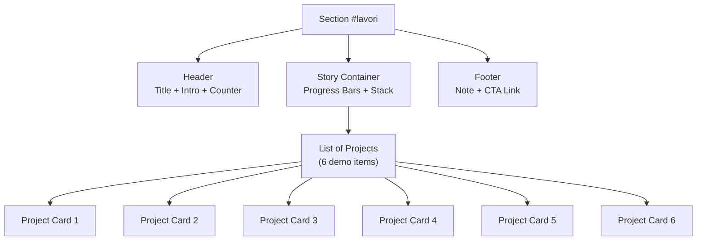

**Diagram sources**
- [index.html:759-858](file://index.html#L759-L858)

**Section sources**
- [index.html:759-858](file://index.html#L759-L858)

## Core Components
The portfolio grid has three main components:
- Section wrapper and header: defines the section context, title, introductory copy, and a counter indicating the number of selected projects.
- Story container: holds the progress indicators and the project list. In normal mode it stacks cards; in story mode it pins the section and animates transitions between cards.
- Project card: contains an image, optional year badge, top metadata line, project name, description, and tag list.

Key responsibilities:
- Layout: CSS Grid controls column counts and spacing across breakpoints.
- Interaction: GSAP ScrollTrigger drives the pinned story animation and per-card transitions.
- Accessibility: Semantic HTML, aria attributes, and focus management are used throughout the page; the portfolio section follows the same patterns.

**Section sources**
- [index.html:433-463](file://index.html#L433-L463)
- [index.html:464-499](file://index.html#L464-L499)
- [index.html:759-858](file://index.html#L759-L858)

## Architecture Overview
The portfolio grid architecture combines declarative markup, CSS layers, and JavaScript animations:
- Markup defines semantic sections, lists, headings, paragraphs, and images.
- CSS layers organize tokens, base styles, atoms, layout, sections, and scenes.
- JavaScript initializes GSAP and ScrollTrigger, sets up Lenis smooth scrolling, and registers scene-specific animations.

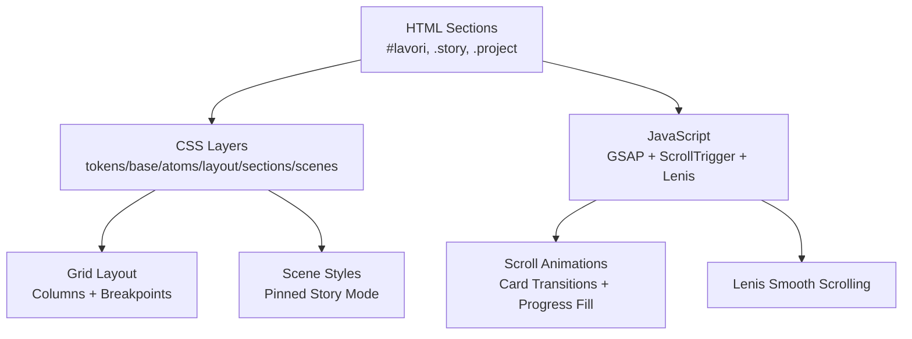

**Diagram sources**
- [index.html:114-116](file://index.html#L114-L116)
- [index.html:433-499](file://index.html#L433-L499)
- [index.html:939-941](file://index.html#L939-L941)
- [index.html:1030-1046](file://index.html#L1030-L1046)
- [index.html:1311-1336](file://index.html#L1311-L1336)

## Detailed Component Analysis

### Grid Layout Algorithm
The portfolio grid uses CSS Grid with responsive breakpoints:
- Default: single-column stack.
- Medium screens (at least 760px): two columns.
- Large screens (at least 1100px): three columns.

Spacing and gaps are controlled via CSS variables and clamp functions for fluid typography and spacing. The `.story__stack` element is the grid container, and each `.project` is a grid item.

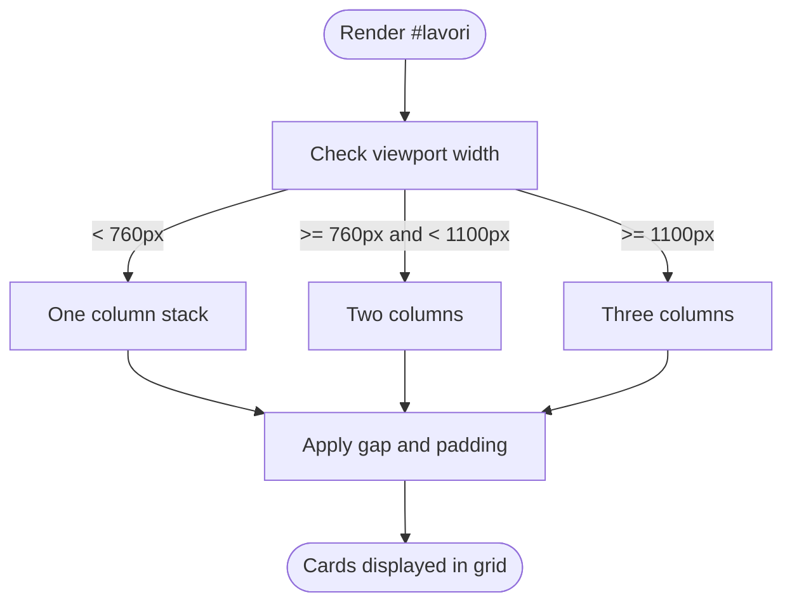

**Diagram sources**
- [index.html:433-463](file://index.html#L433-L463)

**Section sources**
- [index.html:433-463](file://index.html#L433-L463)

### Image Handling
Each project card includes:
- An `` element with WebP source files via `srcset`.
- `sizes` attribute to help the browser choose the appropriate image based on viewport width.
- Lazy loading and async decoding for performance.
- Aspect ratio set via CSS to maintain consistent card proportions.

Techniques:
- WebP format for smaller file sizes.
- Multiple resolutions in `srcset` for different screen densities.
- `loading="lazy"` to defer offscreen images.
- `decoding="async"` to avoid blocking the main thread.
- CSS `object-fit: cover` to fill the card without distortion.

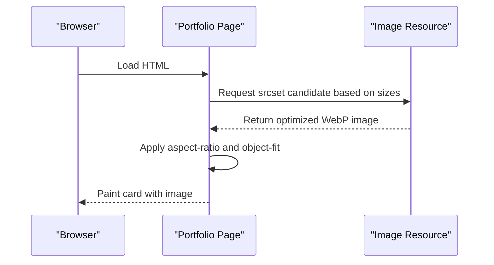

**Diagram sources**
- [index.html:446-448](file://index.html#L446-L448)
- [index.html:779-850](file://index.html#L779-L850)

**Section sources**
- [index.html:446-448](file://index.html#L446-L448)
- [index.html:779-850](file://index.html#L779-L850)

### Responsive Breakpoints
Breakpoints for the portfolio grid:
- Below 760px: single column.
- From 760px to below 1100px: two columns.
- From 1100px onward: three columns.

Additional responsive behaviors:
- Fluid typography using `clamp()` and viewport units.
- Sticky pinned story mode activates under reduced-motion preferences and specific media queries.
- Progress bar and overlay styles adapt to screen size.

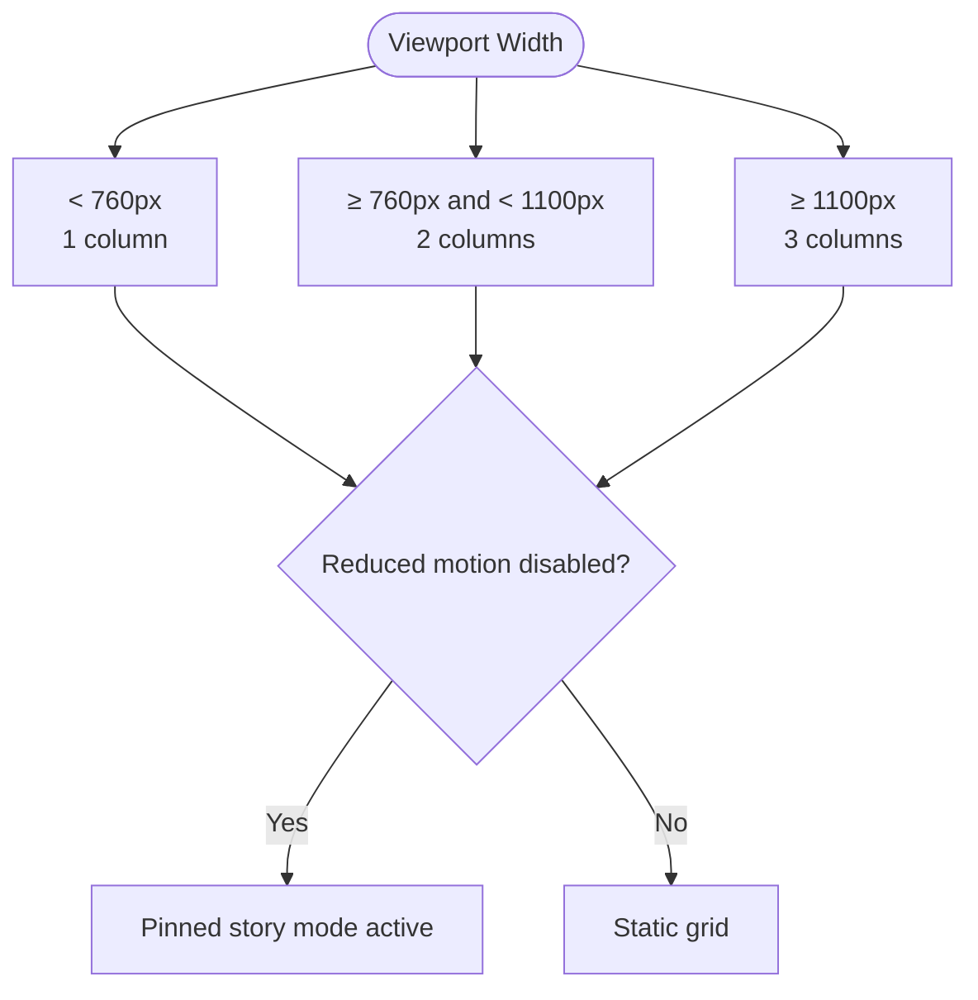

**Diagram sources**
- [index.html:459-462](file://index.html#L459-L462)
- [index.html:464-499](file://index.html#L464-L499)

**Section sources**
- [index.html:459-462](file://index.html#L459-L462)
- [index.html:464-499](file://index.html#L464-L499)

### Project Card Structure
Each project card consists of:
- Media container with image and optional year badge.
- Body containing:
  - Top metadata line with project number and category.
  - Project name heading.
  - Description paragraph.
  - Tag list with bullet separators.

Accessibility:
- Semantic elements (`<li>`, `<h3>`, `
`, `<ul>`) ensure proper structure.
- Images include descriptive alt attributes.
- Badges use reusable badge classes for visual consistency.

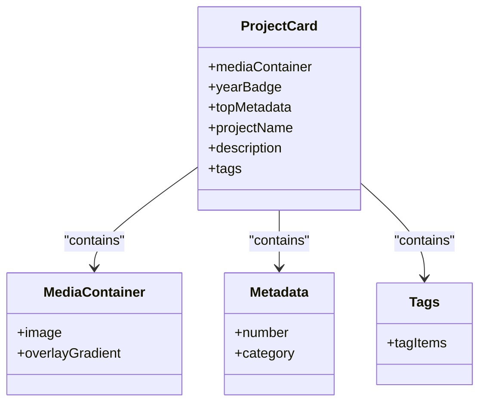

**Diagram sources**
- [index.html:445-457](file://index.html#L445-L457)
- [index.html:779-850](file://index.html#L779-L850)

**Section sources**
- [index.html:445-457](file://index.html#L445-L457)
- [index.html:779-850](file://index.html#L779-L850)

### Hover Effects
On desktops with hover capability:
- When not in story mode, hovering over a project scales its image slightly for emphasis.
- Links and buttons have underline and arrow animations.
- Badges and overlays remain static during hover.

These effects are implemented via CSS media queries and transitions.

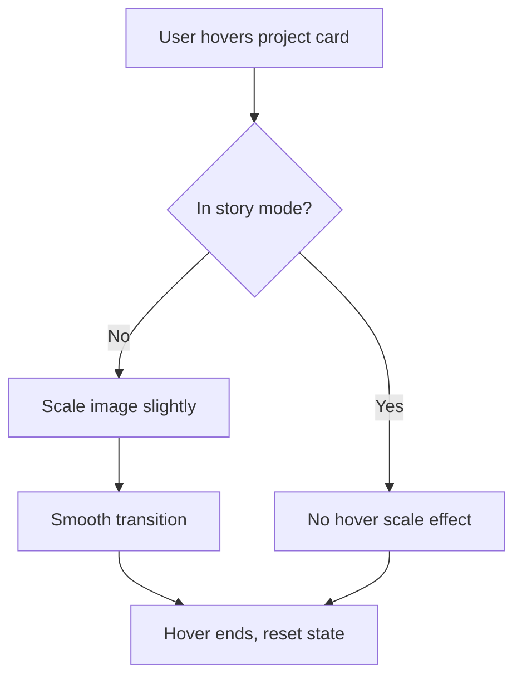

**Diagram sources**
- [index.html:459-460](file://index.html#L459-L460)

**Section sources**
- [index.html:459-460](file://index.html#L459-L460)

### Navigation Between Portfolio Items
Navigation is scroll-driven:
- The section becomes pinned when the user scrolls into view.
- As the user scrolls, each project card fades in/out and scales slightly.
- A progress bar fills proportionally to indicate current project position.
- GSAP ScrollTrigger manages timelines tied to scroll position.

There is no explicit filter or expand interaction. Users navigate by scrolling.

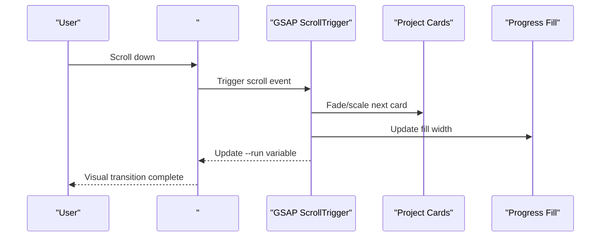

**Diagram sources**
- [index.html:1311-1336](file://index.html#L1311-L1336)

**Section sources**
- [index.html:1311-1336](file://index.html#L1311-L1336)

### CSS Techniques for the Grid and Scene
Key CSS techniques:
- CSS Grid for responsive columns.
- CSS variables for spacing, colors, and radii.
- Clamp functions for fluid typography and spacing.
- Layered styles for organization.
- Scene-specific styles for pinned story mode.
- Backface visibility and will-change for smoother animations.

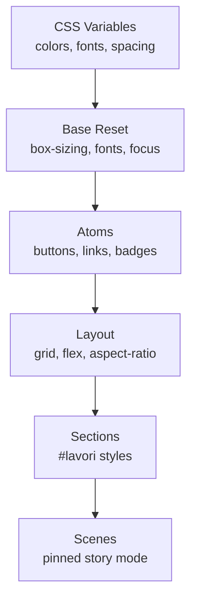

**Diagram sources**
- [index.html:117-138](file://index.html#L117-L138)
- [index.html:140-203](file://index.html#L140-L203)
- [index.html:433-499](file://index.html#L433-L499)

**Section sources**
- [index.html:117-138](file://index.html#L117-L138)
- [index.html:140-203](file://index.html#L140-L203)
- [index.html:433-499](file://index.html#L433-L499)

### JavaScript Interactions
JavaScript responsibilities:
- Initialize GSAP and ScrollTrigger plugins.
- Set up Lenis smooth scrolling.
- Register scene animations for the portfolio section.
- Manage pinned story mode and per-card transitions.
- Update CSS variables for scroll-driven layout.

There is no filtering or expand logic in the portfolio section. Filtering would require additional DOM manipulation and state management beyond the current implementation.

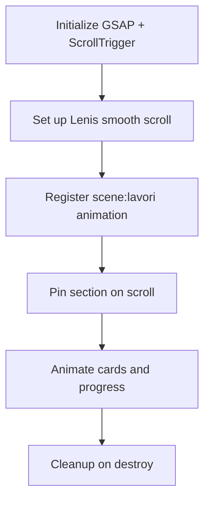

**Diagram sources**
- [index.html:939-941](file://index.html#L939-L941)
- [index.html:1030-1046](file://index.html#L1030-L1046)
- [index.html:1311-1336](file://index.html#L1311-L1336)

**Section sources**
- [index.html:939-941](file://index.html#L939-L941)
- [index.html:1030-1046](file://index.html#L1030-L1046)
- [index.html:1311-1336](file://index.html#L1311-L1336)

## Dependency Analysis
The portfolio grid depends on:
- GSAP and ScrollTrigger for animations.
- Lenis for smooth scrolling.
- CSS layers and variables for styling.
- Semantic HTML structure for accessibility.

External dependencies are loaded from jsDelivr CDN. The README confirms these technologies and browser support.

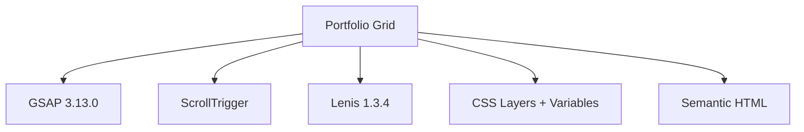

**Diagram sources**
- [index.html:939-941](file://index.html#L939-L941)
- [README.md:78-85](file://README.md#L78-L85)

**Section sources**
- [index.html:939-941](file://index.html#L939-L941)
- [README.md:78-85](file://README.md#L78-L85)

## Performance Considerations
Optimization techniques already present:
- WebP images with multiple resolutions via `srcset`.
- Lazy loading for images outside the initial viewport.
- Async decoding to reduce main-thread blocking.
- CSS `will-change` and `backface-visibility` for smoother transforms.
- Reduced motion support via media queries.

Recommendations:
- Ensure all images are preconverted to WebP and sized appropriately.
- Avoid large inline scripts; keep animations scoped to relevant sections.
- Use `requestIdleCallback` or similar strategies to warm decode tasks before interactions.
- Monitor scroll performance and avoid heavy computations in scroll handlers.

[No sources needed since this section provides general guidance]

## Troubleshooting Guide
Common issues and resolutions:
- Images not loading: verify `srcset` paths and file existence.
- Animations not triggering: check if GSAP and ScrollTrigger are loaded and registered.
- Smooth scrolling not working: confirm Lenis initialization and reduced motion settings.
- Layout breaks on resize: ensure ScrollTrigger refresh is called after dynamic changes.

Validation steps:
- Open browser developer tools and inspect network requests for images.
- Check console errors related to GSAP or ScrollTrigger.
- Test with `prefers-reduced-motion` enabled to validate fallback behavior.

**Section sources**
- [index.html:939-941](file://index.html#L939-L941)
- [index.html:1030-1046](file://index.html#L1030-L1046)
- [index.html:1311-1336](file://index.html#L1311-L1336)

## Conclusion
The portfolio grid is a modern, responsive showcase built with semantic HTML, layered CSS, and GSAP-driven scroll animations. It prioritizes performance through optimized images and efficient animations, while maintaining accessibility and a clean, professional presentation. Adding new projects involves duplicating the existing card structure and updating the counter. Customization should preserve the grid’s responsive behavior and animation integrity.

[No sources needed since this section summarizes without analyzing specific files]

## Appendices

### How to Add New Portfolio Items
Steps:
1. Duplicate an existing `<li class="project">` block within the story list.
2. Replace image paths, titles, descriptions, categories, and tags.
3. Update the project counter text to reflect the new total number of projects.
4. Remove or update the demo note if replacing placeholder content.

Guidance:
- Keep image dimensions and aspect ratios consistent.
- Maintain semantic structure and accessible labels.
- Ensure the counter matches the actual number of project items.

**Section sources**
- [index.html:779-850](file://index.html#L779-L850)
- [index.html:853-856](file://index.html#L853-L856)
- [README.md:72](file://README.md#L72)

### Optimizing Images for Performance
Best practices:
- Convert images to WebP format.
- Provide multiple resolutions in `srcset`.
- Use appropriate `sizes` values matching your grid layout.
- Enable lazy loading for offscreen images.
- Avoid oversized images; match maximum display width.

**Section sources**
- [index.html:446-448](file://index.html#L446-L448)
- [index.html:779-850](file://index.html#L779-L850)
- [README.md:71](file://README.md#L71)

### Customizing the Grid Appearance
Customization options:
- Adjust column counts via breakpoint rules in the section styles.
- Modify spacing and gaps using CSS variables.
- Change colors and typography through token variables.
- Enhance hover effects with transitions and transforms.
- Preserve scene styles for pinned story mode.

Constraints:
- Do not remove `data-8b-*` attributes required by animations.
- Keep semantic structure intact for accessibility.
- Maintain consistent aspect ratios for visual coherence.

**Section sources**
- [index.html:117-138](file://index.html#L117-L138)
- [index.html:433-499](file://index.html#L433-L499)
- [README.md:65-76](file://README.md#L65-L76)