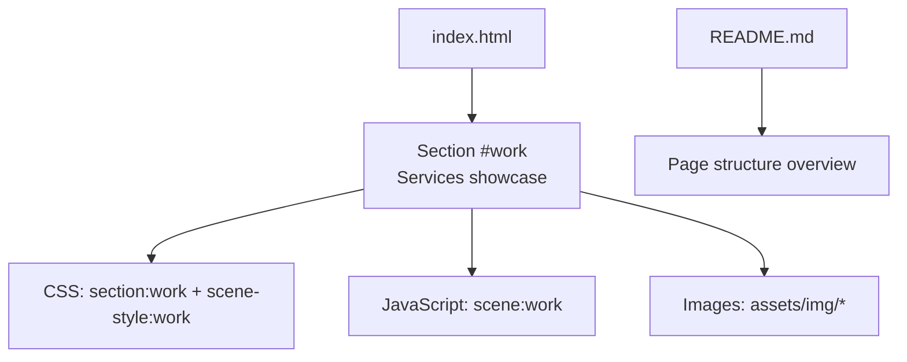
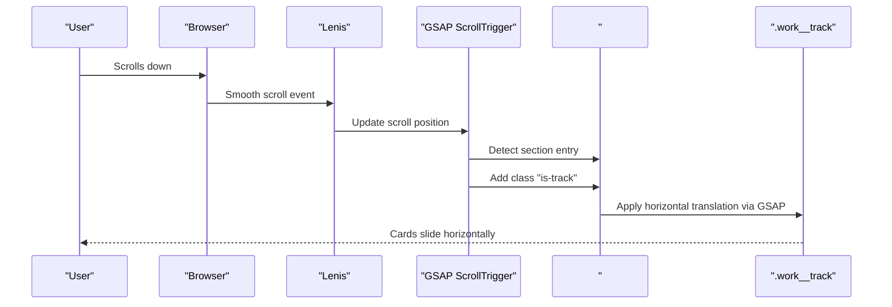
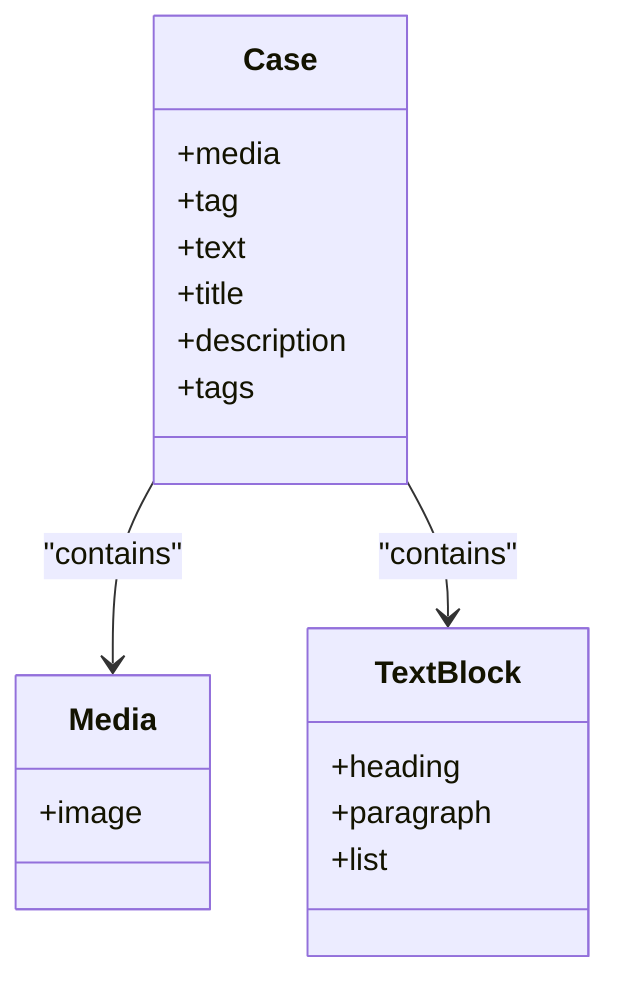
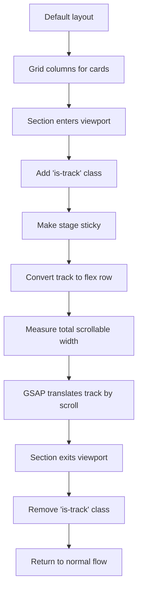
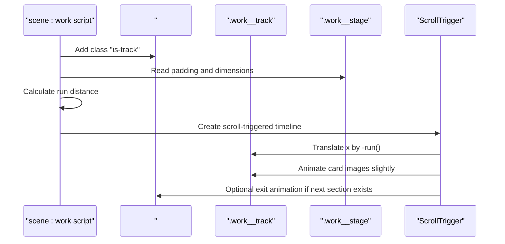
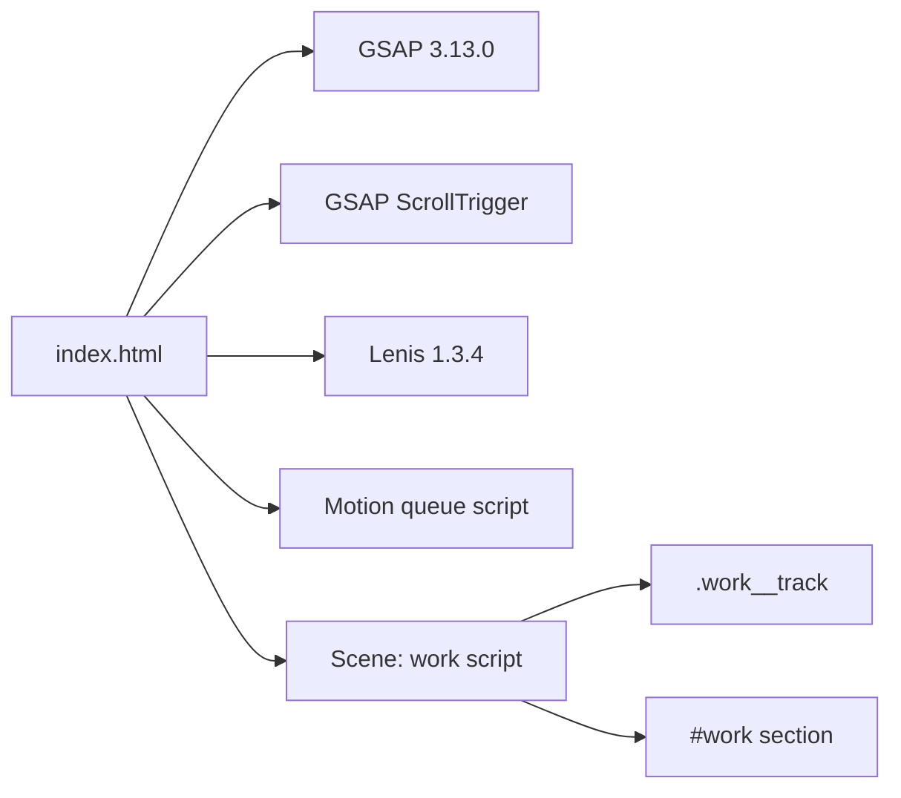

# Services Showcase

<cite>
**Referenced Files in This Document**
- [index.html](file://index.html)
- [README.md](file://README.md)
</cite>

## Table of Contents
1. [Introduction](#introduction)
2. [Project Structure](#project-structure)
3. [Core Components](#core-components)
4. [Architecture Overview](#architecture-overview)
5. [Detailed Component Analysis](#detailed-component-analysis)
6. [Dependency Analysis](#dependency-analysis)
7. [Performance Considerations](#performance-considerations)
8. [Troubleshooting Guide](#troubleshooting-guide)
9. [Conclusion](#conclusion)
10. [Appendices](#appendices)

## Introduction
This document explains the services showcase section that presents five service cards on a horizontal track. The section represents TiTech Digital’s core offerings: web development and e-commerce, design and digital identity, software and automation, SEO and digital growth, and ongoing support. It covers card structure, content organization, CSS layout, JavaScript-driven horizontal scrolling, responsive behavior, and guidance for modifying or extending the section while preserving the intended user experience.

The implementation is part of a single-page website template where this section is named “work” and uses GSAP ScrollTrigger for scroll-based animation and Lenis for smooth scrolling.

## Project Structure
The services showcase lives inside the main page file as a dedicated section with its own markup, styles, and animation script. Related assets include images under `assets/img` and shared typography from Google Fonts. The README describes the overall page structure and confirms that the services showcase is the third major section after the hero and statement.

**Diagram sources**
- [index.html:298-336](file://index.html#L298-L336)
- [index.html:631-669](file://index.html#L631-L669)
- [index.html:1144-1174](file://index.html#L1144-L1174)
- [README.md:17-30](file://README.md#L17-L30)

**Section sources**
- [index.html:298-336](file://index.html#L298-L336)
- [index.html:631-669](file://index.html#L631-L669)
- [README.md:17-30](file://README.md#L17-L30)

## Core Components
The services showcase consists of:

- Section container: `#work`
- Background plate: `.work__plate`
- Sticky stage: `.work__stage`
- Window frame: `.work__window`
- Horizontal track: `.work__track`
- Service cards: `.case`
- Card media: `.case__media` and `.case__img`
- Tag badge: `.case__tag`
- Card text block: `.case__text`
- Title: `.case__name`
- Description: `.case__line`
- Tags list: `.case__tags`

Each `.case` represents one service offering. On small screens the default layout stacks cards vertically; when the section enters the animated state, it becomes a horizontal track.

**Section sources**
- [index.html:631-669](file://index.html#L631-L669)

## Architecture Overview
The services showcase follows a layered architecture:

1. **Markup layer**: semantic HTML defines the section, headings, lists, and cards.
2. **Style layer**: CSS controls the default grid layout and switches to a horizontal flex track when the animated state is active.
3. **Animation layer**: GSAP ScrollTrigger adds the `is-track` class, calculates scroll distance, and translates the track horizontally.
4. **Smooth-scrolling layer**: Lenis provides smooth scrolling and integrates with ScrollTrigger updates.

**Diagram sources**
- [index.html:1018-1034](file://index.html#L1018-L1034)
- [index.html:1144-1174](file://index.html#L1144-L1174)

## Detailed Component Analysis

### Card Structure and Content Organization
Each service card contains:

| Element | Purpose |
|---|---|
| `.case` | Outer card wrapper with image background and overlay text |
| `.case__media` | Media container holding the card image |
| `.case__img` | Responsive image with `srcset` and lazy decoding |
| `.case__tag` | Small badge describing the service area |
| `.case__text` | Text block containing title, description, and tags |
| `.case__name` | Service title |
| `.case__line` | Short description |
| `.case__tags` | Inline list of capability badges |

The five cards represent:

1. Web presence and e-commerce
2. Design and digital identity
3. Software and automation
4. SEO and digital growth
5. Ongoing support

These map directly to TiTech Digital’s positioning as described in the project documentation.

**Diagram sources**
- [index.html:640-666](file://index.html#L640-L666)

**Section sources**
- [index.html:640-666](file://index.html#L640-L666)
- [README.md:7-15](file://README.md#L7-L15)

### CSS Layout and Horizontal Scrolling Mechanism
The default layout uses a grid for stacked presentation. When the section activates the animated state, the following changes occur:

- The section receives class `is-track`.
- The stage becomes sticky and fills the viewport height.
- The window becomes a flex container aligned vertically.
- The track becomes a horizontal flex container with `max-content` width.
- Each card keeps its aspect ratio and does not shrink.
- GSAP translates the track along the X-axis based on scroll progress.

Key CSS behaviors:

| Breakpoint / State | Behavior |
|---|---|
| Default | Vertical grid layout |
| `min-width: 700px` | Two-column grid for non-animated state |
| Animated state | Horizontal flex track |
| Mobile animated track | Adjusted height for vertical space |
| Desktop animated cards | Adjusted aspect ratio |

**Diagram sources**
- [index.html:298-336](file://index.html#L298-L336)
- [index.html:1144-1174](file://index.html#L1144-L1174)

**Section sources**
- [index.html:298-336](file://index.html#L298-L336)
- [index.html:1144-1174](file://index.html#L1144-L1174)

### JavaScript Interactions for Horizontal Navigation
The horizontal navigation is scroll-driven rather than button-driven. The relevant script:

1. Registers GSAP and ScrollTrigger.
2. Initializes Lenis smooth scrolling.
3. Adds the `is-track` class to the section.
4. Calculates the maximum horizontal run distance.
5. Creates a ScrollTrigger timeline that translates the track.
6. Applies subtle parallax to card images.
7. Adds an exit animation when the next section is adjacent.

**Diagram sources**
- [index.html:1018-1034](file://index.html#L1018-L1034)
- [index.html:1144-1174](file://index.html#L1144-L1174)

**Section sources**
- [index.html:1018-1034](file://index.html#L1018-L1034)
- [index.html:1144-1174](file://index.html#L1144-L1174)

### Responsive Behavior Across Devices
Responsive behavior is controlled through CSS media queries and adaptive JS measurements:

- On mobile, the default view stacks cards vertically.
- At `min-width: 700px`, the non-animated grid shows two columns.
- In the animated state, the track becomes horizontal regardless of column count.
- Card aspect ratios adjust between portrait-oriented and wider formats.
- The radius used for the optional curved exit effect adapts to screen width.
- Lenis smooth scrolling respects reduced-motion preferences.

Recommended responsive considerations:

| Device Size | Expected Behavior |
|---|---|
| Small mobile | Vertical stack by default; horizontal track when animated |
| Tablet | Two-column grid before animation; horizontal track during animation |
| Desktop | Wider cards and smoother horizontal scroll |
| Reduced motion | Animations are disabled; content remains accessible |

**Section sources**
- [index.html:298-336](file://index.html#L298-L336)
- [index.html:1144-1174](file://index.html#L1144-L1174)

### How Each Card Represents TiTech Digital’s Offerings
The section explicitly positions TiTech Digital as a partner for digital products. The five cards align with the documented service areas:

| Card | TiTech Digital Offering |
|---|---|
| Web presence and e-commerce | Websites and online stores tailored to business goals |
| Design and digital identity | Brand identity, UI/UX, and product design |
| Software and automation | Web apps, dashboards, APIs, AI, and automation |
| SEO and digital growth | Technical SEO, performance, and conversion optimization |
| Ongoing support | Maintenance, hosting, and continuous optimization |

This alignment is consistent with the README’s service summary and the JSON-LD organization data included in the page head.

**Section sources**
- [index.html:640-666](file://index.html#L640-L666)
- [README.md:7-15](file://README.md#L7-L15)

## Dependency Analysis
The services showcase depends on several external libraries and internal scripts:

- GSAP 3.13.0 for animation timelines.
- GSAP ScrollTrigger for scroll-based triggers.
- Lenis 1.3.4 for smooth scrolling.
- Internal motion queue for safe animation registration.
- Internal scene script for the work section.

**Diagram sources**
- [index.html:927-929](file://index.html#L927-L929)
- [index.html:961-1016](file://index.html#L961-L1016)
- [index.html:1018-1034](file://index.html#L1018-L1034)
- [index.html:1144-1174](file://index.html#L1144-L1174)

**Section sources**
- [index.html:927-929](file://index.html#L927-L929)
- [index.html:961-1016](file://index.html#L961-L1016)
- [index.html:1018-1034](file://index.html#L1018-L1034)
- [index.html:1144-1174](file://index.html#L1144-L1174)

## Performance Considerations
The implementation includes several performance-friendly patterns:

- Images use `srcset`, `sizes`, and lazy decoding.
- The animation layer uses `will-change: transform` on frequently animated elements.
- ScrollTrigger animations are scrubbed rather than time-based, keeping motion tied to user input.
- Lenis smooth scrolling is initialized only when reduced motion is not preferred.
- Image decode work is warmed after page load for pinned sections.

Optimization recommendations:

- Keep images optimized and appropriately sized.
- Avoid adding many heavy animations to the same section.
- Preserve `prefers-reduced-motion` behavior for accessibility.
- Reuse existing classes and variables instead of duplicating layout logic.

[No sources needed since this section provides general guidance]

## Troubleshooting Guide
Common issues and resolutions:

| Issue | Likely Cause | Resolution |
|---|---|---|
| Cards do not scroll horizontally | Section missing `is-track` class or ScrollTrigger not initialized | Verify GSAP and ScrollTrigger are loaded and the scene script runs |
| Horizontal scroll distance is incorrect | Track width or stage padding changed without recalculating run distance | Ensure the script recalculates `--run` on refresh |
| Animation breaks after dynamic content change | DOM mutated after ScrollTrigger setup | Call `refreshScroll()` or let the motion queue handle refresh |
| Smooth scrolling conflicts with native scroll | Lenis and browser scroll both active | Keep Lenis enabled only when reduced motion is not preferred |
| Images appear blurry or oversized | Missing `srcset` or wrong sizes | Use provided responsive image attributes |

Relevant code paths:

- Smooth scrolling initialization and ScrollTrigger integration.
- Refresh helper function.
- Warm-up for pinned section images.
- Work section animation setup and cleanup.

**Section sources**
- [index.html:1018-1043](file://index.html#L1018-L1043)
- [index.html:1144-1174](file://index.html#L1144-L1174)

## Conclusion
The services showcase is a well-structured, scroll-driven horizontal track that presents TiTech Digital’s five core offerings. Its design separates concerns clearly: semantic markup, scoped CSS layers, and GSAP-driven animation. The implementation is responsive, accessible, and extensible. To maintain the intended user experience, modifications should preserve the card structure, keep the horizontal track behavior intact, and respect reduced-motion preferences.

[No sources needed since this section summarizes without analyzing specific files]

## Appendices

### Modifying Service Content
To update service content:

1. Locate the `#work` section.
2. Edit each `.case` element.
3. Update the tag, title, description, and tags list.
4. Replace images if needed while keeping responsive attributes.
5. Keep the number of cards at five unless you also adjust layout expectations.

**Section sources**
- [index.html:640-666](file://index.html#L640-L666)

### Adding New Services
To add more services:

1. Add another `.case` item inside `.work__track`.
2. Provide an image and descriptive text.
3. If changing the number of visible cards, review responsive breakpoints.
4. Test horizontal scroll distance and exit animations.
5. Update any footer links or service lists if they reference the new offering.

**Section sources**
- [index.html:640-666](file://index.html#L640-L666)
- [index.html:904-910](file://index.html#L904-L910)

### Customizing Visual Presentation
To customize visuals:

- Change colors, fonts, and spacing through CSS variables and tokens.
- Adjust card aspect ratios in the animated state.
- Modify gap values for the track.
- Update badge styling through shared component classes.
- Avoid removing `data-8b-*` attributes required by animations.

**Section sources**
- [index.html:117-138](file://index.html#L117-L138)
- [index.html:298-336](file://index.html#L298-L336)
- [README.md:65-76](file://README.md#L65-L76)