# Site Structure and Content

<cite>
**Referenced Files in This Document**   
- [index.html](file://index.html)
- [README.md](file://README.md)
- [CREDITS.md](file://CREDITS.md)
</cite>

## Table of Contents
1. [Introduction](#introduction)
2. [Project Structure](#project-structure)
3. [Core Components](#core-components)
4. [Architecture Overview](#architecture-overview)
5. [Detailed Component Analysis](#detailed-component-analysis)
6. [Dependency Analysis](#dependency-analysis)
7. [Performance Considerations](#performance-considerations)
8. [Troubleshooting Guide](#troubleshooting-guide)
9. [Conclusion](#conclusion)
10. [Appendices](#appendices)

## Introduction
This document explains the structural components and content organization of the TiTech Digital website. The site is a single-page layout that tells a coherent story: it introduces the brand, presents services, demonstrates principles and methodology, shows the studio’s approach, displays selected projects, answers common questions, invites contact, and closes with navigation and legal information.

The intended user journey moves from attention to understanding, then to proof, process, capability, evidence, reassurance, action, and finally closure. Each section has a specific role in guiding visitors toward contacting TiTech Digital while reinforcing positioning as a reliable, method-driven digital partner.

**Section sources**
- [README.md:1-30](file://README.md#L1-L30)

## Project Structure
The project is intentionally minimal: one main HTML file for Italian, an English version under `en/index.html`, shared assets under `assets/img`, and supporting documentation files. All CSS and JavaScript are inline within the HTML, so there is no build step.

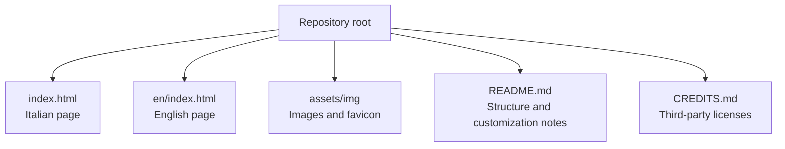

**Diagram sources**
- [index.html:1-15](file://index.html#L1-L15)
- [README.md:32-53](file://README.md#L32-L53)

Key structural characteristics:
- Single-file pages with inline styles and scripts.
- Sections identified by semantic IDs such as `hero`, `statement`, `work`, `again`, `method`, `studio`, `lavori`, `faq`, `contact`, and `footer`.
- Animation hooks use `data-8b-section` and `data-8b-motion` attributes.
- External dependencies are loaded from CDNs: GSAP, ScrollTrigger, and Lenis.

**Section sources**
- [index.html:1-15](file://index.html#L1-L15)
- [index.html:895-901](file://index.html#L895-L901)
- [README.md:32-53](file://README.md#L32-L53)

## Core Components
The ten main sections form the backbone of the site:

| Section | Purpose | User-journey role | Key structural elements |
|---|---|---|---|
| Hero | Opening identity and visual hook | Capture attention and introduce the brand word | Circular image stage, orbit, animated aperture, opening lead text |
| Statement | Two-line positioning statement | Clarify what TiTech Digital does | Large two-line heading, lead paragraph, index links |
| Work | Five service cards on a horizontal track | Present solutions and capabilities | Track, window, five case cards with tags and descriptions |
| Again | Six principle wheel cards | Communicate design values and long-term thinking | Wheel, swing, six partner cards |
| Method | Four-phase process with animated ring | Show how work is delivered | Ring, SVG arc, four steps |
| Studio | Collage with integrated competencies | Demonstrate team approach and skills | Photo collage, roles list |
| Lavori | Portfolio grid with six demo projects | Provide proof through examples | Grid, project cards, year badges, tags |
| FAQ | Accordion using native `
` | Reduce uncertainty and answer objections | Title, list of details/summary items |
| Contact | Project enquiry form | Convert interest into a conversation | Lead text, direct email link, validated form fields |
| Footer | Closing greeting, navigation, legal | Close the experience and provide secondary navigation | Animated closing word, grid columns, legal line |

These sections are linked together through anchor navigation, consistent typography, color tokens, and scroll-driven animations.

**Section sources**
- [index.html:572-893](file://index.html#L572-L893)
- [README.md:17-29](file://README.md#L17-L29)

## Architecture Overview
The site architecture combines semantic HTML, layered CSS, and scroll-triggered animation logic.

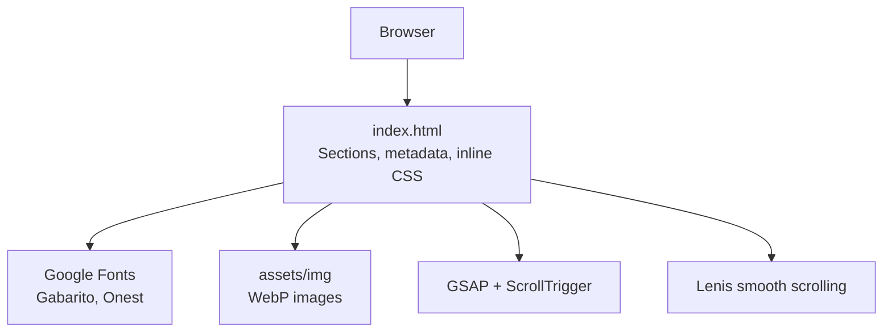

**Diagram sources**
- [index.html:27-30](file://index.html#L27-L30)
- [index.html:895-901](file://index.html#L895-L901)

At runtime:
1. The browser loads the HTML, fonts, and inline CSS.
2. GSAP and ScrollTrigger register plugins.
3. Lenis initializes smooth scrolling when motion is allowed.
4. Intersection observers and ScrollTriggers activate per-section animations.
5. The contact form validates input and opens a `mailto:` request.

**Section sources**
- [index.html:895-1012](file://index.html#L895-L1012)
- [index.html:1013-1303](file://index.html#L1013-L1303)

## Detailed Component Analysis

### Hero
The hero establishes the brand and visual tone. It contains:
- A short introductory paragraph describing TiTech Digital’s focus.
- An opening link to the services section.
- A large title containing the opening word “TiTech”.
- A circular image stage with orbit and moon decorations.
- An animated aperture that reveals the image.

The hero uses CSS variables for sizing, responsive adjustments for landscape and portrait orientations, and keyframe animations for mask reveal, rise, swell, lift, rotation, and orbit. When offscreen, image and orbit animations pause.

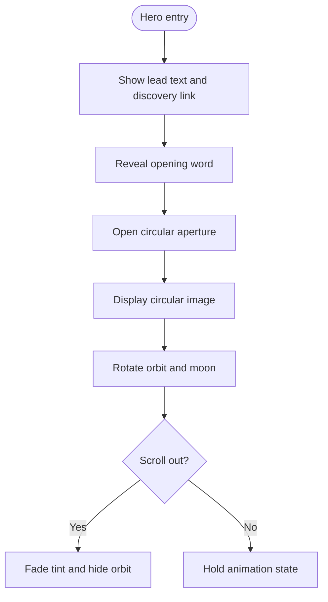

**Diagram sources**
- [index.html:238-282](file://index.html#L238-L282)
- [index.html:574-580](file://index.html#L574-L580)
- [index.html:1076-1095](file://index.html#L1076-L1095)

User-journey role:
- Grabs attention with bold typography and motion.
- Signals technology-led positioning.
- Directs users toward the services section.

Modification guidance:
- Change the opening word inside the title element.
- Replace the hero image source and srcset.
- Keep the circular stage classes and animation attributes intact.
- Update the lead paragraph and discovery link without removing accessibility labels.

**Section sources**
- [index.html:238-282](file://index.html#L238-L282)
- [index.html:574-580](file://index.html#L574-L580)
- [index.html:1076-1095](file://index.html#L1076-L1095)

### Statement
The statement section provides a two-line headline and a concise explanation of TiTech Digital’s approach. It also includes an index linking to major sections.

Key points:
- The headline emphasizes technology moving business forward.
- The lead paragraph connects clear objectives, solid technical choices, and user attention.
- The index helps users navigate directly to services, works, method, studio, and contact.

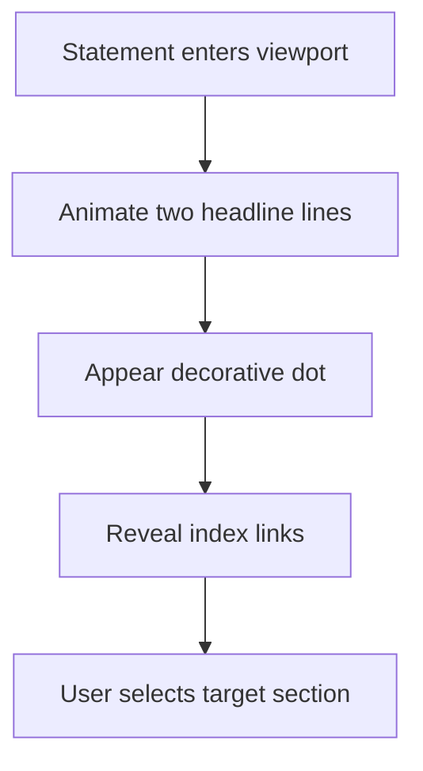

**Diagram sources**
- [index.html:283-297](file://index.html#L283-L297)
- [index.html:583-597](file://index.html#L583-L597)
- [index.html:1097-1110](file://index.html#L1097-L1110)

User-journey role:
- Transitions from emotional hook to rational positioning.
- Provides a map of the page’s narrative.

Modification guidance:
- Edit both headline lines and the lead paragraph.
- Keep the index structure if you want the same navigation behavior.
- Do not remove the `data-8b-motion` attributes used by the animation queue.

**Section sources**
- [index.html:283-297](file://index.html#L283-L297)
- [index.html:583-597](file://index.html#L583-L597)
- [index.html:1097-1110](file://index.html#L1097-L1110)

### Work: Five Service Cards on Horizontal Track
The work section presents five service areas: web and e-commerce, digital identity, software and automation, SEO and growth, and continuous support.

Structural highlights:
- A dark background plate.
- A sticky stage that pins the section during horizontal scrolling.
- A track containing five case cards.
- Each card includes media, tag, name, description, and tags.
- Responsive grid fallbacks below the interactive track.

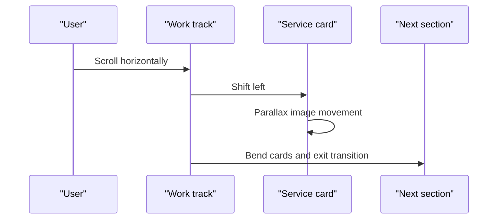

**Diagram sources**
- [index.html:298-336](file://index.html#L298-L336)
- [index.html:599-637](file://index.html#L599-L637)
- [index.html:1112-1143](file://index.html#L1112-L1143)

User-journey role:
- Demonstrates breadth of capabilities.
- Uses horizontal interaction to suggest flow and progression.
- Bridges services to principles.

Modification guidance:
- Add, remove, or reorder service cards by editing the list items.
- Update names, descriptions, and tags.
- Keep the `case` class and media structure for animations to work.
- If changing the number of cards, verify the exit-bend animation still calculates correctly.

**Section sources**
- [index.html:298-336](file://index.html#L298-L336)
- [index.html:599-637](file://index.html#L599-L637)
- [index.html:1112-1143](file://index.html#L1112-L1143)

### Again: Six Principle Wheel Cards
The again section communicates six principles through a wheel that rotates as the user scrolls.

Principles shown:
1. Quality and reliability
2. Structure and scalability
3. Protection and security
4. Continuity and maintainability
5. Connection and integration
6. Evolution and improvement

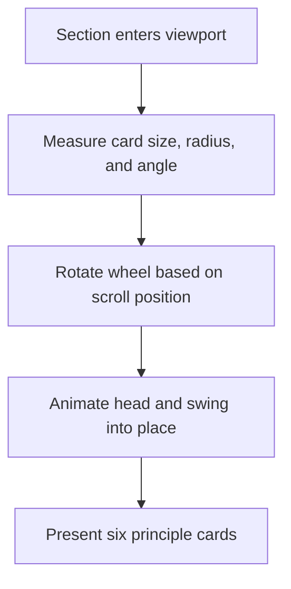

**Diagram sources**
- [index.html:337-368](file://index.html#L337-L368)
- [index.html:639-675](file://index.html#L639-L675)
- [index.html:1144-1188](file://index.html#L1144-L1188)

User-journey role:
- Reinforces long-term thinking and engineering values.
- Uses rotational motion to symbolize evolution and continuity.

Modification guidance:
- Edit each partner card’s badge, name, and description.
- Keep the six-card structure unless you also update the measured step and spin calculations.
- Preserve the `partner` class and image structure.

**Section sources**
- [index.html:337-368](file://index.html#L337-L368)
- [index.html:639-675](file://index.html#L639-L675)
- [index.html:1144-1188](file://index.html#L1144-L1188)

### Method: Four-Phase Process with Animated Ring
The method section explains the delivery process: analysis, design, development, and evolution.

Visual mechanics:
- A ring with an SVG track and animated arc.
- Four station markers around the circle.
- A rotating arm and runner.
- Steps that highlight as the ring animates.

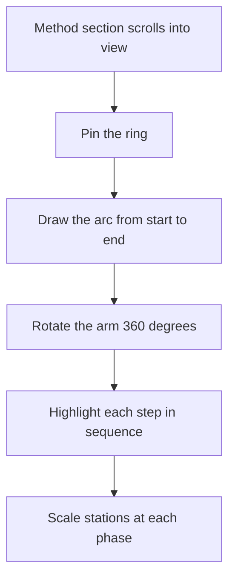

**Diagram sources**
- [index.html:369-405](file://index.html#L369-L405)
- [index.html:679-701](file://index.html#L679-L701)
- [index.html:1190-1207](file://index.html#L1190-L1207)

User-journey role:
- Shows transparency and repeatability.
- Connects services and principles to a concrete workflow.

Modification guidance:
- Edit the four step headings and descriptions.
- Keep the four-step count unless you also adjust the arc timing and station positions.
- Do not remove the SVG classes or CSS variables controlling station placement.

**Section sources**
- [index.html:369-405](file://index.html#L369-L405)
- [index.html:679-701](file://index.html#L679-L701)
- [index.html:1190-1207](file://index.html#L1190-L1207)

### Studio: Collage with Integrated Competencies
The studio section shows how TiTech Digital works with clients through an animated photo collage and an integrated competency list.

Content structure:
- Headline and lead paragraph.
- Multiple photos arranged as a collage.
- Roles listing design, engineering, and digital strategy.
- Call-to-action link to contact.

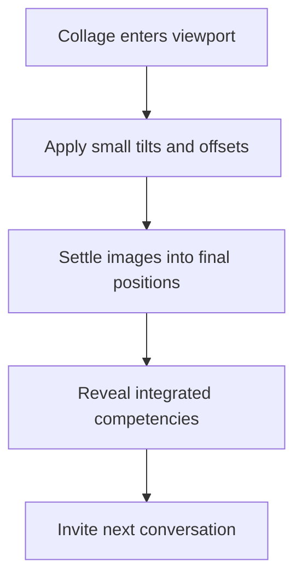

**Diagram sources**
- [index.html:406-432](file://index.html#L406-L432)
- [index.html:703-725](file://index.html#L703-L725)
- [index.html:1251-1265](file://index.html#L1251-L1265)

User-journey role:
- Humanizes the studio and clarifies integrated skills.
- Builds trust before showing portfolio evidence.

Modification guidance:
- Replace images and alt text with real studio visuals.
- Update roles and their sublabels.
- Keep the shot classes and collage container for animation.

**Section sources**
- [index.html:406-432](file://index.html#L406-L432)
- [index.html:703-725](file://index.html#L703-L725)
- [index.html:1251-1265](file://index.html#L1251-L1265)

### Lavori: Portfolio Grid with Six Demo Projects
The lavori section displays six demonstration projects in a responsive grid. Each project includes a media card, year badge, category label, name, description, and tags.

Important note:
- The current content is demonstrative and will be replaced with real case studies.
- The README instructs updating the project count and removing the demo note before publication.

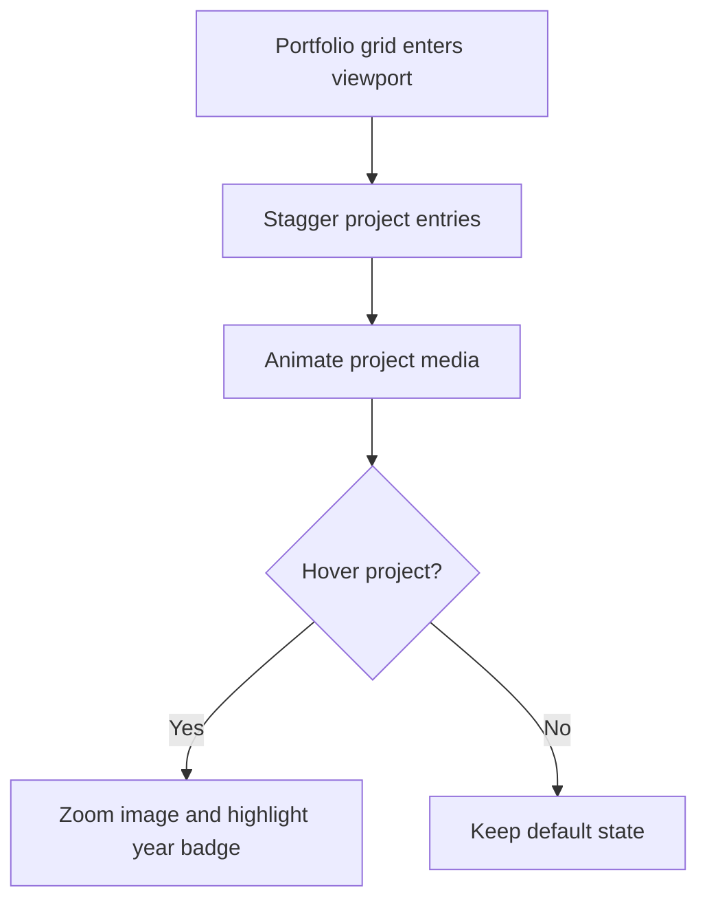

**Diagram sources**
- [index.html:433-467](file://index.html#L433-L467)
- [index.html:727-814](file://index.html#L727-L814)
- [index.html:1267-1278](file://index.html#L1267-L1278)

User-journey role:
- Provides tangible proof of capability.
- Encourages conversion by ending with a call to action.

Modification guidance:
- Replace each project card with real cases.
- Update the selected-project counter.
- Remove the demo-note paragraph before launch.
- Keep the project structure and classes for hover and animation behavior.

**Section sources**
- [index.html:433-467](file://index.html#L433-L467)
- [index.html:727-814](file://index.html#L727-L814)
- [index.html:1267-1278](file://index.html#L1267-L1278)
- [README.md:65-76](file://README.md#L65-L76)

### FAQ: Accordion Using Native Details Elements
The FAQ section uses native `
` and `
` elements to create an accessible accordion without custom JavaScript.

Structure:
- Large title.
- List of question-answer pairs.
- Custom marker that scales when expanded.

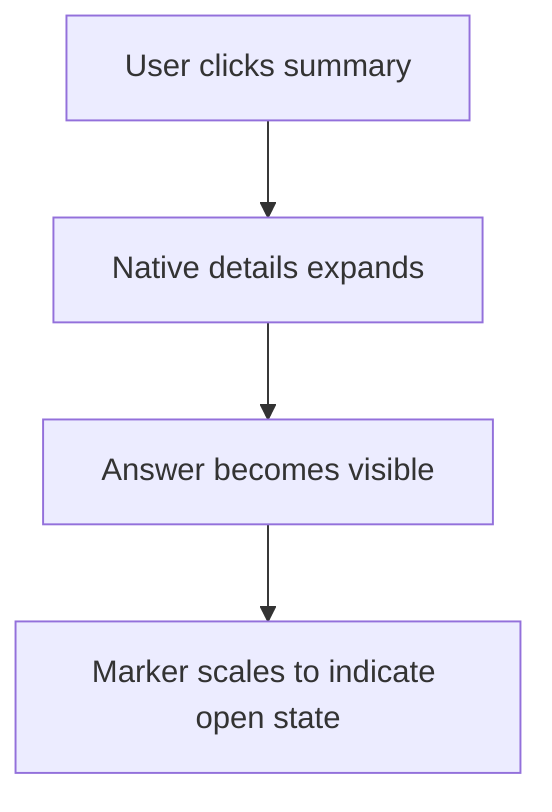

**Diagram sources**
- [index.html:468-483](file://index.html#L468-L483)
- [index.html:816-827](file://index.html#L816-L827)

User-journey role:
- Addresses common concerns after exposure to services, methods, and portfolio.
- Reduces friction before contact.

Modification guidance:
- Edit questions and answers freely.
- Keep the `faq__item`, `faq__answer`, and `faq__mark` classes.
- Maintain semantic `
` and `
` structure for accessibility.

**Section sources**
- [index.html:468-483](file://index.html#L468-L483)
- [index.html:816-827](file://index.html#L816-L827)

### Contact: Form and Direct Email
The contact section invites users to describe their need and offers a direct email alternative.

Form fields:
- Name
- Email
- Company
- Topic dropdown
- Message textarea

Behavior:
- Validates required fields.
- Composes a subject and body.
- Opens the user’s mail client via `mailto:`.
- Displays success or error status messages.

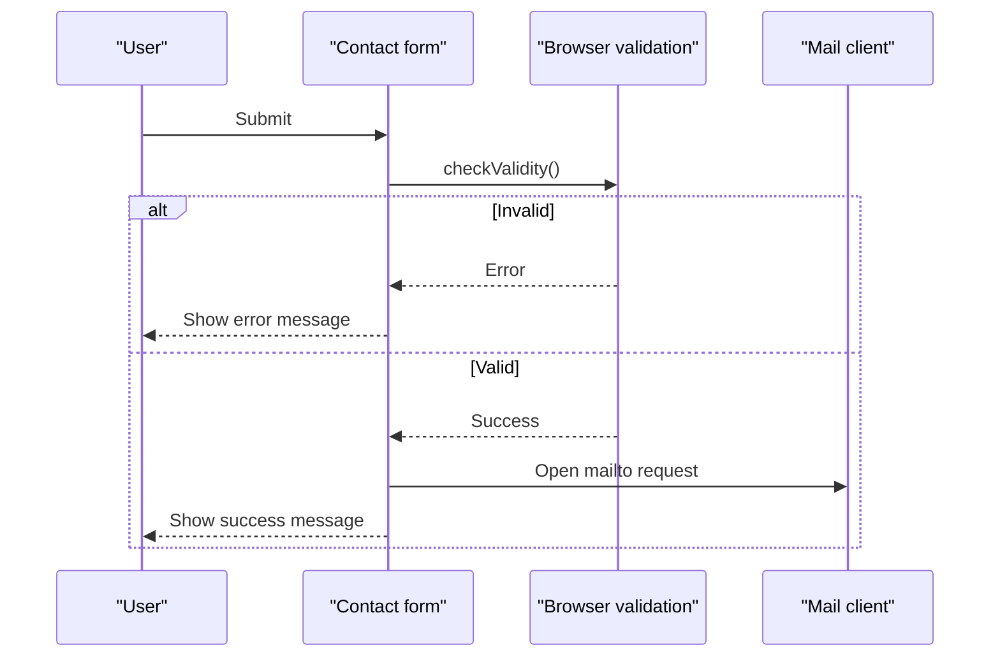

**Diagram sources**
- [index.html:484-504](file://index.html#L484-L504)
- [index.html:829-857](file://index.html#L829-L857)
- [index.html:1210-1238](file://index.html#L1210-L1238)

User-journey role:
- Converts interest into a concrete conversation.
- Provides fallback contact path.

Modification guidance:
- Replace the placeholder email address with the real address.
- Adjust field labels, options, and validation messages.
- To integrate a backend, replace the `mailto:` logic in the contact script.

**Section sources**
- [index.html:484-504](file://index.html#L484-L504)
- [index.html:829-857](file://index.html#L829-L857)
- [index.html:1210-1238](file://index.html#L1210-L1238)
- [README.md:55-63](file://README.md#L55-L63)

### Footer: Closing Greeting, Navigation, and Legal
The footer closes the experience with an animated closing word, exploration links, service links, company info, newsletter-style call-to-action, and legal information.

Structure:
- Animated closing word with circular image aperture.
- Four-column grid: explore, services, company, call-to-action.
- Legal line with copyright, VAT number, rights reserved, and design credit.

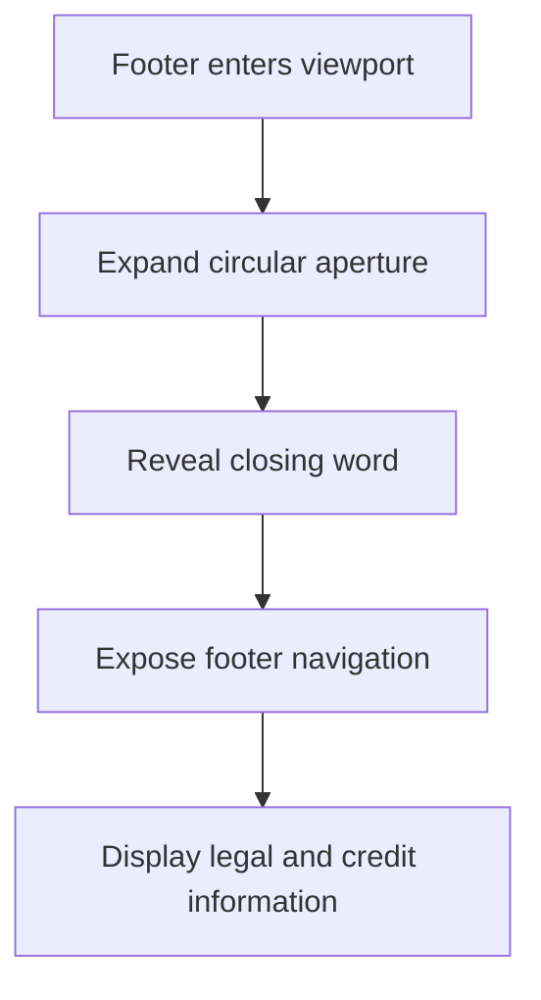

**Diagram sources**
- [index.html:505-532](file://index.html#L505-L532)
- [index.html:860-893](file://index.html#L860-L893)
- [index.html:1291-1302](file://index.html#L1291-L1302)

User-journey role:
- Provides closure and reinforces branding.
- Offers secondary navigation and legal compliance.

Modification guidance:
- Update legal data and email addresses consistently across the page.
- Keep the animated aperture classes and structure.
- Ensure all footer links point to valid section IDs.

**Section sources**
- [index.html:505-532](file://index.html#L505-L532)
- [index.html:860-893](file://index.html#L860-L893)
- [index.html:1291-1302](file://index.html#L1291-L1302)

## Dependency Analysis
The site depends on external libraries and internal section coordination.

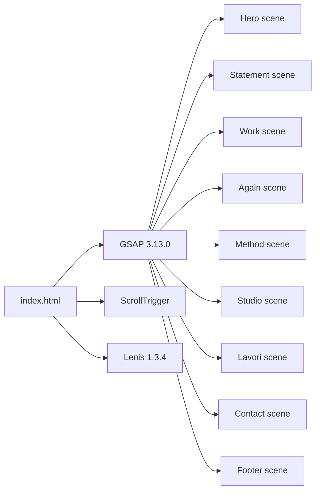

**Diagram sources**
- [index.html:895-901](file://index.html#L895-L901)
- [index.html:986-1012](file://index.html#L986-L1012)
- [index.html:1076-1302](file://index.html#L1076-L1302)

Coupling and cohesion:
- Each scene script targets a specific section ID and class set.
- The motion queue centralizes initialization, reduced-motion handling, and refresh logic.
- Sections communicate indirectly through scroll order and adjacency checks.

Potential circular dependencies:
- None detected; scenes depend on DOM elements but do not mutate unrelated scenes.

External integration points:
- Google Fonts for typography.
- jsDelivr for GSAP, ScrollTrigger, and Lenis.
- Pexels and Unsplash images documented in credits.

**Section sources**
- [index.html:895-1012](file://index.html#L895-L1012)
- [index.html:1013-1303](file://index.html#L1013-L1303)
- [CREDITS.md:7-50](file://CREDITS.md#L7-L50)

## Performance Considerations
- Images are served as WebP with srcset and sizes for responsive loading.
- Hero and social preview images use eager loading hints; other images use lazy loading.
- Motion animations respect `prefers-reduced-motion`.
- Smooth scrolling is provided by Lenis and integrates with ScrollTrigger updates.
- Image decode warm-up runs after load to reduce first-paint jank in pinned sections.

Recommendations:
- Keep images optimized and appropriately sized.
- Avoid adding heavy third-party scripts beyond GSAP, ScrollTrigger, and Lenis.
- Test with reduced motion enabled to ensure usability.
- Monitor scroll performance if adding more pinned or scrub-based animations.

[No sources needed since this section provides general guidance]

## Troubleshooting Guide
Common issues and resolutions:

| Issue | Likely cause | Resolution |
|---|---|---|
| Animations do not run | GSAP or ScrollTrigger failed to load, or reduced motion is active | Check CDN availability and browser settings; inspect console errors |
| Horizontal track does not move | Track width calculation fails or section structure changed | Verify `.work__track` and `.work__window` exist and are not hidden |
| Wheel does not rotate | Section classes or card count changed | Ensure the section has `is-wheel` and six cards retain correct classes |
| Method ring does not animate | Step count or SVG classes changed | Keep four steps and preserve SVG track and arc classes |
| Contact form sends wrong email | Placeholder email not updated | Replace `info@titechdigital.it` in the contact script and footer |
| Mobile menu does not close | Menu event listeners missing or broken | Restore the menu toggle, close button, and Escape-key handler |

**Section sources**
- [index.html:898-921](file://index.html#L898-L921)
- [index.html:1210-1238](file://index.html#L1210-L1238)
- [README.md:55-76](file://README.md#L55-L76)

## Conclusion
The TiTech Digital website is a cohesive, single-page narrative built around ten clearly defined sections. The hero captures attention, the statement positions the brand, the work section showcases services, the again section communicates principles, the method section explains delivery, the studio section demonstrates capability, the lavori section provides proof, the FAQ reduces uncertainty, the contact section drives conversion, and the footer closes the experience.

Maintaining this structure ensures the intended flow remains intact. When modifying content, prioritize preserving semantic structure, animation hooks, accessibility attributes, and cross-section links.

[No sources needed since this section summarizes without analyzing specific files]

## Appendices

### Content Hierarchy Summary
- Brand introduction: hero
- Positioning: statement
- Capabilities: work
- Values: again
- Process: method
- Team approach: studio
- Evidence: lavori
- Reassurance: faq
- Conversion: contact
- Closure: footer

### Modification Checklist
- Update Italian and English versions together.
- Replace placeholder email addresses.
- Replace demo projects with real cases.
- Keep `data-8b-*` attributes and section IDs.
- Preserve image classes and srcset patterns.
- Validate all anchor links.
- Review meta tags and structured data before publishing.

**Section sources**
- [README.md:65-76](file://README.md#L65-L76)
- [index.html:547-571](file://index.html#L547-L571)
- [index.html:860-893](file://index.html#L860-L893)