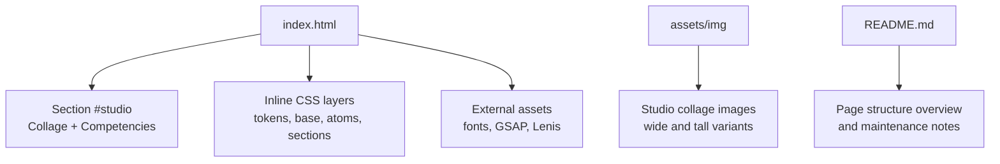
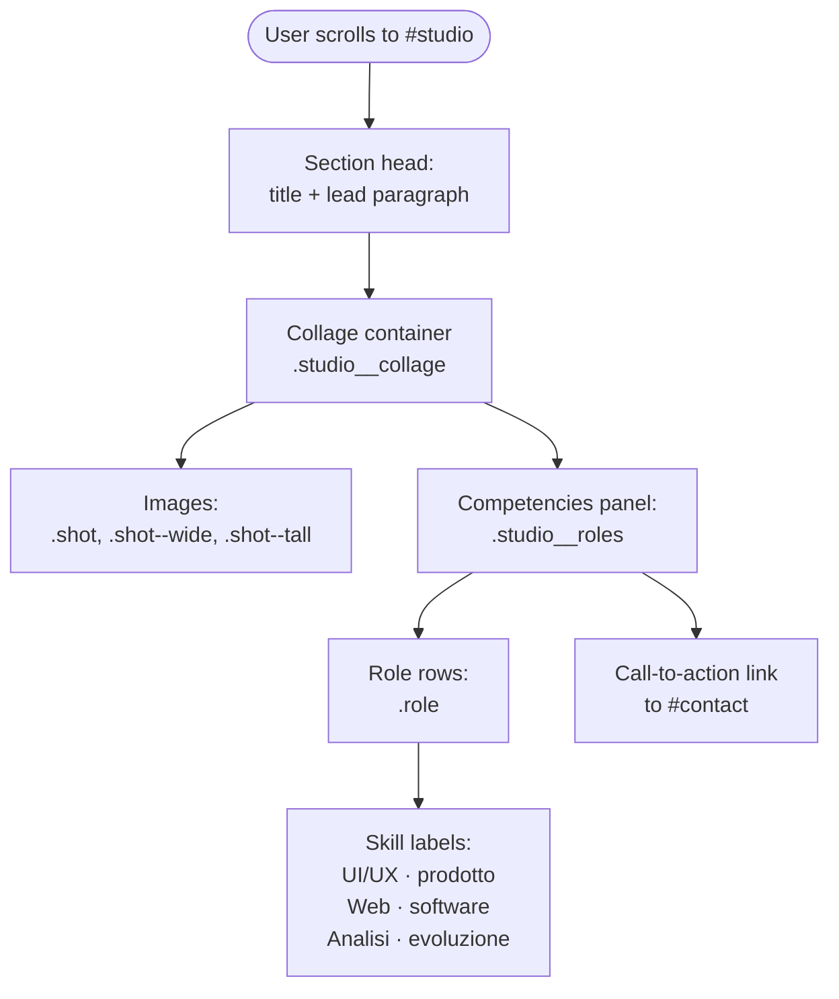
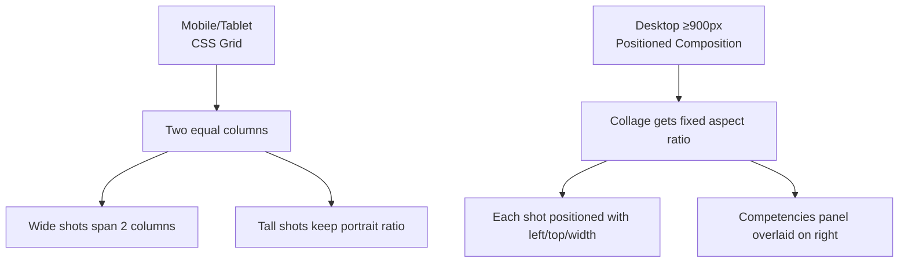
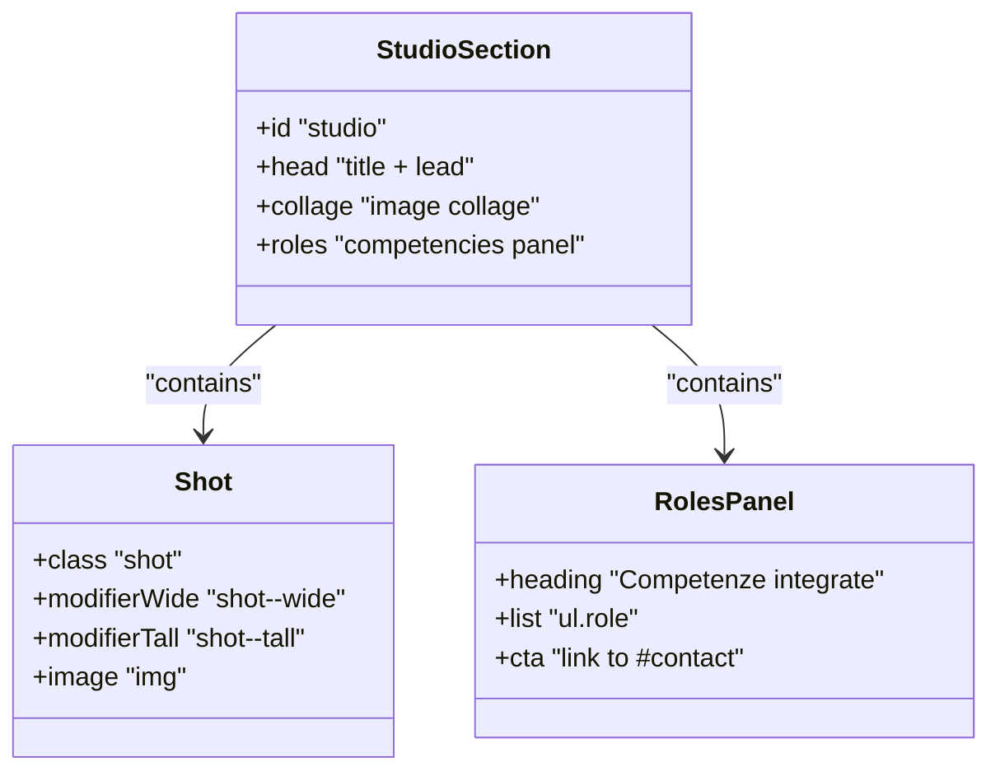
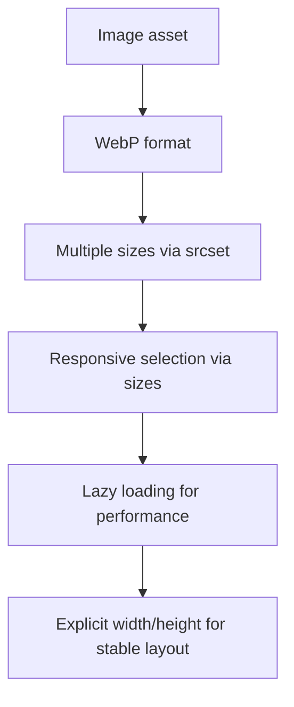
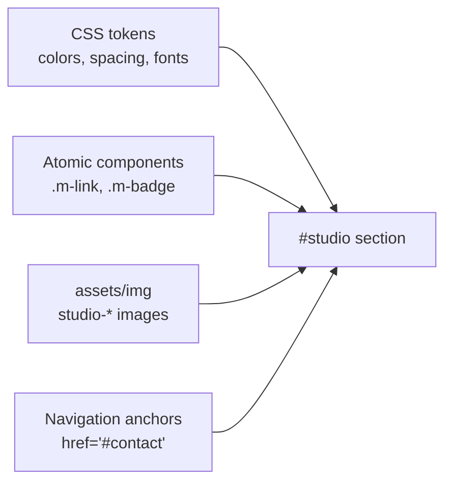

# Team Showcase

<cite>
**Referenced Files in This Document**
- [index.html](file://index.html)
- [README.md](file://README.md)
</cite>

## Table of Contents
1. [Introduction](#introduction)
2. [Project Structure](#project-structure)
3. [Core Components](#core-components)
4. [Architecture Overview](#architecture-overview)
5. [Detailed Component Analysis](#detailed-component-analysis)
6. [Dependency Analysis](#dependency-analysis)
7. [Performance Considerations](#performance-considerations)
8. [Troubleshooting Guide](#troubleshooting-guide)
9. [Conclusion](#conclusion)

## Introduction
This document explains the studio collage with integrated competencies section, which is the visual and informational hub for how the team works together. It covers:
- Collage layout and responsive behavior
- How team information and competencies are structured and displayed
- CSS grid and positioning techniques used to arrange images and text
- Image optimization strategies
- Interactive elements such as hover effects and links
- Practical guidance for updating content, adding new members or roles, and maintaining visual balance

The section is part of a single-page website template that uses inline CSS, semantic HTML, and modern layout features. The documentation focuses on the `#studio` section and its relationship to surrounding page structure.

## Project Structure
The project is a minimal one-page site. The relevant files for this documentation are:
- `index.html`: contains the full page markup, including the studio collage section and all styles.
- `README.md`: describes the page structure, languages, local preview instructions, and customization notes.
- `assets/img`: holds optimized WebP images referenced by the page, including the collage images.

**Diagram sources**
- [index.html:406-432](file://index.html#L406-L432)
- [index.html:735-757](file://index.html#L735-L757)
- [README.md:17-30](file://README.md#L17-L30)

**Section sources**
- [index.html:406-432](file://index.html#L406-L432)
- [index.html:735-757](file://index.html#L735-L757)
- [README.md:17-30](file://README.md#L17-L30)

## Core Components
The studio section has two main parts:
- Visual collage: five images arranged into a cohesive composition.
- Integrated competencies panel: a short list of role areas and sub-skills, plus a call-to-action link.

Key structural elements:
- Section container: `#studio`
- Head area: title and lead paragraph
- Collage container: `.studio__collage`
- Images: `.shot`, with modifier classes `.shot--wide` and `.shot--tall`
- Competencies panel: `.studio__roles` containing an unordered list of `.role` items
- Call-to-action link using the shared link component

Responsive behavior:
- Mobile and tablet: a two-column CSS grid where wide shots span both columns.
- Desktop (from 900px): the collage becomes a positioned composition inside a fixed aspect ratio, with absolute positioning for each shot and the competencies panel overlaid on the right side.

No hover-only animations are defined specifically for the collage; interaction is primarily through navigation links and standard focus states.

**Section sources**
- [index.html:406-432](file://index.html#L406-L432)
- [index.html:735-757](file://index.html#L735-L757)

## Architecture Overview
The collage is not a traditional card-based team grid. Instead, it is a curated photo composition that visually represents collaboration, while the competencies panel communicates the integrated skill areas.

**Diagram sources**
- [index.html:735-757](file://index.html#L735-L757)

## Detailed Component Analysis

### Collage Layout and Grid Behavior
On small screens, the collage uses a two-column CSS grid:
- `.studio__collage` sets `grid-template-columns: repeat(2, minmax(0, 1fr))`.
- Wide shots use `.shot--wide` to span both columns.
- Tall shots use `.shot--tall` to maintain a portrait aspect ratio.
- All images fill their containers with `object-fit: cover`.

On large screens (900px and up), the layout switches to a positioned composition:
- The collage container becomes a block with a fixed aspect ratio.
- Each `.shot` is absolutely positioned with specific left/top percentages and widths.
- The competencies panel is also absolutely positioned on the right side.

**Diagram sources**
- [index.html:406-432](file://index.html#L406-L432)

**Section sources**
- [index.html:406-432](file://index.html#L406-L432)

### Competencies Panel Structure
The competencies panel is a semantic list under `.studio__roles`:
- A heading introduces the integrated skills concept.
- An unordered list contains role entries.
- Each entry pairs a primary role label with a secondary skill descriptor.
- A call-to-action link points to the contact section.

There are no explicit hover animations for individual roles. Interaction relies on:
- Standard link underline and arrow animation from the shared link component.
- Focus-visible outlines for keyboard accessibility.

**Diagram sources**
- [index.html:735-757](file://index.html#L735-L757)

**Section sources**
- [index.html:735-757](file://index.html#L735-L757)

### CSS Grid and Flexbox Usage
- Grid is the primary layout mechanism for the collage and the roles list.
- Flexbox is used within role rows to align the role name and skill descriptors.
- Shared atomic components like `.m-link` provide consistent typography, spacing, and hover animations for links.

Important behaviors:
- Images use `object-fit: cover` to fill their containers without distortion.
- Aspect ratios are enforced via CSS classes and media queries.
- On desktop, absolute positioning creates a layered composition rather than a strict grid.

**Section sources**
- [index.html:406-432](file://index.html#L406-L432)
- [index.html:175-196](file://index.html#L175-L196)

### Image Optimization Strategies
The collage images follow the same optimization pattern used across the site:
- WebP format for better compression.
- Multiple resolutions provided via `srcset`.
- Responsive sizing via `sizes`.
- Lazy loading for non-critical images.
- Explicit width and height attributes to prevent layout shifts.

For the collage:
- Wide images have three breakpoints.
- Tall images have two breakpoints.
- Images are loaded lazily since they are below the fold.

**Diagram sources**
- [index.html:742-746](file://index.html#L742-L746)

**Section sources**
- [index.html:742-746](file://index.html#L742-L746)

### Responsive Behavior
- Below 900px: two-column grid with stacked images and a vertical roles list.
- From 900px: collage becomes a fixed-aspect composition with absolute positioning; the roles panel overlays the right side.
- Typography and spacing scale using clamp and viewport units.
- Reduced motion preferences do not affect the static collage layout; animations elsewhere in the page respect `prefers-reduced-motion`.

**Section sources**
- [index.html:406-432](file://index.html#L406-L432)

### Interactive Elements
- Links use the shared link component with underline and arrow animations on hover.
- Focus-visible outlines ensure keyboard users can see interactive elements.
- No dedicated hover effects are applied to individual collage images or role rows.

**Section sources**
- [index.html:185-192](file://index.html#L185-L192)
- [index.html:747-755](file://index.html#L747-L755)

## Dependency Analysis
The studio section depends on:
- Global CSS tokens for colors, spacing, and typography.
- Shared atomic components for buttons, badges, and links.
- Inline image assets under `assets/img`.
- Page-level semantics and IDs for navigation anchors.

**Diagram sources**
- [index.html:117-137](file://index.html#L117-L137)
- [index.html:175-196](file://index.html#L175-L196)
- [index.html:735-757](file://index.html#L735-L757)

**Section sources**
- [index.html:117-137](file://index.html#L117-L137)
- [index.html:175-196](file://index.html#L175-L196)
- [index.html:735-757](file://index.html#L735-L757)

## Performance Considerations
- Use WebP images with appropriate `srcset` and `sizes` to reduce bandwidth.
- Keep lazy loading enabled for collage images.
- Avoid heavy JavaScript animations on the collage; rely on CSS transforms and will-change only where necessary.
- Maintain explicit image dimensions to prevent cumulative layout shift.
- Ensure contrast between text and background in the competencies panel for readability.

[No sources needed since this section provides general guidance]

## Troubleshooting Guide
Common issues and fixes:
- Images appear stretched or cropped unexpectedly:
  - Verify `object-fit: cover` is applied and aspect ratio classes are correct.
  - Check that width and height attributes match the intended composition.
- Collage breaks on desktop:
  - Confirm the 900px media query is active and absolute positioning values are intact.
  - Ensure no custom CSS overrides `.shot:nth-child()` rules.
- Competencies text overlaps images:
  - Adjust the overlay position or reduce the number of role lines.
  - Consider increasing the collage aspect ratio or repositioning the panel.
- Link hover or focus styles missing:
  - Verify the shared link component classes are present.
  - Check for CSS specificity conflicts.

**Section sources**
- [index.html:406-432](file://index.html#L406-L432)
- [index.html:735-757](file://index.html#L735-L757)

## Conclusion
The studio collage with integrated competencies section combines a curated image composition with a concise skills panel. It uses CSS grid for mobile/tablet layouts and absolute positioning for desktop compositions. Images are optimized with WebP, `srcset`, `sizes`, and lazy loading. The competencies panel communicates design, engineering, and digital strategy capabilities, linking to the contact section for next steps. When updating content, preserve the semantic structure, maintain aspect ratios, and test responsiveness at key breakpoints to keep the collage balanced and accessible.

[No sources needed since this section summarizes without analyzing specific files]