# Animation System with GSAP and Lenis

<cite>
**Referenced Files in This Document**   
- [index.html](file://index.html)
- [en/index.html](file://en/index.html)
- [README.md](file://README.md)
</cite>

## Table of Contents
1. [Introduction](#introduction)
2. [Project Structure](#project-structure)
3. [Core Components](#core-components)
4. [Architecture Overview](#architecture-overview)
5. [Detailed Component Analysis](#detailed-component-analysis)
6. [Dependency Analysis](#dependency-analysis)
7. [Performance Considerations](#performance-considerations)
8. [Troubleshooting Guide](#troubleshooting-guide)
9. [Conclusion](#conclusion)
10. [Appendices](#appendices)

## Introduction
This document explains the animation system built for the TiTech Digital website. It uses:
- GSAP 3.13.0 and ScrollTrigger for scroll-based animations
- Lenis 1.3.4 for smooth scrolling
- A custom animation queue that schedules, isolates, and cleans up timelines
- CSS `@media (prefers-reduced-motion: no-preference)` to disable motion for accessibility

The site is a single-page layout with sections such as hero, statement, service cards, portfolio grid, method cycle, studio collage, FAQ accordion, contact form, and footer. Animations are organized by section using `data-8b-section` attributes and triggered through ScrollTrigger instances created inside per-scene scripts.

**Section sources**
- [README.md:1-30](file://README.md#L1-L30)
- [README.md:78-85](file://README.md#L78-L85)
- [index.html:895-897](file://index.html#L895-L897)

## Project Structure
The project contains:
- Italian page at `index.html`
- English page at `en/index.html`
- Shared assets under `assets/img`
- Documentation and credits files

Both pages share the same animation architecture. The Italian page is the primary implementation; the English page mirrors it with localized content and adjusted asset paths.

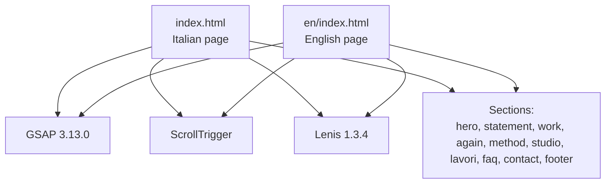

**Diagram sources**
- [index.html:895-897](file://index.html#L895-L897)
- [en/index.html:895-897](file://en/index.html#L895-L897)

**Section sources**
- [README.md:17-30](file://README.md#L17-L30)
- [README.md:32-41](file://README.md#L32-L41)
- [index.html:544-893](file://index.html#L544-L893)
- [en/index.html:544-893](file://en/index.html#L544-L893)

## Core Components
The animation system consists of these core parts:
- External libraries: GSAP, ScrollTrigger, Lenis
- Page initialization: plugin registration, ScrollTrigger configuration, reduced-motion setup, Lenis integration
- Animation queue: scheduling, error isolation, cleanup, and refresh coordination
- Effects library: reusable timeline builders like rise, ink, iris
- Scene scripts: per-section ScrollTrigger configurations
- Section scripts: non-animation behaviors like navigation, hero offscreen detection, contact form handling

Key responsibilities:
- QueueMotion ensures animations run only when appropriate, avoids conflicts, and restores DOM state on errors
- PageInit registers plugins and sets up Lenis only when motion is allowed
- Scene scripts encapsulate ScrollTrigger logic per section
- Effects provide consistent animation primitives

**Section sources**
- [index.html:895-897](file://index.html#L895-L897)
- [index.html:929-984](file://index.html#L929-L984)
- [index.html:986-1012](file://index.html#L986-L1012)
- [index.html:1013-1075](file://index.html#L1013-L1075)

## Architecture Overview
The runtime flow connects user scroll events to Lenis, which updates ScrollTrigger, which drives GSAP timelines bound to specific sections.

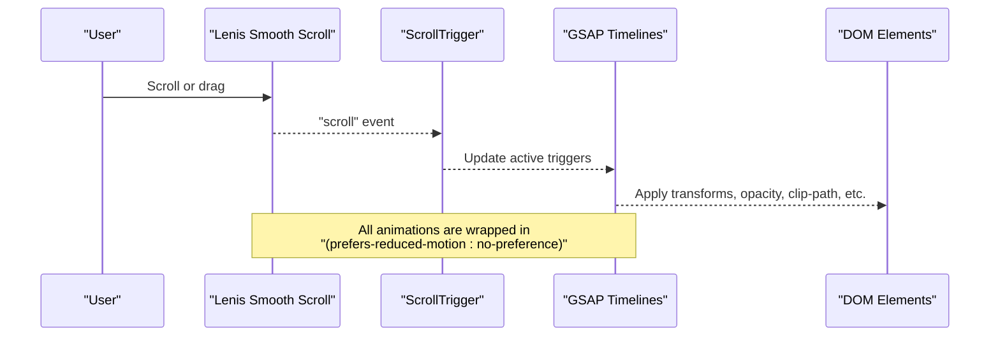

**Diagram sources**
- [index.html:994-1002](file://index.html#L994-L1002)
- [index.html:1076-1303](file://index.html#L1076-L1303)

**Section sources**
- [index.html:986-1012](file://index.html#L986-L1012)
- [index.html:1076-1303](file://index.html#L1076-L1303)

## Detailed Component Analysis

### Animation Queue System
The queue manages when and how animations run. It:
- Waits for fonts and DOM readiness
- Schedules tasks via `scheduler.yield` or fallback timeout
- Refreshes ScrollTrigger after runs
- Wraps each setup in a GSAP context for safe revert behavior
- Observes DOM mutations to restore attributes if an animation fails
- Supports lazy execution near a target element
- Tracks first-run animations separately from queued ones

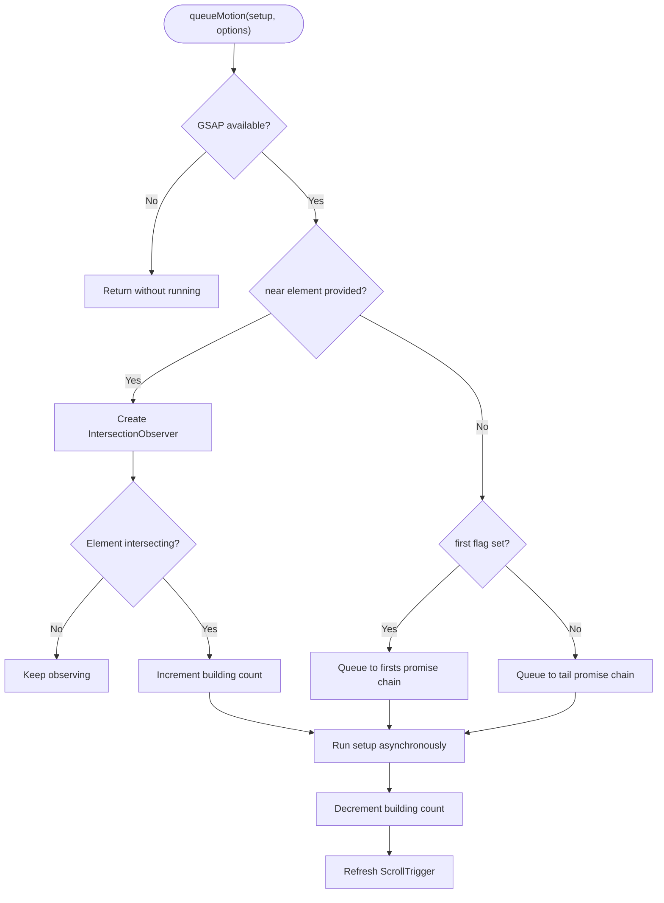

**Diagram sources**
- [index.html:929-984](file://index.html#L929-L984)

**Section sources**
- [index.html:929-984](file://index.html#L929-L984)

### Timeline Management and Effects
The effects module provides reusable timeline builders:
- Rise: reveals text with a clip-path sweep and dot entrance
- Ink: fades in word spans with staggered timing
- Iris: circular reveal for images with subtle scale

These are used by the generic motion scanner that looks for elements marked with `data-8b-motion`.

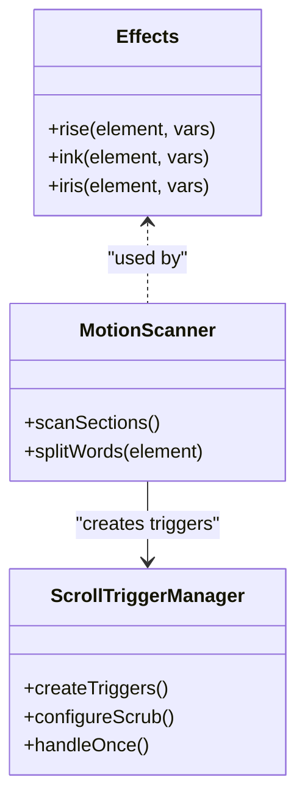

**Diagram sources**
- [index.html:1013-1075](file://index.html#L1013-L1075)

**Section sources**
- [index.html:1013-1075](file://index.html#L1013-L1075)

### Page Initialization and Reduced Motion Support
Page initialization:
- Registers ScrollTrigger
- Configures ScrollTrigger to ignore mobile resize
- Exposes a global `refreshScroll` function
- Sets up Lenis only when `prefers-reduced-motion: no-preference` matches
- Integrates Lenis scroll events with ScrollTrigger update
- Warms image decoding for pinned photo sections

Reduced motion support:
- All animations are wrapped in `gsap.matchMedia().add('(prefers-reduced-motion: no-preference)', ...)`
- When reduced motion is preferred, Lenis is not initialized and animations do not run
- CSS animations also respect `prefers-reduced-motion: no-preference`

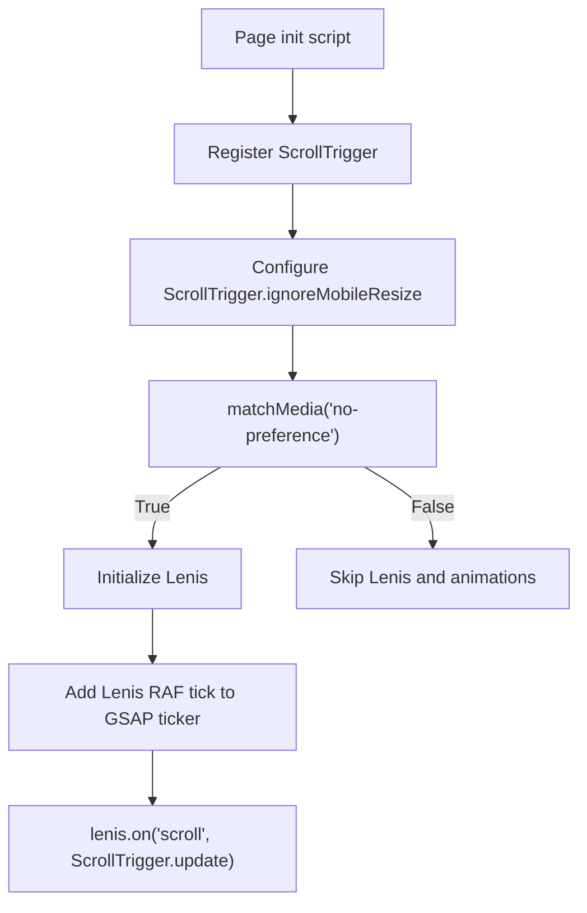

**Diagram sources**
- [index.html:986-1012](file://index.html#L986-L1012)

**Section sources**
- [index.html:986-1012](file://index.html#L986-L1012)
- [index.html:264-280](file://index.html#L264-L280)
- [index.html:526-530](file://index.html#L526-L530)

### Hero Animations
Hero behavior:
- Offscreen detection pauses rotating background animations when out of view
- On exit, the hero aperture scales and translates toward the statement dot
- Intro elements move upward and orbit elements fade out during hero exit

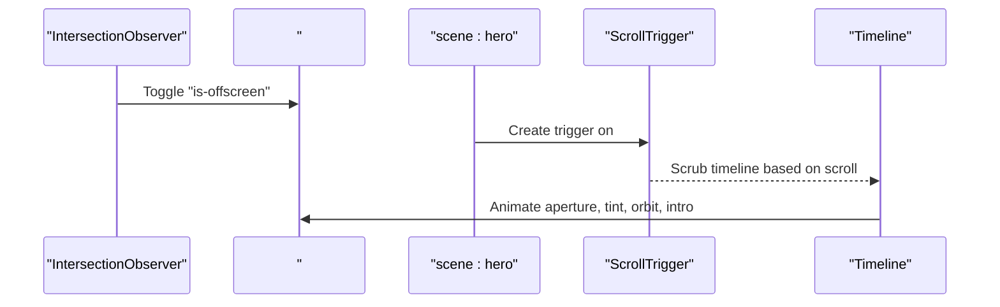

**Diagram sources**
- [index.html:922-928](file://index.html#L922-L928)
- [index.html:1076-1096](file://index.html#L1076-L1096)

**Section sources**
- [index.html:922-928](file://index.html#L922-L928)
- [index.html:1076-1096](file://index.html#L1076-L1096)

### Statement Animations
Statement behavior:
- If adjacent to hero, lines animate into place with scrub
- The decorative dot scales in
- Index links stagger in once the index enters the viewport

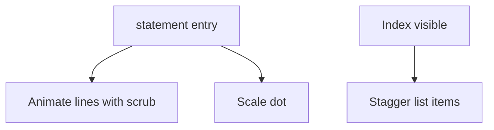

**Diagram sources**
- [index.html:1097-1111](file://index.html#L1097-L1111)

**Section sources**
- [index.html:1097-1111](file://index.html#L1097-L1111)

### Service Cards: Horizontal Track and Wheel Transition
Service cards (`#work`) implement:
- A horizontal track that scrolls horizontally with vertical scroll
- Image parallax within each card
- Plate reveal behind the track
- Optional transition to the next section where cards bend into a wheel-like arrangement

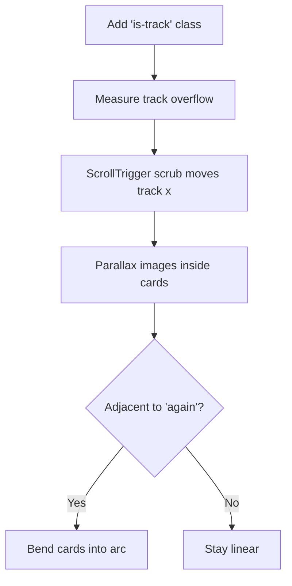

**Diagram sources**
- [index.html:1112-1143](file://index.html#L1112-L1143)

**Section sources**
- [index.html:1112-1143](file://index.html#L1112-L1143)

### Principles Wheel: Rotating Card Carousel
Principles section (`#again`) implements:
- A rotating wheel of partner cards driven by scroll
- Dynamic measurement of card size, radius, step angle, and spin distance
- Optional entry animation from the previous section

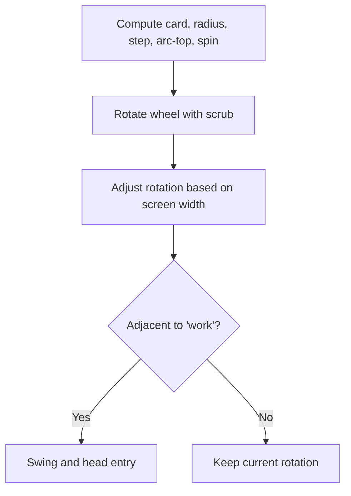

**Diagram sources**
- [index.html:1144-1189](file://index.html#L1144-L1189)

**Section sources**
- [index.html:1144-1189](file://index.html#L1144-L1189)

### Method Cycle: Animated Ring and Steps
Method section (`#method`) implements:
- A sticky ring that stays visible while steps scroll
- SVG stroke drawing and arm rotation synchronized with scroll
- Step highlights and station markers scaling as progress advances

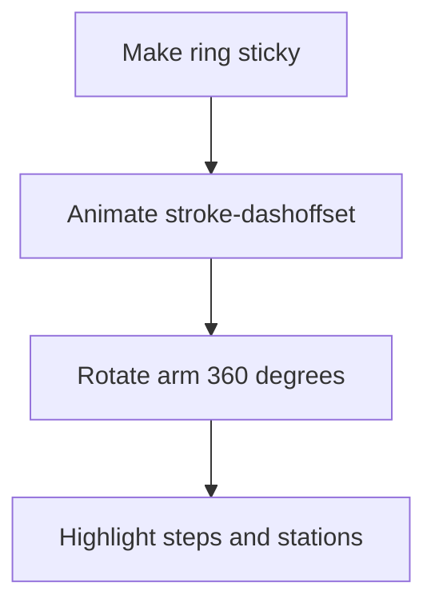

**Diagram sources**
- [index.html:1190-1208](file://index.html#L1190-L1208)

**Section sources**
- [index.html:1190-1208](file://index.html#L1190-L1208)

### Portfolio Grid: Projects Reveal
Portfolio section (`#lavori`) implements:
- Grid items fade and slide in with stagger
- Each project media scales and fades in individually

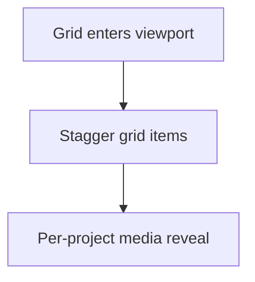

**Diagram sources**
- [index.html:1267-1279](file://index.html#L1267-L1279)

**Section sources**
- [index.html:1267-1279](file://index.html#L1267-L1279)

### FAQ Accordion
FAQ section (`#faq`) uses native `
` elements. There is no dedicated GSAP animation for opening/closing; instead, CSS transitions handle the visual mark indicator.

Accessibility notes:
- Native details/summary semantics provide keyboard and screen reader support
- Visual feedback is provided via CSS transform on the mark element

**Section sources**
- [index.html:816-827](file://index.html#L816-L827)
- [index.html:468-483](file://index.html#L468-L483)

### Contact Form Integration
Contact section (`#contact`) includes:
- Scroll-triggered title animation
- Form validation and mailto composition
- Status messages for success and error states

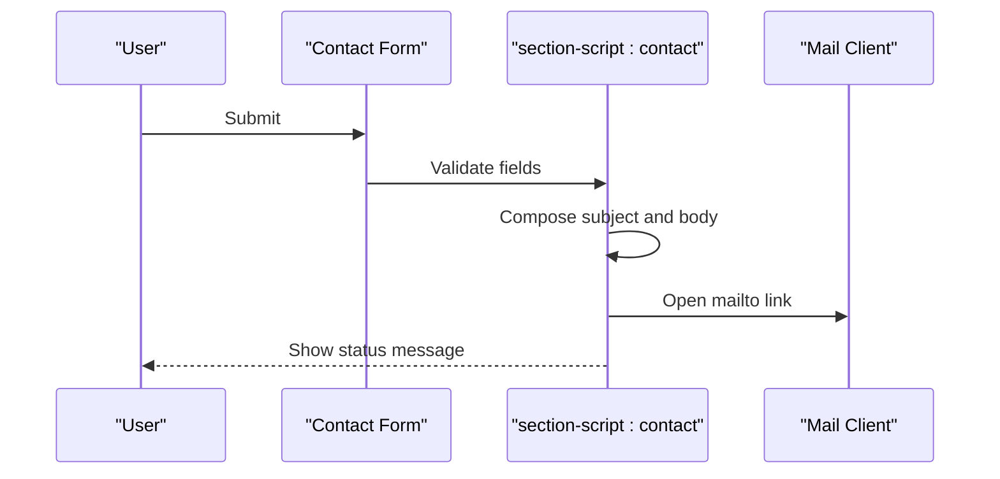

**Diagram sources**
- [index.html:1280-1290](file://index.html#L1280-L1290)
- [index.html:1210-1238](file://index.html#L1210-L1238)

**Section sources**
- [index.html:1280-1290](file://index.html#L1280-L1290)
- [index.html:1210-1238](file://index.html#L1210-L1238)

### Footer Animations
Footer behavior:
- Aperture scales to reveal the closing image
- Tint overlay fades out
- Word lifts into place

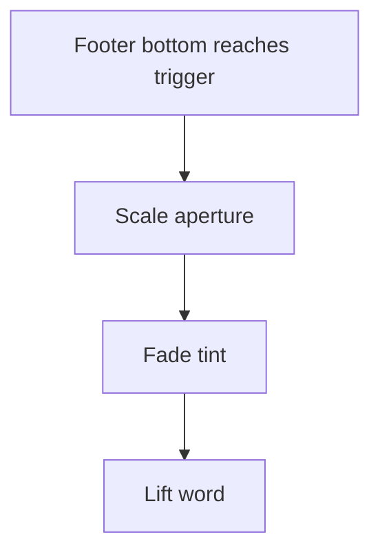

**Diagram sources**
- [index.html:1291-1303](file://index.html#L1291-L1303)

**Section sources**
- [index.html:1291-1303](file://index.html#L1291-L1303)

## Dependency Analysis
External dependencies:
- GSAP 3.13.0
- ScrollTrigger
- Lenis 1.3.4

Internal dependencies:
- Page init depends on ScrollTrigger being registered
- Scene scripts depend on the queue and effects
- Section scripts may interact with Lenis for menu open/close behavior

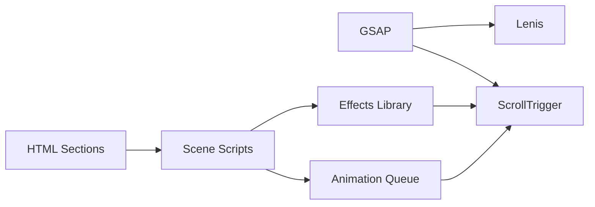

**Diagram sources**
- [index.html:895-897](file://index.html#L895-L897)
- [index.html:929-984](file://index.html#L929-L984)
- [index.html:1013-1075](file://index.html#L1013-L1075)
- [index.html:1076-1303](file://index.html#L1076-L1303)

**Section sources**
- [index.html:895-897](file://index.html#L895-L897)
- [index.html:929-984](file://index.html#L929-L984)
- [index.html:1013-1075](file://index.html#L1013-L1075)
- [index.html:1076-1303](file://index.html#L1076-L1303)

## Performance Considerations
- Use `scrub` judiciously; heavy transforms on many elements can cause jank
- Prefer `will-change` sparingly; the template already applies it to key animated elements
- Warm image decoding for pinned sections to reduce decode latency during scroll
- Avoid animating layout properties; use transforms and opacity where possible
- Keep ScrollTrigger ranges tight to minimize unnecessary recalculations
- Respect `prefers-reduced-motion` to avoid unnecessary work on devices or users who prefer reduced motion

[No sources needed since this section provides general guidance]

## Troubleshooting Guide
Common issues and resolutions:
- Animations not triggering:
  - Ensure ScrollTrigger is registered and configured
  - Verify the section has the correct `data-8b-section` attribute
  - Confirm the trigger element exists before creating the trigger
- ScrollTrigger not updating with Lenis:
  - Confirm Lenis is initialized only under `prefers-reduced-motion: no-preference`
  - Ensure `lenis.on('scroll', ScrollTrigger.update)` is present
- Layout shifts after animation failure:
  - The queue reverts DOM changes and restores attributes on error
  - Check console logs for failed setups
- Stuttering on mobile:
  - Reduce number of simultaneous scrub animations
  - Avoid animating large images directly; animate containers instead
- Menu interaction breaks smooth scroll:
  - Opening the menu stops Lenis; closing resumes it
  - Ensure focus management is intact

**Section sources**
- [index.html:929-984](file://index.html#L929-L984)
- [index.html:986-1012](file://index.html#L986-L1012)
- [index.html:898-921](file://index.html#L898-L921)

## Conclusion
The animation system combines GSAP, ScrollTrigger, and Lenis into a cohesive, accessible, and maintainable architecture. The queue system isolates failures and coordinates refreshes, while scene scripts encapsulate per-section behavior. Reduced motion support ensures accessibility compliance. For new features, follow the established patterns: wrap animations in `gsap.matchMedia().add('(prefers-reduced-motion: no-preference)', ...)`, use `queueMotion` for scheduling, and keep ScrollTrigger scopes scoped to their sections.

[No sources needed since this section summarizes without analyzing specific files]

## Appendices

### Adding New Animations
Steps:
1. Add markup with appropriate semantic structure and `data-8b-section` on the container.
2. If you need reusable effects, extend the effects object with a new builder.
3. Create a new script block with `data-8b-part="scene:your-section"`.
4. Call `queueMotion(() => gsap.matchMedia().add('(prefers-reduced-motion: no-preference)', () => { /* your ScrollTrigger code */ }), { id: 'scene:your-section' })`.
5. If the animation should run immediately on first paint, pass `{ first: true, id: '...' }`.
6. If the animation should wait until a nearby element is visible, pass `{ near: element, id: '...' }`.

Example pattern references:
- Basic scene wrapper: [index.html:1076-1096](file://index.html#L1076-L1096)
- Grid reveal: [index.html:1267-1279](file://index.html#L1267-L1279)
- Complex scrubbed timeline: [index.html:1112-1143](file://index.html#L1112-L1143)

**Section sources**
- [index.html:1076-1096](file://index.html#L1076-L1096)
- [index.html:1267-1279](file://index.html#L1267-L1279)
- [index.html:1112-1143](file://index.html#L1112-L1143)

### Configuring ScrollTrigger
Guidelines:
- Always give each trigger a unique `id`
- Use `start` and `end` relative to the trigger element
- Use `scrub: true` for scroll-linked animations
- Use `once: true` for one-time entrance animations
- Use `invalidateOnRefresh: true` when geometry depends on dynamic measurements
- Wrap all triggers in reduced-motion matchMedia

Reference examples:
- Hero exit scrub: [index.html:1087-1094](file://index.html#L1087-L1094)
- Work track scrub: [index.html:1125-1127](file://index.html#L1125-L1127)
- Again wheel scrub: [index.html:1174-1174](file://index.html#L1174-L1174)
- Method cycle scrub: [index.html:1197-1204](file://index.html#L1197-L1204)

**Section sources**
- [index.html:1087-1094](file://index.html#L1087-L1094)
- [index.html:1125-1127](file://index.html#L1125-L1127)
- [index.html:1174-1174](file://index.html#L1174-L1174)
- [index.html:1197-1204](file://index.html#L1197-L1204)

### Integration Patterns Between GSAP Timelines and DOM Manipulation
Patterns observed:
- Add/remove utility classes like `is-track`, `is-wheel`, `is-cycle` to enable CSS-only layout changes tied to animations
- Compute geometry dynamically using helper functions like `layoutBox`
- Split text into word spans for ink-style animations and revert original HTML after animation
- Use CSS variables to pass computed values to stylesheets during animation

References:
- Utility helpers: [index.html:1034-1057](file://index.html#L1034-L1057)
- Class toggling and variable setting: [index.html:1118-1123](file://index.html#L1118-L1123), [index.html:1154-1169](file://index.html#L1154-L1169), [index.html:1196-1196](file://index.html#L1196-L1196)

**Section sources**
- [index.html:1034-1057](file://index.html#L1034-L1057)
- [index.html:1118-1123](file://index.html#L1118-L1123)
- [index.html:1154-1169](file://index.html#L1154-L1169)
- [index.html:1196-1196](file://index.html#L1196-L1196)