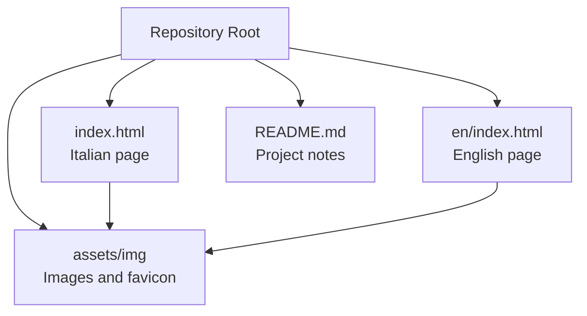
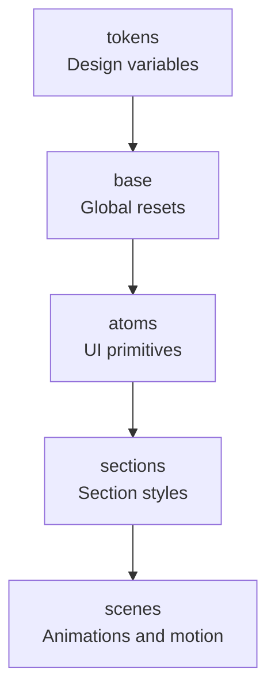
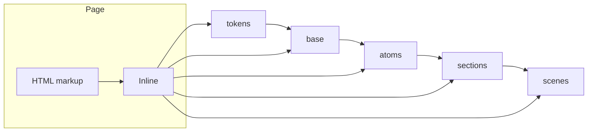
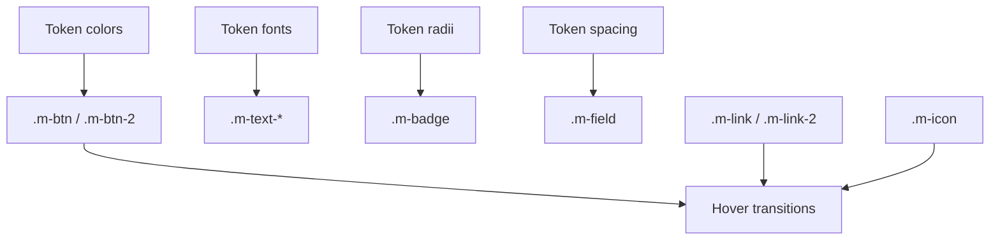
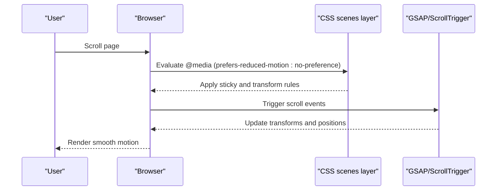
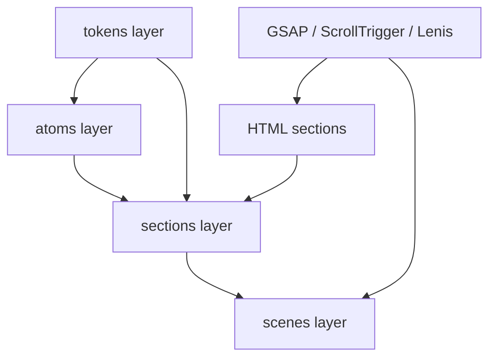

# CSS Architecture and Cascade Layers

<cite>
**Referenced Files in This Document**
- [index.html](file://index.html)
- [en/index.html](file://en/index.html)
- [README.md](file://README.md)
</cite>

## Table of Contents
1. [Introduction](#introduction)
2. [Project Structure](#project-structure)
3. [Core Components](#core-components)
4. [Architecture Overview](#architecture-overview)
5. [Detailed Component Analysis](#detailed-component-analysis)
6. [Dependency Analysis](#dependency-analysis)
7. [Performance Considerations](#performance-considerations)
8. [Troubleshooting Guide](#troubleshooting-guide)
9. [Conclusion](#conclusion)
10. [Appendices](#appendices)

## Introduction
This document explains the CSS architecture used by the TiTech Digital one-page website. The styles are implemented as inline `<style>` blocks inside each HTML page, organized through modern CSS cascade layers. The design system is built around:

- **Design tokens**: colors, fonts, radii, shadows, spacing, and derived values.
- **Base styles**: global resets, typography defaults, focus behavior, and accessibility helpers.
- **Atoms**: reusable UI primitives such as text scales, buttons, links, icons, badges, and form fields.
- **Layout components**: section-specific layout rules for navigation, hero, statement, work, again, method, studio, lavori, faq, contact, and footer.
- **Scene animations**: motion-enhanced behaviors for interactive sections like the horizontal track, rotating wheel, and animated ring.

The site uses a mobile-first responsive approach with fluid typography driven by `clamp()` functions and viewport units. It also relies on modern CSS features such as `color-mix()`, custom properties, sticky positioning, and `prefers-reduced-motion` to keep animations optional and accessible.

**Section sources**
- [README.md:78-85](file://README.md#L78-L85)

## Project Structure
The project is intentionally minimal:

- `index.html` contains the Italian version.
- `en/index.html` contains the English version.
- Both pages embed their own complete CSS using multiple `<style data-8b-part="...">` blocks.
- Assets such as images and fonts are referenced from `assets/img`.
- There is no build step; the site runs directly in the browser.



**Diagram sources**
- [index.html:1-116](file://index.html#L1-L116)
- [en/index.html:1-116](file://en/index.html#L1-L116)
- [README.md:43-53](file://README.md#L43-L53)

**Section sources**
- [README.md:17-53](file://README.md#L17-L53)
- [index.html:1-116](file://index.html#L1-L116)
- [en/index.html:1-116](file://en/index.html#L1-L116)

## Core Components
The CSS architecture is divided into six cascade layers declared once per page:

| Layer | Purpose | Typical Content |
|---|---|---|
| `tokens` | Design variables and shared constants | Colors, fonts, radii, shadows, spacing |
| `base` | Global resets and foundational styles | Box model, typography defaults, focus states, skip link |
| `atoms` | Reusable UI primitives | Text scale classes, buttons, links, icons, badges, fields |
| `layout` | Structural layout utilities | Not heavily used here; most layout lives in section styles |
| `sections` | Section-specific visual and layout rules | Navigation, hero, statement, work, again, method, studio, lavori, faq, contact, footer |
| `scenes` | Motion and scroll-driven enhancements | Track, wheel, cycle, and other scene-based animations |

The layer order is declared explicitly so that later layers can safely override earlier ones without relying on selector specificity wars.



**Diagram sources**
- [index.html:114-116](file://index.html#L114-L116)
- [en/index.html:114-116](file://en/index.html#L114-L116)

**Section sources**
- [index.html:114-203](file://index.html#L114-L203)
- [en/index.html:114-203](file://en/index.html#L114-L203)

## Architecture Overview
The site’s styling strategy follows a layered, token-driven approach:

1. **Tokens define the design language.** All colors, fonts, radii, shadows, and spacing come from CSS custom properties under `:root`.
2. **Base styles normalize the environment.** They set box sizing, typography inheritance, focus visibility, and accessibility helpers.
3. **Atoms provide consistent UI building blocks.** Classes prefixed with `m-` represent reusable components such as `.m-text-*`, `.m-btn`, `.m-link`, `.m-icon`, `.m-badge`, and `.m-field`.
4. **Sections encapsulate per-section styling.** Each major page region has its own `<style data-8b-part="section:...">` block wrapped in `@layer sections`.
5. **Scenes add motion-aware behavior.** Animation-related rules live in `@layer scenes` and are usually guarded by `prefers-reduced-motion: no-preference`.



**Diagram sources**
- [index.html:114-532](file://index.html#L114-L532)
- [en/index.html:114-532](file://en/index.html#L114-L532)

**Section sources**
- [index.html:114-532](file://index.html#L114-L532)
- [en/index.html:114-532](file://en/index.html#L114-L532)

## Detailed Component Analysis

### Custom Properties and Design Tokens
The `tokens` layer defines the visual vocabulary:

- **Colors**: semantic color variables including dark background, light background, accent blue, neutral surfaces, muted text, secondary text, and card backgrounds.
- **Fonts**: two type families, Gabarito for display headings and Onest for body and interface text, with fallback stacks.
- **Radii**: small, pill, and medium border-radius tokens.
- **Shadows**: decorative shadow tokens used for outlines, accents, and depth.
- **Spacing**: fluid spacing tokens using `clamp()` to scale between mobile and desktop.

These tokens are consumed throughout atoms and sections, ensuring consistency across colors, typography, spacing, and shape.

```mermaid
classDiagram
class Tokens {
"+--color-1"
"+--color-2"
"+--color-3"
"+--color-4"
"+--color-5"
"+--color-6"
"+--color-7"
"+--font-1"
"+--font-2"
"+--radius-1"
"+--radius-2"
"+--radius-3"
"+--shadow-1"
"+--shadow-2"
"+--shadow-3"
"+--space-1"
"+--space-2"
}
class Atoms {
"+Uses tokens for colors"
"+Uses tokens for fonts"
"+Uses tokens for radii"
"+Uses tokens for spacing"
}
class Sections {
"+Uses tokens for backgrounds"
"+Uses tokens for typography"
"+Uses tokens for borders and overlays"
}
Tokens --> Atoms : "consumed by"
Tokens --> Sections : "consumed by"
```

**Diagram sources**
- [index.html:117-139](file://index.html#L117-L139)
- [en/index.html:117-139](file://en/index.html#L117-L139)

**Section sources**
- [index.html:117-139](file://index.html#L117-L139)
- [en/index.html:117-139](file://en/index.html#L117-L139)

### Base Styles
The `base` layer establishes predictable defaults:

- Border-box sizing for all elements.
- Consistent text-size adjustment.
- Smooth-scrolling integration hints for Lenis.
- Body background and text color from tokens.
- Reset margins for common block elements.
- Inherited link and form styling.
- Accessible focus-visible outline using the accent color.
- A visually hidden utility class.
- A fixed skip-to-content link styled with tokens.

This layer keeps the foundation stable while allowing higher layers to compose richer interfaces.

**Section sources**
- [index.html:140-164](file://index.html#L140-L164)
- [en/index.html:140-164](file://en/index.html#L140-L164)

### Atoms: Reusable UI Primitives
The `atoms` layer provides component-like classes:

- **Text scale**: `.m-text`, `.m-text-2` through `.m-text-7` define heading and paragraph scales with fluid sizing.
- **Buttons**: `.m-btn` and `.m-btn-2` offer primary and secondary button styles with hover animations.
- **Links**: `.m-link` and `.m-link-2` include underline and arrow animations.
- **Icons**: `.m-icon` wraps SVG icons with hover fill effects.
- **Badges and surfaces**: `.m-badge` and `.m-surface` provide labeled chips and surface containers.
- **Form fields**: `.m-field` standardizes input and textarea appearance and focus state.

All atoms consume tokens rather than hardcoding values, which makes them easy to theme consistently.



**Diagram sources**
- [index.html:165-203](file://index.html#L165-L203)
- [en/index.html:165-203](file://en/index.html#L165-L203)

**Section sources**
- [index.html:165-203](file://index.html#L165-L203)
- [en/index.html:165-203](file://en/index.html#L165-L203)

### Section-Specific Styles
Each major section is wrapped in its own `<style data-8b-part="section:...">` block and placed in `@layer sections`. Examples include:

- **Navigation**: fixed header, brand, links, language switcher, mobile menu overlay.
- **Hero**: first-screen layout with an animated circular image stage.
- **Statement**: headline and two-column content area.
- **Work**: service cards arranged in a grid or horizontal track.
- **Again**: partner principles displayed in a grid or rotating wheel.
- **Method**: four-step process beside an animated ring.
- **Studio**: photo collage and role list.
- **Lavori**: portfolio grid with project metadata.
- **FAQ**: collapsible questions with animated markers.
- **Contact**: contact information and form.
- **Footer**: large closing headline, grid columns, legal row, and subtle rotation animation.

These styles use tokens for colors, spacing, and typography, and they rely on responsive breakpoints and fluid `clamp()` values rather than rigid pixel layouts.

**Section sources**
- [index.html:204-532](file://index.html#L204-L532)
- [en/index.html:204-532](file://en/index.html#L204-L532)

### Scene Animations
The `scenes` layer contains motion-focused rules. These are typically enabled only when the user has not requested reduced motion:

- **Work track**: sticky container and horizontally scrolling track.
- **Again wheel**: absolute-positioned items rotated around a center point.
- **Method ring**: sticky ring with position adjustments across breakpoints.
- **Hero and footer rotations**: continuous image rotation animations.

Animations are paired with `will-change`, `backface-visibility`, and conditional `animation-play-state` changes when elements move offscreen.



**Diagram sources**
- [index.html:323-336](file://index.html#L323-L336)
- [index.html:357-368](file://index.html#L357-L368)
- [index.html:397-405](file://index.html#L397-L405)
- [index.html:264-280](file://index.html#L264-L280)
- [index.html:526-530](file://index.html#L526-L530)

**Section sources**
- [index.html:323-336](file://index.html#L323-L336)
- [index.html:357-368](file://index.html#L357-L368)
- [index.html:397-405](file://index.html#L397-L405)
- [index.html:264-280](file://index.html#L264-L280)
- [index.html:526-530](file://index.html#L526-L530)

## Dependency Analysis
The CSS dependencies follow a clear hierarchy:

- **HTML structure** drives section selectors such as `#navigation`, `#hero`, `#statement`, `#work`, `#again`, `#method`, `#studio`, `#lavori`, `#faq`, `#contact`, and `#footer`.
- **Atoms** depend on **tokens**.
- **Sections** depend on **atoms**, **tokens**, and sometimes **scenes**.
- **Scenes** depend on **sections** because they enhance existing section markup.
- **External libraries** such as GSAP, ScrollTrigger, and Lenis interact with the DOM and CSS classes but do not replace the CSS architecture.



**Diagram sources**
- [index.html:544-800](file://index.html#L544-L800)
- [index.html:114-532](file://index.html#L114-L532)
- [README.md:78-85](file://README.md#L78-L85)

**Section sources**
- [index.html:114-532](file://index.html#L114-L532)
- [index.html:544-800](file://index.html#L544-L800)
- [README.md:78-85](file://README.md#L78-L85)

## Performance Considerations
The current implementation prioritizes simplicity and readability over asset splitting:

- **Single-file CSS**: All styles are inline in each HTML file. This avoids extra HTTP requests but increases initial payload size.
- **Fluid typography**: `clamp()` reduces the need for many breakpoint-specific font rules.
- **Modern CSS features**: `color-mix()`, custom properties, and viewport units reduce repetitive code.
- **Animation safety**: Motion is guarded by `prefers-reduced-motion`, improving performance and accessibility for sensitive users.
- **Image optimization**: WebP assets and `srcset`/`sizes` attributes help deliver appropriately sized images.
- **No build step**: The README confirms there is no build pipeline, which simplifies deployment but limits advanced optimizations like CSS minification or tree-shaking.

Recommended improvements:

- Extract shared CSS into external files if duplication between languages becomes costly.
- Use CSS minification and concatenation during deployment.
- Keep animations GPU-friendly by favoring `transform` and `opacity`.
- Avoid excessive `will-change` usage; apply it only where needed.
- Monitor repaint and reflow costs for large grids and sticky containers.

[No sources needed since this section provides general guidance]

## Troubleshooting Guide

### Debugging CSS Specificity Issues
Because the project uses cascade layers, specificity conflicts should be resolved by layer order rather than by adding more specific selectors:

1. **Check the declared layer order.** The layers are declared as `tokens, base, atoms, layout, sections, scenes`.
2. **Place new styles in the correct layer.** Theme overrides belong in `tokens`; component overrides belong in `atoms` or `sections`; motion overrides belong in `scenes`.
3. **Avoid increasing selector specificity unnecessarily.** Prefer renaming or scoping classes instead of chaining IDs and deep descendant selectors.
4. **Use browser developer tools to inspect computed styles.** Confirm whether a rule is being overridden by a later layer.
5. **Keep section styles scoped to their section ID or class.** This prevents accidental leakage into unrelated parts of the page.

**Section sources**
- [index.html:114-116](file://index.html#L114-L116)
- [en/index.html:114-116](file://en/index.html#L114-L116)

### Maintaining Consistency Across the Site
- **Always read design values from tokens.** Do not hardcode colors, fonts, radii, or spacing in atoms or sections.
- **Reuse atom classes.** Prefer `.m-btn`, `.m-link`, `.m-badge`, and `.m-field` instead of creating duplicate button or link styles.
- **Follow naming conventions.** Section styles use BEM-like modifiers such as `nav__brand`, `hero__stage`, `case__text`, `partner__card`, `method__ring`, `lavori__grid`, and `footer__grid`.
- **Keep both language pages aligned.** The Italian and English pages share the same CSS structure; changes should be mirrored unless intentional localization differences are required.

**Section sources**
- [index.html:117-532](file://index.html#L117-L532)
- [en/index.html:117-532](file://en/index.html#L117-L532)

### Optimizing Stylesheet Performance
- **Prefer tokens over repeated values.** This reduces duplication and makes theme changes faster.
- **Limit heavy animations.** Use `prefers-reduced-motion` and avoid long-running infinite animations when possible.
- **Use `contain: paint` carefully.** It can improve rendering isolation but may cause clipping issues if misapplied.
- **Avoid unnecessary media queries.** Fluid typography and flexible layouts often reduce breakpoint density.
- **Review external resources.** Fonts, GSAP, ScrollTrigger, and Lenis are loaded externally; ensure caching and preload strategies remain appropriate.

**Section sources**
- [index.html:117-532](file://index.html#L117-L532)
- [README.md:78-85](file://README.md#L78-L85)

## Conclusion
The TiTech Digital website demonstrates a practical, modern CSS architecture built around cascade layers. Tokens centralize the design system, base styles establish a stable foundation, atoms provide reusable UI primitives, sections encapsulate per-region styling, and scenes add controlled motion. The result is a readable, maintainable stylesheet that supports fluid typography, responsive layouts, and accessible interactions without requiring a build step.

For future growth, the team should continue using tokens and layers, keep animations respectful of user preferences, and consider extracting shared CSS into external files if duplication becomes a maintenance burden.

[No sources needed since this section summarizes without analyzing specific files]

## Appendices

### Practical Extension Guide

#### Adding a New Design Token
1. Open the `tokens` layer in the relevant HTML file.
2. Add a new CSS custom property under `:root`.
3. Give it a descriptive name following the existing pattern, such as a new color, radius, spacing value, or shadow.
4. Consume the token in atoms or sections instead of hardcoding the value.

**Section sources**
- [index.html:117-139](file://index.html#L117-L139)
- [en/index.html:117-139](file://en/index.html#L117-L139)

#### Creating a New Atom
1. Add a new class in the `atoms` layer.
2. Use tokens for colors, fonts, radii, and spacing.
3. Keep the class focused on one responsibility, similar to `.m-btn`, `.m-link`, or `.m-badge`.
4. Reference the class from section markup rather than duplicating styles.

**Section sources**
- [index.html:165-203](file://index.html#L165-L203)
- [en/index.html:165-203](file://en/index.html#L165-L203)

#### Adding a New Section
1. Create a `<style data-8b-part="section:new-section">` block.
2. Wrap the styles in `@layer sections`.
3. Scope selectors to the section’s ID or class.
4. Use tokens and atom classes wherever possible.
5. If the section needs motion, create a matching `<style data-8b-part="scene-style:new-section">` block in `@layer scenes`.

**Section sources**
- [index.html:204-532](file://index.html#L204-L532)
- [en/index.html:204-532](file://en/index.html#L204-L532)