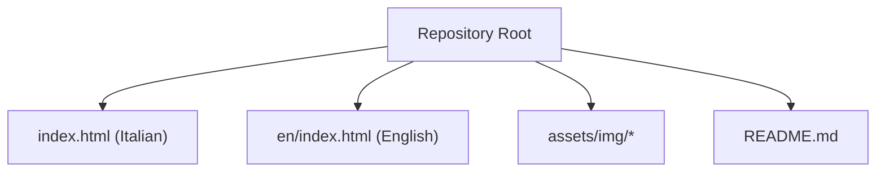
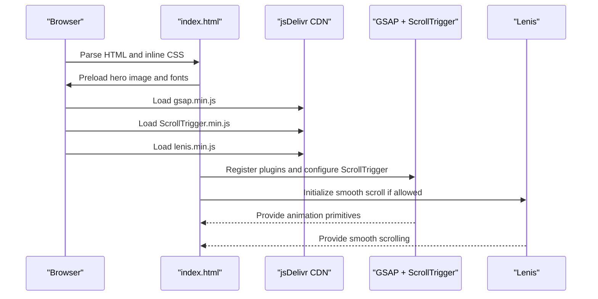
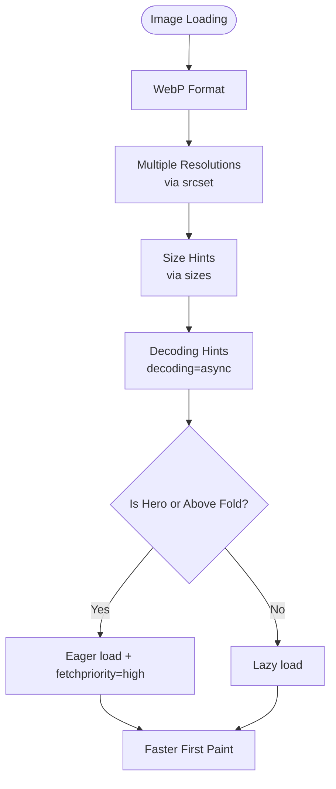
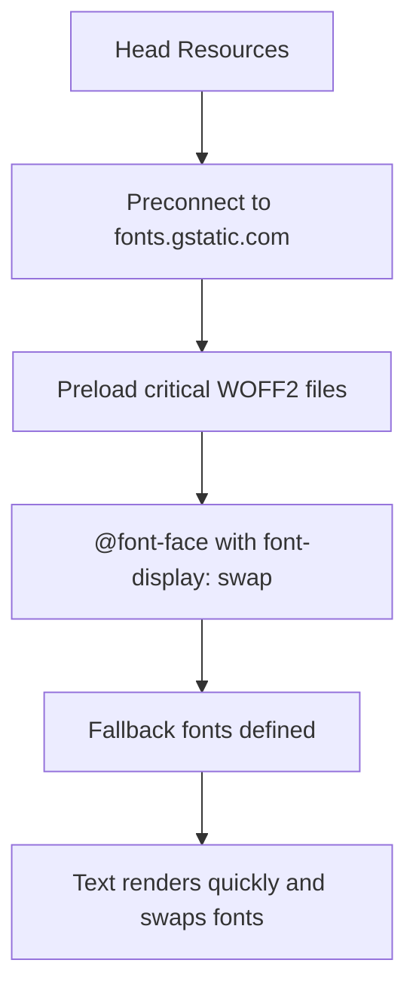
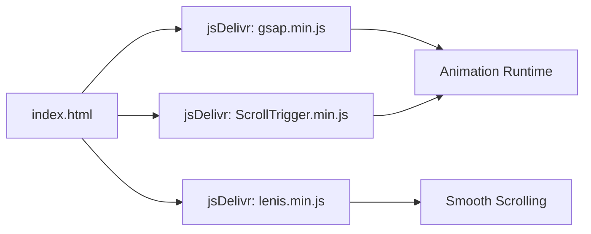
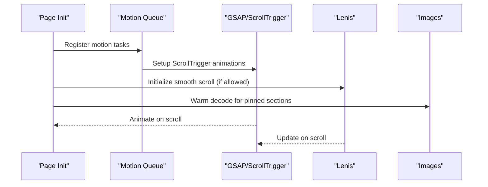
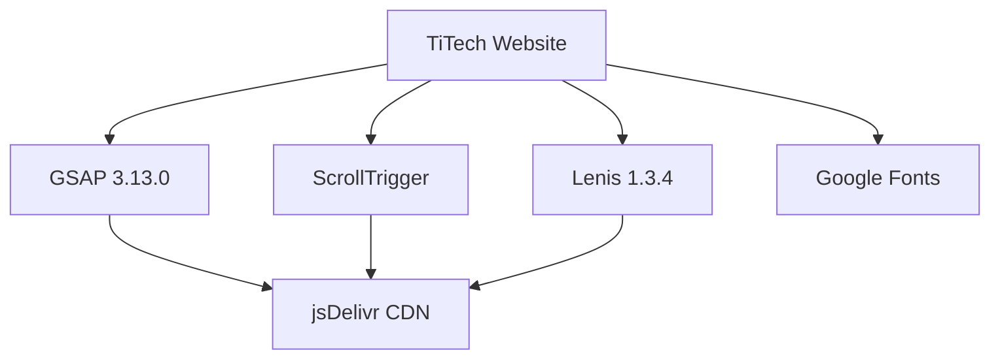

# Performance Optimizations and Best Practices

<cite>
**Referenced Files in This Document**
- [index.html](file://index.html)
- [en/index.html](file://en/index.html)
- [README.md](file://README.md)
</cite>

## Table of Contents
1. [Introduction](#introduction)
2. [Project Structure](#project-structure)
3. [Core Components](#core-components)
4. [Architecture Overview](#architecture-overview)
5. [Detailed Component Analysis](#detailed-component-analysis)
6. [Dependency Analysis](#dependency-analysis)
7. [Performance Considerations](#performance-considerations)
8. [Troubleshooting Guide](#troubleshooting-guide)
9. [Conclusion](#conclusion)

## Introduction
This document explains the performance optimization strategies implemented in the TiTech Digital website, focusing on:
- Lazy loading for images
- Preloading critical resources
- Efficient asset delivery with WebP and responsive image sets
- Minimal external dependencies and CDN usage for GSAP and Lenis
- Core Web Vitals optimization techniques
- Bundle size considerations
- Rendering performance improvements
- Monitoring tools and metrics to measure the impact of changes

The site is a single-page HTML template with inline CSS and JavaScript, plus shared assets and libraries loaded from CDNs. There is no build step.

## Project Structure
At a high level, the project consists of:
- Two language versions: Italian (`index.html`) and English (`en/index.html`)
- Shared static assets under `assets/img`
- A README describing structure, technologies, and local preview instructions

**Diagram sources**
- [index.html:1-10](file://index.html#L1-L10)
- [en/index.html:1-10](file://en/index.html#L1-L10)
- [README.md:17-53](file://README.md#L17-L53)

**Section sources**
- [index.html:1-10](file://index.html#L1-L10)
- [en/index.html:1-10](file://en/index.html#L1-L10)
- [README.md:17-53](file://README.md#L17-L53)

## Core Components
Key performance-related components and patterns:
- Critical resource preloading for hero image and fonts
- Responsive images using WebP, srcset, sizes, and decoding hints
- Lazy loading for below-the-fold images
- External library loading via jsDelivr CDN
- Smooth scrolling via Lenis and animation orchestration via GSAP/ScrollTrigger
- Motion queuing that defers heavy animations until needed
- Reduced-motion support to avoid unnecessary work

**Section sources**
- [index.html:27-30](file://index.html#L27-L30)
- [index.html:611-611](file://index.html#L611-L611)
- [index.html:642-662](file://index.html#L642-L662)
- [index.html:742-745](file://index.html#L742-L745)
- [index.html:781-841](file://index.html#L781-L841)
- [index.html:939-941](file://index.html#L939-L941)
- [index.html:1030-1055](file://index.html#L1030-L1055)
- [index.html:1057-1119](file://index.html#L1057-L1119)
- [README.md:78-85](file://README.md#L78-L85)

## Architecture Overview
The page loads minimal HTML/CSS inline, then initializes lightweight runtime behavior:
- Fonts are preloaded and declared with font-display swap
- The hero image is preloaded as a high-priority image
- GSAP and ScrollTrigger are loaded from jsDelivr
- Lenis smooth scrolling is initialized only when reduced motion is not preferred
- Animations are queued and executed near their triggers to reduce initial work

**Diagram sources**
- [index.html:27-30](file://index.html#L27-L30)
- [index.html:939-941](file://index.html#L939-L941)
- [index.html:1030-1046](file://index.html#L1030-L1046)

## Detailed Component Analysis

### Image Optimization Strategy
The site uses modern image practices:
- WebP format for smaller file sizes
- Multiple resolutions per image via srcset
- Size hints via sizes for correct resolution selection
- Decoding hints to improve paint timing
- Lazy loading for non-critical images
- Eager loading and fetchpriority for the hero image
- Preloading the hero image in the head

**Diagram sources**
- [index.html:27-27](file://index.html#L27-L27)
- [index.html:611-611](file://index.html#L611-L611)
- [index.html:642-662](file://index.html#L642-L662)
- [index.html:742-745](file://index.html#L742-L745)
- [index.html:781-841](file://index.html#L781-L841)

**Section sources**
- [index.html:27-27](file://index.html#L27-L27)
- [index.html:611-611](file://index.html#L611-L611)
- [index.html:642-662](file://index.html#L642-L662)
- [index.html:742-745](file://index.html#L742-L745)
- [index.html:781-841](file://index.html#L781-L841)

### Font Delivery and Preconnect
- Google Fonts are referenced with preconnect to reduce DNS/TLS overhead
- Critical font files are preloaded by URL
- font-display: swap prevents invisible text during font loading
- Fallback fonts are defined to avoid layout shifts while fonts load

**Diagram sources**
- [index.html:28-30](file://index.html#L28-L30)
- [index.html:31-113](file://index.html#L31-L113)

**Section sources**
- [index.html:28-30](file://index.html#L28-L30)
- [index.html:31-113](file://index.html#L31-L113)

### External Dependencies and CDN Usage
- GSAP 3.13.0 and ScrollTrigger are loaded from jsDelivr
- Lenis 1.3.4 is loaded from jsDelivr
- No bundler or build step; scripts are included directly
- Libraries are used minimally and only where needed

**Diagram sources**
- [index.html:939-941](file://index.html#L939-L941)
- [README.md:78-85](file://README.md#L78-L85)

**Section sources**
- [index.html:939-941](file://index.html#L939-L941)
- [README.md:78-85](file://README.md#L78-L85)

### Animation Orchestration and Rendering Performance
- GSAP ScrollTrigger drives scroll-based animations
- Lenis provides smooth scrolling and integrates with ScrollTrigger
- A motion queue defers setup until fonts and DOM are ready
- Animations are registered near their triggers and respect prefers-reduced-motion
- Images in pinned sections are warmed via decode() to reduce first-paint latency

**Diagram sources**
- [index.html:973-1029](file://index.html#L973-L1029)
- [index.html:1030-1055](file://index.html#L1030-L1055)
- [index.html:1057-1119](file://index.html#L1057-L1119)

**Section sources**
- [index.html:973-1029](file://index.html#L973-L1029)
- [index.html:1030-1055](file://index.html#L1030-L1055)
- [index.html:1057-1119](file://index.html#L1057-L1119)

### Core Web Vitals Optimization Techniques
- Largest Contentful Paint (LCP):
  - Hero image preload with fetchpriority high
  - WebP format and responsive variants
  - Early decoding hint for hero image
- First Input Delay / Interaction to Next Paint (INP):
  - Minimal JS upfront; animations deferred
  - Reduced-motion checks prevent unnecessary work
- Cumulative Layout Shift (CLS):
  - Explicit width/height on images
  - Fallback fonts and font-display swap
  - Stable layout for animated sections

**Section sources**
- [index.html:27-27](file://index.html#L27-L27)
- [index.html:611-611](file://index.html#L611-L611)
- [index.html:141-144](file://index.html#L141-L144)
- [index.html:145-163](file://index.html#L145-L163)

### Bundle Size Considerations
- Single HTML file with inline CSS and JS avoids extra network requests
- No build step reduces complexity and tooling overhead
- Only two small third-party libraries are loaded from CDN
- Assets are optimized WebP images with multiple resolutions

**Section sources**
- [README.md:53-53](file://README.md#L53-L53)
- [README.md:78-85](file://README.md#L78-L85)

### Caching Strategies
- Static assets are served from a simple HTTP server locally
- Third-party libraries are cached by jsDelivr’s CDN
- Fonts are cached by Google Fonts’ CDN
- For production, ensure appropriate Cache-Control headers for static assets and long-lived caching for immutable filenames

[No sources needed since this section provides general guidance]

## Dependency Analysis
External dependencies are minimal and intentionally scoped:
- GSAP and ScrollTrigger for animations
- Lenis for smooth scrolling
- Google Fonts for typography
- jsDelivr for reliable CDN delivery

**Diagram sources**
- [index.html:939-941](file://index.html#L939-L941)
- [index.html:28-30](file://index.html#L28-L30)
- [README.md:78-85](file://README.md#L78-L85)

**Section sources**
- [index.html:939-941](file://index.html#L939-L941)
- [index.html:28-30](file://index.html#L28-L30)
- [README.md:78-85](file://README.md#L78-L85)

## Performance Considerations
Recommendations aligned with the current implementation:
- Keep hero image preload and fetchpriority high
- Continue using WebP with srcset and sizes for all images
- Maintain lazy loading for offscreen images
- Preserve reduced-motion checks to avoid unnecessary rendering
- Monitor LCP, INP, and CLS with real-user monitoring
- Validate CDN caching policies for GSAP, ScrollTrigger, and Lenis
- Ensure server-side cache headers for static assets are set appropriately

[No sources needed since this section provides general guidance]

## Troubleshooting Guide
Common issues and remedies:
- Animations not firing:
  - Verify GSAP and ScrollTrigger are loaded before initialization
  - Check that motion queue waits for fonts and DOM readiness
- Smooth scrolling conflicts:
  - Ensure Lenis is initialized only when reduced motion is not preferred
  - Confirm ScrollTrigger.update is called on Lenis scroll events
- Images appear blurry or oversized:
  - Confirm srcset and sizes attributes match layout breakpoints
  - Ensure WebP variants exist at expected paths
- Fonts cause layout shift:
  - Verify font-display swap and fallback fonts are present
  - Confirm preconnect and preload directives are present

**Section sources**
- [index.html:973-1029](file://index.html#L973-L1029)
- [index.html:1030-1055](file://index.html#L1030-L1055)
- [index.html:28-30](file://index.html#L28-L30)
- [index.html:141-144](file://index.html#L141-L144)

## Conclusion
The TiTech website implements a focused set of performance optimizations:
- Preloading critical resources like the hero image and fonts
- Using WebP with responsive image sets and decoding hints
- Lazy loading non-critical images
- Relying on minimal external dependencies delivered via CDN
- Deferring animations and respecting reduced motion
These strategies collectively improve perceived performance, reduce initial payload, and stabilize layout, contributing to better Core Web Vitals.

[No sources needed since this section summarizes without analyzing specific files]