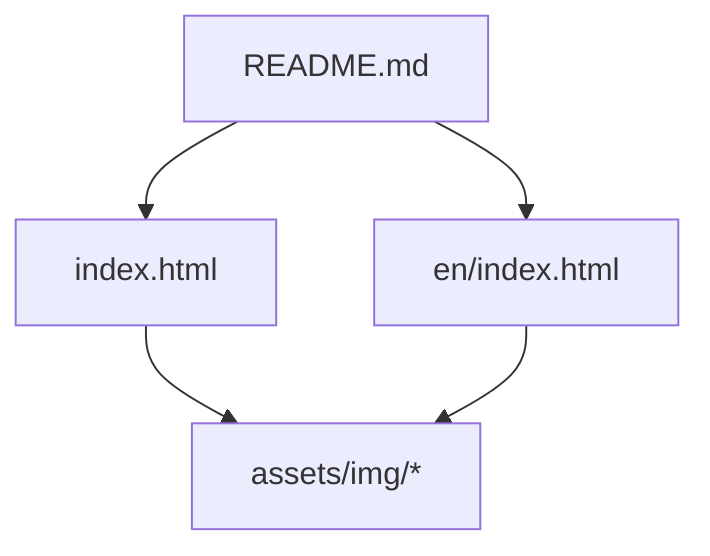
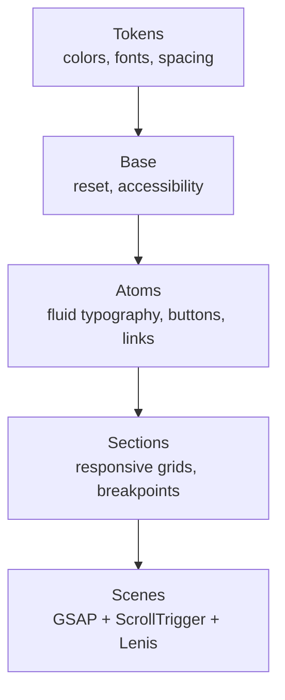
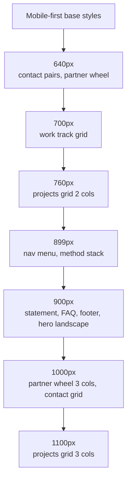
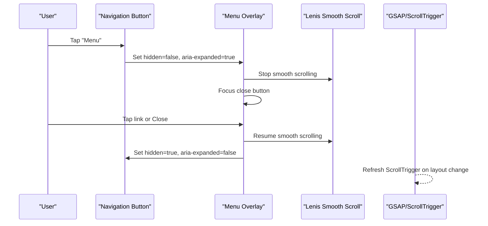
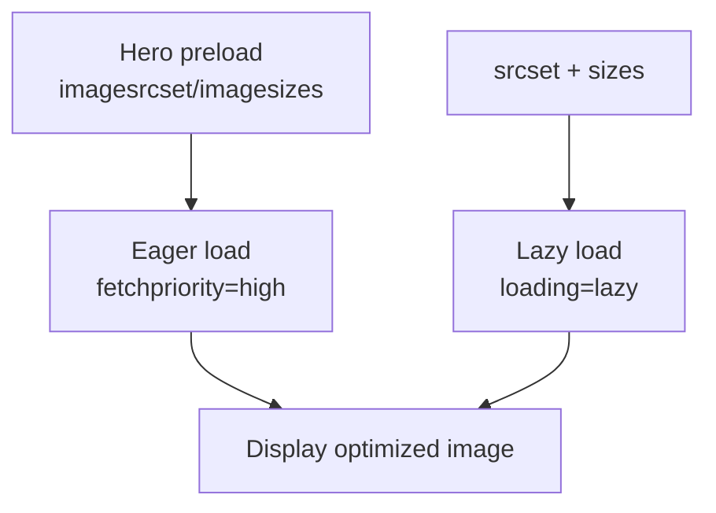
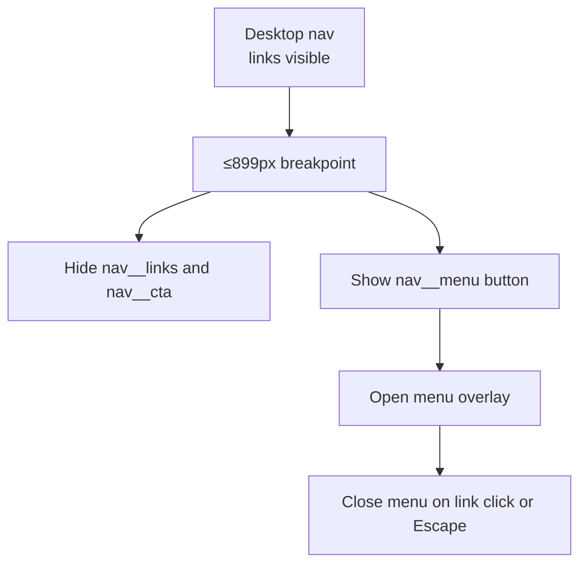
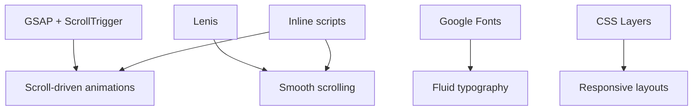

# Responsive Design and Mobile Optimization

<cite>
**Referenced Files in This Document**
- [index.html](file://index.html)
- [en/index.html](file://en/index.html)
- [README.md](file://README.md)
</cite>

## Table of Contents
1. [Introduction](#introduction)
2. [Project Structure](#project-structure)
3. [Core Components](#core-components)
4. [Architecture Overview](#architecture-overview)
5. [Detailed Component Analysis](#detailed-component-analysis)
6. [Dependency Analysis](#dependency-analysis)
7. [Performance Considerations](#performance-considerations)
8. [Troubleshooting Guide](#troubleshooting-guide)
9. [Conclusion](#conclusion)
10. [Appendices](#appendices)

## Introduction
This document explains the responsive design implementation for the TiTech Digital website using a mobile-first methodology. It covers fluid typography with clamp(), breakpoint strategy, flexible grid layouts, touch-friendly interactions, image optimization with WebP and lazy loading, responsive navigation behavior, and testing strategies across screen sizes and devices. The site is built as single-page HTML files with inline CSS and JavaScript, relying on GSAP 3.13.0, ScrollTrigger, and Lenis 1.3.4 for animations and smooth scrolling.

## Project Structure
The project contains:
- Italian version at index.html
- English version at en/index.html
- Shared assets under assets/img (WebP images, SVG logo and favicon)
- README.md describing content structure, languages, local preview, customization, fonts, technologies, and browser support

**Diagram sources**
- [index.html:1-1365](file://index.html#L1-L1365)
- [en/index.html:1-1307](file://en/index.html#L1-L1307)
- [README.md:1-92](file://README.md#L1-L92)

**Section sources**
- [README.md:17-41](file://README.md#L17-L41)
- [README.md:78-85](file://README.md#L78-L85)

## Core Components
- Fluid typography system based on CSS custom properties and clamp()
- Mobile-first layout with CSS Grid and Flexbox
- Breakpoint-driven section behaviors
- Touch-friendly navigation overlay
- Image optimization with WebP, srcset, sizes, and lazy/eager loading
- Animation and smooth-scrolling via GSAP/ScrollTrigger/Lenis

Key implementation highlights:
- CSS layers organize tokens, base, atoms, sections, and scenes
- Tokens define colors, fonts, radii, shadows, and spacing variables
- Atoms define reusable text styles, buttons, links, icons, badges, and form fields
- Sections define per-section responsive layouts and media queries
- Scenes add scroll-driven animations that respect prefers-reduced-motion

**Section sources**
- [index.html:114-202](file://index.html#L114-L202)
- [index.html:204-564](file://index.html#L204-L564)
- [index.html:939-1365](file://index.html#L939-L1365)

## Architecture Overview
The responsive architecture follows a layered approach:
- Tokens: global design tokens including clamp-based spacing
- Base: reset, accessibility helpers, focus states
- Atoms: fluid typography classes and UI primitives
- Sections: per-section responsive rules and breakpoints
- Scenes: animation logic bound to scroll and viewport changes

**Diagram sources**
- [index.html:114-202](file://index.html#L114-L202)
- [index.html:204-564](file://index.html#L204-L564)
- [index.html:939-1365](file://index.html#L939-L1365)

## Detailed Component Analysis

### Fluid Typography System with clamp()
The typography system uses clamp() to scale text smoothly between min and max values relative to viewport width or calculated constraints. Examples include:
- m-text-3: clamp(50px, 9.2vw, 150px)
- m-text-4: clamp(30px, 3.9vw, 58px)
- m-text-5: clamp(19px, 1.7vw, 25px)
- m-text-7: clamp(22px, 2.05vw, 30px)
- Section titles and headings also use clamp() to adapt across devices

This ensures readable text on small screens without sacrificing impact on large displays.

**Section sources**
- [index.html:167-173](file://index.html#L167-L173)
- [index.html:286](file://index.html#L286)
- [index.html:437](file://index.html#L437)
- [index.html:503](file://index.html#L503)

### Breakpoint Strategy
Breakpoints are applied primarily through media queries within section styles:
- 640px: contact pair columns and partner wheel columns
- 700px: work track two-column grid and case aspect ratios
- 760px: projects grid two columns
- 899px: navigation hides desktop links and shows menu button; method switches to stacked layout
- 900px: statement body becomes two columns; studio collage becomes absolute positioning; FAQ becomes two columns; footer grid expands; hero adapts for landscape orientation
- 1000px: partner wheel three columns; contact grid two columns
- 1100px: projects grid three columns

These breakpoints align with common device widths and ensure progressive enhancement from mobile to desktop.

**Diagram sources**
- [index.html:231-235](file://index.html#L231-L235)
- [index.html:316-320](file://index.html#L316-L320)
- [index.html:352-354](file://index.html#L352-L354)
- [index.html:385-394](file://index.html#L385-L394)
- [index.html:420-430](file://index.html#L420-L430)
- [index.html:460-461](file://index.html#L460-L461)
- [index.html:513](file://index.html#L513)
- [index.html:533-534](file://index.html#L533-L534)
- [index.html:552-557](file://index.html#L552-L557)

**Section sources**
- [index.html:231-235](file://index.html#L231-L235)
- [index.html:316-320](file://index.html#L316-L320)
- [index.html:352-354](file://index.html#L352-L354)
- [index.html:385-394](file://index.html#L385-L394)
- [index.html:420-430](file://index.html#L420-L430)
- [index.html:460-461](file://index.html#L460-L461)
- [index.html:513](file://index.html#L513)
- [index.html:533-534](file://index.html#L533-L534)
- [index.html:552-557](file://index.html#L552-L557)

### Flexible Grid Layouts
The site uses CSS Grid extensively for responsive layouts:
- Statement body: single column on mobile, two columns at 900px
- Work track: single column on mobile, two columns at 700px, with special handling for last item spanning
- Partner wheel: one column on mobile, two columns at 640px, three columns at 1000px
- Studio collage: two columns on mobile, absolute positioned composition at 900px
- Projects grid: one column on mobile, two columns at 760px, three columns at 1100px
- Contact grid: single column on mobile, two columns at 1000px
- Footer grid: two columns on mobile, four columns at 900px

Grids are paired with aspect-ratio and clamp() spacing to maintain visual balance across devices.

**Section sources**
- [index.html:288-295](file://index.html#L288-L295)
- [index.html:302-320](file://index.html#L302-L320)
- [index.html:344-354](file://index.html#L344-L354)
- [index.html:411-430](file://index.html#L411-L430)
- [index.html:444-461](file://index.html#L444-L461)
- [index.html:522-534](file://index.html#L522-L534)
- [index.html:546-557](file://index.html#L546-L557)

### Touch-Friendly Interactions
- Buttons and interactive elements have minimum heights of 48px for comfortable tapping
- Focus-visible outlines improve keyboard accessibility
- Navigation menu is a full-screen overlay with accessible attributes (role="dialog", aria-modal="true")
- Menu includes keyboard navigation (Escape to close, Tab trapping)
- Smooth scrolling via Lenis integrates with ScrollTrigger and respects reduced motion preferences

**Diagram sources**
- [index.html:942-965](file://index.html#L942-L965)
- [index.html:1030-1046](file://index.html#L1030-L1046)

**Section sources**
- [index.html:175-196](file://index.html#L175-L196)
- [index.html:204-236](file://index.html#L204-L236)
- [index.html:942-965](file://index.html#L942-L965)
- [index.html:1030-1046](file://index.html#L1030-L1046)

### Image Optimization Techniques
- All images are provided in WebP format for better compression and performance
- Hero image uses preload with imagesrcset and imagesizes for optimal selection
- Most images use srcset with multiple resolutions and sizes descriptors
- Lazy loading is applied to non-critical images; hero and some above-the-fold images use eager loading
- Images are constrained with max-width: 100% and object-fit: cover to fit responsive containers

**Diagram sources**
- [index.html:27](file://index.html#L27)
- [index.html:611](file://index.html#L611)
- [index.html:642-664](file://index.html#L642-L664)
- [index.html:742-746](file://index.html#L742-L746)
- [index.html:781-842](file://index.html#L781-L842)
- [index.html:906](file://index.html#L906)

**Section sources**
- [index.html:27](file://index.html#L27)
- [index.html:611](file://index.html#L611)
- [index.html:642-664](file://index.html#L642-L664)
- [index.html:742-746](file://index.html#L742-L746)
- [index.html:781-842](file://index.html#L781-L842)
- [index.html:906](file://index.html#L906)

### Responsive Navigation Behavior and Mobile Menu
- Desktop: horizontal links with brand, language switcher, and CTA
- Mobile (≤899px): desktop links hidden, menu button shown, full-screen overlay menu with large tap targets
- Language switching available both in top bar and inside the mobile menu
- Accessibility: aria-expanded toggles, role="dialog", aria-modal, Escape key closes menu, focus management

**Diagram sources**
- [index.html:204-236](file://index.html#L204-L236)
- [index.html:942-965](file://index.html#L942-L965)

**Section sources**
- [index.html:204-236](file://index.html#L204-L236)
- [index.html:942-965](file://index.html#L942-L965)

### Testing Strategies for Different Screen Sizes and Device Compatibility
- Use browser dev tools device emulation to test breakpoints at 640px, 700px, 760px, 899px, 900px, 1000px, 1100px
- Validate fluid typography scaling by resizing viewport and checking clamp() ranges
- Verify image selection via srcset/sizes and confirm WebP delivery
- Test touch interactions: menu open/close, keyboard navigation, focus order
- Check reduced motion preference: animations should be disabled when prefers-reduced-motion is set
- Confirm smooth scrolling integration with Lenis and ScrollTrigger refresh on resize/layout changes

Recommended checks:
- Hero image loads eagerly and scales correctly
- Work track scrolls horizontally on mobile and wraps on larger screens
- Partner wheel rotates with scroll and adjusts card size based on viewport
- Method ring animates only when reduced motion is not preferred
- Contact form validates inputs and opens mailto link with pre-filled data

**Section sources**
- [index.html:1030-1046](file://index.html#L1030-L1046)
- [index.html:1057-1119](file://index.html#L1057-L1119)
- [index.html:1120-1365](file://index.html#L1120-L1365)

## Dependency Analysis
External dependencies:
- GSAP 3.13.0 and ScrollTrigger for animations
- Lenis 1.3.4 for smooth scrolling
- Google Fonts for Gabarito and Onest typefaces

Internal dependencies:
- CSS layers organize tokens, base, atoms, sections, scenes
- Scripts initialize Lenis, register ScrollTrigger plugins, and queue motion effects
- IntersectionObserver used to pause/resume animations when offscreen

**Diagram sources**
- [index.html:939-941](file://index.html#L939-L941)
- [index.html:1030-1046](file://index.html#L1030-L1046)
- [index.html:1057-1119](file://index.html#L1057-L1119)

**Section sources**
- [README.md:78-85](file://README.md#L78-L85)
- [index.html:939-941](file://index.html#L939-L941)
- [index.html:1030-1046](file://index.html#L1030-L1046)

## Performance Considerations
- Preload critical resources: hero image and font files
- Use WebP images with srcset and sizes to serve appropriately sized assets
- Apply lazy loading to non-critical images to reduce initial payload
- Respect prefers-reduced-motion to avoid unnecessary animations on low-power devices
- Warm pinned photo sections before they scroll into view to minimize decode delays
- Keep CSS and JS inline to avoid extra requests; no build step required

[No sources needed since this section provides general guidance]

## Troubleshooting Guide
Common issues and resolutions:
- Menu does not close: Ensure Escape key handler is active and focus is managed properly
- Animations not triggering: Verify ScrollTrigger.refresh() is called after layout changes and that prefers-reduced-motion is respected
- Images not loading optimally: Check srcset/sizes syntax and confirm WebP availability
- Smooth scrolling conflicts: Ensure Lenis is started/stopped correctly when opening/closing menu
- Form submission errors: Validate input fields and confirm mailto URL encoding

**Section sources**
- [index.html:942-965](file://index.html#L942-L965)
- [index.html:1030-1046](file://index.html#L1030-L1046)
- [index.html:1254-1282](file://index.html#L1254-L1282)

## Conclusion
The TiTech Digital website implements a robust mobile-first responsive design with fluid typography, well-defined breakpoints, flexible grids, and touch-friendly interactions. Image optimization leverages WebP, srcset, sizes, and selective lazy/eager loading. Navigation adapts seamlessly to mobile with an accessible overlay menu. Animations are scroll-driven and respect user preferences. The architecture is modular, performant, and easy to maintain without a build step.

[No sources needed since this section summarizes without analyzing specific files]

## Appendices

### Browser Support and Technologies
- Fonts: Gabarito and Onest from Google Fonts
- Libraries: GSAP 3.13.0, ScrollTrigger, Lenis 1.3.4
- Modern CSS features: cascade layers, color-mix(), clamp(), viewport units
- Supported browsers: Chrome/Edge 111+, Safari 16.2+, Firefox 113+

**Section sources**
- [README.md:78-85](file://README.md#L78-L85)