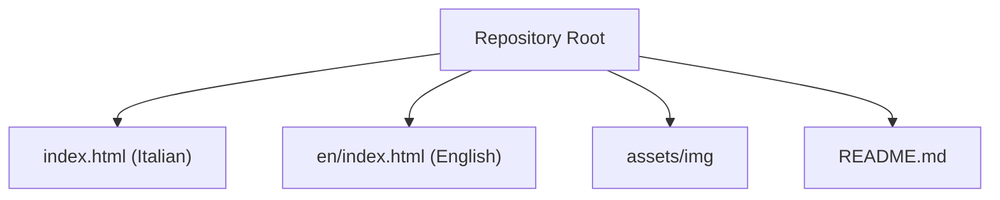
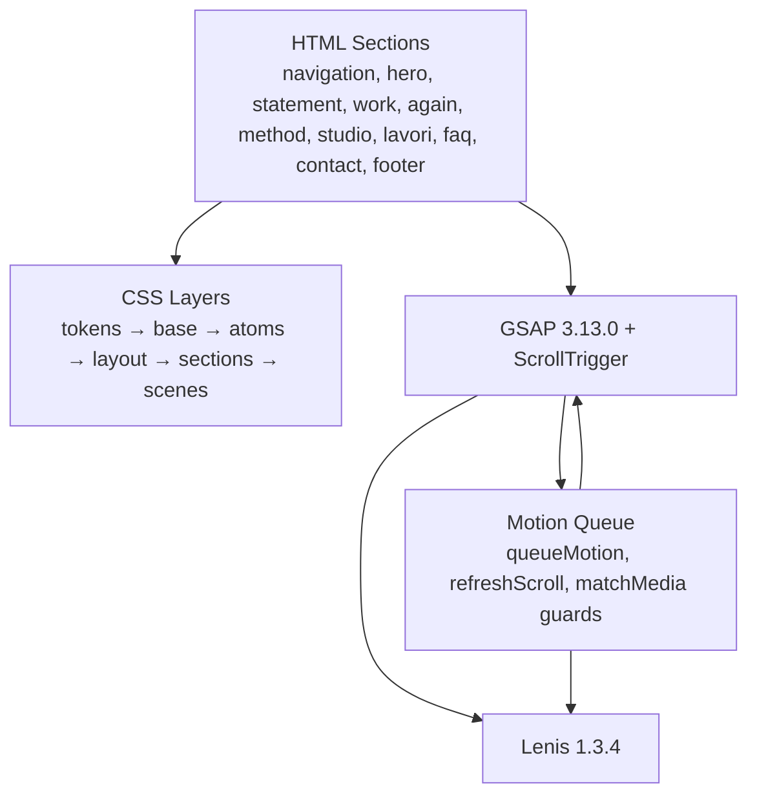
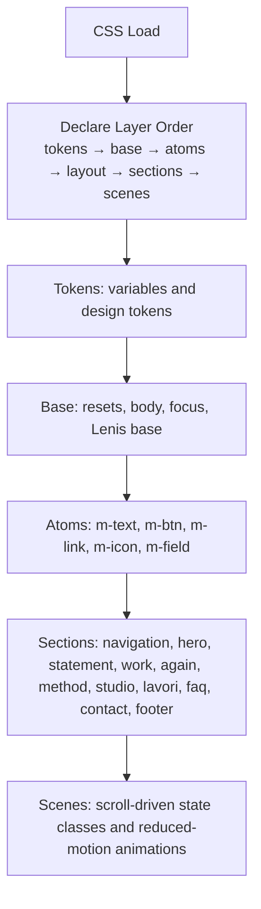
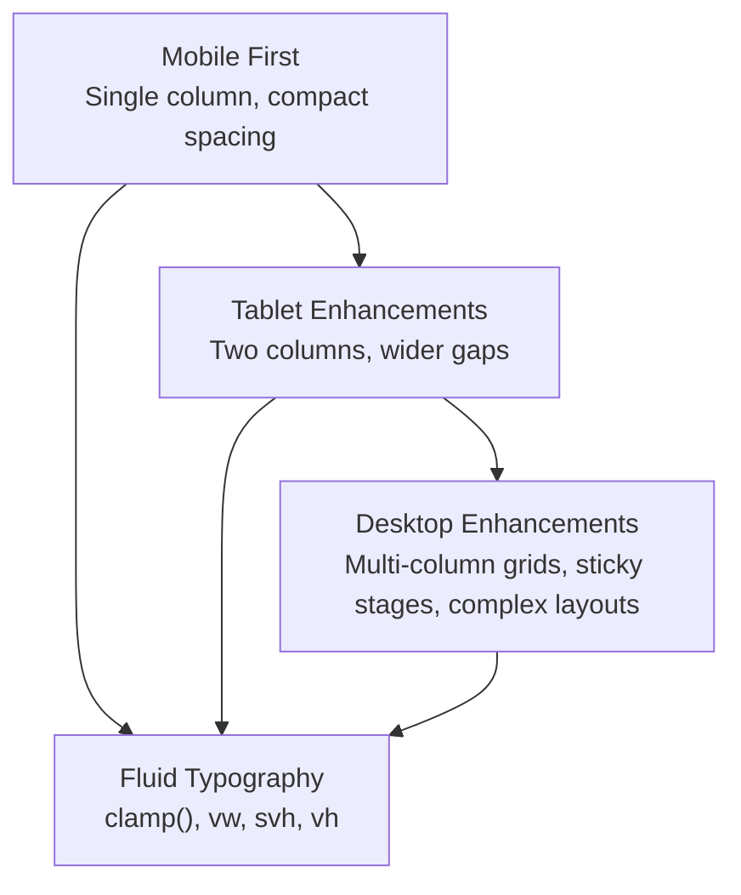
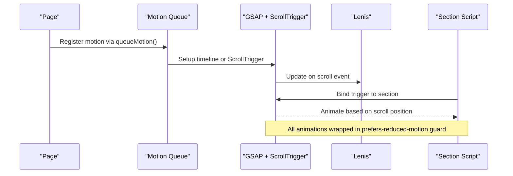
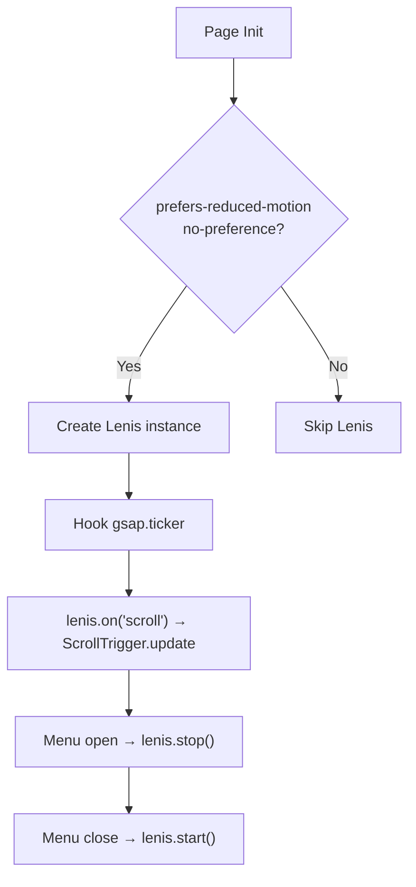
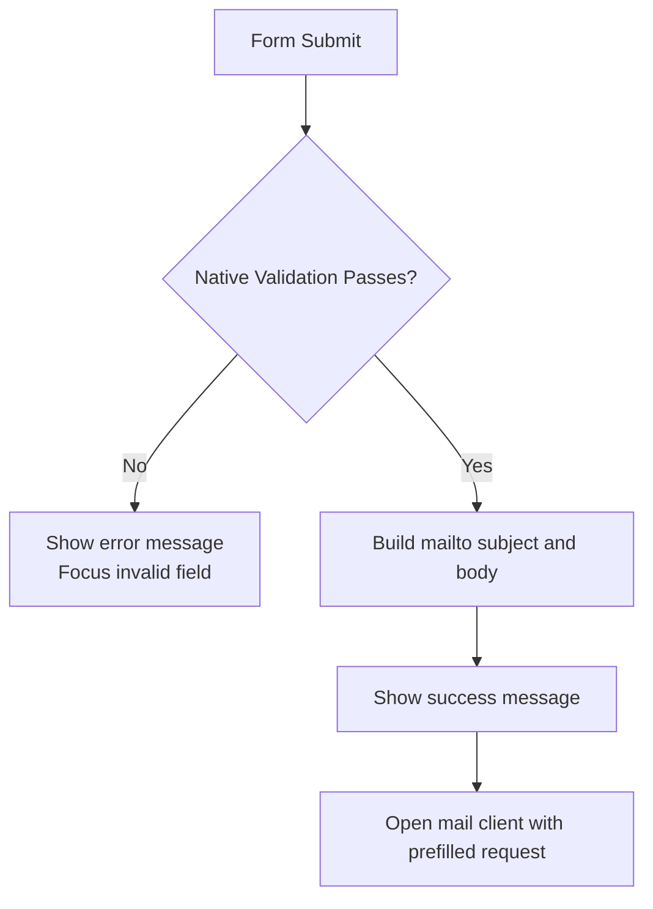
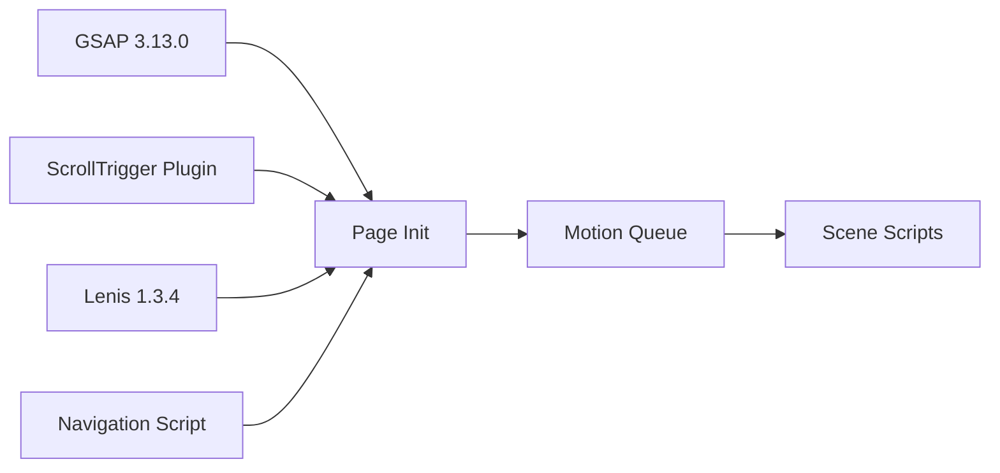

# Technical Implementation

<cite>
**Referenced Files in This Document**
- [README.md](file://README.md)
- [index.html](file://index.html)
</cite>

## Table of Contents
1. [Introduction](#introduction)
2. [Project Structure](#project-structure)
3. [Core Components](#core-components)
4. [Architecture Overview](#architecture-overview)
5. [Detailed Component Analysis](#detailed-component-analysis)
6. [Dependency Analysis](#dependency-analysis)
7. [Performance Considerations](#performance-considerations)
8. [Troubleshooting Guide](#troubleshooting-guide)
9. [Conclusion](#conclusion)

## Introduction
This document explains the technical implementation of the TiTech Digital one-page website. It focuses on:
- The CSS architecture using cascade layers for tokens, base styles, atoms, layout, sections, and scenes.
- The animation system built with GSAP 3.13.0 and ScrollTrigger for scroll-driven effects.
- Lenis 1.3.4 for smooth scrolling.
- Responsive design with fluid typography via `clamp()` and a mobile-first approach.
- Performance optimizations including lazy loading, preloading critical resources, and WebP images.
- Browser compatibility requirements and accessibility features such as reduced motion support.

The site is intentionally simple: each language version is a single HTML file with inline CSS and JavaScript, plus shared external assets such as fonts, GSAP, Lenis, and images.

**Section sources**
- [README.md:1-15](file://README.md#L1-L15)
- [README.md:43-53](file://README.md#L43-L53)

## Project Structure
At the repository root there are two page versions:
- Italian page at `/index.html`.
- English page at `/en/index.html`.

Shared static assets live under `assets/img`, including optimized WebP images, SVG logo, and favicon. The project has no build step; developers edit the HTML files directly and serve them through a local HTTP server.

**Diagram sources**
- [README.md:32-41](file://README.md#L32-L41)
- [README.md:43-53](file://README.md#L43-L53)

**Section sources**
- [README.md:32-41](file://README.md#L32-L41)
- [README.md:43-53](file://README.md#L43-L53)

## Core Components
The website is composed of semantic sections that together tell the company story and guide users to contact information:
- Navigation bar with desktop links, language switcher, call-to-action button, and mobile menu overlay.
- Hero section with animated circular image and entrance animations.
- Statement section introducing the studio’s positioning.
- Work section presenting five service areas on a horizontal track.
- Principles wheel showing six values arranged around a rotating arc.
- Method section illustrating a four-step process with an animated ring.
- Studio section with an animated photo collage and integrated roles.
- Portfolio grid of selected projects.
- FAQ section using native `
` elements.
- Contact section with a client-side form that opens the user’s mail client.
- Footer with closing greeting, navigation, legal data, and credits.

Each section uses a `data-8b-section` attribute so the animation system can discover and bind behaviors without tight coupling between markup and scripts.

**Section sources**
- [index.html:547-571](file://index.html#L547-L571)
- [index.html:574-580](file://index.html#L574-L580)
- [index.html:583-597](file://index.html#L583-L597)
- [index.html:600-637](file://index.html#L600-L637)
- [index.html:640-675](file://index.html#L640-L675)
- [index.html:680-701](file://index.html#L680-L701)
- [index.html:704-725](file://index.html#L704-L725)
- [index.html:728-814](file://index.html#L728-L814)
- [index.html:817-827](file://index.html#L817-L827)
- [index.html:830-857](file://index.html#L830-L857)
- [index.html:861-893](file://index.html#L861-L893)

## Architecture Overview
The runtime architecture combines three main layers:
- Presentation layer: semantic HTML and layered CSS.
- Animation layer: GSAP 3.13.0 with ScrollTrigger for scroll-based effects.
- Scrolling layer: Lenis 1.3.4 providing smooth scrolling when motion is allowed.

**Diagram sources**
- [index.html:114-116](file://index.html#L114-L116)
- [index.html:895-897](file://index.html#L895-L897)
- [index.html:929-984](file://index.html#L929-L984)
- [index.html:986-1012](file://index.html#L986-L1012)

**Section sources**
- [index.html:114-116](file://index.html#L114-L116)
- [index.html:895-897](file://index.html#L895-L897)
- [index.html:929-984](file://index.html#L929-L984)
- [index.html:986-1012](file://index.html#L986-L1012)

## Detailed Component Analysis

### CSS Architecture with Cascade Layers
The stylesheet declares a strict cascade order:
`@layer tokens, base, atoms, layout, sections, scenes;`

This ordering ensures predictable specificity:
- Tokens define colors, fonts, radii, shadows, and spacing variables.
- Base resets box model, typography defaults, focus visibility, skip link, and Lenis-related base rules.
- Atoms provide reusable UI primitives such as text classes, buttons, links, icons, surfaces, badges, and fields.
- Layout and sections style each page region.
- Scenes add scroll-driven presentation states and reduced-motion-safe keyframes.

**Diagram sources**
- [index.html:114-116](file://index.html#L114-L116)
- [index.html:117-139](file://index.html#L117-L139)
- [index.html:140-164](file://index.html#L140-L164)
- [index.html:165-203](file://index.html#L165-L203)

**Section sources**
- [index.html:114-116](file://index.html#L114-L116)
- [index.html:117-139](file://index.html#L117-L139)
- [index.html:140-164](file://index.html#L140-L164)
- [index.html:165-203](file://index.html#L165-L203)

### Responsive Design and Fluid Typography
Typography and spacing use modern fluid units:
- `clamp()` defines minimum, preferred, and maximum sizes for spacing and text.
- Viewport-relative units such as `svh`, `vw`, and `vh` help keep large headings and sections proportional across devices.
- Mobile-first media queries progressively enhance layouts from single-column grids to multi-column grids and complex compositions.

Examples include:
- Fluid spacing variables for vertical rhythm.
- Fluid headline sizes for hero, statement, and portfolio titles.
- Breakpoints at common widths such as 640px, 700px, 760px, 899px, 900px, and 1000px.

**Diagram sources**
- [index.html:135-137](file://index.html#L135-L137)
- [index.html:167-173](file://index.html#L167-L173)
- [index.html:231-235](file://index.html#L231-L235)
- [index.html:316-320](file://index.html#L316-L320)
- [index.html:462-465](file://index.html#L462-L465)

**Section sources**
- [index.html:135-137](file://index.html#L135-L137)
- [index.html:167-173](file://index.html#L167-L173)
- [index.html:231-235](file://index.html#L231-L235)
- [index.html:316-320](file://index.html#L316-L320)
- [index.html:462-465](file://index.html#L462-L465)

### Animation System with GSAP and ScrollTrigger
The animation system is organized into:
- A motion queue that defers setup until fonts and DOM are ready, yields tasks safely, and refreshes ScrollTrigger after mutations.
- Section-scoped effect helpers for rise, ink, and iris animations.
- Scene scripts that register ScrollTrigger timelines bound to specific sections.
- Strict guards using `gsap.matchMedia().add('(prefers-reduced-motion: no-preference)', ...)` so animations only run when the user prefers motion.

**Diagram sources**
- [index.html:929-984](file://index.html#L929-L984)
- [index.html:986-1012](file://index.html#L986-L1012)
- [index.html:1013-1075](file://index.html#L1013-L1075)
- [index.html:1076-1303](file://index.html#L1076-L1303)

Key scene behaviors include:
- Hero exit transition animating the aperture toward the statement dot.
- Statement entry animations for lines and index items.
- Horizontal work track with parallax-like image shifts and optional curved exit geometry.
- Principles wheel rotation driven by scroll, with dynamic radius and step calculations.
- Method ring drawing its arc while steps highlight sequentially.
- Studio collage assembling tilted shots into a flat composition.
- Portfolio grid fade-in and per-project media reveal.
- Contact title scaling and dot entrance.
- Footer aperture opening like a full stop.

**Section sources**
- [index.html:929-984](file://index.html#L929-L984)
- [index.html:1013-1075](file://index.html#L1013-L1075)
- [index.html:1076-1303](file://index.html#L1076-L1303)

### Smooth Scrolling with Lenis
Lenis is initialized only when motion is allowed:
- It applies a lerp value for smooth momentum.
- It anchors scrolling offset to the fixed navigation height.
- It updates ScrollTrigger on every scroll frame.
- It integrates with GSAP’s ticker and disables itself when the mobile menu is open to avoid conflicting scroll behavior.

**Diagram sources**
- [index.html:986-1012](file://index.html#L986-L1012)
- [index.html:898-921](file://index.html#L898-L921)

**Section sources**
- [index.html:986-1012](file://index.html#L986-L1012)
- [index.html:898-921](file://index.html#L898-L921)

### Accessibility and Reduced Motion
Accessibility features include:
- A visible skip link to the main content.
- Semantic landmarks such as header, nav, main, section, and footer.
- ARIA attributes for modal menu, labels, and live regions.
- Focus-visible outlines for keyboard navigation.
- Native `
` for FAQ interactions.
- Reduced motion support through both CSS `@media (prefers-reduced-motion: no-preference)` blocks and JS `gsap.matchMedia()` guards.

When reduced motion is preferred:
- CSS animations inside protected blocks do not run.
- GSAP ScrollTrigger animations are not registered.
- Lenis is not initialized.
- The page remains fully functional and readable.

**Section sources**
- [index.html:158-162](file://index.html#L158-L162)
- [index.html:264-280](file://index.html#L264-L280)
- [index.html:526-530](file://index.html#L526-L530)
- [index.html:817-827](file://index.html#L817-L827)
- [index.html:994-1002](file://index.html#L994-L1002)
- [index.html:1063-1074](file://index.html#L1063-L1074)

### Contact Form Behavior
The contact form does not post to a backend. On submit it:
1. Validates required fields using native form validation.
2. Builds a subject and body from name, email, company, topic, and message.
3. Updates status messages.
4. Opens the user’s default mail client via `mailto:` addressed to the placeholder email.

**Diagram sources**
- [index.html:841-855](file://index.html#L841-L855)
- [index.html:1210-1238](file://index.html#L1210-L1238)

**Section sources**
- [index.html:841-855](file://index.html#L841-L855)
- [index.html:1210-1238](file://index.html#L1210-L1238)

## Dependency Analysis
External dependencies are loaded from jsDelivr:
- GSAP 3.13.0 core library.
- GSAP ScrollTrigger plugin.
- Lenis 1.3.4 smooth scrolling library.

Internal dependencies are structured by script modules:
- Navigation script handles mobile menu toggle, focus management, and Lenis start/stop.
- Motion queue centralizes animation lifecycle, font readiness, and ScrollTrigger refresh.
- Page init registers plugins, configures ScrollTrigger, initializes Lenis, and warms images for pinned sections.
- Scene scripts bind ScrollTrigger timelines to sections.

**Diagram sources**
- [index.html:895-897](file://index.html#L895-L897)
- [index.html:898-921](file://index.html#L898-L921)
- [index.html:929-984](file://index.html#L929-L984)
- [index.html:986-1012](file://index.html#L986-L1012)
- [index.html:1076-1303](file://index.html#L1076-L1303)

**Section sources**
- [index.html:895-897](file://index.html#L895-L897)
- [index.html:898-921](file://index.html#L898-L921)
- [index.html:929-984](file://index.html#L929-L984)
- [index.html:986-1012](file://index.html#L986-L1012)
- [index.html:1076-1303](file://index.html#L1076-L1303)

## Performance Considerations
The implementation includes several performance-oriented practices:

- Preloading critical resources:
  - Hero image is preloaded with `imagesrcset` and `imagesizes` for responsive delivery.
  - Google Fonts are preconnected and preloaded as WOFF2 files.
  - Favicon is linked early.

- Lazy loading:
  - Non-critical images use `loading="lazy"` and `decoding="async"`.
  - Hero image uses eager loading because it is above the fold.

- Optimized images:
  - Images are served as WebP where available.
  - Multiple resolutions are provided via `srcset` and appropriate `sizes`.

- Image decoding warm-up:
  - After page load, images in pinned sections are decoded ahead of time to reduce first-paint jank during scroll animations.

- Efficient animation scheduling:
  - The motion queue waits for fonts and DOM readiness.
  - It yields tasks using `scheduler.yield` when available.
  - ScrollTrigger is refreshed after mutations and layout changes.

- Reduced payload and simplicity:
  - No build step reduces toolchain overhead.
  - Inline CSS and JS avoid extra network requests for small sites.

**Section sources**
- [index.html:27-30](file://index.html#L27-L30)
- [index.html:579](file://index.html#L579)
- [index.html:710-714](file://index.html#L710-L714)
- [index.html:739-800](file://index.html#L739-L800)
- [index.html:1003-1011](file://index.html#L1003-L1011)
- [index.html:929-984](file://index.html#L929-L984)
- [README.md:78-85](file://README.md#L78-L85)

## Troubleshooting Guide
Common issues and their likely causes:

- Animations do not run:
  - Check whether the browser reports `prefers-reduced-motion: reduce`.
  - Verify GSAP and ScrollTrigger are loaded before scene scripts.
  - Ensure the motion queue has access to `window.gsap` and `window.ScrollTrigger`.

- Smooth scrolling feels broken:
  - Confirm Lenis is initialized only when motion is allowed.
  - Check that the mobile menu stops Lenis while open and restarts it when closed.
  - Verify the navigation height anchor is correct if the header changes dynamically.

- ScrollTrigger misalignment after content changes:
  - Use the provided `refreshScroll()` function or rely on the motion queue’s automatic refresh.
  - Avoid mutating animated elements outside the motion queue.

- Contact form does not send email:
  - The form uses `mailto:`; ensure the user’s mail client is configured.
  - Replace the placeholder email address before production deployment.
  - Validate required fields manually or integrate a real backend endpoint.

- Images appear blurry or late:
  - Ensure WebP variants exist and `srcset` paths are correct.
  - Keep `fetchpriority="high"` for above-the-fold images.
  - Allow the image decode warm-up to run after page load.

**Section sources**
- [index.html:994-1002](file://index.html#L994-L1002)
- [index.html:898-921](file://index.html#L898-L921)
- [index.html:929-984](file://index.html#L929-L984)
- [index.html:1210-1238](file://index.html#L1210-L1238)
- [README.md:55-63](file://README.md#L55-L63)

## Conclusion
The TiTech Digital website implements a clean, maintainable architecture:
- CSS cascade layers enforce a clear design-token-to-layout hierarchy.
- GSAP and ScrollTrigger deliver scroll-driven animations that respect user preferences.
- Lenis provides smooth scrolling only when motion is allowed.
- Fluid typography and mobile-first breakpoints create responsive layouts without heavy frameworks.
- Preloading, lazy loading, WebP images, and decode warm-ups improve perceived performance.
- Accessibility features and reduced motion support make the experience inclusive.

For future maintenance, keep the section structure aligned with the animation system, preserve `data-8b-*` attributes, update both language pages consistently, and replace placeholder content and email addresses before publishing.

[No sources needed since this section summarizes without analyzing specific files]